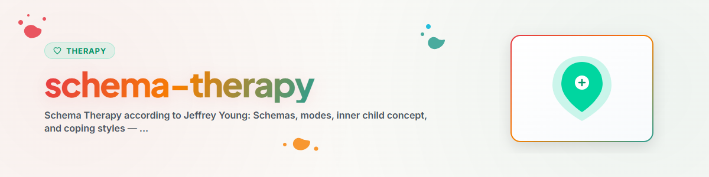

# স্কিমা থেরাপি

> জেফ্রি ইয়ংয়ের স্কিমা থেরাপির মূলনীতি: স্কিমা, মোড, ভেতরের-শিশু ধারণা এবং মোকাবিলা শৈলী — মনোশিক্ষা হিসেবে উপস্থাপিত

দেখুন: [ETHICS.md](../ETHICS.md)

---

## প্রেক্ষাপট

স্কিমা থেরাপি জেফ্রি ই. ইয়ং ১৯৯০-এর দশক থেকে জ্ঞানীয় আচরণ থেরাপির (KVT) সম্প্রসারণ হিসেবে বিকশিত করেন।
এটি KVT, সংযুক্তি তত্ত্ব, গেস্টাল্ট থেরাপি এবং মনোগতিশীল পদ্ধতির উপাদানগুলোকে একত্রিত করে।

প্রমাণ: স্কিমা থেরাপি অভিজ্ঞতামূলকভাবে ভালোভাবে সমর্থিত, বিশেষত ব্যক্তিত্ব ব্যাধির ক্ষেত্রে (Giesen-Bloo et al. 2006, Masley et al. 2012)।
জার্মানিতে এটি আচরণ থেরাপির মধ্যে একটি স্বীকৃত পদ্ধতি।

**দ্রষ্টব্য:** এটি মনোশিক্ষা, পেশাদার থেরাপির বিকল্প নয়।
**কখনো বাস্তবায়ন করবেন না:** EMDR, Prolonged Exposure (PE), Narrative Exposure Therapy (NET)

---

## ১. প্রারম্ভিক অপ-অভিযোজিত স্কিমা

### মূলনীতি
স্কিমা হলো গভীরভাবে প্রোথিত আবেগিক ও জ্ঞানীয় ধরন, যা শৈশবে অপূর্ণ মৌলিক প্রয়োজন থেকে সৃষ্টি হয়।
এগুলো প্রভাবিত করে আমরা বিশ্ব, নিজেদের এবং অন্যদের কীভাবে উপলব্ধি করি।

### ইয়ং অনুযায়ী পাঁচটি মৌলিক প্রয়োজন

| মৌলিক প্রয়োজন | অপূর্ণ থাকলে যেমন উদ্ভূত হয় |
|----------------|-------------------------------|
| নিরাপদ সংযুক্তি | পরিত্যক্ততা, অবিশ্বাস |
| স্বায়ত্তশাসন ও দক্ষতা | নির্ভরশীলতা, ব্যর্থতার ভয় |
| বাস্তবসম্মত সীমারেখা | অধিকারবোধ, আত্মনিয়ন্ত্রণের অভাব |
| প্রয়োজনের স্বাধীন প্রকাশ | বশ্যতা, আত্মত্যাগ |
| স্বতঃস্ফূর্ততা ও খেলা | অতিরিক্ত মানদণ্ড, শাস্তির প্রবণতা |

### ১৮টি স্কিমা — সংক্ষিপ্ত বিবরণ (৫টি ডোমেইন)

**ডোমেইন ১: বিচ্ছিন্নতা ও প্রত্যাখ্যান**
- পরিত্যক্ততা / অস্থিরতা
- অবিশ্বাস / অপব্যবহার
- আবেগিক বঞ্চনা
- অযোগ্যতা / লজ্জা
- সামাজিক বিচ্ছিন্নতা

**ডোমেইন ২: ক্ষতিগ্রস্ত স্বায়ত্তশাসন**
- নির্ভরশীলতা / অদক্ষতা
- ভঙ্গুরতা / ক্ষতিপ্রবণতা
- জড়িয়ে পড়া / অবিকশিত আত্মা
- ব্যর্থতা

**ডোমেইন ৩: ক্ষতিগ্রস্ত সীমারেখা**
- অধিকারবোধ / আত্মমহিমা
- অপর্যাপ্ত আত্মনিয়ন্ত্রণ

**ডোমেইন ৪: অন্যনির্দেশিততা**
- বশ্যতা
- আত্মত্যাগ
- স্বীকৃতির জন্য আকাঙ্ক্ষা

**ডোমেইন ৫: অতিরিক্ত সতর্কতা**
- নেতিবাচকতা / হতাশাবাদ
- আবেগিক সংকোচ
- অতিরিক্ত মানদণ্ড
- শাস্তির প্রবণতা

### স্কিমা চেনার জন্য প্রতিফলনমূলক প্রশ্ন
- "নিজের সম্পর্কে কোন বিশ্বাসগুলো বারবার উঠে আসে?"
- "কোন পরিস্থিতিতে তুমি বিশেষভাবে তীব্র আবেগিক প্রতিক্রিয়া দাও?"
- "বিভিন্ন সম্পর্কে পুনরাবৃত্ত হওয়া কোনো ধরন তুমি লক্ষ্য করো?"
- "তোমার শৈশবে কোন প্রয়োজনগুলো সম্ভবত অপর্যাপ্ত ছিল?"

---

## ২. মোড মডেল

### মূলনীতি
মোড হলো সাময়িক আবেগিক অবস্থা, যা স্কিমা দ্বারা সক্রিয় হয়।
মোড মডেল বিভিন্ন "অভ্যন্তরীণ অংশ" বুঝতে ও শ্রেণিবদ্ধ করতে সহায়তা করে।

### মোডের চারটি শ্রেণি

**শিশু-মোড:**
- *আহত শিশু:* দুঃখিত, একাকী, ভীত, অভিভূত বোধ করে
- *রাগী শিশু:* অপূর্ণ প্রয়োজন নিয়ে ক্ষুব্ধ
- *আবেগপ্রবণ শিশু:* অবিবেচকের মতো কাজ করে, তাৎক্ষণিক তৃপ্তি চায়
- *সুখী শিশু:* নিরাপদ, ভালোবাসাপূর্ণ, স্বতঃস্ফূর্ত বোধ করে

**অপ-অভিযোজিত অভিভাবক-মোড:**
- *শাস্তিদানকারী অভিভাবক-মোড:* অভ্যন্তরীণ কণ্ঠ, যা সমালোচনা করে, শাস্তি দেয়, অবমূল্যায়ন করে
- *দাবিদার অভিভাবক-মোড:* অভ্যন্তরীণ কণ্ঠ, যা পরিপূর্ণতা ও কর্মক্ষমতা দাবি করে

**অপ-অভিযোজিত মোকাবিলা-মোড:**
- *বশ্যতা / সহ্য করা:* নতি স্বীকার করে, অতিরিক্ত মানিয়ে নেয়
- *এড়িয়ে চলা:* আবেগ অবশ করে, সরে যায়, মনোযোগ ঘোরায়
- *অতিক্ষতিপূরণ:* প্রভুত্ব করে, নিয়ন্ত্রণ করে, আক্রমণ করে

**সুস্থ প্রাপ্তবয়স্ক:**
- প্রয়োজন উপলব্ধি করতে ও যথাযথভাবে পূরণ করতে পারে
- সুস্থ সীমারেখা নির্ধারণ করে
- আহত শিশুকে সান্ত্বনা ও শান্ত করে
- অতিরিক্ত অভিভাবক-মোড সীমিত করে

### অনুশীলন: দৈনন্দিন জীবনে মোড চেনা

```
Situation: ______________
Welchen Modus spüre ich gerade?
  [ ] Verletztes Kind — "Ich fühle mich klein und hilflos"
  [ ] Ärgerliches Kind — "Das ist unfair!"
  [ ] Strafender Elternmodus — "Du bist nicht gut genug"
  [ ] Fordernder Elternmodus — "Du musst mehr leisten"
  [ ] Vermeidung — "Ich will nicht darüber nachdenken"
  [ ] Überkompensation — "Ich zeig's denen"
  [ ] Gesunder Erwachsener — "Was brauche ich jetzt wirklich?"
```

---

## ৩. ভেতরের-শিশু কাজ (মনোশিক্ষামূলক)

### মূলনীতি
স্কিমা থেরাপিতে ভেতরের-শিশু কাজের লক্ষ্য হলো নিজের আহত অংশগুলোর প্রতি যত্নশীল অভ্যন্তরীণ মনোভাব গড়ে তোলা।

**সতর্কতা:** গভীর ভেতরের-শিশু কাজ পেশাদার থেরাপিউটিক সহায়তার অধীনে হওয়া উচিত।

### প্রতিফলনমূলক অনুশীলন: ভেতরের শিশুর প্রতি চিঠি

```
Schreibe einen kurzen Brief an dein jüngeres Ich:
1. Was hättest du damals gebraucht?
2. Was würdest du dem Kind heute sagen?
3. Welchen Trost würdest du anbieten?
```

### প্রতিফলনমূলক প্রশ্ন
- "পরিস্থিতিটির কথা ভাবলে — ভেতরে নিজেকে কত বয়সী মনে হয়?"
- "তখন একজন যত্নশীল প্রাপ্তবয়স্ক তোমাকে কী বলতেন?"
- "এই মুহূর্তে তোমার ভেতরের শিশুর কোন প্রয়োজনগুলো অবহেলিত হচ্ছে?"

---

## ৪. মোকাবিলা শৈলী বোঝা

### তিনটি মৌলিক ধরন

| মোকাবিলা শৈলী | কৌশল | উদাহরণ |
|---------------|------|--------|
| সহ্য করা | স্কিমা মেনে নেওয়া, মাথা নত করা | "আমি এমনই, কিছু বদলাতে পারি না" |
| এড়িয়ে চলা | স্কিমা অনুভব করতে না চাওয়া | বিভ্রান্তি, মাদক সেবন, অতিরিক্ত কাজ |
| অতিক্ষতিপূরণ | স্কিমার বিপরীত জীবনযাপন করা | ব্যর্থতার অনুভূতির বদলে পরিপূর্ণতাবাদ |

### প্রতিফলনমূলক প্রশ্ন
- "চাপের মধ্যে পড়লে — তুমি কি বেশি প্রবণ মাথা নত করতে, পালাতে, নাকি লড়াই করতে?"
- "তোমার কোন অভ্যাসগুলো এড়িয়ে চলার কৌশল হতে পারে?"
- "এমন কোনো ক্ষেত্র আছে কি যেখানে তুমি আসলে যা অনুভব করো তার বিপরীত কাজ করো?"

---

## নীতিশাস্ত্র ও সীমারেখা

**একটি AI সহকারী যা করতে পারে:**
- স্কিমা ও মোডকে ধারণা হিসেবে ব্যাখ্যা করতে
- আত্ম-অনুসন্ধানের জন্য প্রতিফলনমূলক প্রশ্ন করতে
- মোকাবিলা শৈলীকে মনোশিক্ষা হিসেবে উপস্থাপন করতে
- ভেতরের-শিশুর সহজ, লিখিত প্রতিফলনমূলক অনুশীলন পরিচালনা করতে

**একটি AI সহকারী যা করতে পারে না:**
- স্কিমা নির্ণয় বা আরোপ করা
- চেয়ার-কাজ বা অভিজ্ঞতা-সক্রিয়কারী অনুশীলন পরিচালনা করা
- রিপেরেন্টিং (পুনঃপিতামাতৃকরণ) প্রস্তাব করা
- শৈশবের আঘাতমূলক অভিজ্ঞতা নিয়ে কাজ করা
- স্কিমা-মোড থেরাপির বিকল্প হওয়া

**তীব্র সংকটের লক্ষণ দেখা গেলে সর্বদা নির্দেশ করুন:**
- টেলিফোন সেলসর্গে: 0800 111 0 111 / 0800 111 0 222
- মনোরোগ জরুরি পরিষেবা: 112
- Krisenchat: krisenchat.de

---

## উৎস নির্দেশিকা

- Young, J. E., Klosko, J. S. & Weishaar, M. E. (2003). *Schema Therapy: A Practitioner's Guide.* Guilford Press.
- Giesen-Bloo, J. et al. (2006). Outpatient Psychotherapy for Borderline Personality Disorder. *Archives of General Psychiatry*, 63(6), 649-658.
- Roediger, E. (2011). *Praxis der Schematherapie.* Schattauer.

---

*BACH v3.8.0 থেকে পোর্টেড | স্ট্যান্ডঅ্যালোন সংস্করণ*
*উৎস: Young et al. (2003), Giesen-Bloo et al. (2006), Roediger (2011) — পেশাদার থেরাপির বিকল্প নয়*
