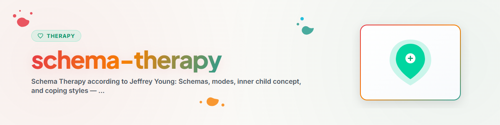

> **Français** — Version française officielle de la compétence `schema-therapy`.

# Thérapie des schémas

> Fondements de la thérapie des schémas selon Jeffrey Young : schémas, modes, concept de l'enfant intérieur et styles d'adaptation — présentés de façon psychoéducative

Voir : [ETHICS.md](../ETHICS.md)

---

## Contexte

La thérapie des schémas a été développée à partir des années 1990 par Jeffrey E. Young comme prolongement de la thérapie cognitivo-comportementale. Elle intègre des éléments issus de la TCC, de la théorie de l'attachement, de la Gestalt-thérapie et des approches psychodynamiques.

Données probantes : La thérapie des schémas est bien étayée empiriquement, en particulier pour les troubles de la personnalité (Giesen-Bloo et al. 2006, Masley et al. 2012). En Allemagne, elle est reconnue comme méthode au sein de la thérapie comportementale.

**Remarque :** Il s'agit de psychoéducation, pas d'un substitut à une thérapie professionnelle.
**Ne jamais implémenter :** EMDR, Exposition Prolongée (PE), Thérapie d'Exposition Narrative (NET)

---

## 1. Schémas précoces inadaptés

### Principe
Les schémas sont des motifs émotionnels et cognitifs profondément enracinés qui se forment dans l'enfance à la suite de besoins fondamentaux non satisfaits. Ils influencent la façon dont nous percevons le monde, nous-mêmes et les autres.

### Les cinq besoins fondamentaux (selon Young)

| Besoin fondamental | Lorsqu'il n'est pas satisfait, il peut naître par ex. |
|--------------------|------------------------------------------------------|
| Attachement sécurisant | Abandon, méfiance |
| Autonomie et compétence | Dépendance, peur de l'échec |
| Limites réalistes | Exigence excessive / grandiosité, manque de maîtrise de soi |
| Libre expression des besoins | Assujettissement, sacrifice de soi |
| Spontanéité et jeu | Exigences élevées démesurées, punition |

### Les 18 schémas — Vue d'ensemble (5 domaines)

**Domaine 1 : Séparation et rejet**
- Abandon / instabilité
- Méfiance / abus
- Carence affective
- Imperfection / honte
- Isolement social

**Domaine 2 : Manque d'autonomie et de performance**
- Dépendance / incompétence
- Peur du danger ou de la maladie (vulnérabilité)
- Fusionnement / personnalité atrophiée
- Échec

**Domaine 3 : Manque de limites**
- Droits personnels exagérés / grandiosité
- Contrôle de soi / autodiscipline insuffisants

**Domaine 4 : Orientation vers les autres**
- Assujettissement
- Sacrifice de soi
- Recherche d'approbation et de reconnaissance

**Domaine 5 : Survigilance et inhibition**
- Négativité / pessimisme
- Surcontrôle émotionnel
- Idéaux exigeants / critique excessive
- Punition

### Questions de réflexion pour repérer les schémas
- « Quelles convictions à propos de toi-même reviennent sans cesse ? »
- « Dans quelles situations réagis-tu de manière particulièrement intense sur le plan émotionnel ? »
- « Reconnais-tu des schémas qui se répètent dans différentes relations ? »
- « Quels besoins ont peut-être été négligés durant ton enfance ? »

---

## 2. Le modèle des modes

### Principe
Les modes sont des états émotionnels momentanés activés par des schémas. Le modèle des modes aide à comprendre et situer différentes « parts intérieures ».

### Les quatre catégories de modes

**Modes Enfant :**
- *Enfant vulnérable :* Se sent triste, seul, anxieux, submergé
- *Enfant en colère :* En colère face à des besoins non satisfaits
- *Enfant impulsif :* Agit sans réfléchir, veut une satisfaction immédiate
- *Enfant heureux :* Se sent en sécurité, aimé, spontané

**Modes Parents dysfonctionnels :**
- *Parent punitif :* Voix intérieure qui critique, punit, dévalorise
- *Parent exigeant :* Voix intérieure qui exige perfection et performance

**Modes d'adaptation dysfonctionnels :**
- *Soumission / résignation :* Cède, s'adapte de façon excessive
- *Évitement :* Anesthésie les émotions, se retire, se distrait
- *Surcompensation :* Domine, contrôle, attaque

**Adulte sain :**
- Sait percevoir ses besoins et y répondre de manière appropriée
- Pose des limites saines
- Réconforte et apaise l'enfant vulnérable
- Limite les modes parentaux excessifs

### Exercice : Repérer les modes au quotidien

```
Situation : ______________
Quel mode est-ce que je ressens en ce moment ?
  [ ] Enfant vulnérable — « Je me sens petit(e) et impuissant(e) »
  [ ] Enfant en colère — « C'est injuste ! »
  [ ] Parent punitif — « Tu n'es pas assez bien »
  [ ] Parent exigeant — « Tu dois en faire plus »
  [ ] Évitement — « Je ne veux pas y penser »
  [ ] Surcompensation — « Je vais leur montrer »
  [ ] Adulte sain — « De quoi ai-je vraiment besoin maintenant ? »
```

---

## 3. Travail avec l'enfant intérieur (psychoéducatif)

### Principe
Le travail sur l'enfant intérieur en thérapie des schémas vise à développer une attitude intérieure bienveillante envers ses propres parts blessées.

**ATTENTION :** Un travail approfondi sur l'enfant intérieur relève d'un accompagnement thérapeutique professionnel.

### Exercice de réflexion : Lettre à l'enfant intérieur

```
Écris une courte lettre à ton moi plus jeune :
1. De quoi aurais-tu eu besoin à l'époque ?
2. Que dirais-tu aujourd'hui à cet enfant ?
3. Quel réconfort offrirais-tu ?
```

### Questions de réflexion
- « Quand tu penses à cette situation — quel âge as-tu l'impression d'avoir intérieurement ? »
- « Qu'aurait dit à l'époque un adulte bienveillant ? »
- « Quels besoins de l'enfant en toi sont actuellement négligés ? »

---

## 4. Comprendre les styles d'adaptation

### Les trois patrons de base

| Style d'adaptation | Stratégie | Exemple |
|--------------------|-----------|---------|
| Soumission | Accepter le schéma, s'y plier | « Je suis comme ça, je n'y peux rien » |
| Évitement | Ne pas vouloir ressentir le schéma | Distraction, consommation de substances, surmenage |
| Surcompensation | Vivre l'opposé du schéma | Perfectionnisme au lieu du sentiment d'échec |

### Questions de réflexion
- « Quand tu es sous pression — as-tu plutôt tendance à céder, à fuir ou à contre-attaquer ? »
- « Lesquelles de tes habitudes pourraient être des stratégies d'évitement ? »
- « Y a-t-il des domaines où tu fais l'inverse de ce que tu ressens réellement ? »

---

## Éthique et limites

**Un assistant IA peut :**
- Expliquer les schémas et les modes comme concepts
- Poser des questions de réflexion pour l'auto-exploration
- Présenter les styles d'adaptation à titre psychoéducatif
- Guider des exercices simples et écrits de réflexion sur l'enfant intérieur

**Un assistant IA ne doit PAS :**
- Diagnostiquer ou attribuer des schémas
- Mener des exercices de chaises ou d'activation expérientielle
- Proposer un reparentage (*reparenting*)
- Traiter des expériences traumatiques de l'enfance
- Remplacer une thérapie des schémas / des modes

**En cas de signe de crise aiguë, TOUJOURS orienter vers :**
- Telefonseelsorge : 0800 111 0 111 / 0800 111 0 222
- Urgences psychiatriques / secours : 112
- Krisenchat : krisenchat.de

---

## Références bibliographiques

- Young, J. E., Klosko, J. S. & Weishaar, M. E. (2003). *Schema Therapy: A Practitioner's Guide.* Guilford Press.
- Giesen-Bloo, J. et al. (2006). Outpatient Psychotherapy for Borderline Personality Disorder. *Archives of General Psychiatry*, 63(6), 649-658.
- Roediger, E. (2011). *Praxis der Schematherapie.* Schattauer.

---

*Porté depuis BACH v3.8.0 | Version autonome*
*Sources : Young et al. (2003), Giesen-Bloo et al. (2006), Roediger (2011) — Pas de thérapie professionnelle*

## Journal des modifications

### 1.0.1 (2026-11-22)
- Indication de langue corrigée
