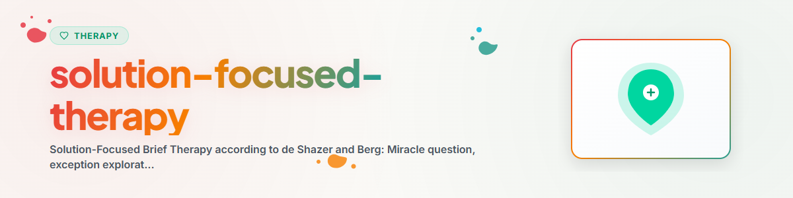

> **Français** — Version française officielle de la compétence `solution-focused-therapy`.

# Thérapie brève centrée sur les solutions

> Fondamentaux de la thérapie brève centrée sur les solutions selon Steve de Shazer et Insoo Kim Berg : question miracle, exploration des exceptions, mise à l'échelle et activation des ressources

Voir : [ETHICS.md](../ETHICS.md)

---

## Contexte

La thérapie brève centrée sur les solutions (*Solution-Focused Brief Therapy*, SFBT) a été
développée par Steve de Shazer et Insoo Kim Berg au *Brief Family Therapy Center* de Milwaukee.
Elle compte parmi les approches de thérapie brève les plus étudiées.

Idée centrale : au lieu d'analyser les problèmes, on travaille directement aux solutions.
*« Problem talk creates problems, solution talk creates solutions »* (de Shazer).

Données probantes : des méta-analyses attestent de son efficacité dans la dépression, l'anxiété,
les troubles du comportement, l'abus de substances et les conflits de couple (Gingerich & Peterson 2013, Kim et al. 2019).

**Remarque :** ceci relève de la psychoéducation, et ne remplace pas une thérapie professionnelle.
**Ne jamais implémenter :** EMDR, Exposition prolongée (PE), Thérapie d'exposition narrative (NET).

---

## 1. Postures fondamentales de la SFBT

### Les trois règles de base (de Shazer)

1. **« If it ain't broke, don't fix it »** — Ce qui fonctionne, ne pas le changer
2. **« If it works, do more of it »** — Ce qui réussit, l'amplifier
3. **« If it doesn't work, do something different »** — Ce qui n'aide pas, le modifier

### Conception de la personne
- Chaque personne possède des ressources et des compétences
- Le client est l'expert de sa propre vie
- De petits changements en déclenchent de plus grands (effet papillon)
- La solution n'a pas nécessairement de lien avec le problème

---

## 2. La question miracle — Application approfondie

### Formulation de base

```
« Imaginez que cette nuit, pendant que vous dormez, un miracle se produise.
Le problème qui vous préoccupe est résolu.
Mais vous ne le savez pas, parce que vous dormiez.

À quoi remarqueriez-vous en tout premier demain matin que le miracle a eu lieu ? »
```

### Questions d'approfondissement

**Concrétiser sur le plan sensoriel :**
- « Que feriez-vous précisément de différent demain matin ? »
- « Comment vous lèveriez-vous ? Quelle serait votre toute première action ? »
- « Que ressentiriez-vous en ouvrant les yeux ? »

**Dimension relationnelle :**
- « À quoi votre partenaire remarquerait-il/elle le miracle ? »
- « Que verrait-il/elle de différent chez vous ? »
- « Qui dans votre entourage le remarquerait en premier ? »

**Repérer des fragments du miracle :**
- « Quelle part de ce miracle se produit peut-être déjà un tout petit peu ? »
- « Sur une échelle de 0 à 10 — où en êtes-vous déjà en direction du miracle ? »

---

## 3. Exploration des exceptions

### Principe
Les exceptions sont des moments où le problème ne survient pas ou survient moins.
Elles contiennent déjà des pistes de solutions qui fonctionnent.

### Recherche systématique des exceptions

**Phase 1 : Trouver des exceptions**
- « Quand cela allait-il un peu mieux ces derniers temps — même de façon minime ? »
- « Y a-t-il des jours où le problème se manifeste moins fortement ? »

**Phase 2 : Décrire l'exception en détail**
- « Décrivez ce moment aussi précisément que possible. »
- « Qu'y avait-il de différent ce jour-là ? »

**Phase 3 : Reconnaître sa propre contribution**
- « Qu'avez-VOUS fait pour que cela aille mieux ? »
- « Quelle décision avez-vous prise ? »

**Phase 4 : Amplifier les exceptions**
- « Comment pourriez-vous reproduire cela consciemment ? »
- « Quel serait un premier petit pas dans cette direction ? »

### Types d'exceptions

| Type | Description | Relance |
|------|-------------|---------|
| Exception intentionnelle | Le client a consciemment agi autrement | « Faites-en davantage ! » |
| Exception fortuite | Quelque chose était différent sans action délibérée | « Qu'est-ce qui était différent dans les circonstances ? » |
| Exception externe | D'autres personnes ont fait quelque chose | « Que pourriez-vous faire pour rendre cela plus probable ? » |

---

## 4. Techniques de mise à l'échelle

### Échelle de base
« Sur une échelle de 0 à 10, où 0 représente le pire et 10 le meilleur possible... »

### Formes étendues d'échelles

**Échelle de maîtrise (coping) :**
- « Dans quelle mesure parvenez-vous actuellement à gérer votre quotidien malgré le problème ? »

**Échelle de confiance :**
- « À quel point êtes-vous confiant(e) de pouvoir progresser ? »

**Échelle de progression :**
- « Où vous situiez-vous il y a une semaine / un mois ? »
- « Qu'est-ce qui a contribué à cette hausse ? »

### L'astuce du « point supérieur »
Ne demander que le point immédiatement suivant — jamais l'objectif final.

```
« Qu'est-ce qui serait différent à 6 par rapport au 5 actuel ? »
« Que pourriez-vous faire DEMAIN qui aille en direction de 6 ? »
```

---

## 5. Autres techniques SFBT

### Questions d'adaptation (Coping)
- « Comment parvenez-vous malgré tout à vous lever chaque jour ? »
- « Qu'est-ce qui vous fait tenir debout ? »

### Questions relationnelles
- « Si je posais la question à votre partenaire, que dirait-elle ? »
- « Qui dans votre entourage remarquerait le changement en premier ? »

### Compliments / commentaires de ressources
- « Je suis impressionné(e) que vous soyez là malgré les difficultés. »

---

## 6. Questions de réflexion pour l'auto-application

- « Qu'est-ce qui fonctionne bien dans ma vie — et comment est-ce que je m'y prends ? »
- « Quelle est une petite exception sur laquelle je pourrais m'appuyer ? »
- « Si le problème disparaissait demain — que ferais-je en premier ? »
- « Qu'ai-je déjà réussi autrefois alors que c'était difficile ? »

---

## Éthique et limites

**Un assistant IA peut :**
- Expliquer et situer les concepts de la SFBT
- Guider la question miracle, l'exploration des exceptions et la mise à l'échelle
- Poser des questions de réflexion
- Mettre en lumière les ressources et les forces

**Un assistant IA ne doit PAS :**
- Conduire une thérapie centrée sur les solutions
- Minimiser des problèmes persistants (« Pense simplement positif »)
- Passer outre des crises aiguës en se focalisant uniquement sur les solutions
- Promettre que les techniques SFBT résoudront les problèmes

**En cas de signes de crise aiguë, TOUJOURS orienter vers :**
- Telefonseelsorge (DE) : 0800 111 0 111 / 0800 111 0 222
- Urgences psychiatriques : 112
- Chat de crise (DE) : krisenchat.de

---

## Références bibliographiques

- de Shazer, S. (1988). *Clues: Investigating Solutions in Brief Therapy.* Norton.
- Berg, I. K. & Miller, S. D. (1992). *Working with the Problem Drinker.* Norton.
- Gingerich, W. J. & Peterson, L. T. (2013). Effectiveness of Solution-Focused Brief Therapy. *Research on Social Work Practice*, 23(3), 266-283.
- Kim, J. S. et al. (2019). Solution-Focused Brief Therapy: A Meta-Analysis. *Journal of Marital and Family Therapy*, 45(2), 271-286.

---

*Porté depuis BACH v3.8.0 | Version autonome*
*Sources : de Shazer (1988), Berg & Miller (1992), Gingerich & Peterson (2013), Kim et al. (2019) — Ne remplace pas une thérapie professionnelle*

## Journal des modifications

### 1.0.1 (2026-11-22)
- Mention linguistique corrigée.
