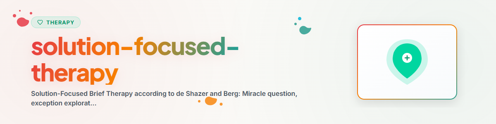

# Terapia Focada em Soluções

> Fundamentos da terapia breve focada em soluções segundo Steve de Shazer e Insoo Kim Berg: pergunta do milagre, exploração de exceções, escalonamento, ativação de recursos

Veja: [ETHICS.md](../ETHICS.md)

---

## Contexto

A terapia breve focada em soluções (Solution-Focused Brief Therapy, SFBT) foi
desenvolvida por Steve de Shazer e Insoo Kim Berg no Brief Family Therapy Center em Milwaukee.
Ela está entre as abordagens de terapia breve mais bem pesquisadas.

Ideia central: em vez de analisar problemas, trabalha-se diretamente com soluções.
"Problem talk creates problems, solution talk creates solutions" (de Shazer).

Evidência: meta-análises comprovam a eficácia em depressão, ansiedade, problemas de comportamento,
abuso de substâncias e conflitos de casal (Gingerich & Peterson 2013, Kim et al. 2019).

**Observação:** Isto é psicoeducação, não substitui a terapia profissional.
**Nunca implementar:** EMDR, Prolonged Exposure (PE), Narrative Exposure Therapy (NET)

---

## 1. Atitudes básicas da SFBT

### As três regras básicas (de Shazer)

1. **"If it ain't broke, don't fix it"** — O que funciona, não mudar
2. **"If it works, do more of it"** — O que dá certo, reforçar
3. **"If it doesn't work, do something different"** — O que não ajuda, mudar

### Visão de ser humano
- Toda pessoa tem recursos e competências
- O cliente é o especialista em sua própria vida
- Pequenas mudanças provocam mudanças maiores (efeito borboleta)
- A solução não precisa ter relação com o problema

---

## 2. A pergunta do milagre — aplicação aprofundada

### Forma básica Pergunta do milagre: "Imagine que esta noite, enquanto você dorme, acontece um milagre. O problema que te preocupa está resolvido. Mas você não percebe isso, porque estava dormindo. O que você notaria logo de manhã, ao acordar, que mostraria que o milagre aconteceu?"

```
"Stell dir vor, heute Nacht passiert ein Wunder, während du schläfst.
Das Problem, das dich beschäftigt, ist gelöst.
Du weißt es aber nicht, weil du geschlafen hast.

Woran würdest du morgen früh als Erstes merken, dass das Wunder passiert ist?"
```

### Perguntas de aprofundamento

**Concretizar o nível sensorial:**
- "O que exatamente você faria de diferente amanhã de manhã?"
- "Como você se levantaria? O que faria primeiro?"
- "O que você sentiria ao abrir os olhos?"

**Nível relacional:**
- "Como seu parceiro / sua parceira perceberia o milagre?"
- "O que ele/ela veria de diferente em você?"
- "Quem no seu entorno perceberia isso primeiro?"

**Encontrar frações do milagre:**
- "Qual parte desse milagre talvez já esteja acontecendo um pouquinho?"
- "Em uma escala de 0 a 10 — quão perto você já está do milagre?"

---

## 3. Exploração de exceções

### Princípio
Exceções são momentos em que o problema não ocorre ou ocorre com menos intensidade.
Elas já contêm abordagens de solução que funcionam.

### Busca sistemática de exceções

**Fase 1: encontrar exceções**
- "Quando foi a última vez em que as coisas estiveram um pouco melhores — mesmo que minimamente?"
- "Há dias em que o problema se manifesta com menos força?"

**Fase 2: descrever as exceções em detalhe**
- "Descreva esse momento da forma mais precisa possível"
- "O que foi diferente naquele dia?"

**Fase 3: reconhecer a própria contribuição**
- "O que VOCÊ fez para que as coisas ficassem melhores?"
- "Que decisão você tomou?"

**Fase 4: reforçar as exceções**
- "Como você poderia repetir isso de forma consciente?"
- "Qual seria um primeiro pequeno passo nessa direção?"

### Tipos de exceções

| Tipo | Descrição | Pergunta |
|------|-----------|----------|
| Exceção intencional | O cliente fez algo diferente de propósito | "Faça mais disso!" |
| Exceção casual | Algo foi diferente sem intenção consciente | "O que foi diferente nas circunstâncias?" |
| Exceção externa | Outras pessoas fizeram algo | "O que você poderia fazer para tornar isso mais provável?" |

---

## 4. Técnicas de escalonamento

### Escalonamento básico
"Em uma escala de 0 a 10, em que 0 é o pior e 10 é o melhor possível..."

### Formas ampliadas de escalonamento

**Escala de enfrentamento:**
- "Quão bem você consegue, apesar do problema, dar conta do seu dia a dia neste momento?"

**Escala de confiança:**
- "Quão confiante você está de que consegue fazer progressos?"

**Escala de progresso:**
- "Onde você estava há uma semana / um mês?"
- "O que contribuiu para a melhora?"

### O truque do "um ponto a mais"
Perguntar sempre apenas pelo próximo ponto — nunca pelo objetivo final. Perguntas equivalentes: "O que seria diferente em um 6 em comparação com o atual 5?" e "O que você poderia fazer AMANHÃ que se aproxime do 6?"

```
"Was wäre bei einer 6 anders als bei der jetzigen 5?"
"Was könntest du MORGEN tun, das in Richtung 6 geht?"
```

---

## 5. Outras técnicas da SFBT

### Perguntas de enfrentamento
- "Como você consegue, mesmo assim, se levantar todo dia?"
- "O que te mantém de pé?"

### Perguntas relacionais
- "Se eu perguntasse à sua parceira, o que ela diria?"
- "Quem no seu entorno perceberia a mudança primeiro?"

### Elogios / comentários sobre recursos
- "Impressiona-me que, apesar das dificuldades, você esteja aqui."

---

## 6. Perguntas de reflexão para a autoaplicação

- "O que funciona bem na minha vida — e como faço isso?"
- "Qual é uma pequena exceção sobre a qual eu poderia construir?"
- "Se o problema desaparecesse amanhã — o que eu faria primeiro?"
- "O que eu já consegui antes, apesar de ser difícil?"

---

## Ética e limites

**Um assistente de IA pode:**
- Explicar e classificar conceitos da SFBT
- Orientar a pergunta do milagre, a exploração de exceções e o escalonamento
- Fazer perguntas de reflexão
- Apontar para recursos e forças

**Um assistente de IA NÃO pode:**
- Conduzir terapia focada em soluções
- Minimizar problemas persistentes ("Pense positivo, só isso")
- Ignorar crises agudas com foco em soluções
- Prometer que as técnicas da SFBT resolvem problemas

**Em caso de sinais de crise aguda, SEMPRE encaminhar para:**
- Telefonseelsorge: 0800 111 0 111 / 0800 111 0 222
- Serviço psiquiátrico de emergência: 112
- Krisenchat: krisenchat.de

---

## Referências

- de Shazer, S. (1988). *Clues: Investigating Solutions in Brief Therapy.* Norton.
- Berg, I. K. & Miller, S. D. (1992). *Working with the Problem Drinker.* Norton.
- Gingerich, W. J. & Peterson, L. T. (2013). Effectiveness of Solution-Focused Brief Therapy. *Research on Social Work Practice*, 23(3), 266-283.
- Kim, J. S. et al. (2019). Solution-Focused Brief Therapy: A Meta-Analysis. *Journal of Marital and Family Therapy*, 45(2), 271-286.

---

*Portado a partir de BACH v3.8.0 | Versão standalone*
*Fontes: de Shazer (1988), Berg & Miller (1992), Gingerich & Peterson (2013), Kim et al. (2019) — Sem terapia profissional*
