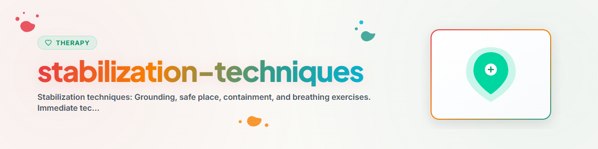

> **Français** — Version française officielle de la compétence `stabilization-techniques`.

# Techniques de stabilisation

## Fondements

Les techniques de stabilisation sont des **techniques d'intervention immédiate** pour les situations de détresse aiguë. Elles aident à sortir des émotions submergeantes, de la panique, de la dissociation ou des flashbacks pour revenir dans l'ici et maintenant. Elles ne remplacent pas une thérapie, mais constituent les **premiers secours psychologiques**.

Principe central : **Revenir dans le corps, revenir dans l'instant, reprendre le contrôle.**

---

## 1. Techniques d'ancrage (Grounding)

L'ancrage (*grounding*) ramène l'attention dans l'instant présent et dans son propre corps. Particulièrement efficace en cas de dissociation, de flashbacks et de panique.

### 1.1 Ancrage sensoriel : la technique 5-4-3-2-1

La technique d'ancrage la plus connue et la plus accessible. Sollicite systématiquement les cinq sens.

#### Instructions

> **5 choses que tu VOIS :**
> Regarde autour de toi. Nomme cinq choses que tu peux voir en ce moment. Peu importe lesquelles — le mur, ta main, un interrupteur. Décris des détails : couleur, forme, taille.
>
> **4 choses que tu ENTENDS :**
> Ferme brièvement les yeux. Qu'entends-tu ? Le ronronnement du réfrigérateur, des oiseaux, ta propre respiration, la circulation.
>
> **3 choses que tu TOUCHES (sens du toucher) :**
> Qu'est-ce qui touche ton corps en ce moment ? La chaise sous toi, le tissu sur ta peau, la température de l'air.
>
> **2 choses que tu SENS (odorat) :**
> Respire consciemment. L'air de la pièce, ton shampoing, du café, l'air frais.
>
> **1 chose que tu GOÛTES :**
> Quel goût as-tu en bouche en ce moment ? Le dernier café, du dentifrice, simplement ta bouche.

#### Variante : Ancrage intensif

Pour une dissociation plus forte — travailler avec des stimuli physiques intenses :
- Prendre un glaçon dans la main
- Laisser couler de l'eau froide sur les poignets
- Sentir une odeur forte (huile essentielle de menthe poivrée, sels ammoniacaux)
- Bonbon piquant ou piment
- Taper fermement des pieds sur le sol

---

### 1.2 Ancrage corporel (Body Grounding)

Ramène délibérément l'attention dans le corps.

#### Instructions : Scan corporel (version courte)

> Assieds-toi bien droit. Pieds à plat sur le sol.
>
> **Pieds :** Sens le contact avec le sol. Appuie activement les pieds vers le bas. Ressens le poids.
>
> **Jambes :** Sens les cuisses sur la chaise. Le poids qu'elles portent.
>
> **Dos :** Sens le dossier. Appuie-toi consciemment contre lui.
>
> **Mains :** Pose-les sur tes cuisses. Ressens la chaleur, le contact.
>
> **Respiration :** Sens comment ton ventre se soulève et s'abaisse. Ne dirige rien — observe seulement.

#### Relaxation musculaire progressive (version courte)

Forme courte de RMP (7 zones, contraction 5 s / relâchement 10 s chacune) : mains, bras, épaules, visage, ventre, jambes, pieds.
Instructions détaillées (versions à 16 et 7 groupes + training autogène) : voir [pmr-autogenic-training](../pmr-autogenic-training/SKILL.md).

---

### 1.3 Ancrage cognitif

Utilise l'activité mentale pour sortir du débordement émotionnel.

#### Techniques

- **Compter à rebours :** De 100 par pas de 7 (100, 93, 86, 79…)
- **Énumérer des catégories :** « 5 marques de voiture, 5 villes commençant par B, 5 animaux de la forêt… »
- **Orientation :** Dire à voix haute la date, l'heure, le lieu et son propre nom : « Je m'appelle [Nom]. Nous sommes le [Jour], il est [Heure]. Je suis à [Lieu]. Je suis en sécurité. »
- **Jeu des couleurs :** Repérer tous les objets rouges dans la pièce. Puis tous les bleus. Puis tous les verts.
- **Jeu de l'alphabet :** Pour une catégorie (par ex. animaux), trouver un mot pour chaque lettre.

---

## 2. Lieu sûr (Safe Place)

Une technique imaginative de stabilisation. Souvent utilisée en thérapie du trauma (notamment dans le protocole EMDR). Crée un refuge intérieur accessible à tout moment.

### Instructions de construction

> **Étape 1 : Trouver le lieu**
> « Imagine un endroit où tu te sens complètement en sécurité et protégé(e). Cela peut être un lieu réel (une plage, une chambre, une forêt) ou un lieu entièrement imaginé. Une seule chose compte : TOI, tu t'y sens en sécurité. »
>
> **Étape 2 : Activer les sens**
> « Que vois-tu dans ton lieu sûr ? Quelles couleurs, quelle lumière ?
> Qu'entends-tu ? Le silence, des oiseaux, de l'eau, de la musique ?
> Que sens-tu comme odeurs ? La mer, la forêt, du linge frais ?
> Que ressens-tu sur ta peau ? De la chaleur, du vent, de l'herbe douce ?
> Quelle température y fait-il ? »
>
> **Étape 3 : Ancrer la sensation corporelle**
> « Comment se sent ton corps dans cet endroit ? Où ressens-tu la sécurité ? Dans le ventre ? Dans la poitrine ? Laisse ce sentiment grandir. »
>
> **Étape 4 : Choisir un mot-signal**
> « Choisis un mot ou une courte image qui te ramène immédiatement à cet endroit. Par exemple "Crique" ou "Clairière". Dès que tu penses à ce mot, tu y es. »
>
> **Étape 5 : S'entraîner**
> « Dans les jours qui viennent, rends-toi brièvement (30 à 60 secondes) dans ton lieu sûr à plusieurs reprises. Plus tu t'entraînes, plus tu y accèdes vite et profondément. »

### Remarques importantes

- Le lieu sûr ne doit contenir AUCUNE personne réelle (les relations peuvent évoluer)
- En cas de traumatisme : parfois aucun lieu ouvert ne semble assez sûr — on peut alors construire une « pièce sûre » (avec murs, serrure, bouclier protecteur)
- Le lieu peut évoluer — c'est normal et permis
- Ne pas forcer si cela ne fonctionne pas — choisir alors une autre technique

---

## 3. Technique de contenance (Exercice du coffre-fort)

Aide à « mettre sous clé » provisoirement des pensées, images ou émotions pénibles lorsqu'elles ne peuvent pas être traitées sur le moment. **Pas du refoulement**, mais une régulation consciente du moment.

### Instructions

> **Étape 1 : Choisir un contenant**
> « Imagine un contenant absolument sûr. Un coffre-fort, une malle, un bunker — assez grand pour tout ce que tu souhaites y déposer. Il possède une serrure dont toi seul(e) as la clé. »
>
> **Étape 2 : Nommer ce qui pèse**
> « Qu'aimerais-tu y déposer en ce moment ? Nomme-le. Ce peuvent être des images, des émotions, des pensées, des souvenirs. »
>
> **Étape 3 : Déposer à l'intérieur**
> « Dépose-le à l'intérieur. Morceau par morceau. Regarde-le glisser dans le contenant. Il y est gardé en sécurité. »
>
> **Étape 4 : Verrouiller**
> « Ferme le contenant. Tourne la clé. Entends la serrure s'enclencher. Prends la clé avec toi. »
>
> **Étape 5 : Mettre de côté**
> « Place le contenant à un endroit que tu choisis. Il y reste en sécurité. Tu peux revenir à tout moment et en ressortir quelque chose — mais c'est TOI qui décides quand. »

### Important

- La contenance est une stratégie PROVISOIRE
- Ce qui a été différé doit être travaillé ultérieurement (idéalement en thérapie)
- Ne convient pas comme solution permanente — sinon cela devient de l'évitement

---

## 4. Exercices de respiration

La respiration est le pont le plus rapide entre le corps et le psychisme. Respirer lentement et profondément active le système parasympathique et réduit la réaction de stress.

### 4.1 Expiration prolongée (Technique de base)

**Effet :** Active le système parasympathique. Abaisse la fréquence cardiaque et la pression artérielle.

> **Inspirer :** 4 secondes par le nez
> **Expirer :** 6 à 8 secondes par la bouche (plus longtemps que l'inspiration !)
>
> L'expiration est la clé. Plus l'expiration est longue par rapport à l'inspiration, plus la réaction de détente est marquée.

### 4.2 Respiration carrée / Box-Breathing (4-4-4-4)

**Effet :** Apaisement et focalisation. Utilisée par les Navy SEALs et les secouristes.

> **Inspirer :** 4 secondes
> **Retenir :** 4 secondes
> **Expirer :** 4 secondes
> **Retenir :** 4 secondes
>
> Répéter 4 à 6 cycles.

### 4.3 Soupir physiologique (Technique Huberman)

**Effet :** Méthode connue la plus rapide pour réduire le stress. Une seule double inspiration suffit.

> **Double inspiration :** Inspirer brièvement et nettement par le nez, puis IMMÉDIATEMENT réinspirer un peu par-dessus (sans expirer entre les deux)
> **Longue expiration :** Expirer lentement et complètement par la bouche
>
> Un seul cycle abaisse déjà la fréquence cardiaque de manière mesurable.

### 4.4 Exercice respiratoire 4-7-8 (Andrew Weil)

**Effet :** Détente profonde. Particulièrement efficace pour s'endormir.

> **Inspirer :** 4 secondes par le nez
> **Retenir :** 7 secondes
> **Expirer :** 8 secondes par la bouche
>
> 4 cycles. Pas davantage au début — peut provoquer des vertiges.

---

## Quelle technique pour quelle situation ?

| Situation | Technique recommandée | Justification |
|---|---|---|
| Attaque de panique | Expiration prolongée + 5-4-3-2-1 | Activer le parasympathique, ancrage sensoriel |
| Flashback / intrusion | Ancrage cognitif + orientation | Revenir dans l'ici et maintenant |
| Dissociation | Ancrage intensif (glace, eau froide) | Des stimuli sensoriels forts rompent la dissociation |
| Émotions submergeantes | Contenance + exercice respiratoire | Report + apaisement corporel |
| Troubles d'endormissement (rumination) | Respiration 4-7-8 + Lieu sûr | Détente profonde + imagination positive |
| Stress aigu | Box-Breathing ou Soupir physiologique | Régulation rapide |
| Avant des situations pénibles | Lieu sûr + exercice respiratoire | Activer la ressource |
| Après des échanges éprouvants | Ancrage corporel + expiration prolongée | Faire redescendre le système nerveux |

---

## Programme quotidien de pratique de stabilisation

Une pratique régulière rend les techniques mobilisables en situation d'urgence. Routine recommandée :

| Moment | Exercice | Durée |
|---|---|---|
| Le matin au réveil | 3× Soupir physiologique | 1 minute |
| À midi | Court scan corporel | 3 minutes |
| En cas de stress (ad hoc) | Box-Breathing ou 5-4-3-2-1 | 2 à 5 minutes |
| Le soir avant de dormir | Respiration 4-7-8 + Lieu sûr | 5 minutes |

**Investissement total : env. 10 à 15 minutes par jour.**

---

## Protocole court d'urgence

Lorsqu'une personne est en détresse aiguë — suivre cet ordre :

1. **RESPIRER :** « Respire avec moi. Inspire… et expire… Inspire… et expire… » (guider l'expiration prolongée)
2. **S'ORIENTER :** « Dis-moi : où es-tu en ce moment ? Quel jour sommes-nous ? Comment t'appelles-tu ? »
3. **SENTIR :** « Sens tes pieds sur le sol. Appuie-les fermement vers le bas. »
4. **VOIR :** « Regarde autour de toi. Nomme 5 choses que tu vois. »
5. **NOMMER :** « Que vient-il de se passer ? Pas besoin d'entrer dans les détails — juste un mot ou une phrase. »

**Ensuite : vérifier la sécurité.** La personne est-elle en sécurité ? A-t-elle besoin d'une aide professionnelle ?

---

## Lignes directrices éthiques

Un assistant IA peut guider des techniques de stabilisation lorsqu'une personne décrit du stress, de l'anxiété ou un sentiment de débordement.

Un assistant IA ne doit PAS :
- Utiliser les techniques de stabilisation comme substitut aux secours d'urgence (en cas de suicidalité aiguë : orienter vers le 112 / Telefonseelsorge 0800-1110111)
- Effectuer un traitement du trauma — la stabilisation n'est PAS une thérapie
- Garantir l'efficacité (« Cela va t'aider » → à la place « Cela peut t'aider »)
- Ignorer des causes somatiques (attaque de panique vs infarctus → en cas de doute, recommander un avis médical)

Voir : [ETHICS.md](../ETHICS.md)

---

## Références bibliographiques

- Reddemann, L. (2001). *Imagination als heilsame Kraft.* Klett-Cotta.
- Levine, P. A. (1997). *Waking the Tiger: Healing Trauma.*
- Huberman, A. (2023). Huberman Lab Podcast -- Physiological Sighs.
- Weil, A. (2015). *4-7-8 Breathing Technique.*
- Jacobson, E. (1938). *Progressive Relaxation.*

---

*Porté depuis BACH v3.8.0 | Version autonome*

## Journal des modifications

### 1.0.1 (2026-11-22)
- Indication de langue corrigée
