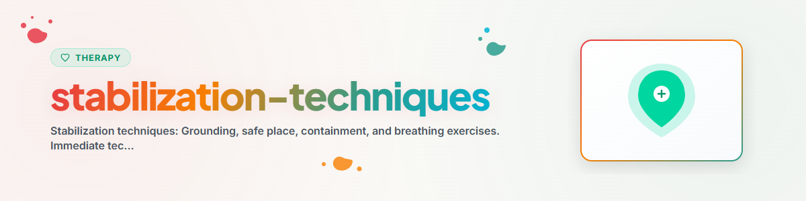

# Técnicas de Estabilização

## Fundamentos

As técnicas de estabilização são **técnicas imediatas** para situações de sofrimento agudo. Elas ajudam a voltar ao aqui e agora a partir de sentimentos avassaladores, pânico, dissociação ou flashbacks. Não substituem a terapia, mas funcionam como **primeiros socorros para a psique**.

Princípio central: **de volta ao corpo, de volta ao momento, de volta ao controle.**

---

## 1. Técnicas de Aterramento (Grounding)

O grounding ("aterramento") direciona a atenção de volta ao momento presente e ao próprio corpo. É especialmente eficaz em casos de dissociação, flashbacks e pânico.

### 1.1 Grounding sensorial: a técnica 5-4-3-2-1

A técnica mais conhecida e de mais fácil acesso. Ativa sistematicamente os cinco sentidos.

#### Instruções

> **5 coisas que você VÊ:**
> Olhe ao redor. Nomeie cinco coisas que você consegue ver agora. Tanto faz o quê: a parede, a sua mão, um interruptor de luz. Descreva detalhes: cor, forma, tamanho.
>
> **4 coisas que você OUVE:**
> Feche os olhos por um instante. O que você ouve? O zumbido da geladeira, pássaros, a sua própria respiração, o trânsito.
>
> **3 coisas que você SENTE (tato):**
> O que está tocando o seu corpo agora? A cadeira embaixo de você, o tecido na pele, a temperatura do ar.
>
> **2 coisas que você CHEIRA:**
> Cheire com atenção. O ar do ambiente, o seu xampu, café, ar fresco.
>
> **1 coisa que você PROVA:**
> O que você sente no paladar agora? O último café, a pasta de dente, simplesmente a sua boca.

#### Variante: grounding intensivo

Para dissociação mais intensa, trabalhar com estímulos corporais:
- Pegar cubos de gelo na mão
- Deixar água fria escorrer pelos pulsos
- Sentir um cheiro forte (óleo de hortelã-pimenta, sais aromáticos de amônia)
- Chupar uma bala ou comer algo bem picante
- Bater os pés com força no chão

---

### 1.2 Grounding corporal (Body Grounding)

Direciona a atenção de forma específica para o corpo.

#### Instruções: varredura corporal (versão curta)

> Sente-se com a coluna ereta. Pés apoiados por inteiro no chão.
>
> **Pés:** Sinta o contato com o chão. Pressione os pés ativamente para baixo. Sinta o peso.
>
> **Pernas:** Sinta as coxas sobre a cadeira. O peso que elas sustentam.
>
> **Costas:** Sinta o encosto. Recoste-se de forma consciente.
>
> **Mãos:** Coloque-as sobre as coxas. Sinta o calor, o contato.
>
> **Respiração:** Sinta a barriga subir e descer. Não controle, apenas observe.

#### Relaxamento muscular progressivo (versão curta)

Versão curta do PMR (7 regiões, 5 s de tensão / 10 s de relaxamento cada): mãos, braços, ombros, rosto, barriga, pernas, pés.
Instruções detalhadas (versões de 16 e 7 grupos musculares + treino autógeno) em [pmr-autogenic-training](../pmr-autogenic-training/SKILL.md).

---

### 1.3 Grounding cognitivo

Usa a atividade mental para sair da sobrecarga emocional.

#### Técnicas

- **Contagem regressiva:** de 100 em intervalos de 7 (100, 93, 86, 79...)
- **Listar categorias:** "5 marcas de carro, 5 cidades com B, 5 animais da floresta..."
- **Orientação:** dizer a data, a hora, o lugar e o próprio nome: "Eu sou [nome]. Hoje é [dia], [hora]. Estou em [lugar]. Estou seguro."
- **Jogo das cores:** encontrar todos os objetos vermelhos do cômodo. Depois todos os azuis. Depois todos os verdes.
- **Jogo do alfabeto:** dentro de uma categoria (por exemplo, animais), encontrar uma palavra para cada letra

---

## 2. Lugar Seguro (Safe Place)

Uma técnica de estabilização imaginativa. É usada com frequência na terapia de trauma (inclusive no protocolo EMDR). Cria um refúgio interno que pode ser acessado a qualquer momento.

### Instruções para a construção

> **Passo 1: encontrar o lugar**
> "Imagine um lugar onde você se sente completamente seguro e acolhido. Pode ser um lugar real (uma praia, um quarto, uma floresta) ou um lugar totalmente imaginado. O importante é apenas: VOCÊ se sente seguro ali."
>
> **Passo 2: ativar os sentidos**
> "O que você vê no seu lugar seguro? Quais cores, qual luz?
> O que você ouve? Silêncio, pássaros, água, música?
> Que cheiro você sente? Mar, floresta, roupa lavada?
> O que você sente na pele? Calor, vento, grama macia?
> Qual é a temperatura?"
>
> **Passo 3: ancorar a sensação corporal**
> "Como o seu corpo se sente nesse lugar? Onde você percebe a segurança? Na barriga? No peito? Deixe essa sensação crescer."
>
> **Passo 4: escolher uma palavra-chave**
> "Escolha uma palavra ou uma imagem curta que o leve imediatamente a esse lugar. Por exemplo, 'enseada' ou 'clareira'. Quando você pensar nessa palavra, você estará lá."
>
> **Passo 5: praticar**
> "Nos próximos dias, volte ao seu lugar seguro por alguns instantes (30 a 60 segundos) várias vezes. Quanto mais você praticar, mais rápido e profundamente você chegará lá."

### Observações importantes

- O lugar seguro NÃO deve conter pessoas reais (os relacionamentos podem mudar)
- No caso de trauma: às vezes nenhum lugar é seguro o suficiente; nesse caso pode-se construir um "espaço seguro" (com muros, cadeado, escudo de proteção)
- O lugar pode mudar com o tempo; isso é normal e permitido
- Não force se não funcionar; nesse caso, escolha outra técnica

---

## 3. Técnica de Contenção (exercício do cofre)

Ajuda a "trancar" temporariamente pensamentos, imagens ou sentimentos angustiantes quando eles não podem ser trabalhados naquele momento. **Não é repressão**, mas uma regulação consciente do momento.

### Instruções

> **Passo 1: escolher o recipiente**
> "Imagine um recipiente absolutamente seguro. Um cofre, um baú, um bunker, grande o suficiente para tudo o que você quiser colocar dentro. Ele tem uma fechadura, e só você tem a chave."
>
> **Passo 2: nomear o que pesa**
> "O que você gostaria de colocar ali agora? Dê nome a isso. Podem ser imagens, sentimentos, pensamentos, lembranças."
>
> **Passo 3: colocar dentro**
> "Coloque tudo dentro. Peça por peça. Observe como isso desliza para dentro do recipiente. Está guardado com segurança."
>
> **Passo 4: trancar**
> "Feche o recipiente. Gire a chave. Ouça a fechadura travar. Guarde a chave com você."
>
> **Passo 5: guardar**
> "Coloque o recipiente em um lugar que você escolher. Ele fica seguro ali. Você pode voltar a qualquer momento e retirar algo, mas é VOCÊ quem decide quando."

### Importante

- A contenção é uma estratégia TEMPORÁRIA
- O que foi adiado precisa ser trabalhado depois (idealmente em terapia)
- Não é adequada como solução permanente, pois pode se transformar em evitação

---

## 4. Exercícios de Respiração

A respiração é a ponte mais rápida entre corpo e psique. Respirar devagar e profundamente ativa o sistema parassimpático e reduz a resposta ao estresse.

### 4.1 Expiração prolongada (técnica básica)

**Efeito:** ativa o parassimpático. Diminui a frequência cardíaca e a pressão arterial.

> **Inspirar:** 4 segundos pelo nariz
> **Expirar:** 6 a 8 segundos pela boca (mais longo que a inspiração!)
>
> A expiração é a chave. Quanto mais longa a expiração em relação à inspiração, mais forte a resposta de relaxamento.

### 4.2 Respiração quadrada (4-4-4-4)

**Efeito:** acalma e promove o foco. Usada por Navy SEALs e socorristas.

> **Inspirar:** 4 segundos
> **Reter:** 4 segundos
> **Expirar:** 4 segundos
> **Reter:** 4 segundos
>
> Repetir de 4 a 6 ciclos.

### 4.3 Suspiro fisiológico (técnica de Huberman)

**Efeito:** o método conhecido mais rápido para reduzir o estresse. Basta uma única dupla inspiração.

> **Dupla inspiração:** inspire curto e forte pelo nariz e, IMEDIATAMENTE, puxe mais um pouco o ar (sem expirar entre as duas)
> **Expiração longa:** expire devagar e por completo pela boca
>
> Um único ciclo já reduz a frequência cardíaca de forma mensurável.

### 4.4 Exercício 4-7-8 (Andrew Weil)

**Efeito:** relaxamento profundo. Especialmente bom para adormecer.

> **Inspirar:** 4 segundos pelo nariz
> **Reter:** 7 segundos
> **Expirar:** 8 segundos pela boca
>
> 4 ciclos. Não comece com mais do que isso, pois pode causar tontura.

---

## Qual técnica usar e quando?

| Situação | Técnica recomendada | Justificativa |
|---|---|---|
| Ataque de pânico | Expiração prolongada + 5-4-3-2-1 | Ativar o parassimpático, ancorar pelos sentidos |
| Flashback / intrusão | Grounding cognitivo + orientação | Voltar ao aqui e agora |
| Dissociação | Grounding intensivo (gelo, água fria) | Estímulos sensoriais fortes interrompem a dissociação |
| Sentimentos avassaladores | Contenção + exercício de respiração | Adiamento + acalmia corporal |
| Dificuldade para dormir (ruminação) | Respiração 4-7-8 + lugar seguro | Relaxamento profundo + imaginação positiva |
| Estresse agudo | Respiração quadrada ou suspiro fisiológico | Regulação rápida |
| Antes de situações difíceis | Lugar seguro + exercício de respiração | Ativar um recurso |
| Após conversas difíceis | Grounding corporal + expiração prolongada | Desacelerar o sistema nervoso |

---

## Plano diário para a prática de estabilização

Praticar com regularidade torna as técnicas acessíveis na hora do aperto. Rotina recomendada:

| Momento | Exercício | Duração |
|---|---|---|
| De manhã, ao acordar | 3x suspiro fisiológico | 1 minuto |
| Ao meio-dia | Varredura corporal curta | 3 minutos |
| Em caso de estresse (ad hoc) | Respiração quadrada ou 5-4-3-2-1 | 2 a 5 minutos |
| À noite, antes de dormir | Respiração 4-7-8 + lugar seguro | 5 minutos |

**Esforço total: cerca de 10 a 15 minutos por dia.**

---

## Protocolo breve de emergência

Quando alguém está em situação de crise aguda, siga esta ordem:

1. **RESPIRAR:** "Respire comigo. Inspire... e expire... Inspire... e expire..." (conduzir a expiração prolongada)
2. **ORIENTAR:** "Me diga: onde você está agora? Que dia é hoje? Qual é o seu nome?"
3. **SENTIR:** "Sinta os seus pés no chão. Pressione-os firmemente para baixo."
4. **VER:** "Olhe ao redor. Nomeie 5 coisas que você vê."
5. **NOMEAR:** "O que aconteceu agora há pouco? Você não precisa entrar em detalhes, apenas uma palavra ou uma frase."

**Depois: esclarecer a segurança.** A pessoa está segura? Ela precisa de ajuda profissional?

---

## Diretrizes éticas

Um assistente de IA pode orientar técnicas de estabilização quando uma pessoa descreve estresse, ansiedade ou sobrecarga.

Um assistente de IA NÃO deve:
- Usar técnicas de estabilização como substituto de socorro de emergência (em caso de ideação suicida aguda: encaminhar para 112 / Telefonseelsorge 0800-1110111)
- Realizar trabalho de elaboração de trauma: estabilização NÃO é terapia
- Garantir a eficácia ("Isso vai ajudar" -> em vez disso, "Isso pode ajudar")
- Ignorar causas físicas (ataque de pânico vs. infarto -> na dúvida, recomendar avaliação médica)

Veja: [ETHICS.md](../ETHICS.md)

---

## Referências

- Reddemann, L. (2001). *Imagination als heilsame Kraft.* Klett-Cotta.
- Levine, P. A. (1997). *Waking the Tiger: Healing Trauma.*
- Huberman, A. (2023). Huberman Lab Podcast -- Physiological Sighs.
- Weil, A. (2015). *4-7-8 Breathing Technique.*
- Jacobson, E. (1938). *Progressive Relaxation.*

---

*Adaptado do BACH v3.8.0 | Versão standalone*
