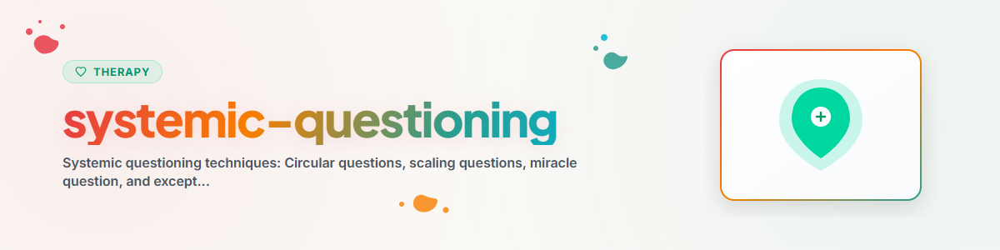

> **Français** — Version française officielle de la compétence `systemic-questioning`.

# Techniques de questionnement systémique

## Fondement

Les techniques de questionnement systémique proviennent de la thérapie et du conseil systémiques. Elles visent à **élargir les perspectives**, **rendre les schémas visibles** et **ouvrir de nouvelles possibilités**. Elles sont orientées vers les solutions et les ressources — non centrées sur le problème.

Hypothèse centrale : **les problèmes ne naissent pas dans les personnes isolées, mais dans les relations et les schémas entre les personnes.**

---

## Types de questions

### 1. Questions circulaires

**Objectif :** stimuler le changement de perspective. La personne est invitée à se mettre à la place d'autrui et à percevoir les dynamiques relationnelles.

#### Structure de base
« À votre avis, comment [Personne X] voit-elle / ressent-elle / juge-t-elle cela ? »

#### Variantes

**Questions relationnelles :**
- « À votre avis, que pense votre partenaire lorsque vous vous mettez en retrait ? »
- « Comment votre meilleure amie décrirait-elle votre relation ? »
- « Si je demandais à votre frère quel est le plus gros problème dans la famille — que dirait-il ? »

**Questions de différence :**
- « Qui dans la famille souffre le plus de cette situation ? »
- « Qui remarque le changement en premier ? »
- « Avec qui avez-vous la relation la plus proche — avec votre mère ou votre père ? »

**Questions d'accord :**
- « Votre partenaire serait-il d'accord avec cela ? »
- « Qui dans votre entourage voit les choses comme vous ? »

**Questions de classement :**
- « Si vous classiez les membres de votre famille selon leur capacité à gérer les conflits — quel serait l'ordre ? »

---

### 2. Questions d'échelle

**Objectif :** rendre mesurables des états abstraits, rendre les progrès visibles, concrétiser les objectifs. Développées par **Steve de Shazer** et **Insoo Kim Berg**.

#### Structure de base
« Sur une échelle de 0 à 10, où 0 correspond à [pôle A] et 10 à [pôle B] — où vous situez-vous actuellement ? »

#### Variantes

**Échelle d'état :**
- « Sur une échelle de 0 à 10 — à quel point vous sentez-vous sous tension actuellement ? »
- « Où étiez-vous sur cette échelle la semaine dernière ? »

**Échelle de progression :**
- « Où étiez-vous sur cette échelle il y a un mois ? »
- « Qu'est-ce qui a contribué à vous faire passer de 3 à 5 ? »

**Échelle d'objectif :**
- « Où devriez-vous être sur l'échelle pour que ce soit "assez bien" ? »
- « Qu'est-ce qui serait différent si vous étiez un point plus haut ? »

**Échelle de confiance :**
- « Sur une échelle de 0 à 10, à quel point êtes-vous confiant(e) de pouvoir y arriver ? »
- « De quoi auriez-vous besoin pour être plus confiant(e) d'un point ? »

**Échelle relationnelle :**
- « Où votre partenaire évaluerait-il/elle votre relation sur cette échelle ? »

#### Questions de suivi (essentielles !)

- « Qu'est-ce qui fait que vous n'êtes pas à 0 ? » (activation des ressources)
- « Que faudrait-il qu'il se passe pour monter d'un point ? » (orientation solution par petits pas)
- « À quoi remarqueriez-vous que vous êtes à [valeur cible] ? » (concrétisation)

---

### 3. La question miracle

**Objectif :** clarifier les objectifs et vision de solution. Contourne la pensée focalisée sur le problème et active l'imagination des solutions. Développée par **Steve de Shazer**.

#### Formulation originale

> « Imaginez que vous alliez vous coucher ce soir et que vous vous endormiez. Et pendant votre sommeil, un miracle se produit. Le problème qui vous a amené ici est résolu. Mais vous ne le savez pas, parce que vous dormiez. À quoi remarqueriez-vous en premier demain matin que le miracle s'est produit ? »

#### Questions d'approfondissement

- « Qu'y aurait-il d'autre de différent ? »
- « Qui le remarquerait en premier ? »
- « Que remarquerait [partenaire/collègue/ami] de nouveau chez vous ? »
- « Que feriez-vous différemment ? »
- « Y a-t-il des moments où le miracle se produit déjà un tout petit peu ? »

#### Variantes courtes

- « Si le problème disparaissait demain — qu'est-ce qui changerait ? »
- « À quoi ressemblerait votre quotidien idéal ? »
- « Si tout était comme vous le souhaitez — que feriez-vous ? »

---

### 4. Questions d'exception

**Objectif :** identifier les moments où le problème N'apparaît PAS ou apparaît moins. Montre que la personne dispose déjà de ressources de solution.

#### Structure de base
« Quand est-ce différent ? Quand le problème n'apparaît-il pas ? »

#### Variantes

- « Y a-t-il eu récemment des moments où cela allait mieux ? »
- « Qu'y avait-il de différent dans ces moments-là ? »
- « Qu'avez-VOUS fait de différent dans ces moments-là ? »
- « Qui était présent ? Quel était le cadre ? »
- « Comment avez-vous réussi à ce que ce soit mieux à ce moment-là ? »
- « Que faudrait-il qu'il se passe pour que ces exceptions deviennent plus fréquentes ? »

---

### 5. Questions hypothétiques

**Objectif :** ouvrir de nouveaux espaces de réflexion, assouplir les croyances rigides, explorer des options d'action.

#### Variantes

- « Supposons que vous essayiez simplement — que pourrait-il arriver de mieux ? »
- « Que se passerait-il si vous faisiez l'inverse de ce que vous faites d'habitude ? »
- « Si vous deviez conseiller quelqu'un dans la même situation — que lui diriez-vous ? »
- « Si la peur n'entrait pas en ligne de compte — que feriez-vous ? »
- « Si vous regardiez cette journée avec 5 ans de recul — quel conseil vous donneriez-vous ? »

---

### 6. Questions d'aggravation (intervention paradoxale)

**Objectif :** renforcer le sentiment de maîtrise. Si quelqu'un peut décrire comment aggraver le problème, il a manifestement une prise dessus — et peut aussi l'améliorer.

#### Variantes

- « Que pourriez-vous faire pour que cela empire à coup sûr ? »
- « Comment pourriez-vous vous y prendre pour que la dispute dégénère ? »
- « Que faudrait-il qu'il se passe pour que tout tourne complètement mal ? »

**Important :** cette technique NE convient PAS en cas de crise aiguë, de suicidalité ou de dépression sévère.

---

## Sélection sensible au contexte

| Situation | Technique recommandée | Justification |
|---|---|---|
| La personne est bloquée dans le problème | Question miracle | Sort de la transe du problème |
| Progression peu visible | Questions d'échelle | Rend les petits pas mesurables |
| Conflits relationnels | Questions circulaires | Permet le changement de perspective |
| « C'est TOUJOURS comme ça » | Questions d'exception | Brise la généralisation |
| Peur du changement | Questions hypothétiques | Permet une simulation mentale sans risque |
| Impuissance / perte de contrôle | Questions d'aggravation | Montre sa propre capacité d'influence |
| Objectifs flous | Question miracle + échelle | Clarifie la direction et le point de départ |

---

## Combinaisons

Les questions systémiques déploient toute leur force lorsqu'elles sont combinées :

### Schéma : Échelle + Exception + Petit pas

1. « Sur une échelle de 0 à 10, où êtes-vous maintenant ? » -> ex. « 4 »
2. « Qu'est-ce qui fait que vous n'êtes pas à 0 ? » (Ressources !)
3. « Y a-t-il eu des moments où vous étiez à 5 ou plus ? » (Exceptions !)
4. « Qu'est-ce qui était différent alors ? » (Repérer les schémas !)
5. « Quel serait le plus petit pas pour passer de 4 à 5 ? » (Action !)

### Schéma : Question miracle + Circulaire + Échelle

1. Poser la question miracle (créer une image-objectif)
2. « Qui le remarquerait en premier ? » (Circulaire — contexte relationnel)
3. « Où en êtes-vous déjà sur le chemin du miracle ? » (Échelle — progression)

### Schéma : Circulaire + Hypothétique

1. « À votre avis, comment votre responsable voit-il la situation ? »
2. « Supposons qu'il dise exactement ce que vous supposez — que pourriez-vous faire alors ? »

---

## À faire et à éviter (Dos and Don'ts)

### À faire
- **Poser des questions ouvertes** — aucune question suggestive
- **Rester curieux** — la réponse a plus de valeur que la question
- **Laisser des silences** — les bonnes questions demandent du temps
- **Rebondir sur les réponses** — la relance compte plus que la technique suivante
- **Formuler avec bienveillance** — « Qu'avez-vous réussi ? » plutôt que « Qu'avez-vous mal fait ? »

### À éviter
- **Ne pas interroger comme un interrogatoire** — max. 2–3 questions d'affilée, puis refléter
- **Pas en crise aiguë** — stabiliser d'abord, explorer ensuite
- **Pas comme manipulation** — les questions doivent témoigner d'une curiosité authentique
- **Pas de questions d'aggravation en cas de suicidalité** — jamais

---

## Lignes directrices éthiques

Un assistant IA peut poser des questions systémiques pour stimuler la réflexion et l'élargissement des perspectives.

Un assistant IA ne doit PAS :
- Utiliser les questions systémiques comme instrument diagnostique
- Mener un conseil conjugal ou relationnel se substituant à une thérapie professionnelle
- Travailler uniquement par questions en cas de crise aiguë — stabiliser d'abord
- Employer des questions d'aggravation dans des états de grande fragilité

Voir : [ETHICS.md](../ETHICS.md)

---

## Références bibliographiques

- de Shazer, S. (1985). *Keys to Solution in Brief Therapy.*
- Selvini Palazzoli, M. et al. (1981). *Hypothetisieren -- Zirkularitaet -- Neutralitaet.*
- Schlippe, A. von & Schweitzer, J. (2012). *Lehrbuch der systemischen Therapie und Beratung.*
- Berg, I. K. & Dolan, Y. (2001). *Tales of Solutions.*

---

*Porté depuis BACH v3.8.0 | Version autonome*

## Journal des modifications

### 1.0.1 (2026-11-22)
- Mention linguistique corrigée.
