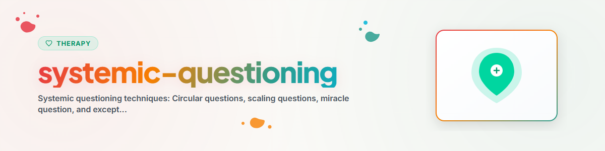

# Técnicas de Perguntas Sistêmicas

## Fundamentação

As técnicas de perguntas sistêmicas provêm da terapia e do aconselhamento sistêmicos. Elas visam a **ampliar perspectivas**, **tornar padrões visíveis** e **abrir novas possibilidades**. São orientadas para soluções e recursos — e não centradas no problema.

Premissa central: **os problemas não surgem nas pessoas, mas nas relações e nos padrões entre as pessoas.**

---

## Tipos de Perguntas

### 1. Perguntas Circulares

**Objetivo:** estimular a mudança de perspectiva. A pessoa é convidada a colocar-se no lugar de outras e a reconhecer padrões relacionais.

#### Estrutura básica
"O que você acha que [Pessoa X] percebe/sente/avalia?"

#### Variantes

**Perguntas sobre relações:**
- "O que você acha que seu parceiro pensa quando você se retrai?"
- "Como sua melhor amiga descreveria o relacionamento de vocês?"
- "Se eu perguntasse ao seu irmão qual é o maior problema da família — o que ele diria?"

**Perguntas de diferença:**
- "Quem na família sofre mais com a situação?"
- "Quem percebe a mudança primeiro?"
- "Com quem você tem um vínculo mais próximo — com sua mãe ou com seu pai?"

**Perguntas de concordância:**
- "Seu parceiro concordaria com isso?"
- "Quem no seu círculo vê a situação de forma semelhante a você?"

**Perguntas de classificação:**
- "Se você ordenasse os membros da sua família segundo quem lida melhor com conflitos — como seria essa ordem?"

---

### 2. Perguntas de Escalonamento

**Objetivo:** tornar mensuráveis estados abstratos, tornar visíveis os progressos e concretizar objetivos. Desenvolvidas por **Steve de Shazer** e **Insoo Kim Berg**.

#### Estrutura básica
"Em uma escala de 0 a 10, em que 0 é [Polo A] e 10 é [Polo B] — onde você está agora?"

#### Variantes

**Escalonamento do estado:**
- "Em uma escala de 0 a 10 — quão sobrecarregado você se sente agora?"
- "Em que ponto da escala você estava na semana passada?"

**Escalonamento do progresso:**
- "Em que ponto desta escala você estava há um mês?"
- "O que contribuiu para que você passasse de um 3 para um 5?"

**Escalonamento de objetivo:**
- "Em que ponto da escala você precisaria estar para que fosse 'bom o suficiente'?"
- "O que seria diferente se você estivesse um ponto acima?"

**Escalonamento de confiança/segurança:**
- "Em uma escala de 0 a 10, quão confiante você está de que consegue fazer isso?"
- "O que você precisaria para se sentir um ponto mais confiante?"

**Escalonamento relacional:**
- "Em que ponto da escala seu parceiro avaliaria o relacionamento de vocês?"

#### Perguntas de acompanhamento (essenciais!)

- "O que levou você a não estar em 0?" (ativação de recursos)
- "O que precisaria acontecer para você subir um ponto?" (orientação a soluções em pequenos passos)
- "Como você perceberia que está no valor-alvo?" (concretização)

---

### 3. A Pergunta do Milagre

**Objetivo:** esclarecer objetivos e criar uma visão de solução. Contorna o pensamento centrado no problema e ativa a imaginação de soluções. Desenvolvida por **Steve de Shazer**.

#### Formulação original

> "Imagine que você vai dormir hoje à noite e adormece. E, enquanto você dorme, acontece um milagre. O problema que trouxe você até aqui está resolvido. Mas você não sabe, porque estava dormindo. Como você perceberia amanhã de manhã, logo de início, que o milagre aconteceu?"

#### Perguntas de aprofundamento

- "O que mais seria diferente?"
- "Quem notaria isso primeiro?"
- "O que [parceiro/colega/amigo] notaria de novo em você?"
- "O que você faria de maneira diferente?"
- "Há momentos em que o milagre já acontece um pouquinho?"

#### Variantes abreviadas

- "Se o problema desaparecesse amanhã — o que seria diferente?"
- "Como seria o seu dia a dia ideal?"
- "Se tudo fosse como você deseja — o que você faria?"

---

### 4. Perguntas de Exceção

**Objetivo:** identificar momentos em que o problema NÃO ocorre ou ocorre menos. Mostra que a pessoa já dispõe de recursos para a solução.

#### Estrutura básica
"Quando é diferente? Quando o problema não aparece?"

#### Variantes

- "Houve, recentemente, momentos em que as coisas estavam melhores?"
- "O que foi diferente nesses momentos?"
- "O que VOCÊ fez de diferente nesses momentos?"
- "Quem estava presente? Como era o ambiente?"
- "Como você conseguiu que, naquele momento, as coisas estivessem melhores?"
- "O que precisaria acontecer para que essas exceções se tornassem mais frequentes?"

---

### 5. Perguntas Hipotéticas

**Objetivo:** abrir espaços de pensamento, flexibilizar convicções rígidas e testar opções de ação.

#### Variantes

- "Suponha que você simplesmente experimentasse — o que poderia acontecer no melhor dos casos?"
- "O que aconteceria se você fizesse o oposto do que normalmente faz?"
- "Se você desse um conselho a alguém que está na mesma situação — o que diria?"
- "Se o medo não tivesse peso algum — o que você faria?"
- "Se você olhasse para hoje daqui a 5 anos — que conselho se daria?"

---

### 6. Perguntas de Agravamento (Intervenção Paradoxal)

**Objetivo:** fortalecer a convicção de controle. Quando alguém consegue descrever como poderia agravar o problema, evidentemente tem influência sobre ele — e também pode melhorá-lo.

#### Variantes

- "O que você poderia fazer para que isso fique garantidamente pior?"
- "Como você poderia fazer para que a discussão escalasse?"
- "O que precisaria acontecer para que tudo desse completamente errado?"

**Importante:** esta técnica NÃO é adequada em crises agudas, suicidalidade ou depressão grave.

---

## Seleção Sensível ao Contexto

| Situação | Técnica de pergunta recomendada | Justificativa |
|---|---|---|
| A pessoa está presa ao problema | Pergunta do milagre | Tira da transe do problema |
| Progresso não visível | Perguntas de escalonamento | Torna pequenos passos mensuráveis |
| Conflitos relacionais | Perguntas circulares | Possibilita mudança de perspectiva |
| "É SEMPRE assim" | Perguntas de exceção | Rompe a generalização |
| Medo de mudança | Perguntas hipotéticas | Possibilita testar ideias sem risco |
| Impotência / perda de controle | Perguntas de agravamento | Mostra a própria influência |
| Objetivos pouco claros | Pergunta do milagre + escalonamento | Esclarece direção e ponto de partida |

---

## Combinações

As perguntas sistêmicas desenvolvem todo o seu efeito quando combinadas:

### Padrão: Escalonamento + Exceção + Pequeno passo

1. "Em uma escala de 0 a 10, onde você está agora?" -> por exemplo, "4"
2. "O que levou você a não estar em 0?" (Recursos!)
3. "Houve momentos em que você esteve em 5 ou mais?" (Exceções!)
4. "O que foi diferente ali?" (Reconhecer padrões!)
5. "Qual seria o menor passo para ir de 4 a 5?" (Ação!)

### Padrão: Pergunta do milagre + Circular + Escalonamento

1. Fazer a pergunta do milagre (gerar a imagem-alvo)
2. "Quem notaria isso primeiro?" (Circular — contexto relacional)
3. "Até que ponto você já percorreu o caminho para o milagre?" (Escalonamento — progresso)

### Padrão: Circular + Hipotética

1. "O que você acha que seu chefe pensa sobre a situação?"
2. "Supondo que ele dissesse exatamente o que você imagina — o que você poderia fazer então?"

---

## Recomendações e Restrições

### Recomendações
- **Perguntar de forma aberta** — sem perguntas sugestivas
- **Manter a curiosidade** — a resposta é mais valiosa do que a pergunta
- **Deixar pausas** — boas perguntas precisam de tempo
- **Retomar as respostas** — o acompanhamento é mais importante do que a técnica seguinte
- **Formular com apreço** — "O que você conseguiu?" em vez de "O que você fez de errado?"

### Restrições
- **Não perguntar de forma inquisitória** — no máximo 2 a 3 perguntas seguidas, depois refletir
- **Não usar em crise aguda** — primeiro estabilizar, depois explorar
- **Não usar como manipulação** — as perguntas precisam ser autenticamente curiosas
- **Nunca usar perguntas de agravamento em caso de suicidalidade**

---

## Diretrizes Éticas

Um assistente de IA pode fazer perguntas sistêmicas para promover reflexão e ampliação de perspectiva.

Um assistente de IA NÃO pode:
- Usar perguntas sistêmicas como instrumento diagnóstico
- Conduzir aconselhamento relacional que substitua a terapia profissional
- Trabalhar exclusivamente com perguntas em crise aguda — primeiro a estabilização
- Empregar perguntas de agravamento em estados frágeis

Ver: [ETHICS.md](../ETHICS.md)

---

## Referências

- de Shazer, S. (1985). *Keys to Solution in Brief Therapy.*
- Selvini Palazzoli, M. et al. (1981). *Hypothetisieren — Zirkularitaet — Neutralitaet.*
- Schlippe, A. von & Schweitzer, J. (2012). *Lehrbuch der systemischen Therapie und Beratung.*
- Berg, I. K. & Dolan, Y. (2001). *Tales of Solutions.*

---

*Portado do BACH v3.8.0 | Versão standalone*
