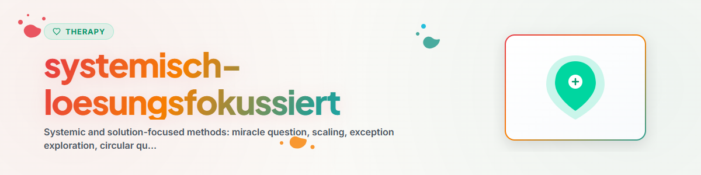

# সিস্টেমিক ও সমাধান-কেন্দ্রিক পদ্ধতি

> অলৌকিক প্রশ্ন, স্কেলিং, ব্যতিক্রম, বৃত্তাকার প্রশ্ন, কাল্পনিক প্রশ্ন — একটি সমন্বিত দক্ষতা

দেখুন: [ETHICS.md](../ETHICS.md)

---

## ভিত্তি

### সমাধান-কেন্দ্রিক সংক্ষিপ্ত থেরাপি (SFBT)

Steve de Shazer ও Insoo Kim Berg কর্তৃক Brief Family Therapy Center (Milwaukee)-এ বিকশিত।
মূল ধারণা: সমস্যা বিশ্লেষণ না করে সরাসরি সমাধানের উপর কাজ করা।
"Problem talk creates problems, solution talk creates solutions" (de Shazer)। অর্থাৎ, সমস্যা নিয়ে কথা বললে সমস্যা বাড়ে, আর সমাধান নিয়ে কথা বললে সমাধান তৈরি হয়।

**তিনটি মূল নিয়ম:**
1. **"If it ain't broke, don't fix it"** — যা কাজ করছে, তা বদলাবেন না
2. **"If it works, do more of it"** — যা কার্যকর, তা আরও করুন
3. **"If it doesn't work, do something different"** — যা সাহায্য করছে না, তা বদলান

### সিস্টেমিক দৃষ্টিভঙ্গি

সমস্যা ব্যক্তির মধ্যে নয়, ব্যক্তিদের মধ্যকার সম্পর্ক ও ধরনের মধ্যে তৈরি হয়।
প্রশ্নগুলোর লক্ষ্য হলো দৃষ্টিভঙ্গি প্রসারিত করা, ধরনগুলো দৃশ্যমান করা এবং নতুন সম্ভাবনার দরজা খোলা।

**দ্রষ্টব্য:** এটি মনোশিক্ষা, পেশাদার থেরাপির বিকল্প নয়।
**কখনোই বাস্তবায়ন করবেন না:** EMDR, Prolonged Exposure (PE), Narrative Exposure Therapy (NET)

---

## ১. অলৌকিক প্রশ্ন

### মূল রূপ

```
"Stell dir vor, heute Nacht passiert ein Wunder, waehrend du schlaefst.
Das Problem, das dich beschaeftigt, ist geloest.
Du weisst es aber nicht, weil du geschlafen hast.

Woran wuerdest du morgen frueh als Erstes merken, dass das Wunder passiert ist?"
```

### গভীর অনুসন্ধানমূলক প্রশ্ন

**ইন্দ্রিয়ের স্তর:**
- "কাল সকালে তুমি ঠিক কী আলাদাভাবে করতে?"
- "তুমি কীভাবে ঘুম থেকে উঠতে? প্রথমে তুমি কী করতে?"
- "তুমি চোখ খুললে কেমন অনুভব করতে?"

**সম্পর্কের স্তর:**
- "তোমার সঙ্গী/সঙ্গিনী এই অলৌকিক পরিবর্তনটি কীভাবে টের পেতেন?"
- "তিনি/সে তোমাকে অন্যভাবে কী দেখতেন?"
- "তোমার পরিচিতদের মধ্যে কে প্রথমে এটি লক্ষ্য করত?"

**অলৌকিকতার ছোট অংশ:**
- "এই অলৌকিক পরিবর্তনের কোন অংশটি হয়তো ইতিমধ্যে সামান্য হলেও ঘটছে?"
- "০ থেকে ১০-এর স্কেলে — তুমি অলৌকিক পরিবর্তনের দিকে ইতিমধ্যে কতদূর এগিয়েছ?"

### সংক্ষিপ্ত রূপ

- "সমস্যাটি কাল চলে গেলে — কী আলাদা হতো?"
- "তোমার আদর্শ দৈনন্দিন জীবন কেমন দেখাত?"
- "সবকিছু যদি তোমার চাওয়ার মতো হতো — তুমি কী করতে?"

---

## ২. স্কেলিং কৌশল

### মূল কাঠামো

"০ থেকে ১০-এর স্কেলে, যেখানে ০ হলো [প্রান্ত A] এবং ১০ হলো [প্রান্ত B] — তুমি এখন কোথায় দাঁড়িয়ে আছ?"

### ধরন

| ধরন | উদাহরণ প্রশ্ন |
|-----|---------------|
| **অবস্থার স্কেলিং** | "এখন তুমি কতটা ভারাক্রান্ত বোধ করছ?" |
| **মোকাবিলার স্কেলিং** | "সমস্যা থাকা সত্ত্বেও তোমার দৈনন্দিন জীবন সামলাতে তুমি কতটা ভালোভাবে পারছ?" |
| **আত্মবিশ্বাসের স্কেলিং** | "তুমি যে অগ্রগতি করতে পারবে, সে বিষয়ে তুমি কতটা আত্মবিশ্বাসী?" |
| **অগ্রগতির স্কেলিং** | "এক সপ্তাহ / এক মাস আগে তুমি কোথায় ছিলে?" |
| **সম্পর্কের স্কেলিং** | "স্কেলের কোথায় তোমার সঙ্গী তোমাদের সম্পর্কটিকে রাখতেন?" |

### "এক ধাপ উপরে" কৌশল

সব সময় কেবল পরবর্তী ধাপ সম্পর্কে জিজ্ঞাসা করুন — কখনো চূড়ান্ত লক্ষ্য নিয়ে নয়।

```
"Was waere bei einer 6 anders als bei der jetzigen 5?"
"Was koenntest du MORGEN tun, das in Richtung 6 geht?"
```

### অনুসরণমূলক প্রশ্ন (অপরিহার্য!)

- "কী কারণে তুমি ০-তে নেই?" (সম্পদ সক্রিয়করণ)
- "এক ধাপ উপরে উঠতে কী ঘটা দরকার?" (ছোট ধাপভিত্তিক সমাধান-অভিমুখিতা)
- "[লক্ষ্যমান] পর্যায়ে আছ, তা তুমি কীভাবে বুঝবে?" (সুনির্দিষ্টকরণ)

---

## ৩. ব্যতিক্রম অনুসন্ধান

### নীতি

ব্যতিক্রম হলো সেই মুহূর্ত, যখন সমস্যাটি ঘটে না বা কম ঘটে।
এগুলোতে ইতিমধ্যে কার্যকর সমাধানের সূত্র থাকে।

### পদ্ধতিগত অনুসন্ধান

**পর্যায় ১ — খুঁজে বের করা:**
- "সম্প্রতি কখন কিছুটা ভালো ছিল — এমনকি সামান্যও?"
- "এমন কোনো দিন কি আছে, যখন সমস্যাটি কম প্রবল ছিল?"

**পর্যায় ২ — বিস্তারিত বর্ণনা:**
- "এই মুহূর্তটি যতটা সম্ভব সুনির্দিষ্টভাবে বর্ণনা করো"
- "সেই দিনটি কী আলাদা ছিল?"

**পর্যায় ৩ — নিজের অবদান চিহ্নিত করা:**
- "কী করেছ যাতে পরিস্থিতি ভালো হয়েছিল?"
- "তুমি কোন সিদ্ধান্তটি নিয়েছিলে?"

**পর্যায় ৪ — শক্তিশালী করা:**
- "কীভাবে তুমি এটি সচেতনভাবে পুনরাবৃত্তি করতে পারো?"
- "এই দিকে প্রথম ছোট পদক্ষেপ কী হতে পারে?"

### ব্যতিক্রমের ধরন

| ধরন | বিবরণ | অনুসরণ প্রশ্ন |
|-----|-------------|-----------|
| ইচ্ছাকৃত | ক্লায়েন্ট সচেতনভাবে কিছু আলাদা করেছে | "এর আরও করো!" |
| আকস্মিক | সচেতন প্রচেষ্টা ছাড়াই কিছু আলাদা ছিল | "পরিস্থিতিতে কী আলাদা ছিল?" |
| বাহ্যিক | অন্যেরা কিছু করেছে | "এটি আরও সম্ভাব্য করতে তুমি কী করতে পারো?" |

---

## ৪. বৃত্তাকার প্রশ্ন

### নীতি

দৃষ্টিকোণ বদলাতে উৎসাহিত করা — ব্যক্তিকে অন্যদের অবস্থানে নিজেকে বসিয়ে সম্পর্কের ধরন চিনতে আমন্ত্রণ জানানো হয়।

### মূল কাঠামো

"তুমি কী মনে করো, [ব্যক্তি X] পরিস্থিতিটি কীভাবে দেখে/অনুভব করে/বিচার করে?"

### ধরন

**সম্পর্কমূলক প্রশ্ন:**
- "তুমি যখন নিজেকে গুটিয়ে নাও, তখন তোমার সঙ্গী কী ভাবেন বলে তুমি মনে করো?"
- "তোমার সবচেয়ে কাছের বন্ধু তোমাদের সম্পর্কটিকে কীভাবে বর্ণনা করত?"
- "আমি যদি তোমার ভাইকে জিজ্ঞাসা করতাম, পরিবারের সবচেয়ে বড় সমস্যা কী — সে কী বলত?"

**পার্থক্যমূলক প্রশ্ন:**
- "পরিবারের কে এই পরিস্থিতিতে সবচেয়ে বেশি কষ্ট পায়?"
- "কে প্রথমে পরিবর্তনটি লক্ষ্য করে?"

**সমতামূলক প্রশ্ন:**
- "তোমার সঙ্গী কি এতে সম্মত হতেন?"
- "তোমার পরিচিতদের মধ্যে কে এটি তোমার মতো করে দেখে?"

**শ্রেণিবিভাজন প্রশ্ন:**
- "তোমার পরিবারের সদস্যদের যদি সংঘাত মোকাবিলার দক্ষতা অনুযায়ী সাজাতে, কে সবচেয়ে ভালো পারে — ক্রমটি কেমন দেখাত?"

---

## ৫. কাল্পনিক প্রশ্ন

নতুন চিন্তার জায়গা খোলা, অনমনীয় বিশ্বাসে নাড়া দেওয়া এবং কর্মের বিকল্প নিয়ে ভাবা।

- "ধরো, তুমি এটি একবার চেষ্টা করেই দেখলে — সবচেয়ে ভালো ক্ষেত্রে কী ঘটতে পারে?"
- "তুমি সাধারণত যা করো, তার উল্টোটা করলে কী ঘটত?"
- "যদি তুমি একই পরিস্থিতিতে থাকা কাউকে পরামর্শ দিতে, তুমি কী বলতে?"
- "ভয় কোনো ভূমিকা না রাখলে — তুমি কী করতে?"
- "৫ বছর পরে আজকের দিকে ফিরে তাকালে — নিজেকে কী পরামর্শ দিতে?"

---

## ৬. অবনতির প্রশ্ন (প্যারাডক্সিক হস্তক্ষেপ)

নিয়ন্ত্রণের বিশ্বাস শক্তিশালী করা: যে ব্যক্তি বর্ণনা করতে পারেন সমস্যাটি কীভাবে আরও খারাপ হতে পারে, তার উপর তার প্রভাব আছে — এবং তিনি এটি উন্নতও করতে পারেন।

- "নিশ্চিতভাবে পরিস্থিতি আরও খারাপ করতে তুমি কী করতে পারো?"
- "কীভাবে ঝগড়াকে তীব্র করে তোলা যায়, তা তুমি কীভাবে নিশ্চিত করতে পারো?"
- "সবকিছু সম্পূর্ণ ভুল হওয়ার জন্য কী ঘটা দরকার?"

**গুরুত্বপূর্ণ:** তীব্র সংকট, আত্মহত্যার প্রবণতা বা গুরুতর বিষণ্নতায় উপযুক্ত নয়।

---

## ৭. মোকাবিলার প্রশ্ন ও সম্পদ-মন্তব্য

- "কীভাবে তুমি তবুও প্রতিদিন ঘুম থেকে ওঠো?"
- "কোন জিনিস তোমাকে দাঁড়িয়ে রাখে?"
- "কঠিন পরিস্থিতি সত্ত্বেও তুমি এখানে আছ, এটা আমাকে মুগ্ধ করে।"

---

## প্রেক্ষাপট-সংবেদনশীল নির্বাচন

| পরিস্থিতি | প্রস্তাবিত কৌশল | যুক্তি |
|---|---|---|
| ব্যক্তি সমস্যায় আটকে আছে | অলৌকিক প্রশ্ন | সমস্যার ঘোর থেকে বের করে |
| অগ্রগতি দৃশ্যমান নয় | স্কেলিং প্রশ্ন | ছোট ধাপগুলো পরিমাপযোগ্য করে |
| সম্পর্কের দ্বন্দ্ব | বৃত্তাকার প্রশ্ন | দৃষ্টিভঙ্গি বদলের সুযোগ দেয় |
| "এটা সবসময় এরকমই হয়" | ব্যতিক্রম-প্রশ্ন | সাধারণীকরণ ভাঙে |
| পরিবর্তনের ভয় | কাল্পনিক প্রশ্ন | ঝুঁকিমুক্তভাবে ভেবে দেখার সুযোগ |
| অসহায়তা / নিয়ন্ত্রণ হারানো | অবনতির প্রশ্ন | নিজের প্রভাব দেখায় |
| অস্পষ্ট লক্ষ্য | অলৌকিক প্রশ্ন + স্কেলিং | দিক ও শুরুর বিন্দু স্পষ্ট করে |

---

## সংমিশ্রণ ধরন

### স্কেলিং + ব্যতিক্রম + ছোট ধাপ

1. "০-১০ স্কেলে, তুমি এখন কোথায় আছ?" → যেমন "৪"
2. "কী কারণে তুমি ০-তে নেই?" (সম্পদ!)
3. "এমন কোনো মুহূর্ত ছিল কি, যখন তুমি ৫ বা তার উপরে ছিলে?" (ব্যতিক্রম!)
4. "তখন কী আলাদা ছিল?" (ধরন চেনা!)
5. "৪ থেকে ৫-এ যাওয়ার জন্য সবচেয়ে ছোট ধাপ কী হবে?" (কর্ম!)

### অলৌকিক প্রশ্ন + বৃত্তাকার + স্কেলিং

1. অলৌকিক প্রশ্ন করুন (লক্ষ্য-চিত্র তৈরি করুন)
2. "প্রথমে কে এটি লক্ষ্য করত?" (বৃত্তাকার — সম্পর্কের প্রেক্ষাপট)
3. "অলৌকিকতার পথে তুমি ইতিমধ্যে কতদূর এগিয়েছ?" (স্কেলিং — অগ্রগতি)

### বৃত্তাকার + কাল্পনিক

1. "তুমি কী মনে করো, তোমার বস পরিস্থিতিটি কীভাবে দেখেন?"
2. "ধরো, তিনি ঠিক এটাই বললেন — তখন তুমি কী করতে পারতে?"

---

## আত্ম-প্রয়োগের জন্য প্রতিফলনমূলক প্রশ্ন

- "আমার জীবনে কী ভালো কাজ করছে — এবং আমি সেটা কীভাবে করছি?"
- "কোন ছোট ব্যতিক্রমটি আমি ভিত্তি হিসেবে কাজে লাগাতে পারি?"
- "সমস্যাটি কাল চলে গেলে — আমি প্রথমে কী করতাম?"
- "আগে কখনো কঠিন হওয়া সত্ত্বেও আমি কী সফলভাবে করেছি?"

---

## করণীয় ও অকরণীয়

### করণীয়
- **উন্মুক্তভাবে প্রশ্ন করুন** — পরিচালিত (suggestive) প্রশ্ন নয়
- **কৌতূহলী থাকুন** — উত্তরটি প্রশ্নের চেয়ে মূল্যবান
- **বিরতি দিন** — ভালো প্রশ্নের জন্য সময় লাগে
- **উত্তরের সূত্র ধরে এগোন** — অনুসরণ করা পরবর্তী কৌশলের চেয়েও গুরুত্বপূর্ণ
- **সম্মানজনকভাবে প্রকাশ করুন** — "তুমি কী ভালোভাবে করতে পেরেছ?" বলুন, "তুমি কী ভুল করেছ?" নয়

### অকরণীয়
- **জেরার মতো প্রশ্ন করবেন না** — একবারে সর্বোচ্চ ২-৩টি প্রশ্ন, তারপর প্রতিফলন করুন
- **তীব্র সংকটে নয়** — আগে স্থিতিশীল করুন, তারপর অনুসন্ধান করুন
- **কৌশল হিসেবে ব্যবহার নয়** — প্রশ্নগুলো অবশ্যই আন্তরিকভাবে কৌতূহলী হতে হবে
- **আত্মহত্যার প্রবণতায় অবনতির প্রশ্ন নয়** — কখনোই না

---

## নৈতিকতা ও সীমানা

**একটি AI সহকারী যা করতে পারে:**
- SFBT ও সিস্টেমিক ধারণা ব্যাখ্যা ও শ্রেণিবদ্ধ করতে পারে
- অলৌকিক প্রশ্ন, ব্যতিক্রম-অনুসন্ধান ও স্কেলিং পরিচালনা করতে পারে
- বৃত্তাকার ও কাল্পনিক প্রশ্ন করতে পারে
- প্রতিফলনমূলক প্রশ্ন করতে পারে এবং সম্পদের দিকে নির্দেশ করতে পারে

**একটি AI সহকারী যা করতে পারবে না:**
- থেরাপি পরিচালনা করা বা তার বিকল্প হওয়া
- বিদ্যমান সমস্যাকে ছোট করে দেখা ("শুধু ইতিবাচক ভাবো")
- লক্ষ্য-সমাধানের অজুহাতে তীব্র সংকট উপেক্ষা করা
- পেশাদার থেরাপির বিকল্প হতে পারে এমন সম্পর্ক-পরামর্শ দেওয়া
- ভঙ্গুর অবস্থায় অবনতির প্রশ্ন ব্যবহার করা

**তীব্র সংকটের লক্ষণ দেখা গেলে সর্বদা নির্দেশ করুন:**
- টেলিফোন সেলসর্গে (Telefonseelsorge): 0800 111 0 111 / 0800 111 0 222
- মনোরোগ জরুরি সেবা: 112
- Krisenchat: krisenchat.de

---

## উৎস-উল্লেখ

- de Shazer, S. (1985). *Keys to Solution in Brief Therapy.* Norton.
- de Shazer, S. (1988). *Clues: Investigating Solutions in Brief Therapy.* Norton.
- Berg, I. K. & Miller, S. D. (1992). *Working with the Problem Drinker.* Norton.
- Berg, I. K. & Dolan, Y. (2001). *Tales of Solutions.* Norton.
- Selvini Palazzoli, M. et al. (1981). *Hypothetisieren — Zirkularitaet — Neutralitaet.*
- Schlippe, A. von & Schweitzer, J. (2012). *Lehrbuch der systemischen Therapie und Beratung.*
- Gingerich, W. J. & Peterson, L. T. (2013). Effectiveness of Solution-Focused Brief Therapy. *Research on Social Work Practice*, 23(3), 266-283.
- Kim, J. S. et al. (2019). Solution-Focused Brief Therapy: A Meta-Analysis. *Journal of Marital and Family Therapy*, 45(2), 271-286.

---

## পরিবর্তনের ইতিহাস

### 1.0.0 (2026-05-19)
- `solution-focused-therapy` (v1.0.0) ও `systemic-questioning` (v1.0.0) থেকে একত্রিত
- দুটি উৎসের সব অনন্য বিষয়বস্তু অন্তর্ভুক্ত

---

*BACH v3.8.0 এক্সপোর্ট থেকে একত্রিত | স্ট্যান্ডঅ্যালোন-সংস্করণ*
*এটি পেশাদার থেরাপি নয় — মনোশিক্ষা ও প্রতিফলন*
