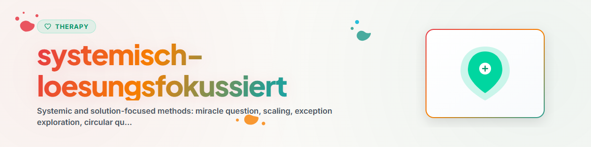

> **Français** — Version française officielle de la compétence `systemisch-loesungsfokussiert`.

# Méthodes systémiques et orientées solutions

> Question du miracle, graduation, exceptions, questions circulaires, questions hypothétiques — une compétence intégrée

Voir : [ETHICS.md](../ETHICS.md)

---

## Fondements

### Thérapie brève orientée solutions (TBOS / SFBT)

Développée par Steve de Shazer et Insoo Kim Berg au Brief Family Therapy Center (Milwaukee).
Idée centrale : au lieu d'analyser les problèmes, travailler directement aux solutions.
« Problem talk creates problems, solution talk creates solutions » (de Shazer).

**Les trois règles de base :**
1. **« If it ain't broke, don't fix it »** — Ce qui fonctionne, ne pas le changer
2. **« If it works, do more of it »** — Ce qui marche, le renforcer
3. **« If it doesn't work, do something different »** — Ce qui n'aide pas, le modifier

### Perspective systémique

Les problèmes ne naissent pas dans les individus, mais dans les relations et les schémas entre les personnes. Les questions visent à élargir les perspectives, à rendre les schémas visibles et à ouvrir de nouvelles possibilités.

**Remarque :** Il s'agit de psychoéducation, pas d'un substitut à une thérapie professionnelle.
**Ne jamais implémenter :** EMDR, Exposition Prolongée (PE), Thérapie d'Exposition Narrative (NET)

---

## 1. La question du miracle

### Forme de base

```
« Imagine que cette nuit un miracle se produise pendant que tu dors.
Le problème qui te préoccupe est résolu.
Mais tu ne le sais pas, parce que tu as dormi.

À quoi remarquerais-tu demain matin en tout premier lieu que le miracle a eu lieu ? »
```

### Relances d'approfondissement

**Niveau sensoriel :**
- « Que ferais-tu exactement différemment demain matin ? »
- « Comment te lèverais-tu ? Que ferais-tu en premier ? »
- « Que ressentirais-tu en ouvrant les yeux ? »

**Niveau relationnel :**
- « À quoi ton/ta partenaire remarquerait-il/elle le miracle ? »
- « Que verrait-il/elle de différent chez toi ? »
- « Qui dans ton entourage le remarquerait en premier ? »

**Fragments du miracle :**
- « Quelle part de ce miracle se produit peut-être déjà un tout petit peu ? »
- « Sur une échelle de 0 à 10 — où en es-tu déjà sur le chemin du miracle ? »

### Variantes courtes

- « Si le problème disparaissait demain — qu'est-ce qui serait différent ? »
- « À quoi ressemblerait ton quotidien idéal ? »
- « Si tout était comme tu le souhaites — que ferais-tu ? »

---

## 2. Techniques de graduation (échelles)

### Structure de base

« Sur une échelle de 0 à 10, où 0 représente [pôle A] et 10 [pôle B] — où te situes-tu actuellement ? »

### Variantes

| Type | Exemple de question |
|------|---------------------|
| **Échelle d'état** | « À quel point te sens-tu accablé(e) en ce moment ? » |
| **Échelle d'adaptation** | « Comment parviens-tu, malgré le problème, à gérer ton quotidien ? » |
| **Échelle de confiance** | « À quel point es-tu confiant(e) dans ta capacité à faire des progrès ? » |
| **Échelle de progrès** | « Où te situais-tu il y a une semaine / un mois ? » |
| **Échelle relationnelle** | « Où ton/ta partenaire placerait-il/elle votre relation sur l'échelle ? » |

### L'astuce du « un point plus haut »

Ne jamais demander l'objectif final — toujours uniquement le point suivant.

```
« Qu'est-ce qui serait différent à 6 par rapport au 5 actuel ? »
« Que pourrais-tu faire DEMAIN qui aille en direction de 6 ? »
```

### Questions de suivi (essentielles !)

- « Qu'est-ce qui a permis que tu ne sois pas à 0 ? » (activation des ressources)
- « Que faudrait-il pour monter d'un point ? » (orientation solution par petits pas)
- « À quoi reconnaîtrais-tu que tu es à [valeur cible] ? » (concrétisation)

---

## 3. Exploration des exceptions

### Principe

Les exceptions sont les moments où le problème ne survient pas ou survient moins. Elles contiennent déjà des pistes de solution qui fonctionnent.

### Recherche systématique

**Phase 1 — Repérer :**
- « Quand cela s'est-il passé un peu mieux ces derniers temps — ne serait-ce que de façon minime ? »
- « Y a-t-il des jours où le problème se manifeste moins fortement ? »

**Phase 2 — Décrire en détail :**
- « Décris ce moment aussi précisément que possible »
- « Qu'y avait-il de différent ce jour-là ? »

**Phase 3 — Reconnaître sa propre contribution :**
- « Qu'as-TU fait pour que ce soit mieux ? »
- « Quelle décision as-tu prise ? »

**Phase 4 — Renforcer :**
- « Comment pourrais-tu répéter cela consciemment ? »
- « Quel serait un premier petit pas dans cette direction ? »

### Types d'exceptions

| Type | Description | Relance |
|------|-------------|---------|
| Intentionnelle | Le client a délibérément fait quelque chose différemment | « Fais-en davantage ! » |
| Fortuite | Quelque chose était différent sans action consciente | « Qu'est-ce qui était différent dans les circonstances ? » |
| Externe | D'autres personnes ont fait quelque chose | « Que pourrais-tu faire pour rendre cela plus probable ? » |

---

## 4. Questions circulaires

### Principe

Stimuler le changement de perspective — inviter la personne à se mettre à la place des autres et à repérer les schémas relationnels.

### Structure de base

« D'après toi, comment [Personne X] voit-elle / ressent-elle / juge-t-elle cela ? »

### Variantes

**Questions relationnelles :**
- « Que pense ton/ta partenaire d'après toi lorsque tu te mets en retrait ? »
- « Comment ta meilleure amie décrirait-elle votre relation ? »
- « Si je demandais à ton frère quel est le plus grand problème dans la famille — que dirait-il ? »

**Questions de différence :**
- « Qui dans la famille souffre le plus de la situation ? »
- « Qui remarque le changement en premier ? »

**Questions d'accord :**
- « Ton/ta partenaire serait-il/elle d'accord avec cela ? »
- « Qui dans ton entourage voit les choses de manière similaire à toi ? »

**Questions de classement :**
- « Si tu classais les membres de ta famille selon leur capacité à gérer les conflits — quel serait l'ordre ? »

---

## 5. Questions hypothétiques

Ouvrir de nouveaux espaces de pensée, assouplir les convictions rigides, explorer mentalement des options d'action.

- « Supposons que tu essaies simplement — que pourrait-il arriver de mieux ? »
- « Que se passerait-il si tu faisais l'inverse de ce que tu fais habituellement ? »
- « Si tu donnais un conseil à quelqu'un se trouvant dans la même situation — que dirais-tu ? »
- « Si la peur ne jouait aucun rôle — que ferais-tu ? »
- « En regardant aujourd'hui dans 5 ans — quel conseil te donnerais-tu ? »

---

## 6. Questions d'aggravation (intervention paradoxale)

Renforcer le sentiment de contrôle : qui sait décrire comment aggraver le problème a une prise dessus — et peut aussi l'améliorer.

- « Que pourrais-tu faire pour que ce soit garanti d'empirer ? »
- « Comment pourrais-tu t'y prendre pour que la dispute dégénère ? »
- « Que faudrait-il qu'il arrive pour que tout tourne complètement mal ? »

**Important :** NE CONVIENT PAS en cas de crise aiguë, de suicidalité ou de dépression sévère.

---

## 7. Questions d'adaptation (Coping) et commentaires de ressources

- « Comment réussis-tu malgré tout à te lever chaque jour ? »
- « Qu'est-ce qui te permet de tenir ? »
- « Cela m'impressionne que tu sois là malgré les difficultés. »

---

## Choix adapté au contexte

| Situation | Technique recommandée | Justification |
|---|---|---|
| Personne bloquée dans le problème | Question du miracle | Fait sortir de la transe du problème |
| Progrès non visibles | Questions de graduation | Rend visibles les petits pas |
| Conflits relationnels | Questions circulaires | Permet le changement de perspective |
| « C'est TOUJOURS comme ça » | Questions d'exception | Brise la généralisation |
| Peur du changement | Questions hypothétiques | Exploration mentale sans risque |
| Impuissance / perte de contrôle | Questions d'aggravation | Montre sa propre capacité d'influence |
| Objectifs flous | Question du miracle + graduation | Clarifie direction et point de départ |

---

## Modèles combinatoires

### Graduation + Exception + Petit pas

1. « Sur une échelle de 0 à 10, où te situes-tu actuellement ? » → par ex. « 4 »
2. « Qu'est-ce qui a permis que tu ne sois pas à 0 ? » (Ressources !)
3. « Y a-t-il eu des moments où tu étais à 5 ou plus ? » (Exceptions !)
4. « Qu'est-ce qui était différent alors ? » (Repérer les schémas !)
5. « Quel serait le plus petit pas pour passer de 4 à 5 ? » (Action !)

### Question du miracle + Circulaire + Graduation

1. Poser la question du miracle (générer l'image cible)
2. « Qui le remarquerait en premier ? » (Circulaire — contexte relationnel)
3. « Où en es-tu déjà sur le chemin du miracle ? » (Graduation — progrès)

### Circulaire + Hypothétique

1. « Comment penses-tu que ton supérieur voit la situation ? »
2. « Supposons qu'il dise exactement cela — que pourrais-tu faire alors ? »

---

## Questions de réflexion pour l'auto-application

- « Qu'est-ce qui fonctionne bien dans ma vie — et comment est-ce que je fais ? »
- « Quelle est une petite exception sur laquelle je pourrais m'appuyer ? »
- « Si le problème disparaissait demain — que ferais-je en tout premier lieu ? »
- « Qu'ai-je déjà réussi par le passé même si c'était difficile ? »

---

## À faire et à éviter (Dos and Don'ts)

### À faire
- **Poser des questions ouvertes** — pas de questions suggestives
- **Rester curieux** — la réponse a plus de valeur que la question
- **Laisser des silences** — les bonnes questions demandent du temps
- **Rebondir sur les réponses** — la relance compte plus que la technique suivante
- **Formuler avec estime** — « Qu'as-tu réussi ? » plutôt que « Qu'as-tu mal fait ? »

### À éviter
- **Ne pas mener d'interrogatoire** — max. 2 à 3 questions d'affilée, puis reformuler
- **Pas en cas de crise aiguë** — stabiliser d'abord, explorer ensuite
- **Ne pas manipuler** — les questions doivent naître d'une curiosité authentique
- **Pas de questions d'aggravation en cas de suicidalité** — jamais

---

## Éthique et limites

**Un assistant IA peut :**
- Expliquer et situer les concepts de TBOS/SFBT et systémiques
- Guider la question du miracle, l'exploration des exceptions et la graduation
- Poser des questions circulaires et hypothétiques
- Poser des questions de réflexion et mettre en évidence les ressources

**Un assistant IA ne doit PAS :**
- Mener ou remplacer une thérapie
- Minimiser des problèmes persistants (« Pense juste positif »)
- Passer outre des crises aiguës avec une orientation solution hâtive
- Donner des conseils relationnels remplaçant une thérapie professionnelle
- Utiliser des questions d'aggravation dans des états fragiles

**En cas de signe de crise aiguë, TOUJOURS orienter vers :**
- Telefonseelsorge : 0800 111 0 111 / 0800 111 0 222
- Urgences psychiatriques / secours : 112
- Krisenchat : krisenchat.de

---

## Références bibliographiques

- de Shazer, S. (1985). *Keys to Solution in Brief Therapy.* Norton.
- de Shazer, S. (1988). *Clues: Investigating Solutions in Brief Therapy.* Norton.
- Berg, I. K. & Miller, S. D. (1992). *Working with the Problem Drinker.* Norton.
- Berg, I. K. & Dolan, Y. (2001). *Tales of Solutions.* Norton.
- Selvini Palazzoli, M. et al. (1981). *Hypothetisieren — Zirkularitaet — Neutralitaet.*
- Schlippe, A. von & Schweitzer, J. (2012). *Lehrbuch der systemischen Therapie und Beratung.*
- Gingerich, W. J. & Peterson, L. T. (2013). Effectiveness of Solution-Focused Brief Therapy. *Research on Social Work Practice*, 23(3), 266-283.
- Kim, J. S. et al. (2019). Solution-Focused Brief Therapy: A Meta-Analysis. *Journal of Marital and Family Therapy*, 45(2), 271-286.

---

## Journal des modifications

### 1.0.1 (2026-11-22)
- Indication de langue corrigée

### 1.0.0 (2026-05-19)
- Fusion de `solution-focused-therapy` (v1.0.0) et `systemic-questioning` (v1.0.0)
- Intégration de tous les contenus uniques des deux sources

---

*Fusionné depuis des exports BACH v3.8.0 | Version autonome*
*Pas de thérapie professionnelle — Psychoéducation et réflexion*
