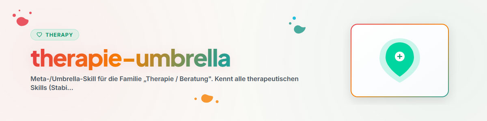

# थेरेपी / परामर्श — छत्र

## उद्देश्य

„थेरेपी / परामर्श" परिवार का प्रवेश-बिंदु। यह समग्र रूटिंग को एकत्र करता है और
विशेष मामलों के लिए उपयुक्त स्किल तक मार्गदर्शन करता है। तीन सक्रिय प्रवेश-बिंदु स्किल्स सामने की
परत बनाते हैं; उनके पीछे अपंजीकृत विशेष प्रक्रियाओं की एक लंबी पूंछ है, जो `code-skill-index`
(सूची `catalog-therapy.md`) के माध्यम से पहुँच योग्य है।

## सदस्य और रूटिंग

| स्किल | किसके लिए | कब इसे अन्य की जगह चुनें |
|-------|-------------------------------|-------------------------------|
| `/stabilization-techniques` | संकट-हस्तक्षेप, ग्राउंडिंग, सुरक्षित स्थान, PMR, घबराहट, सहनशीलता की खिड़की | तीव्र तनाव/संकट में **सबसे पहले** — पद्धति से पहले स्थिरीकरण |
| `/guideline-therapies-overview` | दिशानिर्देश-प्रक्रियाओं का अवलोकन: KVT, ACT, स्कीमा-थेरेपी, एक्सपोज़र, सिस्टमिक, गहराई-मनोविज्ञान | जब उपयुक्त **विधि** चुननी या समझानी हो |
| `/counseling-basics` | वार्तालाप-संचालन: सक्रिय श्रवण, प्रतिबिंबित करना, मान्यता देना, MI/OARS, चक्रीय प्रश्न | जब बात **बातचीत के तरीके** की हो, विधि की नहीं |
| (अपंजीकृत विशेष स्किल्स) | एकल प्रक्रियाएँ (जेनोग्राम, एक्सपोज़र-विवरण, सकारात्मक मनोविज्ञान, …) | जब किसी ठोस एकल प्रक्रिया की गहराई से आवश्यकता हो → `code-skill-index` के माध्यम से |

> रूटिंग-नियम: तीव्र संकट → `/stabilization-techniques` · विधि चुनना/समझाना →
> `/guideline-therapies-overview` · वार्तालाप-तकनीक → `/counseling-basics` · गहरी एकल प्रक्रिया →
> `code-skill-index` के माध्यम से अपंजीकृत विशेष स्किल।

## अच्छी तरह जुड़े संयोजन

- `/stabilization-techniques` (पहले, तीव्र) → `/guideline-therapies-overview` (बाद में, मध्यकालिक):
  पहले सुरक्षा/सहनशीलता की खिड़की स्थापित करें, फिर उपयुक्त दिशानिर्देश-प्रक्रिया चुनें।
- `/counseling-basics` **दोनों** के साथ चलता है — वार्तालाप-दृष्टिकोण (MI/OARS, मान्यता) स्थिरीकरण
  और विधि-कार्य दोनों में सहायक होता है।

## साझा परिपाटियाँ

- निदान स्थापित करने का स्थान न लें; मनोशिक्षा-आधारित और संसाधन-उन्मुख ढंग से कार्य करें।
- सहनशीलता की खिड़की मुख्य धुरी के रूप में: अति-उत्तेजना में पहले स्थिर करें, सामना न करें।
- लागू करने से पहले एकल स्किल्स की लाइव फ़ाइलें पढ़ें — यह छत्र कोई सामग्री पुनः प्रस्तुत नहीं करता।

## परिवर्तन-लॉग

### 0.1.0 (2026-06-17)
- प्रारंभिक संस्करण। थेरेपी / परामर्श परिवार के लिए ऑडिट-मोड (1c1) द्वारा निर्मित।
