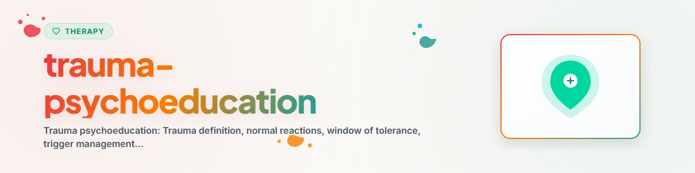

> **Français** — Version française officielle de la compétence `trauma-psychoeducation`.

# Psychoéducation sur le traumatisme

> Connaissances sur le trauma, les séquelles traumatiques et la fenêtre de tolérance : comprendre des réactions normales à des événements anormaux — pure psychoéducation, AUCUN traitement du traumatisme

Voir : [ETHICS.md](../ETHICS.md)

**Voir aussi :** [stabilization-techniques](../stabilization-techniques/SKILL.md) (ancrage, lieu sûr, mise à distance/containment — techniques immédiates) | [psychoeducation](../psychoeducation/SKILL.md) (TSPT dans le contexte d'autres troubles)

---

## Contexte

La psychoéducation sur le traumatisme aide les personnes concernées à comprendre et situer
leurs réactions. Savoir que des symptômes tels que flashbacks, hypervigilance ou évitement sont des
réactions NORMALES à des événements ANORMAUX soulage déjà et réduit la honte ainsi que
les auto-reproches.

Données probantes : la psychoéducation est un élément reconnu de la thérapie du trauma
(Flatten et al. 2011, recommandation S3 pour le TSPT). En tant qu'intervention isolée, elle ne suffit
pas, mais elle peut renforcer la motivation thérapeutique et atténuer les symptômes.

**IMPORTANT :** cette compétence transmet exclusivement des CONNAISSANCES sur le trauma.
Elle ne réalise AUCUN travail d'élaboration traumatique, n'explore AUCUN souvenir pénible
et ne pose AUCUNE question sur les détails du traumatisme.
**Ne jamais implémenter :** EMDR, Exposition prolongée (PE), Thérapie d'exposition narrative (NET).

---

## 1. Qu'est-ce qu'un traumatisme ?

### Définition

Un traumatisme est un événement qui dépasse les capacités d'adaptation d'une personne
et s'accompagne d'un vécu d'impuissance, de perte de contrôle et/ou de peur de mourir.
Ce n'est pas l'événement seul qui définit le trauma, mais le vécu subjectif.

### Types de traumatismes

| Type | Description | Exemples |
|------|-------------|----------|
| Type I (trauma unique) | Événement ponctuel et inattendu | Accident, agression, catastrophe naturelle |
| Type II (trauma complexe) | Traumatisation répétée et prolongée | Maltraitance, négligence, guerre |
| Trauma accidentel | Événements fortuits | Accident de la route, incendie, accident du travail |
| Trauma interpersonnel | Causé par des êtres humains | Violence, abus, torture |
| Trauma secondaire | Par exposition indirecte / témoignage | Professions d'aide, proches |

### Ce qui N'est PAS un trauma (délimitation)

Tout événement pénible n'est pas un traumatisme au sens clinique :
- Rupture, licenciement, dispute — éprouvant, mais en règle générale pas un trauma
- Harcèlement — peut avoir un effet traumatisant (surtout chez l'enfant), mais n'est pas automatiquement un trauma
- C'est l'évaluation individuelle qui prévaut, pas la nature abstraite de l'événement

---

## 2. Réactions normales à des événements anormaux

### Les trois schémas de réaction

```
HYPERACTIVATION (Hyperarousal)
- Vigilance et tension permanentes
- Sursauts faciles
- Troubles du sommeil
- Irritabilité, accès de colère
- Difficultés de concentration

REVIVISCENCE (Intrusion)
- Flashbacks (souvenirs ressentis comme réels dans l'instant)
- Cauchemars
- Souvenirs pénibles surgissant brusquement
- Réactions corporelles lors du rappel (tachycardie, sueurs)

ÉVITEMENT ET ENGOURDISSEMENT (Constriction)
- Évitement de lieux, personnes, situations
- Engourdissement émotionnel
- Retrait social
- Sentiment d'étrangeté ou de détachement
- Perte d'intérêt et de plaisir
```

### Message essentiel pour les personnes concernées

```
« Ces réactions sont des réactions NORMALES à des événements ANORMAUX.

Votre corps et votre esprit essaient de vous protéger.
La vigilance vous protège contre un nouveau danger.
Les souvenirs tentent de digérer ce qui a été vécu.
L'évitement vous protège contre le débordement.

Vous n'êtes pas "fou/folle". Vous n'êtes pas "faible".
Votre système nerveux réagit exactement comme il est programmé
pour réagir face à une menace extrême. »
```

### Évolution temporelle

```
ÉVOLUTION APRÈS UN ÉVÉNEMENT TRAUMATIQUE

0-4 semaines : Réaction aiguë de stress (NORMALE)
               - Choc, sidération, agitation
               - Troubles du sommeil, réactions de sursaut
               - Flashbacks, cauchemars
               - Chez la majorité des personnes : récupération spontanée

4+ semaines :  Si les symptômes ne diminuent pas : TSPT possible
               - Évaluation diagnostique professionnelle recommandée
               - Une intervention précoce améliore le pronostic

Mois-années :  Chronicisation possible
               - La thérapie reste efficace même longtemps après
               - « Il n'est jamais trop tard pour demander de l'aide »
```

---

## 3. La fenêtre de tolérance (Window of Tolerance)

### Le modèle (d'après Dan Siegel)

```
            ________________________________________________
           |                                                |
           |   AU-DESSUS DE LA FENÊTRE : Hyperarousal       |
           |   Panique, colère, surexcitation, flashbacks   |
           |   Tachycardie, sueurs, tremblements            |
           |   « Combat ou fuite »                          |
           |________________________________________________|
           |                                                |
           |   FENÊTRE DE TOLÉRANCE                         |
           |   (Window of Tolerance)                        |
           |                                                |
           |   Ici, nous pouvons :                          |
           |   - Penser et ressentir en même temps          |
           |   - Traiter l'information                      |
           |   - Entretenir des relations                   |
           |   - Résoudre des problèmes                     |
           |   - Apprendre et grandir                       |
           |________________________________________________|
           |                                                |
           |   EN DESSOUS DE LA FENÊTRE : Hypoarousal       |
           |   Sidération, engourdissement, dissociation    |
           |   Manque d'énergie, vide, coupure              |
           |   « Réflexe d'immobilisation »                 |
           |________________________________________________|
```

### Que signifie cela ?

- **Dans la fenêtre :** nous pouvons réguler le stress et fonctionner
- **Au-dessus de la fenêtre :** trop d'activation — le corps est en mode alarme
- **En dessous de la fenêtre :** trop peu d'activation — le corps se met en veille/coupure

### Le trauma et la fenêtre

```
AVANT le trauma :         APRÈS le trauma (non traité) :

|_______________|         |_____|
|               |         |     |  <- La fenêtre s'est RÉTRÉCIE
|    FENÊTRE    |         | F.  |
|   (large)     |         |     |
|_______________|         |_____|

Même de petits stimuli peuvent, après un trauma, faire
sortir de la fenêtre (déclencheurs / Triggers).

OBJECTIF de la thérapie : ÉLARGIR à nouveau la fenêtre.
```

### Comprendre les déclencheurs (Triggers)

```
Les TRIGGERS sont des stimuli qui rappellent le trauma et mettent le système
nerveux en état d'alarme — souvent de façon inconsciente.

Les déclencheurs peuvent être :
- Des sons (détonation, cris, musique particulière)
- Des odeurs (fumée, parfum, alcool)
- Des images (actualités, films, lieux)
- Des sensations corporelles (oppression, contact, douleur)
- Des dates du calendrier (dates anniversaires)
- Des situations relationnelles (dispute, perte de contrôle)

Les triggers ne sont PAS une faiblesse. Ce sont des signaux d'alarme
mémorisés du système nerveux. En thérapie, on apprend à identifier les
déclencheurs et à réguler le système nerveux.
```

---

## 4. Stratégies de soin de soi

### Assurer les besoins fondamentaux

```
CHECK-LIST DES BESOINS FONDAMENTAUX

[ ] Sommeil : horaires réguliers, au moins 7 heures
[ ] Alimentation : repas réguliers, hydratation suffisante
[ ] Mouvement : au moins 20 minutes par jour (une marche suffit)
[ ] Liens sociaux : au moins une personne de confiance
[ ] Sécurité : se sentir en sécurité dans son propre environnement
[ ] Structure : rythme journalier avec des repères fixes
```

### Stratégies de soin de soi au quotidien

**Corporel :**
- Activité physique régulière (réduit les hormones de stress)
- Exercices de respiration
- Sommeil suffisant (respecter l'hygiène du sommeil)
- Réduire caféine et alcool (amplifient hyperactivation/engourdissement)

**Social :**
- Avoir une personne de confiance (sans obligation de parler du trauma)
- Éviter l'isolement — même de petits contacts aident
- Apprendre à poser des limites (avoir le droit de dire « non »)
- Accepter du soutien

**Émotionnel :**
- Nommer les émotions (sans les juger)
- Utiliser des techniques de stabilisation (5-4-3-2-1, Lieu sûr)
- Tenir un journal (optionnel, sans contrainte)
- Trouver des modes d'expression créatifs (dessin, musique, écriture)

**Cognitif :**
- S'informer (psychoéducation — cette compétence)
- Remettre en question les auto-reproches (« Ce n'était pas de ma faute »)
- Vérification de réalité face au catastrophisme
- Être patient avec soi-même (la guérison demande du temps)

---

## 5. Trouver une aide professionnelle

### Quand consulter un professionnel ?

```
UNE AIDE PROFESSIONNELLE EST INDIQUÉE LORSQUE :

- Les symptômes durent plus de 4 semaines
- Les symptômes s'aggravent au lieu de s'améliorer
- Le quotidien n'est plus gérable (travail, relations)
- Des flashbacks ou cauchemars surviennent très fréquemment
- L'évitement restreint fortement la vie quotidienne
- Recours aux substances pour faire face
- Idées suicidaires ou automutilations
- Le sentiment : « Je n'y arrive pas seul(e) »
```

### Points de contact (Allemagne)

```
AIDE D'URGENCE :
- Telefonseelsorge : 0800 111 0 111 / 0800 111 0 222 (24/7, gratuit)
- Krisenchat : krisenchat.de (par chat, pour les jeunes)
- Urgences psychiatriques : 112

SPÉCIFIQUE AU TRAUMA :
- Consultations d'urgence trauma (dans de nombreuses cliniques, sans ordonnance préalable)
- Aide aux victimes : Weisser Ring (116 006)
- Consultations médico-légales contre les violences (en cas de violence physique)
- Ligne d'aide pour les femmes : 08000 116 016
- Ligne d'aide abus sexuels : 0800 22 55 530

TROUVER UNE THÉRAPIE :
- Service de rendez-vous des caisses d'assurance maladie (DE) : 116 117
- Psychotherapie-Informationsdienst (PID) : www.psychotherapiesuche.de
- Important : rechercher des thérapeutes spécialisés en « thérapie du trauma »
```

---

## 6. Questions fréquentes (FAQ)

### « Suis-je maintenant traumatisé(e) ? »

Tout le monde qui traverse un événement pénible ne développe pas un trouble post-traumatique.
La majorité des personnes récupère spontanément en quelques semaines. Seul un professionnel
peut diagnostiquer la présence d'un TSPT.

### « Dois-je en parler ? »

Non. Se forcer à en parler peut être nocif. Certaines personnes bénéficient
d'en parler, d'autres non. Il n'y a aucune obligation. En thérapie,
le bon moment est déterminé ensemble.

### « Pourquoi est-ce que je réagis encore ainsi alors que c'est ancien ? »

Les souvenirs traumatiques sont stockés différemment des souvenirs ordinaires.
Ils peuvent être réactivés par des déclencheurs et donnent l'impression que
l'événement se produit MAINTENANT. Le cerveau ne distingue pas « autrefois » et « maintenant ».
La thérapie aide à « reclasser » ces souvenirs.

### « Suis-je faible parce que je n'y arrive pas seul(e) ? »

Non. Chercher de l'aide est un signe de force. La thérapie du trauma est efficace —
la plupart des personnes peuvent aller nettement mieux avec un accompagnement professionnel.

---

## Éthique et limites

**Un assistant IA peut :**
- Transmettre des connaissances sur le trauma et ses conséquences (psychoéducation)
- Normaliser les réactions habituelles et soulager
- Expliquer la fenêtre de tolérance
- Proposer des stratégies de soin de soi
- Orienter vers une aide professionnelle
- Proposer des techniques de stabilisation

**Un assistant IA ne doit PAS :**
- Conduire un traitement du trauma (EMDR, Exposition, NET, IRRT)
- Poser des questions sur les détails du trauma ou les explorer
- Travailler le contenu des flashbacks (uniquement stabiliser)
- Diagnostiquer un TSPT ou d'autres troubles liés au trauma
- Évaluer le risque suicidaire
- Donner des recommandations médicamenteuses
- Émettre des jugements sur la culpabilité ou la responsabilité
- « Retravailler » ou « élaborer » les souvenirs
- Poser des questions suggestives (« Se pourrait-il que... »)

**LIMITE PARTICULIÈREMENT STRICTE :** le traitement du trauma appartient exclusivement
aux psychothérapeutes formés en psychotraumatologie. Cette compétence n'offre que de la
psychoéducation et de la stabilisation. Pour toute forme d'exploration traumatique : STOP et orientation
vers un professionnel.

**En cas de signes de crise aiguë, TOUJOURS orienter vers :**
- Telefonseelsorge (DE) : 0800 111 0 111 / 0800 111 0 222
- Urgences psychiatriques : 112
- Chat de crise (DE) : krisenchat.de

---

*Porté depuis BACH v3.8.0 | Version autonome*
*Sources : Flatten et al. (2011), Siegel (2012), Reddemann (2001), S3-Leitlinie PTBS (2019) — Ne remplace pas une thérapie professionnelle*

## Journal des modifications

### 1.0.1 (2026-11-22)
- Mention linguistique corrigée.
