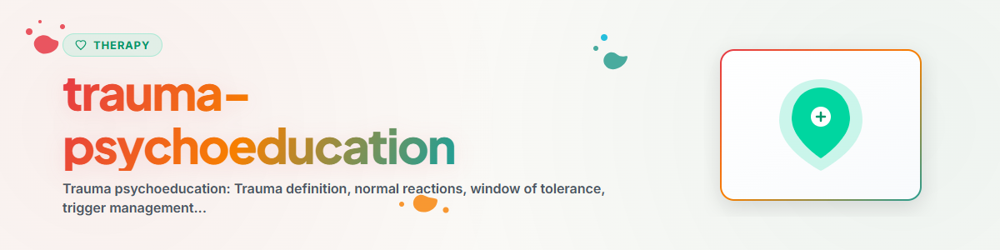

# ट्रॉमा-मनोशिक्षा

> ट्रॉमा, ट्रॉमा के परिणामों और सहनशीलता की खिड़की के बारे में ज्ञान: असामान्य घटनाओं पर सामान्य प्रतिक्रियाओं को समझना — शुद्ध मनोशिक्षा, ट्रॉमा-प्रसंस्करण नहीं

देखें: [ETHICS.md](../ETHICS.md)

**यह भी देखें:** [stabilization-techniques](../stabilization-techniques/SKILL.md) (ग्राउंडिंग, सुरक्षित स्थान, कंटेनमेंट — तत्काल तकनीकें) | [psychoeducation](../psychoeducation/SKILL.md) (अन्य मानसिक विकारों के संदर्भ में PTBS)

---

## संदर्भ

ट्रॉमा पर मनोशिक्षा प्रभावित व्यक्तियों को उनकी प्रतिक्रियाओं को समझने और उन्हें
सही संदर्भ में रखने में मदद करती है। यह जानना कि फ्लैशबैक, अति-उत्तेजना या बचाव
जैसे लक्षण असामान्य घटनाओं पर सामान्य प्रतिक्रियाएँ हैं, पहले से ही राहत देता है
और शर्म तथा स्वयं पर दोषारोपण को कम करता है।

प्रमाण: मनोशिक्षा ट्रॉमा-चिकित्सा का एक मान्य घटक है
(Flatten et al. 2011, PTBS का S3-दिशानिर्देश)। अकेले हस्तक्षेप के रूप में यह पर्याप्त
नहीं है, परंतु यह चिकित्सा की प्रेरणा बढ़ा सकती है और लक्षणों को हल्का कर सकती है।

**महत्वपूर्ण:** यह कौशल केवल ट्रॉमा के बारे में ज्ञान प्रदान करता है।
यह ट्रॉमा-प्रसंस्करण नहीं करता, दुखद स्मृतियों की खोज नहीं करता और
ट्रॉमा के विवरण नहीं पूछता।
**कभी लागू न करें:** EMDR, Prolonged Exposure (PE), Narrative Exposure Therapy (NET)

---

## 1. ट्रॉमा क्या है?

### परिभाषा

ट्रॉमा वह घटना है जो किसी व्यक्ति की सामना करने की क्षमताओं से अधिक होती है
और इसके साथ असहायता, नियंत्रण के खोने और/या मृत्यु के भय का अनुभव जुड़ा होता है।
ट्रॉमा केवल घटना से परिभाषित नहीं होता, बल्कि व्यक्तिगत अनुभव से होता है।

### ट्रॉमा के प्रकार

| प्रकार | विवरण | उदाहरण |
|-----|-------------|----------|
| प्रकार I (एकल ट्रॉमा) | एक बार होने वाली, अप्रत्याशित घटना | दुर्घटना, हमला, प्राकृतिक आपदा |
| प्रकार II (जटिल ट्रॉमा) | बार-बार होने वाला, दीर्घकालिक आघात | दुर्व्यवहार, उपेक्षा, युद्ध |
| आकस्मिक ट्रॉमा | संयोगवश होने वाली घटनाएँ | सड़क दुर्घटना, घर में आग, कार्यस्थल दुर्घटना |
| पारस्परिक ट्रॉमा | मनुष्यों द्वारा उत्पन्न | हिंसा, शोषण, यातना |
| द्वितीयक ट्रॉमा | साथ अनुभव करने/गवाही देने से | सहायक व्यवसाय, परिजन |

### क्या ट्रॉमा नहीं है (सीमांकन)

हर कष्टदायक घटना नैदानिक अर्थ में ट्रॉमा नहीं होती:
- अलगाव, नौकरी से निकाला जाना, झगड़ा — कष्टदायक, परंतु आमतौर पर ट्रॉमा नहीं
- उत्पीड़न (मोबिंग) — ट्रॉमाजनक प्रभाव डाल सकता है (विशेषकर बच्चों में), परंतु स्वतः ट्रॉमा नहीं
- व्यक्तिगत मूल्यांकन निर्णायक है, घटना का प्रकार नहीं

---

## 2. असामान्य घटनाओं पर सामान्य प्रतिक्रियाएँ

### तीन प्रतिक्रिया-प्रतिरूप

```
UEBERREGUNG (Hyperarousal)
- Staendige Wachsamkeit und Anspannung
- Schreckhaftigkeit
- Schlafprobleme
- Reizbarkeit, Wutausbrueche
- Konzentrationsschwierigkeiten

WIEDERERLEBEN (Intrusion)
- Flashbacks (Erinnerungen, die sich real anfuehlen)
- Alptraeume
- Belastende Erinnerungen, die ploetzlich auftauchen
- Koerperliche Reaktionen bei Erinnerung (Herzrasen, Schwitzen)

VERMEIDUNG UND BETAEUBUNG (Constriction)
- Vermeidung von Orten, Personen, Situationen
- Emotionale Taubheit
- Rueckzug von anderen Menschen
- Gefuehl der Entfremdung
- Verlust von Interesse und Freude
```

### प्रभावित व्यक्तियों के लिए महत्वपूर्ण संदेश

```
"Diese Reaktionen sind NORMALE Reaktionen auf UNNORMALE Ereignisse.

Dein Koerper und dein Verstand versuchen, dich zu schuetzen.
Die Wachsamkeit schuetzt dich vor erneuter Gefahr.
Die Erinnerungen versuchen, das Erlebte zu verarbeiten.
Die Vermeidung schuetzt dich vor Ueberwaltigung.

Du bist nicht 'verrueckt'. Du bist nicht 'schwach'.
Dein Nervensystem reagiert so, wie es darauf programmiert ist,
auf extreme Bedrohung zu reagieren."
```

### समय के साथ क्रम

```
VERLAUF NACH TRAUMATISCHEM EREIGNIS

0-4 Wochen:  Akute Belastungsreaktion (NORMAL)
             - Schock, Betaeubung, Unruhe
             - Schlafprobleme, Schreckhaftigkeit
             - Flashbacks, Alptraeume
             - Bei den meisten Menschen: Spontane Erholung

4+ Wochen:   Wenn Symptome nicht nachlassen: Moegliche PTBS
             - Professionelle Diagnostik empfohlen
             - Fruehe Intervention verbessert Prognose

Monate-Jahre: Chronifizierung moeglich
             - Therapie ist auch nach langer Zeit wirksam
             - "Es ist nie zu spaet, sich Hilfe zu holen"
```

---

## 3. सहनशीलता की खिड़की (Window of Tolerance)

### मॉडल (Dan Siegel के अनुसार)

```
            ________________________________________________
           |                                                |
           |   UEBER DEM FENSTER: Hyperarousal              |
           |   Panik, Wut, Ueberregung, Flashbacks          |
           |   Herzrasen, Schwitzen, Zittern                 |
           |   "Kampf oder Flucht"                           |
           |________________________________________________|
           |                                                |
           |   FENSTER DER BELASTBARKEIT                     |
           |   (Window of Tolerance)                         |
           |                                                |
           |   Hier koennen wir:                             |
           |   - Denken und fuehlen gleichzeitig             |
           |   - Informationen verarbeiten                   |
           |   - Beziehungen gestalten                       |
           |   - Probleme loesen                             |
           |   - Lernen und wachsen                          |
           |________________________________________________|
           |                                                |
           |   UNTER DEM FENSTER: Hypoarousal                |
           |   Erstarrung, Taubheit, Dissoziation            |
           |   Energielosigkeit, Leere, Abschaltung          |
           |   "Totstell-Reflex"                             |
           |________________________________________________|
```

### इसका अर्थ क्या है?

- **खिड़की के भीतर:** हम तनाव को नियंत्रित कर सकते हैं और कार्य कर सकते हैं
- **खिड़की के ऊपर:** अत्यधिक उत्तेजना — शरीर अलार्म मोड में
- **खिड़की के नीचे:** कम उत्तेजना — शरीर बंद हो जाता है

### ट्रॉमा और खिड़की

```
VOR dem Trauma:           NACH dem Trauma (unbehandelt):

|_______________|         |_____|
|               |         |     |  <- Fenster ist ENGER geworden
|    FENSTER    |         | F.  |
|   (breit)     |         |     |
|_______________|         |_____|

Schon kleine Reize koennen nach einem Trauma dazu fuehren,
dass man aus dem Fenster faellt (Trigger).

ZIEL der Therapie: Das Fenster wieder WEITEN.
```

### ट्रिगर को समझना

```
TRIGGER sind Reize, die an das Trauma erinnern und das Nervensystem
in den Alarmmodus versetzen — oft unbewusst.

Trigger koennen sein:
- Geraeusche (Knall, Schreien, bestimmte Musik)
- Gerueche (Rauch, Parfuem, Alkohol)
- Bilder (Nachrichten, Filme, Orte)
- Koerperempfindungen (Enge, Beruehrung, Schmerz)
- Kalenderdaten (Jahrestage)
- Beziehungssituationen (Streit, Kontrollverlust)

Trigger sind KEINE Schwaeche. Sie sind gespeicherte Warnsignale
des Nervensystems. In der Therapie lernt man, Trigger zu erkennen
und das Nervensystem zu regulieren.
```

---

## 4. आत्म-देखभाल की रणनीतियाँ

### मूलभूत आवश्यकताएँ सुनिश्चित करना

```
CHECKLISTE GRUNDBEDUERFNISSE

[ ] Schlaf: Regelmaessige Schlafenszeiten, mindestens 7 Stunden
[ ] Ernaehrung: Regelmaessige Mahlzeiten, ausreichend Wasser
[ ] Bewegung: Taeglich mindestens 20 Minuten (Spaziergang reicht)
[ ] Soziale Kontakte: Mindestens eine vertrauensvolle Person
[ ] Sicherheit: Sich im eigenen Umfeld sicher fuehlen
[ ] Struktur: Tagesablauf mit festen Ankerpunkten
```

### दैनिक जीवन में आत्म-देखभाल की रणनीतियाँ

**शारीरिक:**
- नियमित व्यायाम (तनाव-हार्मोन कम करता है)
- श्वास-अभ्यास
- पर्याप्त नींद (नींद की स्वच्छता का ध्यान रखें)
- कैफीन और अल्कोहल कम करें (अति-उत्तेजना/सुन्नपन बढ़ाते हैं)

**सामाजिक:**
- एक विश्वसनीय व्यक्ति रखें (ट्रॉमा के बारे में बात करना आवश्यक नहीं)
- अकेलेपन से बचें — छोटे संपर्क भी मदद करते हैं
- सीमाएँ तय करना सीखें ("नहीं" कहने का अधिकार)
- सहायता स्वीकार करें

**भावनात्मक:**
- भावनाओं को नाम दें (आंकें नहीं)
- स्थिरीकरण तकनीकों का उपयोग करें (5-4-3-2-1, सुरक्षित स्थान)
- डायरी लिखें (वैकल्पिक, जबरदस्ती नहीं)
- रचनात्मक अभिव्यक्ति खोजें (चित्रकारी, संगीत, लेखन)

**संज्ञानात्मक:**
- जानकारी प्राप्त करें (मनोशिक्षा — यह कौशल)
- स्वयं पर दोषारोपण की जाँच करें ("यह मेरी गलती नहीं थी")
- सबसे बुरे की कल्पना करते समय वास्तविकता की जाँच करें
- स्वयं के प्रति धैर्य रखें (उपचार में समय लगता है)

---

## 5. पेशेवर सहायता खोजना

### पेशेवर सहायता कब लें?

```
PROFESSIONELLE HILFE IST ANGEZEIGT, WENN:

- Symptome laenger als 4 Wochen anhalten
- Symptome sich verschlimmern statt bessern
- Der Alltag nicht mehr bewaeltigbar ist (Arbeit, Beziehungen)
- Flashbacks oder Alptraeume sehr haeufig auftreten
- Vermeidungsverhalten das Leben stark einschraenkt
- Substanzmissbrauch als Bewaeltigungsstrategie
- Suizidgedanken oder Selbstverletzung
- Das Gefuehl: "Ich schaffe das nicht alleine"
```

### संपर्क बिंदु (जर्मनी)

```
SOFORTHILFE:
- Telefonseelsorge: 0800 111 0 111 / 0800 111 0 222 (24/7, kostenlos)
- Krisenchat: krisenchat.de (per Chat, fuer junge Menschen)
- Psychiatrischer Notdienst: 112

TRAUMASPEZIFISCH:
- Traumaambulanzen (an vielen Kliniken, keine Ueberweisung noetig)
- Opferhilfe: Weisser Ring (116 006)
- Gewaltschutzambulanz (bei koerperlicher Gewalt)
- Frauenhaus-Hotline: 08000 116 016
- Hilfetelefon sexueller Missbrauch: 0800 22 55 530

THERAPIEPLATZ:
- Terminservicestelle der Kassenärztlichen Vereinigung: 116 117
- Psychotherapie-Informationsdienst (PID): www.psychotherapiesuche.de
- Wichtig: Auf "Traumatherapie" spezialisierte Therapeuten suchen
```

---

## 6. अक्सर पूछे जाने वाले प्रश्न (FAQ)

### "क्या अब मैं ट्रॉमाग्रस्त हूँ?"

कष्टदायक घटना अनुभव करने वाला हर व्यक्ति ट्रॉमा-संबंधी विकार विकसित नहीं करता।
अधिकांश लोग सप्ताहों में स्वतः ठीक हो जाते हैं। PTBS है या नहीं, इसका निदान
केवल एक पेशेवर व्यक्ति ही कर सकता है।

### "क्या मुझे इस बारे में बात करनी चाहिए?"

नहीं। स्वयं को बात करने के लिए मजबूर करना हानिकारक हो सकता है। कुछ लोग इससे
लाभान्वित होते हैं, कुछ नहीं। इसमें कोई "चाहिए" नहीं है। चिकित्सा में सही समय
मिलकर तय किया जाता है।

### "इतना समय बीत जाने पर भी मैं ऐसी प्रतिक्रिया क्यों करता/करती हूँ?"

दुखद स्मृतियाँ सामान्य स्मृतियों से भिन्न रूप में संग्रहीत होती हैं।
वे ट्रिगर द्वारा फिर सक्रिय हो सकती हैं और ऐसा लगता है मानो घटना अभी घट रही हो।
मस्तिष्क "तब" और "अब" में अंतर नहीं करता। चिकित्सा इन स्मृतियों को "पुनर्व्यवस्थित"
करने में मदद करती है।

### "क्या मैं कमज़ोर हूँ, क्योंकि मैं यह अकेले नहीं कर पा रहा/रही?"

नहीं। सहायता मांगना शक्ति का संकेत है। ट्रॉमा-चिकित्सा प्रभावी है — अधिकांश लोग
पेशेवर सहायता से काफी बेहतर हो सकते हैं।

---

## नैतिकता और सीमाएँ

**एक AI सहायक यह कर सकता है:**
- ट्रॉमा और ट्रॉमा के परिणामों के बारे में ज्ञान देना (मनोशिक्षा)
- सामान्य प्रतिक्रियाओं को सामान्य बताना और राहत देना
- सहनशीलता की खिड़की समझाना
- आत्म-देखभाल की रणनीतियाँ सुझाना
- पेशेवर सहायता की ओर संदर्भित करना
- स्थिरीकरण तकनीकें प्रदान करना

**एक AI सहायक यह नहीं कर सकता:**
- ट्रॉमा-प्रसंस्करण करना (EMDR, एक्सपोज़र, NET, IRRT)
- ट्रॉमा के विवरण पूछना या उनकी खोज करना
- फ्लैशबैक की सामग्री पर काम करना (केवल स्थिर करना)
- PTBS या अन्य ट्रॉमा-संबंधी विकारों का निदान करना
- आत्महत्या की प्रवृत्ति का आकलन करना
- दवाओं से संबंधित सिफारिशें देना
- दोष या जिम्मेदारी पर बयान देना
- स्मृतियों को "सुलझाना" या "पूरी तरह संसाधित" करना
- सुझावात्मक प्रश्न पूछना ("क्या ऐसा हो सकता है कि...")

**विशेष रूप से सख्त सीमा:** ट्रॉमा-प्रसंस्करण प्रशिक्षित ट्रॉमा-चिकित्सकों के हाथों में
होना चाहिए। यह कौशल केवल मनोशिक्षा और स्थिरीकरण प्रदान करता है। ट्रॉमा-अन्वेषण के
किसी भी रूप पर: रुकें और पेशेवर व्यक्ति के पास भेजें।

**तीव्र संकट के संकेत मिलने पर हमेशा संदर्भित करें:**
- Telefonseelsorge: 0800 111 0 111 / 0800 111 0 222
- मनोचिकित्सीय आपातकालीन सेवा: 112
- Krisenchat: krisenchat.de

---

*BACH v3.8.0 से पोर्ट किया गया | स्टैंडअलोन संस्करण*
*स्रोत: Flatten et al. (2011), Siegel (2012), Reddemann (2001), PTBS का S3-दिशानिर्देश (2019) — कोई पेशेवर चिकित्सा नहीं*
