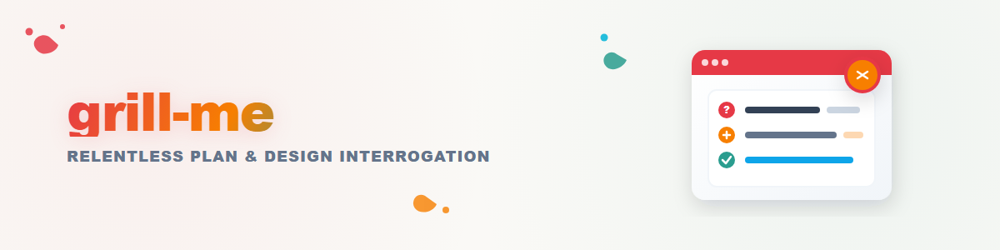

"grilling" के साथ Skill tool को कॉल करें।

<!--
Vendored from mattpocock/skills (skills/productivity/grill-me/SKILL.md, MIT
License, Copyright (c) 2026 Matt Pocock -- see LICENSE next to this file).

Modification vs. upstream: the `description` field was extended with German
trigger phrases ("grill mich") and an explicit non-trigger/abgrenzung note
against this library's existing artifact-review skills (code-review,
3agenten-review, 7phasen-review, caveman-review). The `category` and
`language` fields and this comment were added; all are local convention
(recommended, not one of the nine house fields), not upstream content, and
`language: en` reflects that the vendored body is unmodified English.
The body (the single instruction line) and `disable-model-invocation: true`
are unchanged from upstream.

Adopted 2026-08-24 per Ticket T-20260824-594031458: the user asked whether a
"grill me" skill exists; none did locally, and this upstream implementation
(design-tree / frontier / rounds interrogation, see skills/third-party/grilling/)
is the well-known, MIT-licensed original that the term "grill me" refers to
in the current Claude Code skill ecosystem -- adopted rather than
independently re-implemented.
-->
