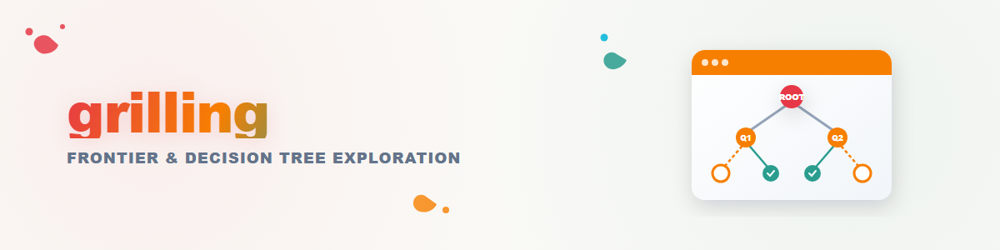

ユーザーと共通理解に至るまで、容赦なく質問を続けてください。これを**設計ツリー**として捉えてください。すべての決定は、そこから派生する決定へと分岐します。

ツリーは**ラウンド**単位で進めてください。**フロンティア**とは、前提となる決定がすでに確定しているすべての決定を指します。つまり、まだ聞いていない回答を推測することなく、_今_ 尋ねることができる質問です。フロンティア全体を1ラウンドで尋ねてください。各質問に番号を付け、推奨する回答も併せて示します。その後、次のラウンドに進む前にユーザーの回答を待ちます。

ラウンドは次のような形式で示してください：

```
❓ **Q1** - **<question title>**: <question body, might be multiple paragraphs, including multiple choices>

➡️ <your recommended answer>

---

❓ **Q2** - **<question title>**: <question body, might be multiple paragraphs, including multiple choices>

➡️ <your recommended answer>
```

ユーザーの回答が出るたびに設計ツリーは再構成されます。確定した決定はフロンティアを外側へ広げ、それらに依存していた質問を尋ねられるようにします。フロンティアを再計算し、次のラウンドを尋ねてください。回答が、このラウンドでまだ未解決の別の質問に依存する場合、その質問は今回のラウンドではなく_後のラウンド_に回してください。

_事実_を調べることはあなたの役割であり、ユーザーの役割ではありません。フロンティアの質問が環境（ファイルシステム、ツールなど）からの事実を必要とする場合は、サブエージェントを派遣してそれを調べてください。調べられることをユーザーに尋ねてはいけません。また、その調査の完了を待って全体を止めないでください。実行中の調査は未確定の前提条件であるため、その調査に依存する質問のみがサブエージェントの報告を待ちます。それ以外のフロンティアの質問は今すぐ尋ねてください。_決定_はユーザーのものです。それらをユーザーに提示し、回答を待ってください。

セッションは、フロンティアが空になったときに完了します。つまり、設計ツリーのすべての分岐を訪れ、暗黙のうちに仮定されたままの事項が何も残っていない状態です。ユーザーが共通理解に達したことを確認するまで、それに基づいて行動しないでください。

<!--
Vendored from mattpocock/skills (skills/productivity/grilling/SKILL.md, MIT
License, Copyright (c) 2026 Matt Pocock -- see LICENSE next to this file).

Modification vs. upstream: the `description` field was extended with German
trigger phrases ("grill mich"). The `category` and `language` fields and this
comment were added; all are local convention (recommended, not one of the
nine house fields), not upstream content, and `language: en` reflects that
the vendored body is unmodified English. The body (the design tree / frontier
/ rounds method) is unchanged from upstream.

Adopted 2026-08-24 per Ticket T-20260824-594031458 alongside skills/third-
party/grill-me/ (the thin, explicit-only entry point that calls this skill).
-->
