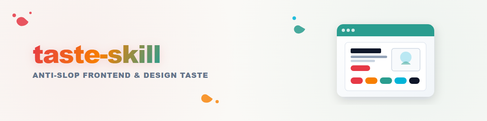

# tasteskill: مهارة الواجهة الأمامية المضادة للحشو

> الصفحات المقصودة والمحافظ الشخصية وإعادة التصميم. ليست لوحات تحكم، ولا جداول بيانات، ولا واجهات منتج متعددة الخطوات.
> كل قاعدة أدناه **سياقية**. لا تُطبَّق أي منها تلقائياً. اقرأ الموجز أولاً، ثم اسحب فقط ما يناسبه.

---

## 0. استنتاج الموجز (اقرأ الموقف قبل أي شيء آخر)

قبل لمس الشيفرة أو ضبط المؤشرات، **استنتج ما يريده المستخدم فعلاً**. معظم مخرجات النماذج اللغوية في التصميم رديئة لأن النموذج يقفز إلى جماليات افتراضية بدلاً من قراءة الموقف.

### 0.أ اقرأ هذه الإشارات أولاً
1. **نوع الصفحة** - مقصودة (SaaS / استهلاكية / وكالة / حدث)، محفظة (مطور / مصمم / استوديو إبداعي)، إعادة تصميم (حفظ مقابل إعادة بناء كاملة)، محتوى تحريري / مدونة.
2. **كلمات الأجواء** التي استخدمها المستخدم - "minimalist"، "calm"، "Linear-style"، "Awwwards"، "brutalist"، "premium consumer"، "Apple-y"، "playful"، "serious B2B"، "editorial"، "agency-y"، "glassy"، "dark tech".
3. **إشارات المرجعية** - روابط أرسلها، لقطات شاشة ألصقها، منتجات سمّاها، علامات تجارية ينافسها.
4. **الجمهور** - لجنة مشتريات B2B مقابل مستهلك يهتم بالتصميم مقابل مسؤول توظيف يتصفح محفظة. الجمهور يحدد الجمالية، لا ذوقك.
5. **أصول العلامة القائمة** - الشعار، اللون، الخط، الصور. في إعادة التصميم، هذه مادة أولية وليست مدخلاً اختيارياً (انظر القسم 11).
6. **القيود الضمنية** - جماهير تعطي الأولوية لإمكانية الوصول، القطاع العام، الصناعات المنظمة، التجارة القائمة على الثقة، منتجات الأطفال. هذه القيود **تتجاوز** التفضيل الجمالي.

### 0.ب اكتب "قراءة تصميم" من سطر واحد قبل التوليد
قبل أي شيفرة، اذكر في سطر واحد: **"أقرأ هذا على أنه: \<page kind> لـ \<audience>، بلغة \<vibe>، معميل نحو \<design system or aesthetic family>."**

أمثلة على القراءات:
- *"أقرأ هذا على أنه: صفحة مقصودة لـ B2B SaaS موجّهة لمشترين تقنيين، بلغة minimalist على طراز Linear، مع ميل نحو أدوات Tailwind + Geist + حركة مقيّدة."*
- *"أقرأ هذا على أنه: محفظة مصمم منفرد لمسؤولي التوظيف، بلغة تحريرية / نوع حركي، مع ميل نحو CSS أصلي + حركة مرتبطة بالتمرير + طباعة مخصصة."*
- *"أقرأ هذا على أنه: إعادة تصميم موقع خدمة حكومية، بلغة تقوم على الثقة، مع ميل نحو GOV.UK Frontend أو USWDS."*

### 0.ج إذا كان الموجز غامضاً، اطرح سؤالاً واحداً ولا تخمّن
اطرح **سؤالاً توضيحياً واحداً** فقط - لا مجموعة أسئلة - وفقط عندما تختلف قراءة التصميم اختلافاً حقيقياً. مثال: *"هل يجب أن يكون هذا أقرب إلى Linear النظيف أم إلى Awwwards التجريبي؟"*

إذا استطعت الاستنتاج بثقة من السياق، **فلا تسأل**. أعلن قراءة التصميم وتابع.

### 0.د انضباط ضد الافتراضات
لا تنجرف إلى: تدرجات بنفسجية على طراز الذكاء الاصطناعي، بطل (hero) مركزي فوق خلفية mesh داكنة، ثلاث بطاقات ميزات متساوية، زجاجية عامة (glassmorphism) على كل شيء، حركات دقيقة لا تنتهي في كل مكان، Inter مع slate-900. هذه هي الافتراضات الأساسية للنماذج اللغوية. تجاوزها عمداً بناءً على قراءة التصميم.

---

## 1. المؤشرات الثلاثة (الإعداد الأساسي)

بعد قراءة التصميم، اضبط ثلاثة مؤشرات. كل قرار تخطيط وحركة وكثافة مشروط بهذه المؤشرات.

* **`DESIGN_VARIANCE: 8`** - 1 = تماثل تام، 10 = فوضى فنية
* **`MOTION_INTENSITY: 6`** - 1 = ثابت، 10 = سينمائي / فيزيائي
* **`VISUAL_DENSITY: 4`** - 1 = معرض فني / فسيح، 10 = قمرة قيادة / بيانات مكدسة

**خط الأساس:** `8 / 6 / 4`. استخدم هذه القيم ما لم تتجاوزها قراءة التصميم. لا تطلب من المستخدم تعديل هذا الملف - تتم التجاوزات عبر الحوار.

### 1.أ استنتاج المؤشرات (قراءة التصميم ← قيم المؤشرات)
| الإشارة | VARIANCE | MOTION | DENSITY |
|---|---|---|---|
| "minimalist / clean / calm / editorial / Linear-style" | 5-6 | 3-4 | 2-3 |
| "premium consumer / Apple-y / luxury / brand" | 7-8 | 5-7 | 3-4 |
| "playful / wild / Dribbble / Awwwards / experimental / agency" | 9-10 | 8-10 | 3-4 |
| "landing page / portfolio / marketing site (default)" | 7-9 | 6-8 | 3-5 |
| "trust-first / public-sector / regulated / accessibility-critical" | 3-4 | 2-3 | 4-5 |
| "redesign - preserve" | مطابق للقائم | +1 | مطابق للقائم |
| "redesign - overhaul" | +2 | +2 | مطابق للقائم |

### 1.ب إعدادات الحالات الجاهزة
| حالة الاستخدام | VARIANCE | MOTION | DENSITY |
|---|---|---|---|
| صفحة مقصودة (SaaS، سائدة) | 7 | 6 | 4 |
| صفحة مقصودة (وكالة / إبداعية) | 9 | 8 | 3 |
| صفحة مقصودة (مستهلك فاخر) | 7 | 6 | 3 |
| محفظة (مصمم / استوديو) | 8 | 7 | 3 |
| محفظة (مطور) | 6 | 5 | 4 |
| محتوى تحريري / مدونة | 6 | 4 | 3 |
| خدمة قطاع عام | 3 | 2 | 5 |
| إعادة تصميم - حفظ | مطابق | مطابق+1 | مطابق |
| إعادة تصميم - إعادة بناء | +2 | +2 | مطابق |

### 1.ج كيف تقود المؤشرات المخرجات
استخدم هذه القيم (أو القيم المتجاوَزة من المستخدم) كمتغيرات عامة. تشير المراجع المتقاطعة في هذه الوثيقة إلى أسماء المتغيرات الدقيقة نفسها - لا تخترع أسماء بديلة مثل `LAYOUT_VARIANCE` أو `ANIM_LEVEL` أبداً.

---

## 2. خريطة الموجز ← نظام التصميم

بعد الحصول على قراءة التصميم (القسم 0) والمؤشرات (القسم 1)، اختر الأساس المناسب. لا تكتب CSS مخصصاً لأشياء لها حزمة رسمية. ولا تتظاهر بأن اتجاهاً جمالياً عابراً هو نظام رسمي.

### 2.A متى تستخدم نظام تصميم حقيقيًا (استخدم الحزم الرسمية)

| يبدو الموجز كـ… | استخدم | السبب |
|---|---|---|
| Microsoft / برمجيات المؤسسات كخدمة (SaaS) / لوحات المعلومات | `@fluentui/react-components` أو `@fluentui/web-components` | Fluent UI الرسمي، ورموز تصميم Microsoft، وإمكانية الوصول منجزة |
| واجهة على طراز Google، ومنتج بنمط Material | `@material/web` + رموز Material 3 | رسمي، وقابل للتخصيص عبر Material Theming |
| منصات B2B وتحليلات المؤسسات على طراز IBM | `@carbon/react` + `@carbon/styles` | Carbon الرسمي، وأنماط كثافة البيانات الناضجة |
| أسطح تطبيقات Shopify | `polaris.js` مكونات الويب / Polaris React | مطلوب لواجهة إدارة Shopify |
| منتج على طراز Atlassian / Jira | `@atlaskit/*` + `@atlaskit/tokens` | نظام تصميم Atlassian الرسمي |
| أداة للمطورين على طراز GitHub / صفحة مجتمعية | `@primer/css` أو `@primer/react-brand` | Primer الرسمي؛ والمتغير Brand للتسويق |
| خدمة عامة في المملكة المتحدة | `govuk-frontend` | متوقعة قانونيًا وتنظيميًا |
| القطاع العام في الولايات المتحدة / القائم على الثقة أولًا | `uswds` | نفس السبب |
| نموذج أولي سريع لأعمال محلية أو وكالة | Bootstrap 5.3 | بسيط وسريع ويعمل |
| أساس React حديث وسهل الوصول | `@radix-ui/themes` | مكونات أولية وسمة مصقولة |
| برمجيات SaaS حديثة حيث تمتلك المكونات | shadcn/ui (`npx shadcn@latest add ...`) | أنت تمتلك الشيفرة، وتسهل تخصيصها؛ لا تشحن الحالة الافتراضية أبدًا |
| برمجيات SaaS حديثة مبنية على Tailwind / تسويق الذكاء الاصطناعي | أدوات Tailwind v4 + متغير `dark:` | الخيار الافتراضي للمطورين المستقلين والفرق الصغيرة |

**قاعدة الأمانة:** إذا بدا الموجز كأحد الأنظمة أعلاه، فثبّت الحزمة **الرسمية** واستخدمها. لا تُعِد إنشاء CSS الخاص بها يدويًا. ولا تستورد رموز نظام ما ثم تتجاوز 90% منها.

**نظام واحد لكل مشروع.** لا تجمع Fluent React مع Carbon في الشجرة نفسها. ولا تستورد مكونات shadcn/ui داخل تطبيق Material 3.

### 2.B عندما يكون الموجز توجهًا جماليًا لا نظامًا
لهذه التوجهات **لا توجد حزمة رسمية واحدة**. ابنِ باستخدام CSS أصلي + Tailwind + مكتبة مكونات مُصانة. وكن صادقًا في تعليقات الشيفرة حول ما هو مستوحى من الخارج وما هو مادة رسمية.

| الجمالية | التنفيذ الصادق |
|---|---|
| Glassmorphism / "الزجاج المصنفر" | `backdrop-filter`، وحدود متعددة الطبقات، وتراكبات إبراز. وفّر احتياطيًا بتعبئة صلبة لـ `prefers-reduced-transparency`. |
| Bento (شبكات البلاط على طراز Apple) | CSS Grid بخلايا ذات أحجام مختلطة. لا توجد مكتبة واحدة تملك هذا. |
| Brutalism | CSS أصلي، وخط أحادي المسافة، وحدود خام. بلا مكتبة. |
| Editorial / مجلات | خطوط مزخرفة (Serif)، وشبكة غير متماثلة، ومساحات بيضاء واسعة. بلا مكتبة. |
| Dark tech / hacker | خط أحادي المسافة مع لون نيون مميز، وزخارف الطرفية. بلا مكتبة. |
| Aurora / تدرجات الشبكة | SVG أو تدرجات شعاعية متعددة الطبقات. بلا مكتبة. |
| Kinetic typography | رسوم متحركة CSS أصلية، ورسوم متحركة مرتبطة بالتمرير، وGSAP لعمليات الاختطاف. بلا مكتبة. |
| **Apple Liquid Glass** | توثّق Apple هذا لمنصات Apple فقط. **لا يوجد `liquid-glass.css` رسمي.** التنفيذات على الويب تقريبية باستخدام `backdrop-filter` + حدود متعددة الطبقات + إبرازات. صنّفه بوضوح على أنه تقريب. |

---

## 3. البنية والاتفاقيات الافتراضية

ما لم تختر قراءة التصميم نظامًا حقيقيًا (القسم 2.A)، فهذه هي الافتراضات:

### 3.A المكدس
* **الإطار:** React أو Next.js. الافتراضي هو مكونات الخادم (RSC).
  * **أمان RSC:** الحالة العامة تعمل فقط في مكونات العميل. في Next.js، لُفَّ المزوِّدات في مكون `"use client"`.
  * **عزل التفاعلية:** يجب أن يكون أي مكون يستخدم Motion أو مستمعات التمرير أو فيزياء المؤشر ورقة طرفية معزولة مع `'use client'` في أعلاه. مكونات الخادم تُصيّر التخطيطات الثابتة فقط.
* **التنسيق:** **Tailwind v4** (افتراضي). Tailwind v3 فقط إذا كان المشروع الحالي يتطلب ذلك.
  * بالنسبة لـ v4: لا تستخدم إضافة `tailwindcss` في `postcss.config.js`. استخدم `@tailwindcss/postcss` أو إضافة Vite.
* **الرسوم المتحركة:** **Motion** (المكتبة المعروفة سابقًا باسم Framer Motion). استورد من `motion/react` (`import { motion } from "motion/react"`). حزمة `framer-motion` ما زالت تعمل كاسم بديل قديم - فضّل `motion/react` في الشيفرة الجديدة.
* **الخطوط:** استخدم دائمًا `next/font` (Next.js) أو استضف ذاتيًا باستخدام `@font-face` + `font-display: swap`. لا تربط Google Fonts عبر `<link>` في الإنتاج أبدًا.

### 3.B الحالة
* `useState` / `useReducer` المحلية للواجهة المعزولة.
* الحالة العامة فقط لتجنب تمرير الخصائص العميق - Zustand أو Jotai أو سياق React.
* **لا تستخدم أبدًا** `useState` لتتبع القيم المستمرة التي يقودها إدخال المستخدم (موضع المؤشر، وتقدم التمرير، وفيزياء المؤشر، والتحويم المغناطيسي). استخدم `useMotionValue` / `useTransform` / `useScroll` الخاصة بـ Motion. فـ `useState` يعيد تصيير شجرة React عند كل تغيير ويتعطل على الأجهزة المحمولة.

### 3.C الأيقونات
* **المكتبات المسموح بها (حسب الأولوية):** `@phosphor-icons/react`، و`hugeicons-react`، و`@radix-ui/react-icons`، و`@tabler/icons-react`.
* **غير مستحسنة:** `lucide-react`. مقبولة فقط عندما يطلبها المستخدم صراحةً أو عندما يعتمد المشروع عليها بالفعل.
* **لا تصنع أيقونات SVG يدويًا أبدًا.** إذا كان رمز مفقودًا، فثبّت مكتبة ثانية أو ركّبه من العناصر الأولية - ولا ترسم مسارات أيقونات من الصفر.
* **عائلة واحدة لكل مشروع.** لا تخلط Phosphor مع Lucide في شجرة المكونات نفسها.
* **وحّد `strokeWidth` عالميًا** (مثلًا `1.5` أو `2.0`).

### 3.D سياسة الرموز التعبيرية
غير مستحسنة افتراضيًا في الشيفرة والترميز والنص المرئي. استبدل الرموز برموز من مكتبة الأيقونات. **الاستثناء:** اسمح بالرموز التعبيرية فقط عندما يطلب المستخدم صراحةً نبرة مرحة أو على طراز الدردشة أو التواصل الاجتماعي - وحتى حينها استخدمها باعتدال وبقصد.

### 3.E منطق الاستجابة وتخطيط الواجهة
* توحيد نقاط الكسر (`sm 640`، `md 768`، `lg 1024`، `xl 1280`، `2xl 1536`).
* احتواء تخطيطات الصفحات باستخدام `max-w-[1400px] mx-auto` أو `max-w-7xl`.
* **استقرار منفذ العرض:** لا تستخدم أبدًا `h-screen` لأقسام البطل (Hero) ذات الارتفاع الكامل. استخدم دائمًا `min-h-[100dvh]` لمنع قفز التخطيط على الأجهزة المحمولة (شريط العناوين في iOS Safari).
* **الشبكة بدلاً من حسابات Flex:** لا تستخدم أبدًا حسابات النسب المئوية المعقدة في Flexbox (`w-[calc(33%-1rem)]`). استخدم دائمًا CSS Grid (`grid grid-cols-1 md:grid-cols-3 gap-6`).

### 3.F التحقق من التبعيات (إلزامي)
قبل استيراد أي مكتبة خارجية، تحقّق من `package.json`. إذا كانت الحزمة مفقودة، اعرض أمر التثبيت أولاً. **لا تفترض أبدًا** وجود مكتبة.

---

## 4. توجيهات الهندسة التصميمية (تصحيح الانحياز)

تميل نماذج اللغة الكبيرة إلى الclichés. تجاوز هذه الإعدادات الافتراضية بشكل استباقي. لكل قاعدة مسار تجاوز يراعي السياق.

### 4.1 الطباعة
* **العناوين الرئيسية / الكبيرة:** الافتراضي `text-4xl md:text-6xl tracking-tighter leading-none`.
* **النص / الفقرات:** الافتراضي `text-base text-gray-600 leading-relaxed max-w-[65ch]`.
* **اختيار الخط غير المزيّن (Sans):**
  * **غير مستحسن كافتراضي:** `Inter`. اختر `Geist` أو `Outfit` أو `Cabinet Grotesk` أو `Satoshi` أو خطًا مزيّنًا (Serif) يناسب العلامة التجارية أولاً.
  * **التجاوز:** يُقبل Inter عندما يطلب المستخدم صراحةً طابعًا محايدًا أو قياسيًا أو على نمط Linear، أو عندما يكون الموجز موقعًا حكوميًا أو موقعًا يركز على إمكانية الوصول.
* **أزواج يجب معرفتها:** `Geist` + `Geist Mono`، `Satoshi` + `JetBrains Mono`، `Cabinet Grotesk` + `Inter Tight`، `GT America` + `IBM Plex Mono`.

* **انضباط الخطوط المزيّنة (غير مستحسنة جدًا كافتراضي):**
  * الخط المزيّن **غير مستحسن جدًا كخط افتراضي لأي مشروع.** عبارة "يبدو إبداعيًا / فاخرًا / تحريريًا" ليست سببًا لاختيار الخط المزيّن. النموذج الذهني الافتراضي للوكيل بأن "الموجز الإبداعي = خط مزيّن" هو أكثر علامة مميزة للذكاء الاصطناعي اختبارًا في الجولات الإنتاجية.
  * **الخط المزيّن مقبول فقط عندما يتحقق أحد هذين الشرطين صراحةً:**
    - يذكر موجز العلامة التجارية خطًا مزيّنًا بعينه، أو
    - تنتمي العائلة الجمالية فعلاً إلى التحرير / الفخامة / النشر / المخطوطات / التراث / الطابع القديم، وتستطيع توضيح سبب ملاءمة هذا الخط المزيّن تحديدًا لهذه العلامة تحديدًا.
  * لكل ما عدا ذلك (وكالات إبداعية، استوديوهات تصميم، علامات تجارية حديثة، منتجات استهلاكية راقية، معارض أعمال، أنماط حياة)، **استخدم افتراضيًا عناوين غير مزيّنة (Sans-serif)** (Geist Display، ABC Diatype، Söhne Breit، Cabinet Grotesk Display، Migra Sans، GT Walsheim، Inter Display، PP Neue Montreal). خطوط العناوين غير المزيّنة ليست "مملة"، بل هي الافتراضي للسبب نفسه الذي يجعل الأسود الافتراضي في عالم الموضة.
  * **قاعدة التأكيد (ذات صلة):** عندما تريد تأكيد كلمة داخل عنوان (حركة "و `spatial` design" الحيوية)، استخدم **المائل أو الغامق من العائلة نفسها**. لا تُدرج كلمة بخط مزيّن عشوائيًا في عنوان غير مزيّن (أو العكس) فقط لإضافة اهتمام بصري. التأكيد بين عائلات مختلفة هواية غير احترافية. التأكيد المائل أو الغامق ضمن العائلة نفسها هو الخيار الصحيح.
  * **محظور تحديدًا كافتراضي:** `Fraunces` و`Instrument_Serif` (الخطان المزيّنان للعناوين المفضلان لدى نماذج اللغة الكبيرة).
  * **إذا كان الخط المزيّن مبررًا** (نادرًا، وفقًا لما سبق)، فاختر من هذه المجموعة، ولا تعِد استخدام الخط المزيّن نفسه في مشاريع متتالية: PP Editorial New، GT Sectra Display، Cardinal Grotesque، Reckless Neue، Tiempos Headline، Recoleta، Cormorant Garamond، Playfair Display، EB Garamond، IvyPresto، Migra، Editorial Old، Saol Display، Söhne Breit Kursiv، Domaine Display، Canela، Schnyder، Tobias، NB Architekt، ITC Galliard.

* **مساحة نزول الحروف المائلة (إلزامي):** عندما يُستخدم المائل في الطباعة الكبيرة وتحتوي الكلمة على حرف نازل (`y g j p q`)، فإن `leading-[1]` أو `leading-none` ستقطع الجزء النازل. استخدم `leading-[1.1]` كحد أدنى وأضف مساحة احتياطية `pb-1` أو `mb-1` على العنصر الملتف. دقّق كل كلمة مائلة في العناوين الكبيرة قبل التسليم.

### 4.2 تصحيح الألوان
* لون تمييز واحد كحدٍ أقصى. التشبّع أقل من 80% افتراضيًا.
* **قاعدة اللیلكي (THE LILA RULE):** يُنصح بتجنّب جماليات "توهّج الأرجواني / الأزرق الاصطناعي" كخيار افتراضي. لا أزرار بتوهّج بنفسجي تلقائي، ولا تدرجات نيون عشوائية. استخدم قواعد محايدة (الزنك / الأردواز / الحجر) مع ألوان تمييز مفردة عالية التباين (الزمردي، الأزرق الكهربائي، الوردي العميق، البرتقالي المحروق، وغيرها).
* **التجاوز:** إذا طلبت الهوية التجارية أو الموجز صراحةً الأرجواني أو البنفسجي أو الليلكي، فاحتضنه. لكن نفّذه بقصد: لوحة ألوان متسقة، ومحايدات منسجمة، وتدرجات متحفظة. لا تدرجات ذكاء اصطناعي عامة رديئة.
* **لوحة واحدة لكل مشروع.** لا تتأرجح بين الرماديات الدافئة والباردة داخل المشروع نفسه.
* **قفل اتساق الألوان (إلزامي):** بمجرد اختيار لون تمييز لصفحة، يُستخدم عبر الصفحة بأكملها. لا يحصل موقع بدرجات رمادية دافئة فجأة على زر دعوة إلى الإجراء أزرق في القسم السابع. ولا يحصل موقع بتمييز وردي على شارة حالة فيروزية في التذييل. اختر لونًا واحدًا، واقفله، ودقّق كل مكوّن قبل النشر.

* **حظر لوحة الألوان للمستهلك المتميز (إلزامي، ثاني أكثر علامة متكررة للذكاء الاصطناعي):**
  * بالنسبة لموجزات المستهلك المتميز (أدوات الطهي، العافية، الحِرف اليدوية، الفخامة، الحِرف التراثية، سلع المنازل المباشرة للمستهلك، وغيرها)، يميل النموذج افتراضيًا إلى **البيج/الكريمي الدافئ + النحاسي/الطيني/الأحمر القاتم/المغرة + النص الداكن الإسبريسو/الحبر**. وتحديدًا، فئات الست عشرية المحظورة كخلفيات وألوان تمييز افتراضية:
    - الخلفيات: `#f5f1ea`، `#f7f5f1`، `#fbf8f1`، `#efeae0`، `#ece6db`، `#faf7f1`، `#e8dfcb` (جميعها "ورق دافئ / كريمي / طباشيري / عظمي")
    - ألوان التمييز: `#b08947`، `#b6553a`، `#9a2436`، `#9c6e2a`، `#bc7c3a`، `#7d5621` (جميعها "نحاسي / طيني / أحمر قاتم / مغرة")
    - النص: `#1a1714`، `#1a1814`، `#1b1814` (جميعها "إسبريسو / أسود داكن دافئ")
  * هذه اللوحة **محظورة** كاختيار افتراضي لموجزات المستهلك المتميز. كل موقع للمستهلك المتميز شحنته من قبل استخدم هذه اللوحة بالضبط. وهذا يجعل العلامة التجارية غير مرئية.
  * **بدائل افتراضية (دوّرها، ولا تعيد استخدامها):**
    - **الفخامة الباردة:** رمادي فضي + كروم + دخاني (تخيّل Tesla وApple Watch وHermès بدون الجلد)
    - **الغابة:** أخضر عميق + عظمي + لمسة كهرمانية (تخيّل Filson وPatagonia المتميزة)
    - **الأسود والبني الفاتح:** أسود حقيقي غير نقي + بني فاتح دافئ، تباين حاد، بلا بيج
    - **الكوبالت + الكريمي:** أزرق مشبّع أمام محايد واحد، بلا نحاسي
    - **الطوبي + الأردواز:** صدأ دافئ أمام رمادي بارد، بلا نحاسي
    - **الزيتوني + الطوبي + الورق:** زيتوني مكتوم مع تمييز أحمر طوبي
    - **أحادي اللون الخالص + لمسة مشبّعة واحدة:** أبيض مكسور + أسود مكسور + لون تمييز واحد زاهٍ (أزرق كهربائي، زمردي، وردي ساطع، وغيرها)
  * **قاعدة تدوير اللوحة:** إذا كان آخر مشروع للمستهلك المتميز أنتجته يستخدم عائلة البيج+النحاسي، فيجب أن يستخدم هذا المشروع عائلة مختلفة. لا تشحن لوحة الحِرف الدافئة نفسها مرتين متتاليتين.
  * **التجاوز:** لوحة البيج+النحاسي+الإسبريسو مقبولة **فقط** عندما تسمّي الهوية التجارية هذه الألوان صراحةً، أو عندما تكون الهوية فعلًا عتيقة/حرفية/دافئة الطابع، وتستطيع أن تبيّن لماذا تناسب هذه اللوحة هذه العلامة بعينها. الاتجاه التلقائي إليها لأن "هذا موجز لأدوات الطهي" أمر محظور.

### 4.3 تنويع التخطيط
* **مكافحة الانحياز للوسط:** تُتجنّب أقسام البطل/العنوان الرئيسي (H1) المتمركزة عندما `DESIGN_VARIANCE > 4`. فرض "تقسيم الشاشة" (50/50)، أو "محتوى محاذى لليسار / أصل محاذى لليمين"، أو "مساحة بيضاء غير متماثلة"، أو بنى مثبتة عند التمرير.
* **التجاوز:** البطل المتمركز مقبول لموجزات التحرير / البيان / الإعلان عن الإطلاق، حيث تكون الرسالة نفسها هي التصميم.

### 4.4 المادية والظلال والبطاقات
* استخدم البطاقات **فقط** عندما يوصل الارتفاع تراتبية حقيقية. وإلا فجمّع العناصر باستخدام `border-t` أو `divide-y` أو المساحة السلبية.
* عند استخدام ظل، لوّنه بدرجة لون الخلفية. لا ظلال سوداء نقية على الخلفيات الفاتحة.
* بالنسبة إلى `VISUAL_DENSITY > 7`: حاويات البطاقات العامة **محظورة**. تتنفس مقاييس البيانات في تخطيط بسيط.
* **قفل اتساق الأشكال (إلزامي):** اختر مقياس انحناء زوايا واحدًا للصفحة والتزم به. الخيارات: حادة بالكامل (نصف قطر 0)، ناعمة بالكامل (نصف قطر 12-16 بكسل)، أو كبسولية بالكامل (نصف قطر كامل للعناصر التفاعلية). الأنظمة المختلطة مسموحة فقط عندما توجد قاعدة موثّقة (مثلًا "الأزرار كبسولية كاملة، والبطاقات 16 بكسل، والحقول 8 بكسل") وتُتبع هذه القاعدة في كل مكان. الأزرار الدائرية في تخطيط مربع، أو البطاقات المربعة في صفحة أزرارها كبسولية، تصميم معطوب.

### 4.5 حالات واجهة المستخدم التفاعلية

تميل نماذج اللغة الكبيرة إلى الاكتفاء بـ"الحالة الناجحة الثابتة فقط". نفّذ دائمًا الدورات الكاملة:

* **حالة التحميل:** هياكل تحميل (Skeleton) تطابق شكل التخطيط النهائي. تجنّب دوائر التحميل الدائرية العامة.
* **حالات الفراغ:** مصممة بعناية؛ وتوضّح كيفية ملئها.
* **حالات الخطأ:** واضحة، ضمن النموذج (inline) للنماذج، أو سياقية (toasts) للرسائل العابرة فقط.
* **الاستجابة اللمسية:** على `:active`، استخدم `-translate-y-[1px]` أو `scale-[0.98]` لمحاكاة الضغط الفعلي.
* **فحص تباين الأزرار (إلزامي، إمكانية الوصول):** قبل شحن أي زر، تحقّق من أن نص الزر مقروء على خلفية الزر. الزر الأبيض مع نص أبيض، و`bg-white` لزر الدعوة إلى الإجراء (CTA) مع تسمية `text-white`، والزر الشفاف على خلفية الصفحة دون حدود → كلها محظورة. دقّق كل زر دعوة إلى إجراء: نسبة التباين لا تقل عن الحد الأدنى لمعيار WCAG AA (4.5:1 للنص الأساسي، و3:1 للنص الكبير بحجم 18 بكسل فأكثر). تنطبق القاعدة نفسها على الأزرار الشفافة فوق الخلفيات الفوتوغرافية (استخدم خلفية داعمة أو طبقة تظليل أو حدًّا).
* **حظر التفاف نص زر الدعوة إلى الإجراء (إلزامي):** يجب أن يتسع نص الزر في سطر واحد على سطح المكتب. إذا التفّت تسمية مثل "VIEW SELECTED WORK" إلى سطرين أو ثلاثة، فالزر معطّل. أصلحه إما بتقصير التسمية (3 كلمات كحد أقصى لأزرار الدعوة الأساسية، ويُفضّل كلمة إلى كلمتين)، أو بتوسيع الزر (لا تقيّد `max-width` بشكل مصطنع في أزرار الدعوة إلى الإجراء). تُعدّ أزرار الدعوة الملتفّة على سطح المكتب إخفاقًا في الفحص المسبق.
* **حظر تكرار نية الدعوة إلى الإجراء (إلزامي):** وجود دعوتين إلى إجراء لهما النية نفسها في الصفحة الواحدة يُعدّ إخفاقًا في الفحص المسبق. أمثلة على النية الواحدة: "Get in touch" + "Contact us" + "Let's talk" + "Start a project" + "Start something" + "Reach out" = كلها ذات نية "التواصل"، فاختر تسمية واحدة واستخدمها في كل مكان من الصفحة (التنقل، والواجهة الرئيسية، والتذييل). وينطبق الأمر نفسه على "Try free" + "Get started" + "Sign up free" (كلها ذات نية "التسجيل")، وعلى "View work" + "See selected work" + "Browse projects" (كلها ذات نية "المعرض"). تسمية واحدة لكل نية.
* **فحص تباين النماذج (إلزامي، إمكانية الوصول):** يجب أن تجتاز حقول الإدخال، ونص العنصر النائب (placeholder)، وحلقات التركيز، ونص المساعدة، ونص الخطأ معيار WCAG AA للتباين مقابل خلفية القسم. كل ما يلي محظور: العنصر النائب الفاتح على نموذج قريب من الأبيض، والنموذج الأبيض على قسم أبيض في الصفحة، وتسميات النماذج الأرمد من نسبة تباين 4.5:1. دقّق كل نموذج قبل شحنه.

### 4.6 أنماط البيانات والنماذج

* ضع التسمية فوق حقل الإدخال. نص المساعدة اختياري لكنه موجود في الترميز. يوضع نص الخطأ أسفل حقل الإدخال. المعيار `gap-2` لكتل الإدخال.
* لا تستخدم العنصر النائب بديلًا عن التسمية. أبدًا.

### 4.7 انضباط التخطيط (قواعد صارمة. مخالفة أي منها تعني شحن عمل معطّل)

* **يجب أن يظهر القسم الرئيسي (Hero) بالكامل ضمن نافذة العرض الأولية.** عنوان لا يتجاوز سطرين على الحاسوب، ونص فرعي لا يتجاوز **20 كلمة** وفي الوقت نفسه لا يتجاوز 3-4 أسطر، وأزرار الدعوة إلى الإجراء (CTA) مرئية دون التمرير. إذا كان النص طويلاً أكثر من اللازم: قلّل حجم الخط أو اختصر النص. إذا لم تستطع وصف القيمة المقترحة في 20 كلمة من النص الفرعي، فالقيمة المقترحة غير واضحة، وليست القاعدة ضيقة. لا تدع القسم الرئيسي يتجاوز حدوده فيُجبر المستخدم على التمرير للعثور على زر الدعوة إلى الإجراء.
* **انضباط حجم الخط في القسم الرئيسي.** خطّط لحجم الخط وحجم الصورة *معاً*. إذا كانت أصل الصورة الرئيسية كبيراً وكان العنوان يتجاوز 6 كلمات، فلا تبدأ من `text-7xl/text-8xl`. النطاق الافتراضي المعقول: `text-4xl md:text-5xl lg:text-6xl` لمعظم الأقسام الرئيسية؛ و`text-6xl md:text-7xl` فقط عندما يتكون العنوان من 3-5 كلمات. العنوان الرئيسي المكوّن من 4 أسطر هو دائماً خطأ في حجم الخط، وليس خطأ في طول النص.
* **الحد الأقصى للحشو العلوي في القسم الرئيسي (إلزامي):** الحد الأقصى للحشو العلوي للقسم الرئيسي `pt-24` (≈6rem) على الحاسوب. أي قيمة أكبر من ذلك تعني أن محتوى القسم الرئيسي يطفو في منتصف نافذة العرض تقريباً، ويبدو كخلل في التخطيط لا كمساحة مقصودة. إذا احتاج القسم الرئيسي إلى مساحة تنفس أكبر، فزِد حجم الخط أو حجم الصورة، لا الحشو العلوي.
* **انضباط تكديس عناصر القسم الرئيسي (بحد أقصى 4 عناصر نصية).** القسم الرئيسي لحظة واحدة، وليس قائمة ميزات. العناصر النصية المسموح بها، بحد أقصى 4 في المجموع:
  1. التسمية الصغيرة (ملصق صغير بحروف كبيرة) أو شريط العلامة التجارية أو لا شيء - اختر صفراً أو عنصراً واحداً
  2. العنوان الرئيسي (بحد أقصى سطرين، انظر أعلاه)
  3. النص الفرعي (بحد أقصى 20 كلمة، وبحد أقصى 4 أسطر)
  4. أزرار الدعوة إلى الإجراء (زر أساسي واحد + زر ثانوي واحد كحد أقصى)
  - **محظور في القسم الرئيسي:** سطر تسويقي صغير أسفل أزرار الدعوة إلى الإجراء (مثل "يعمل مع GitHub وGitLab وGit المستضاف ذاتياً")، أو شريط ثقة صغير ("تستخدمه فرق هندسية في..."), أو تلميح للتسعير ("مجاني للمستخدم الفردي، و10 دولارات لكل مستخدم للفرق")، أو قائمة نقاط للميزات، أو صف صور رمزية للدليل الاجتماعي. كل هذه العناصر تنتقل إلى أقسام مخصصة أسفل القسم الرئيسي مباشرة.
  - إذا كان لديك تسمية صغيرة وسطر تسويقي أسفل أزرار الدعوة إلى الإجراء في القسم الرئيسي نفسه، فأسقط السطر التسويقي. وإذا كان لديك شريط علامة تجارية وسطر تسويقي، فأسقط السطر التسويقي. عنصر نصي صغير واحد فقط لكل قسم رئيسي، بحد أقصى.
* **يجب أن يقع جدار "يثق به" / "يستخدمه" للشعارات أسفل القسم الرئيسي، وليس داخله أبداً.** القسم الرئيسي مخصص للقيمة المقترحة وزر الدعوة الأساسي إلى الإجراء. جدار الشعارات قسم منفصل يأتي مباشرة بعده. لا تحشُر شعارات الثقة في الصف المرن نفسه الذي يحوي نص القسم الرئيسي.
* **يجب أن تظهر شريطة التنقل في سطر واحد على الحاسوب.** إذا لم تتسع العناصر عند 1024 بكسل (`lg`)، فاختصر التسميات، أو أسقط العناصر الثانوية، أو انتقل إلى القائمة المنسدلة (hamburger). التنقل المكوّن من سطرين على الحاسوب تصميم معطّل.
* **الحد الأقصى لارتفاع شريط التنقل: 80 بكسل على الحاسوب، والافتراضي 64-72 بكسل.** لا أشرطة تنقل ضخمة على طراز "الوكالات" تستهلك 15% من نافذة العرض.
* **يجب أن تتمتع شبكات Bento بإيقاع، لا بتكرار من جانب واحد.** لا تكدّس 6 صفوف من نمط "صورة يساراً / نص يميناً". نوّع التكوين: بالتناوب بين صفوف ميزات بعرض كامل، وخلايا بأحجام غير متماثلة، وفواصل عمودية.
* **قاعدة عدد خلايا Bento (إلزامية):** تحتوي شبكة Bento على عدد من الخلايا يساوي تماماً عدد المحتويات المتوفرة. 3 عناصر ← 3 خلايا (تقسيم 1+2، أو 2+1، أو ثلاثية غير متماثلة). 5 عناصر ← 5 خلايا (2+3، أو 3+2، أو قسم رئيسي+4، إلخ). إذا كانت شبكتك تحوي خلية فارغة في الوسط أو في النهاية، فقد أخطأت في التخطيط. أعد تشكيل الشبكة؛ لا تلصق مربعاً فارغاً.
* **حظر تكرار أنماط تخطيط الأقسام.** بمجرد استخدام عائلة تخطيط لقسم ما (مثل بطاقات الصور ثلاثية الأعمدة، أو الاقتباس بعرض كامل، أو تقسيم النص والصورة)، لا تظهر تلك العائلة إلا مرة واحدة كحد أقصى في الصفحة. يجب ألا يبدو "أعمال مختارة" كأنه "ما نقدمه". الصفحة المقصودة المكوّنة من 8 أقسام يجب أن تستخدم 4 عائلات تخطيط مختلفة على الأقل.
* **حد التناوب المتعرج (إلزامي).** التناوب بين تخطيط "صورة يساراً + نص يميناً" ثم "نص يساراً + صورة يميناً" يُعد تخطيطاً مبتذلاً. الحد الأقصى قسمان متتاليان بهذا النمط المقسّم للصورة والنص. أما التقسيم الثالث المتتالي للصورة والنص فهو فشل في الفحص المسبق (Pre-Flight Fail). اكسر النمط بقسم بعرض كامل، أو قسم مكدس عمودياً، أو شبكة Bento، أو شريط متحرك (marquee)، أو عائلة تخطيط مختلفة.
* **انضباط التسمية الصغيرة (إلزامي، وهي القاعدة الأكثر انتهاكاً في الاختبارات الإنتاجية).** "التسمية الصغيرة" هي الملصق الصغير بحروف كبيرة وتباعد واسع للأحرف، ويقع فوق عنوان القسم (مثل `FOUR COLORWAYS` و`SELECTED WORK` و`THE HARDWARE` و`Git-native task management`). توقيع CSS النموذجي لها: `text-[11px] uppercase tracking-[0.18em]` و`font-mono text-[10.5px] uppercase tracking-[0.22em]`. تضع كل المواقع المبنية بالذكاء الاصطناعي تسمية فوق كل عنوان قسم، مما ينتج الإيقاع النمطي نفسه. القاعدة الصارمة:
  - **تسمية واحدة كحد أقصى لكل 3 أقسام.** القسم الرئيسي يُحسب كقسم واحد. لذا فالصفحة المكوّنة من 9 أقسام يمكنها استخدام 3 تسميات كحد أقصى في المجموع.
  - إذا كان للقسم A تسمية، فلا يمكن أن يكون للقسمين التاليين له أي تسمية.
  - **الفحص المسبق آلي:** عدّ مرات ظهور `uppercase tracking` (أو ما يشابهها من تسميات صغيرة بخط موحد فوق العناوين) عبر جميع مكونات الأقسام. إذا تجاوز العدد ceil(sectionCount / 3)، فإن المخرج يفشل.
  - **البديل عن التسمية الصغيرة:** أسقطها تماماً. يكفي العنوان وحده. وإذا احتجت إلى تصنيف قسم ما، فموقع القسم في الصفحة يصنفه بالفعل؛ لا حاجة إلى ملصق.
* **حظر ترويسة الانقسام (إلزامي).** النمط "عنوان كبير مرتفع يساراً + فقرة شرح صغيرة يميناً" كترويسة قسم (عمود أيسر بعرض col-span-7/8، وعمود أيمن بعرض col-span-4/5 مع فقرة نص صغيرة معلقة فيه) **محظور كخيار افتراضي**. يجب أن يحمل القسم رسالة واحدة مركّزة. إذا احتجت فعلاً إلى كل من العنوان وفقرة شرح، فاجعلهما مكدّسين عمودياً (العنوان في الأعلى، والنص أسفله، بعرض أقصى 65ch). لا تلجأ إلى نمط الترويسة المنقسمة إلا عند وجود سبب تركيبي حقيقي (مثلاً عندما يحمل العمود الأيمن عنصراً مرئياً أو تفاعلياً، لا مجرد نص حشو).
* **تنوع خلفيات Bento (إلزامي).** لا يمكن أن تكون أقسام Bento وشبكات الميزات 6 بطاقات بيضاء على أبيض تحوي نصاً بداخلها. يجب أن تحتوي خلية أو خليتان على الأقل، بل 2-3 خلايا في أي شبكة متعددة الخلايا، على تنوع بصري حقيقي: صورة فعلية، أو تدرج لوني مناسب للعلامة التجارية (ليس البنفسجي الشائع في الذكاء الاصطناعي)، أو نمط، أو خلفية ملوّنة. شبكة Bento بلون كريمي على كريمي تحوي طباعة فقط تبدو كإعداد افتراضي مملّ بالذكاء الاصطناعي، حتى عندما تكون بقية الصفحة جيدة.
* **يجب أن يكون الانهيار على الجوال معلناً صراحةً لكل قسم.** لكل تخطيط متعدد الأعمدة، صرّح ببديل `< 768px` في المكوّن نفسه. لا افتراضات من نوع "سيعمل الأمر، فTailwind يتولى ذلك".

### 4.8 استراتيجية الصور والأصول البصرية

صفحات الهبوط والمعارض الشخصية **منتجات بصرية**. الصفحات النصية فقط مع أقسام وهمية تحاكي لقطات الشاشة هي حشو رديء.

**ترتيب الأولوية للأصول البصرية:**
1. **أداة توليد الصور أولاً.** إذا كانت أي أداة لتوليد الصور متاحة في البيئة (`generate_image`، أداة صور MCP، أدوات التوليد المدمجة في بيئة التطوير، أدوات الصور من OpenAI، إلخ) فيجب عليك استخدامها لإنشاء أصول خاصة بكل قسم: صور فوتوغرافية رئيسية، ولقطات للمنتجات، وخلفيات بملمس، وصور تعبّر عن الأجواء. أنشئ الصور بنسبة العرض إلى الارتفاع المناسبة لكل قسم. لا تتخطَّ هذه الخطوة لأن كتابة CSS يدوياً تبدو أسرع.
2. **الصور الحقيقية من الويب ثانياً.** عند عدم توفر أداة توليد، استخدم مصادر تصوير حقيقية. الخيارات الافتراضية المقبولة:
   * `https://picsum.photos/seed/{descriptive-seed}/{w}/{h}` للصور الفوتوغرافية البديلة (يجب أن يصف الـ seed القسم، مثل `marrow-cookware-kitchen`)
   * روابط فعلية لصور مخزون أو صور علامات تجارية عندما يوفّرها الموجز
   * مصادر ذات ترخيص مفتوح (Unsplash عبر رابط مباشر، وPexels) إذا كان ذلك مسموحاً صراحةً
3. **الملاذ الأخير: أبلغ المستخدم.** إذا لم يكن أيٌّ من الخيارين ممكناً، فلا تملأ الصفحة برسومات SVG مصنوعة يدوياً ولا بـ"لقطات شاشة وهمية" مبنية بعناصر div. بدلاً من ذلك، اترك أماكن نائبة واضحة الوسم (`<!-- TODO: hero product photo, 1600x1200 -->`)، وفي نهاية الرد قل: *"تحتاج هذه الصفحة إلى صور حقيقية في المواضع التالية: \[قائمة المواضع\]. يُرجى توليدها أو تزويدنا بها."*

**حتى المواقع البسيطة تحتاج إلى صور حقيقية.** الصفحة النصية الخالصة ليست بساطةً تصميمية، بل عمل غير مكتمل. حتى موقع تحريري بأسلوب Linear يحتاج إلى صورتين أو ثلاث صور حقيقية على الأقل (صورة رئيسية، وصورة لمنتج أو لنمط حياة، وصورة داعمة). ولّد صوراً فوتوغرافية بالأبيض والأسود وبأسلوب بسيط إذا كان الموجز مقيّداً، ولا تتخطَّ الصور كلياً لمجرد انخفاض مستوى الزخرفة.

**شعارات الشركات الحقيقية لإثبات الثقة الاجتماعية.** عندما يطلب الموجز جداراً للشعارات تحت عنوان "موثوق به من قبل / يستخدمه / العملاء"، لا تعتمد افتراضياً على كلمات علامات نصية عادية (`<span>Acme Co</span>` منسّقة في صف). استخدم شعارات SVG حقيقية:
* **المصدر: Simple Icons** (`https://cdn.simpleicons.org/{slug}/ffffff` لأي لون، أو حزمة npm `simple-icons`). تغطي معظم العلامات المعروفة.
* **البديل: devicon** لشعارات المكدّس التقني (`@svgr/cli` أو عبر CDN).
* **إذا اخترعت اسم علامة تجارية، فاصنع علامة SVG لها أيضاً.** أنشئ أحرفاً أحادية بسيطة (حرف واحد داخل دائرة، أو رابط لحرفين، أو رمز تجريدي) تُعرض كـ `<svg>` مضمّن يطابق أسلوب الصفحة. الكلمات النصية العادية لأسماء علامات مخترعة تبدو عامة.
* **يجب دائماً** أن تظهر الشعارات بشكل سليم في الوضعين الفاتح والداكن (أبيض على داكن، أو أسود على فاتح، أو متغير سمة بلون واحد).
* **قاعدة الشعارات فقط (إلزامية):** جدار الشعارات يحتوي على الشعارات فقط ولا شيء غيرها. لا تكتب أسماء الصناعة أو الفئة أسفل كل شعار (لا `Vercel` + `hosting` تحته، ولا `Stripe` + `payments`، ولا `Cloudflare` + `infra`). الشعار هو المصداقية، والتسمية لا تضيف شيئاً يجهله المستخدم. الاختياري فقط: اسم العلامة كنص بديل لقارئات الشاشة، ورابط اختياري إلى موقع العلامة. هذا كل شيء.

**الرسومات التوضيحية المصنوعة يدوياً:**
* أيقونات SVG من المكتبات: مقبولة (انظر القسم 3.C).
* رسومات SVG زخرفية مصنوعة يدوياً (رسومات توضيحية مخصصة، وشعارات، وعلامات): **يُنصح بشدة بتجنبها**، ولا تُستخدم كخيار افتراضي. وهي مقبولة فقط عندما:
  - يطلب الموجز ذلك صراحةً ("ارسم لي شعار SVG")
  - تكون علامة هندسية واحدة بسيطة (مربع، أو دائرة، أو اسم علامة بخط عرض)
  - تكون واثقاً من جودة الناتج

**لقطات الشاشة الوهمية المبنية بعناصر div محظورة.** "معاينة منتج مبنية يدوياً" تُرسم بمستطيلات `<div>`، وقوائم مهام وهمية، ولوحات تحكم وهمية، ونوافذ طرفية وهمية، هي علامة فارقة مميِّزة للذكاء الاصطناعي. إذا احتجت إلى عرض منتج:
* استخدم رابط لقطة شاشة حقيقية إن وُجد
* ولّد لقطة عبر أداة الصور
* استخدم معاينة مكوّن حقيقية (نسخة مصغرة فعلية من الواجهة داخل الصفحة)
* أو تخطَّ المعاينة كلياً واستخدم صوراً تحريرية

**المنطقة الرئيسية تحتاج إلى مرئي حقيقي.** النص مع بقعة متدرجة ليس منطقة رئيسية، بل مكان نائب.

### 4.9 كثافة المحتوى

تعيش صفحات الهبوط على **الانطباع الأول**، لا على القراءة الكاملة. اقطع بلا رحمة.

* **نمط المحتوى الافتراضي لكل قسم:** عنوان قصير (≤ 8 كلمات) + فقرة فرعية قصيرة (≤ 25 كلمة) + أصل بصري واحد أو دعوة إلى اتخاذ إجراء واحدة. أي زيادة على ذلك يجب أن تكون مبررة بوظيفة القسم.
* **لا أقسام لعرض البيانات بكثافة.** جدول منشورات من 20 صفاً، أو قائمة جوائز من 30 صفاً، أو مصفوفة أسعار ضخمة في صفحة تسويقية = تخطيط خاطئ. استخدم بدلاً من ذلك:
  - أهم 3-5 نقاط بارزة + رابط "عرض القائمة الكاملة"
  - شريط متحرك (Marquee) أو عرض دوّار (Carousel) للمحتوى الواسع
  - صفحة مختلفة كلياً إذا كانت البيانات هي المنتج نفسه
* **القوائم الطويلة تحتاج إلى مكوّن واجهة مختلف، لا إلى قائمة أطول.** القائمة الافتراضية بالنقاط أو بصفوف `divide-y` هي الخيار الكسول. إذا تجاوزت العناصر 5 عناصر، فاستخدم أحد هذه البدائل. `<ul>`
  - تقسيم بعمودين مع عناصر مجمّعة
  - شبكة بطاقات تحتوي كل منها على صورة وتسمية لكل عنصر
  - تبويبات أو أكورديون إذا كانت العناصر قابلة للتصنيف
  - حبوب (Pills) أفقية قابلة للتمرير مع التقاط (scroll-snap)
  - عرض دوّار للقوائم الواسعة (شهادات، شعارات، قدرات)
  - شريط متحرك للأشياء الكثيرة التي لا تحتاج إلى اهتمام فردي
  جدول مواصفات من 10 صفوف مع خط فاصل تحت كل صف هو **الخيار الأسوأ** افتراضياً. إما أن تجمع الصفوف في 2-3 مجموعات مع فواصل خفيفة، أو تنتقل إلى تخطيط بطاقة لكل مواصفة.
* **جداول المواصفات تحديداً (نمط أدوات المطبخ Marrow).** جدول مواصفات منتج طويل مع `border-b` في كل صف هو الخيار الافتراضي للذكاء الاصطناعي في موجزات أدوات الطبخ والأجهزة والملابس والمنتجات الحرفية. وهو ممنوع. البدائل الملموسة:
  - **شبكة بطاقات بعمودين:** تحصل كل مواصفة على بطاقتها الخاصة، مع اسم المواصفة، والقيمة (رقم كبير بارز)، وجملة واحدة في "لماذا يهم". ترتب البطاقات بعمودين على الحاسوب وبعمود واحد على الهاتف.
  - **حبوب أفقية قابلة للتمرير مع التقاط:** كل مواصفة حبة، ويستطيع المستخدم التنقل بينها بالتمرير السريع.
  - **مجموعات مرتبة:** اجمع 10 مواصفات في 3 عناقيد منطقية (مثل "المواد" و"الطهي" و"الضمان")، ولكل عنقود فاصل خفيف واحد وعنوان للعنقود.
  - **المميز مقابل الباقي:** اعرض 3-4 مواصفات رئيسية كبطاقات عرض كبيرة، وضع الباقي ضمن قسم قابل للطي بعنوان "عرض المواصفات الكاملة".

* **تدقيق النص (إلزامي قبل التسليم):** قبل إعلان أي مهمة منجزة، أعد قراءة كل نص مرئي في الصفحة (العناوين، العناوين الفرعية، العناوين الصغيرة الفوقية، تسميات الأزرار، نص المحتوى، التسميات التوضيحية، النص البديل، نص التذييل، رسائل الخطأ). ضع علامة على أي نص:
  - **مكسور نحوياً** (مثل "مجاني على ماضيه"، "خطتان لكن واحدة منهما صادقة"، "لنضعه على الطاولة" خارج السياق)
  - **مرجعه غير واضح** (مثل "نخطط للبقاء على هذا الحال" دون سياق سابق)
  - **يبدو هلوسة من الذكاء الاصطناعي** (ألعاب لفظية لطيفة لكنها خاطئة، استعارات مفروضة لا تتسق، عبارات "عدم أنيق" أو ما شابه)
  - **يقرأ كنموذج لغوي يحاول أن يبدو متأملاً** (تواضع يحمل عدوانية مبطنة، تسميات حرفية مزيفة، تعليقات شعرية مصطنعة عن الصفحة نفسها)
  أعد كتابة كل نص تمت الإشارة إليه. وإذا لم تكن متأكداً من معنى نص ما، فاستبدله بجملة وظيفية عادية وواضحة. النص اللطيف المولّد بالذكاء الاصطناعي أسوأ من نص ممل لكنه سليم.
* **الأرقام الدقيقة المصطنعة تُعلَّم.** أرقام مثل `92%` و`4.1×` و`48k` و`5.8 mm` و`13.4 lb` إما أن:
  - تأتي من بيانات حقيقية (الموجز، إرشادات العلامة التجارية، مقاييس عامة) - مقبولة
  - تكون موسومة صراحةً بأنها تجريبية (`<!-- mock -->`، "مثال"، "بيانات عينة") - مقبولة
  - أو هي جماليات مواصفات مخترعة من الذكاء الاصطناعي - ممنوعة. لا تصطنع دقة هندسية لا تدّعيها العلامة التجارية.
* **نبرة نص واحدة لكل صفحة.** لا تخلط بين النص التقني الأحادي المسافة ("47 مهمة · 0.6 تبديل سياق/يوم") والنثر التحريري والعبارات التسويقية الحادة في التكوين نفسه، ما لم تطلب نبرة العلامة التجارية ذلك صراحةً.

### 4.10 الاقتباسات والشهادات

* **3 أسطر كحد أقصى** لنص الاقتباس. وليس 6 أبداً. إذا كان الاقتباس الأصلي أطول فاقطعه. الاقتباس في صفحة الهبوط مقتطف، وليس المراجعة الكاملة.
* بالنسبة للخطوط الصغيرة جداً (مثل الشهادات بنمط التذييل)، يجوز أن يمتد الحد الأقصى للسطور قليلاً. الروح: "يُفهم بنظرة واحدة."
* **لا شرطات طويلة داخل نص الاقتباس** كزخرفة تصميمية (وقفات طويلة، شرطات متحركة، نقاط بشرطات طويلة). انظر القسم 9.G، فالشرطة الطويلة ممنوعة تماماً.
* النسبة: الاسم + الدور + (اختيارياً) الشركة. وليس الاسم وحده أبداً ("- سارة").
* علامات الاقتباس: استخدم علامات اقتباس طباعية حقيقية ( « » أو " " ) أو لا تستخدم أي علامة. وليس علامات ASCII المستقيمة ( " ).

### 4.11 قفل سمة الصفحة (اتساق الوضع الفاتح/الداكن)

للصفحة سمة واحدة، والأقسام لا تنقلب.

* إذا كانت الصفحة في الوضع الداكن، فجميع الأقسام في الوضع الداكن. لا قسم بوضع فاتح بلون ورق دافئ بين أقسام داكنة (أو العكس). يجب ألا يشعر المستخدم بأنه انتقل إلى موقع مختلف في منتصف التمرير.
* الاستثناء: إذا طلب الموجز صراحةً تصميم "قصة كتل لونية" أو "تبديل السمة عند التمرير" وكان ذلك تكويناً متعمداً (تبديل كامل واحد للسمة بانتقال قوي، وليس تناوباً عشوائياً)، فهو مسموح مرة واحدة في الصفحة.
* السلوك الافتراضي: اختر الفاتح أو الداكن أو التلقائي (`prefers-color-scheme`) على مستوى الصفحة واقفله. التدرجات الخلفية للأقسام ضمن العائلة اللونية نفسها مقبولة (`bg-zinc-950` بجوار `bg-zinc-900`)، أما التحول إلى `bg-amber-50` في منتصف صفحة `bg-zinc-950` فخطأ.
* عند استخدام نظام تصميم فيه سمات مدمجة (Radix Themes، أو shadcn/ui مع `<Theme>`)، اضبط السمة مرة واحدة في `layout.tsx` أو في جذر الصفحة. لا تسمح للأقسام الفردية بتجاوزها.

---

## 5. الاستباقية المرتبطة بالسياق

هذه أدوات وليست إعدادات افتراضية. استخدمها عندما تقتضي قراءة التصميم ذلك. **لا يُفعَّل أي منها تلقائياً.**

* **الزجاج السائل / Glassmorphism:** مناسب للمنتجات الاستهلاكية الفاخرة، أو الأجواء القريبة من Apple، أو العلامات التجارية الفاخرة، أو التراكبات الإعلامية. غير مناسب للوحات المعلومات، أو القطاع العام، أو "قطاع الأعمال إلى الأعمال الممل". عند استخدامه، تجاوز `backdrop-blur`: أضف حدًا داخليًا بعرض 1 بكسل (`border-white/10`) وظلًا داخليًا خفيفًا (`shadow-[inset_0_1px_0_rgba(255,255,255,0.1)]`) لمحاكاة انكسار الضوء على الحافة المادية. وفِّر بديلًا بتعبئة صلبة ضمن `prefers-reduced-transparency`.
* **الفيزياء الدقيقة المغناطيسية:** استخدمها عندما يكون `MOTION_INTENSITY > 5` **و** يوحي الموجز بالفخامة أو المرح أو طابع الوكالات. نفِّذها **حصريًا** باستخدام `useMotionValue` / `useTransform` من Motion خارج دورة عرض React. ولا تستخدم `useState` أبدًا. راجع القسم 3.B.
* **التفاعلات الدقيقة الدائمة** (النبض، والكتابة الآلية، والطفو، والوميض، والدوار): استخدمها عندما يكون `MOTION_INTENSITY > 5` **و** يستفيد القسم فعليًا من الحركة (مؤشرات الحالة، والتغذيات الحية، والإحساس بالذكاء الاصطناعي). **ليست كل بطاقة بحاجة إلى حلقة لا نهائية.** إذا كان القسم معلوماتيًا، فاتركه ثابتًا. طبّق الفيزياء الزنبركية (`type: "spring", stiffness: 100, damping: 20`)، ولا تستخدم التخفيف الخطي.
* **"حركة مُعلنة، حركة مُعروضة."** إذا كان `MOTION_INTENSITY > 4`، فيجب أن تتحرك الصفحة فعليًا: انتقالات دخول للقسم الرئيسي، وكشف عند التمرير للأقسام الأساسية، وفيزياء التمرير فوق أزرار الدعوة إلى الإجراء، على الأقل. الصفحة الثابتة التي تدّعي `MOTION_INTENSITY: 7` معطّلة. وعلى العكس، إذا لم تتمكن من تقديم حركة تعمل ضمن النطاق المتاح، فاخفض المقياس إلى 3 وقدّم صفحة ثابتة نظيفة. لا تنفّذ حركة نصف مكتملة قد تتعطل (مثل ScrollTriggers المقطوعة، أو الظهور المتقطع، أو غياب دوال التنظيف).
* **يجب أن تكون الحركة مبررة (إلزامي).** قبل إضافة أي رسوم متحركة، اسأل: "ماذا تُوصل هذه الحركة؟" الإجابات الصحيحة: التسلسل الهرمي (لفت الانتباه إلى الشيء الصحيح)، أو سرد القصة (كشف المحتوى بتسلسل يطابق السرد)، أو التغذية الراجعة (الإقرار بفعل المستخدم)، أو انتقال الحالة (إظهار أن شيئًا قد تغيّر). الإجابة غير الصحيحة: "بدت رائعة". استخدام GSAP في كل مكان لأن GSAP متاح أمر مبتدئ. كل ScrollTrigger، وكل شريط متحرك، وكل قسم مثبّت يحتاج إلى سبب. إذا لم تستطع صياغة السبب في جملة واحدة، فاحذف الرسم المتحرك.
* **شريط متحرك واحد كحد أقصى في الصفحة (إلزامي).** الشرائط النصية الأفقية المتحركة ("شعارات تتحرك بلا نهاية"، "بيان يتحرك جانبيًا"، "شريط كلمات حركي") مناسبة **مرة واحدة فقط** في الصفحة كحد أقصى. وجود شريطين أو أكثر في الصفحة نفسها يبدو كحشو كسول. اختر القسم الوحيد الذي يخدم فيه الشريط المحتوى فعليًا، واستخدم تخطيطًا مختلفًا للأقسام الأخرى.
* **نمط Sticky-Stack في GSAP (عند استخدام مكدس التمرير).** يجب أن يكون "مكدس البطاقات عند التمرير" Sticky-Stack **حقيقيًا**، وليس قائمة كشف متسلسلة. راجع القسم 5.A أدناه للاطلاع على هيكل الكود المرجعي. الخطأ الشائع: يُطلق المشغِّل في منتصف التمرير بدلًا من التثبيت عند أعلى منفذ العرض. الإصلاح: `start: "top top"` وليس `start: "top center"` أو `"top 80%"`.
* **نمط الانزلاق الأفقي في GSAP (عند استخدام اختطاف التمرير الأفقي).** راجع القسم 5.B أدناه للاطلاع على الهيكل المرجعي. الخطأ الشائع: تبدأ الحركة قبل تثبيت القسم، فيرى المستخدم نصف شريحة. الإصلاح نفسه: `start: "top top"`، ثبّت الغلاف، واجعل المسار الداخلي مرتبطًا بالتمرير.

### 5.A هيكل Sticky-Stack المرجعي

```tsx
"use client";
import { useRef, useEffect } from "react";
import { gsap } from "gsap";
import { ScrollTrigger } from "gsap/ScrollTrigger";
import { useReducedMotion } from "motion/react";

gsap.registerPlugin(ScrollTrigger);

export function StickyStack({ cards }: { cards: React.ReactNode[] }) {
  const ref = useRef<HTMLDivElement>(null);
  const reduce = useReducedMotion();

  useEffect(() => {
    if (reduce || !ref.current) return;
    const ctx = gsap.context(() => {
      const cardEls = gsap.utils.toArray<HTMLElement>(".stack-card");
      cardEls.forEach((card, i) => {
        if (i === cardEls.length - 1) return;
        ScrollTrigger.create({
          trigger: card,
          start: "top top",                              // pin at viewport top
          endTrigger: cardEls[cardEls.length - 1],
          end: "top top",
          pin: true,
          pinSpacing: false,
        });
        gsap.to(card, {
          scale: 0.92,
          opacity: 0.55,
          ease: "none",
          scrollTrigger: {
            trigger: cardEls[i + 1],
            start: "top bottom",
            end: "top top",
            scrub: true,
          },
        });
      });
    }, ref);
    return () => ctx.revert();
  }, [reduce]);

  return (
    <div ref={ref} className="relative">
      {cards.map((card, i) => (
        <div
          key={i}
          className="stack-card sticky top-0 min-h-[100dvh] flex items-center justify-center"
        >
          {card}
        </div>
      ))}
    </div>
  );
}
```

النقاط الحاسمة: `start: "top top"`، و`pin: true`، وتثبيت كل بطاقة ما عدا الأخيرة، ويُدار تحويل التصغير/الشفافية بواسطة مشغِّل تمرير **البطاقة التالية** (بحيث تتقلص البطاقة السابقة عند وصول التالية).

### 5.B هيكل Horizontal-Pan المرجعي

```tsx
"use client";
import { useRef, useEffect } from "react";
import { gsap } from "gsap";
import { ScrollTrigger } from "gsap/ScrollTrigger";
import { useReducedMotion } from "motion/react";

gsap.registerPlugin(ScrollTrigger);

export function HorizontalPan({ children }: { children: React.ReactNode }) {
  const wrap = useRef<HTMLDivElement>(null);
  const track = useRef<HTMLDivElement>(null);
  const reduce = useReducedMotion();

  useEffect(() => {
    if (reduce || !wrap.current || !track.current) return;
    const ctx = gsap.context(() => {
      const distance = track.current!.scrollWidth - window.innerWidth;
      gsap.to(track.current, {
        x: -distance,
        ease: "none",
        scrollTrigger: {
          trigger: wrap.current,
          start: "top top",                              // pin starts when section top hits viewport top
          end: () => `+=${distance}`,                    // scroll distance = track width minus viewport
          pin: true,
          scrub: 1,
          invalidateOnRefresh: true,
        },
      });
    }, wrap);
    return () => ctx.revert();
  }, [reduce]);

  return (
    <section ref={wrap} className="relative overflow-hidden">
      <div ref={track} className="flex h-[100dvh] items-center">
        {children}
      </div>
    </section>
  );
}
```

النقاط الحاسمة: `start: "top top"`، و`pin: true`، و`end: "+=${distance}"` (طول التمرير = مسافة الانتقال الأفقي المطلوبة)، و`scrub: 1`. يُثبَّت الغلاف، ويتحرك المسار الداخلي أفقيًا عندما يمرّر المستخدم عموديًا.

### 5.C هيكل Scroll-Reveal Stagger المرجعي (بديل أخف)

بالنسبة إلى "العناصر تظهر عند دخولها منفذ العرض" البسيط (دون تثبيت)، فضّل `whileInView` من Motion على GSAP، فهو أخف ولا يحتاج إلى ScrollTrigger:

```tsx
"use client";
import { motion, useReducedMotion } from "motion/react";

export function RevealStagger({ items }: { items: string[] }) {
  const reduce = useReducedMotion();
  return (
    <ul className="grid gap-6">
      {items.map((item, i) => (
        <motion.li
          key={item}
          initial={reduce ? false : { opacity: 0, y: 24 }}
          whileInView={{ opacity: 1, y: 0 }}
          viewport={{ once: true, amount: 0.3 }}
          transition={{
            duration: 0.6,
            delay: i * 0.06,
            ease: [0.16, 1, 0.3, 1],
          }}
        >
          {item}
        </motion.li>
      ))}
    </ul>
  );
}
```

استخدم هذا من أجل: قوائم الميزات، وشبكات الشهادات، وجدران الشعارات، وأي شيء يحتاج فقط إلى "الظهور عند التمرير". احتفظ بـ GSAP لأعمال التثبيت والربط بالتمرير الفعلية.

### 5.D أنماط الرسوم المتحركة المحظورة

* **`window.addEventListener("scroll", ...)`** محظور. يعمل عند كل إطار تمرير، ويعاني من التقطع، ولا يجمع التحديثات. استخدم `useScroll()` من Motion، أو `ScrollTrigger` من GSAP، أو IntersectionObserver، أو `scroll-driven animations` في CSS (`animation-timeline: view()`).
* **حسابات تقدم التمرير المخصصة** باستخدام `window.scrollY` في حالة React، للسبب نفسه. فهي تعيد العرض عند كل إطار.
* **حلقات `requestAnimationFrame` التي تمس حالة React.** استخدم بدلًا منها قيم الحركة (`useMotionValue` + `useTransform`).
* **انتقالات التخطيط:** استخدم خاصيتي `layout` و`layoutId` من Motion لتغييرات الحالة المرئية (إعادة ترتيب القوائم، وتوسيع النوافذ المنبثقة، والعناصر المشتركة بين المسارات). لا تغلّف المحتوى الثابت بخصائص `layout` "احتياطًا"، لأن ذلك يكلّف عمليات قياس إضافية.
* **التنسيق المتسلسل (Staggered Orchestration):** استخدم `staggerChildren` (من Motion) أو تتابع CSS (`animation-delay: calc(var(--index) * 100ms)`) للحظات الكشف التي يكون فيها للتسلسل أهمية. وبالنسبة إلى `staggerChildren`، يجب أن يشترك العنصر الأب (`variants`) والعناصر الفرعية في شجرة Client Component نفسها.

---

## 6. ضوابط الأداء وإمكانية الوصول

### 6.A تسريع العتاد
* حرّك **فقط** `transform` و`opacity`. لا تحرّك أبدًا `top` و`left` و`width` و`height`.
* استخدم `will-change: transform` باعتدال، ولا تطبقه إلا على العناصر التي ستتحرك فعليًا.

### 6.B تقليل الحركة (إلزامي)
* **يجب أن تحترم أي حركة تتجاوز `MOTION_INTENSITY > 3` قيمة `prefers-reduced-motion`.** هذا غير قابل للتفاوض.
* في Motion: غلّف الحركة بـ `useReducedMotion()` وخفّضها إلى حالة ثابتة.
* في CSS: احصر الرسوم المتحركة ضمن `@media (prefers-reduced-motion: no-preference)`، أو وفّر كتلة تجاوز ضمن `@media (prefers-reduced-motion: reduce)` تعطّلها.
* يجب أن تتحول الحلقات اللانهائية، والتأثير الparallax، واختطاف التمرير، والفيزياء المغناطيسية إلى حالة ثابتة أو فورية عند تقليل الحركة.

### 6.C الوضع الداكن (إلزامي لأي صفحة موجّهة للمستخدم)
* صمّم للوضعين **منذ البداية**. لا تشحن أبداً وضعاً فاتحاً فقط أو داكناً فقط دون تعليمات صريحة من المستخدم.
* استخدم متغيّر Tailwind `dark:` أو متغيّرات CSS للرموز. اختر استراتيجية واحدة لكل مشروع.
* **لا تُحدّد هنا ألوان وضع داكن بعينها.** الموجز هو من يقرر. حافظ على التسلسل البصري وهوية العلامة التجارية وتباين WCAG AA (وAAA للنص الأساسي) عبر الوضعين.
* احترم `prefers-color-scheme: dark`. الافتراضي هو تفضيل النظام ما لم تُصرّ العلامة التجارية على وضع بعينه.

### 6.D أهداف مؤشرات الويب الأساسية (Core Web Vitals)
* **LCP** أقل من 2.5 ثانية. يجب أن تكون صورة البطل `next/image priority` أو محمّلة مسبقاً.
* **INP** أقل من 200 ميلّي ثانية. انقل الأعمال الثقيلة خارج الخيط الرئيسي.
* **CLS** أقل من 0.1. احجز مساحة للصور والخطوط والتضمينات.
* شغّل Lighthouse قبل إعلان اكتمال أي صفحة.

### 6.E تكلفة DOM
* طبّق مرشحات الحبيبات / الضوضاء حصرياً على العناصر الكاذبة الثابتة ذات `pointer-events-none` (مثل `fixed inset-0 z-[60] pointer-events-none`). لا تطبقها أبداً على الحاويات القابلة للتمرير، فإعادة الرسم المستمرة لوحدة معالجة الرسوميات تدمّر معدل الإطارات على الجوال.
* انتبه إلى حجم الحزمة. الحركة ليست صغيرة. Three.js كبيرة الحجم. أجّل تحميل كل ما ليس فوق الطيّة.

### 6.F تقييد Z-Index
لا تُكثر أبداً من `z-50` أو `z-10` بشكل عشوائي. استخدم z-index حصراً لسياقات الطبقات النظامية (الأشرطة العلوية اللاصقة، والنوافذ المنبثقة، والتراكبات، والحبيبات). وثّق مقياس z-index في ملف ثوابت المشروع.

---

## 7. تعريفات المؤشرات (مرجع تقني)

### DESIGN_VARIANCE (المستوى 1-10)
* **1-3 (متوقّع):** شبكة CSS متماثلة (12 عموداً، وحدات fr متساوية)، حشوات متساوية، محاذاة في المركز.
* **4-7 (مُزاح):** تداخلات `margin-top: -2rem`، ونسب أبعاد صور متنوعة (4:3 بجانب 16:9)، وعناوين محاذاة لليسار فوق بيانات محاذاة للمركز.
* **8-10 (غير متماثل):** تخطيطات Masonry، وشبكة CSS بوحدات كسرية (`grid-template-columns: 2fr 1fr 1fr`)، ومناطق فراغ ضخمة (`padding-left: 20vw`).
* **تجاوز الجوال:** بالنسبة للمستويات 4-10، يجب أن تنهار التخطيطات غير المتماثلة فوق `md:` إلى عمود واحد صارم (`w-full`، و`px-4`، و`py-8`) على نوافذ العرض `< 768px`.

### MOTION_INTENSITY (المستوى 1-10)
* **1-3 (ثابت):** لا رسوم متحركة تلقائية. حالات CSS `:hover` و`:active` فقط. `prefers-reduced-motion` هو الوضع الافتراضي على أي حال.
* **4-7 (CSS سلس):** `transition: all 0.3s cubic-bezier(0.16, 1, 0.3, 1)`. يتتابع `animation-delay` لتحميل العناصر. ركّز على `transform` و`opacity`.
* **8-10 (تصميم حركي متقدم):** كشوفات معقّدة مرتبطة بالتمرير، وحركة مختلفة السرعة (parallax)، ورسوم متحركة مرتبطة بالتمرير (CSS `animation-timeline` أو GSAP ScrollTrigger). استخدم خطافات Motion. **لا تستخدم أبداً `window.addEventListener('scroll')`**، فهو حظر صارم وليس "تفضيلاً تجنبياً". راجع القسم 5.D للبدائل المسموحة.

### VISUAL_DENSITY (المستوى 1-10)
* **1-3 (معرض فني):** مساحة بيضاء وفيرة. فجوات أقسام ضخمة (من `py-32` إلى `py-48`). راقٍ ونظيف.
* **4-7 (تطبيق يومي):** تباعد تطبيقات الويب القياسي (من `py-16` إلى `py-24`).
* **8-10 (قمرة قيادة):** حشوات محكمة. لا صناديق بطاقات؛ خطوط بعرض 1 بكسل تفصل البيانات. إلزامي: `font-mono` لجميع الأرقام.

---

## 8. بروتوكول الوضع الداكن

ثنائي الوضع افتراضياً. لا تفترض وضعاً فاتحاً فقط ما لم يكن الموجز تحريرياً يحاكي الطباعة.

### 8.A استراتيجية الرموز (اختر واحدة والتزم بها)
* **متغيّر Tailwind `dark:`** (الافتراضي للمشاريع القائمة على الأدوات المساعدة): كل أداة لون مقترنة بأداة الوضع الداكن الخاصة بها (`bg-white dark:bg-zinc-950`، و`text-gray-900 dark:text-gray-100`).
* **متغيّرات CSS** (لـ shadcn/ui، أو Radix Themes، أو مكتبات المكوّنات ذات السمات): عرّف رموزاً دلالية (`--surface`، و`--surface-elevated`، و`--text-primary`، و`--accent`) وبدّل القيم تحت `[data-theme="dark"]` أو `@media (prefers-color-scheme: dark)`.

### 8.B لا تُحدّد الألوان هنا
الموجز والعلامة التجارية هما من يقرران. تفرض هذه المهارة فقط:
* **التباين**: الحد الأدنى WCAG AA للنص الأساسي، وهدف AAA لنص البطل.
* **تكافؤ التسلسل الهرمي**: التسلسل البصري الذي يعمل في الوضع الفاتح يجب أن يعمل في الداكن. إذا برز زر الدعوة للإجراء في الفاتح، فليبرز في الداكن.
* **وفاء العلامة التجارية**: يبقى لون العلامة الأساسي قابلاً للتمييز. لا تُزيل تشبّع العلامة التجارية في الوضع الداكن.
* **لا أسود نقيّ `#000000` ولا أبيض نقيّ `#ffffff`**: استخدم أسود غير خالص (zinc-950، ورمادي دافئ قريب من الأسود) وأبيض غير خالص. القيم النقية تقتل العمق.

### 8.C الوضع الافتراضي
احترم `prefers-color-scheme` ما لم تُصرّ العلامة التجارية على خلاف ذلك. أضف مفتاح تبديل يدوي إذا كان أي من الوضعين سيفقد التعبير الأساسي عن العلامة التجارية.

### 8.D اختبر في الوضعين قبل الإنهاء
افتح الصفحة في الوضعين أثناء التطوير. لا تشحن صفحة رأيتها في وضع واحد فقط.

---

## 9. علامات الذكاء الاصطناعي (الأنماط المحظورة)

تجنّب هذه البصمات إلا إذا طلبها الموجز صراحة.

### 9.A المرئيات وCSS
* **لا توهج نيوني أو خارجي** افتراضياً. استخدم حدوداً داخلية أو ظلالاً خفيفة ملوّنة.
* **لا أسود نقي (`#000000`).** أسود غير خالص، أو zinc-950، أو فحمي.
* **لا ألوان تمييز مفرطة التشبّع.** أزِل التشبّع لتمتزج مع الألوان المحايدة.
* **لا نص متدرّج مفرط** للعناوين الكبيرة.
* **لا مؤشرات فأرة مخصّصة.** قديمة، ومعادية لإمكانية الوصول، ومعادية للأداء.

### 9.B الطباعة
* **تجنّب Inter كخط افتراضي.** راجع القسم 4.1. يوجد مسار تجاوز.
* **لا عناوين H1 ضخمة** تصرخ بلا داعٍ. تحكّم في التسلسل الهرمي بالوزن واللون، لا بالحجم الخام.
* **قيود الخطوط المزخرفة (Serif):** للمحتوى التحريري / الفاخر / النشر. ليس للوحات المعلومات.

### 9.C التخطيط والتباعد
* **حشوات وهوامش مثالية رياضياً.** لا عناصر عائمة بفجوات محرجة.
* **لا صفوف بطاقات مميزات متساوية من 3 أعمدة.** صف الميزات العام "ثلاث بطاقات متطابقة أفقياً" محظور. استخدم تخطيط زجزاج من عمودين، أو شبكة غير متماثلة، أو مثبّتة بالتمرير، أو بديلاً بتمرير أفقي.

### 9.D المحتوى والبيانات (تأثير "Jane Doe")
* **لا أسماء عامة.** "John Doe" و"Sarah Chan" و"Jack Su" ← استخدم أسماء إبداعية وواقعية ومناسبة للمنطقة.
* **لا صور رمزية عامة.** لا أيقونات SVG على شكل "بيضة" ولا أيقونات مستخدم من Lucide ← استخدم عناصر نائبة لصور واقعية أو تنسيقًا محددًا.
* **لا أرقام مثالية بشكل مصطنع.** تجنب `99.99%` و`50%` و`1234567`. استخدم بيانات طبيعية وغير منتظمة (`47.2%` و`+1 (312) 847-1928`).
* **لا أسماء علامات تجارية مستوحاة من الشركات الناشئة النمطية.** "Acme" و"Nexus" و"SmartFlow" و"Cloudly" ← ابتكر أسماء سياقية وراقية تبدو حقيقية.
* **لا أفعال حشو.** "Elevate" و"Seamless" و"Unleash" و"Next-Gen" و"Revolutionize" ← استخدم أفعالًا ملموسة فقط.

### 9.E الموارد والمكونات الخارجية
* **لا أيقونات SVG مكتوبة يدويًا.** استخدم Phosphor أو HugeIcons أو Radix أو Tabler. استخدم Lucide عند الطلب الصريح فقط.
* **يُنصح بشدة بعدم استخدام SVG زخرفية مكتوبة يدويًا** كخيار افتراضي (انظر القسم 4.8).
* **لا لقطات شاشة وهمية مبنية بعناصر div.** لا تُنشئ واجهة منتج مزيفة من مستطيلات `<div>` لمحاكاة لقطة شاشة. استخدم صورًا حقيقية أو صورًا مُنشأة أو تخطَّ المعاينة.
* **لا روابط Unsplash معطلة.** استخدم `https://picsum.photos/seed/{descriptive-string}/{w}/{h}` أو عناصر نائبة لصور مُنشأة أو أصولًا فعلية.
* **تخصيص shadcn/ui:** مسموح، لكن لا يُستخدم أبدًا في حالته الافتراضية. خصص أنصاف الأقطار والألوان والظلال والطباعة لتتناسب مع جماليات المشروع.
* **نظافة جاهزة للإنتاج:** كود نظيف بصريًا، ومميز، ومصقول بعناية فائقة.

### 9.F السمات المميزة لاختبارات الإنتاج (محظورة صراحةً)

نشأت هذه الأنماط من اختبارات حقيقية لصفحات هبوط مولّدة بواسطة نماذج لغوية. وهي البصمات التي يلجأ إليها النموذج افتراضيًا عندما يحاول أن "يبدو مصممًا". اعتبرها محظورات صارمة ما لم يطلب الموجز أحدها صراحةً.

**البطل وأعلى الصفحة**
* **لا تسميات إصدار في القسم الرئيسي (Hero).** `V0.6` و`v2.0` و`BETA` و`INVITE-ONLY PREVIEW` و`EARLY ACCESS` و`ALPHA` - محظورة كعناوين علوية افتراضية. لا تُقبل إلا عندما يتعلق الموجز صراحةً بإطلاق منتج أو بحالة معاينة.
* **لا عناوين فرعية علوية بنمط "العلامة · رقم 01"**. أسطر البيانات الوصفية الصغيرة مثل "Marrow · No. 01 · The 6-quart" ← احذفها.

**ترقيم الأقسام والتسميات الصغيرة**
* **لا عناوين علوية بأرقام الأقسام.** `00 / INDEX` و`001 · Capabilities` و`002 · Featured commission` و`06 · how it works` و`05 · The honest table` - محظورة. يجب أن تسمّي العناوين العلوية الموضوع بلغة بسيطة، لا أن تعدّد.
* **لا ترقيم بنمط `01 / 4` على الصور أو بطاقات Bento.** إذا كان بإمكان المستخدم العدّ، فلا حاجة للتسمية.
* **لا إشارات تمرير بنمط `Scroll · 001 Capabilities`.** يكفي سهم بسيط أو كلمة "Scroll" دون بادئة رقم قسم.
* **لا تسميات نطاق بنمط "فهرس الأعمال، 2018 - 2026"** كعناوين علوية. قل فقط ما هو القسم.

**الفواصل والنقاط**
* **النقطة الوسطى (`·`) مقننة.** بحد أقصى نقطة واحدة في كل سطر من أشرطة البيانات الوصفية. لا تستخدمها كفاصل افتراضي لكل شيء ("foo · bar · baz · qux · quux"). إذا احتجت إلى عائلة من الفواصل، فضّل فواصل الأسطر أو الخطوط الرفيعة أو الأعمدة.
* **لا نقاط حالة ملونة زخرفية على كل قائمة أو تنقل أو شارة.** نقطة ملونة قبل "ONE Q4 SLOT OPEN" أو قبل كل رابط تنقل أو كل صف مهام - محظورة افتراضيًا. مقبولة فقط عندما تنقل النقطة حالة دلالية فعلية (حالة خادم أو علامة توفر) وتُستخدم باعتدال.

**شرطات الوصل ولمسات الطباعة الزخرفية**
* **لا شرطة طويلة (`—`) كعنصر تصميمي أو في أي مكان آخر.** راجع القسم 9.G أدناه للحظر الكامل وغير القابل للتفاوض. يُحظر حرف الشرطة الطويلة في العناوين الرئيسية والعناوين العلوية والشارات ونص الجسم والاقتباسات والإسناد والتعليقات التوضيحية ونصوص الأزرار والنص البديل. استخدم الشرطة العادية (`-`).
* **لا عناوين رئيسية مكسورة ومائلة بنمط `<br>`** كحركة تصميمية افتراضية. تقسيمات مثل "for thirty\<br\>*years.*". يجب أن تُقرأ العناوين بشكل طبيعي أولًا، وأن تكون ذكية فقط عندما يتطلب الموجز ذلك.
* **لا نص عمودي مدور** ("فهرس الأعمال، 2018 - 2026" مدورًا بزاوية 90°). كليشيه شائع في معارض الوكالات. استخدمه فقط عندما يكون الموجز صراحةً متعلقًا بوكالة أو Awwwards أو بالتجريب، وعندما يخدم غرضًا تركيبيًا حقيقيًا.
* **لا خطوط تقاطع أو شبكات رفيعة كزخرفة.** الخطوط الرأسية والأفقية المرسومة فقط لجعل الصفحة "تبدو مصممة" - محظورة. استخدمها فقط عندما تنظّم محتوى حقيقيًا.

**معاينات منتجات وهمية**
* **لا واجهات منتجات وهمية مبنية بعناصر div في القسم الرئيسي** (قائمة مهام وهمية، أو طرفية وهمية، أو لوحة تحكم مبنية من عناصر div مُنسقة). وهي السمة الأولى لتصميم النماذج اللغوية. استخدم لقطة شاشة حقيقية أو صورة مُنشأة أو معاينة مكون حقيقية، أو لا شيء على الإطلاق.
* **لا تذييلات إصدار وهمية** ("v0.6.2-rc.1" و"آخر مزامنة قبل 4 ثوانٍ · main") داخل لقطات شاشة وهمية. لا تضيف شيئًا وتبدو مصطنعة بالذكاء الاصطناعي.

**سمات نص التسويق**
* **لا عناوين إثبات اجتماعي بنمط "مستخدم بهدوء في" / "موثوق به بهدوء"**. استخدم لغة طبيعية: "موثوق به من"، "مستخدم في"، "يشمل العملاء"، أو تخطَّ العنوان كليًا إذا كانت الشعارات كافية.
* **لا تسميات شعرية بنمط "من الميدان" / "ملاحظات ميدانية" / "قيد العمل حاليًا على الطاولة" / "على مكاتبنا" / "ألواح متفرقة"** في أقسام الاقتباسات أو المدونة أو الشريط الجانبي. تبدو كحرفية متصنعة. استخدم تسميات وظيفية بسيطة ("الشهادات"، "أحدث الكتابات"، "نعمل عليه الآن") أو تخطَّ التسمية.
* **لا إشارات متواضعة مصطنعة إلى الصناعة** بنمط "نحترم الفرنسيين" في نص الجسم. لطيفة وتبدو من صنع الذكاء الاصطناعي.
* **لا أشرطة طقس أو موقع** ("LIS 14:23 · 18°C") في الرؤوس أو التذييلات ما لم يكن الموجز متعلقًا صراحةً بمكان أو باستوديو موزع حسب المناطق الزمنية.
* **لا جمل بيانات وصفية صغيرة تحت العناوين العلوية.** جمل مثل *"كل واحدة من هذه ميزة نشحنها اليوم، وليست وعدًا بخارطة طريق. ستبقى القائمة قصيرة عن قصد."* تحت عنوان قسم تُعد حشوًا. يكفي: عنوان علوي + عنوان رئيسي + نص.
* **لا تسميات خطوات عامة.** "المرحلة 1 / المرحلة 2 / المرحلة 3"، "الخطوة 1 / الخطوة 2 / الخطوة 3"، "الطور 01 / الطور 02 / الطور 03"، "المرور الأول / المرور الثاني / المرور الثالث" - محظورة. محتوى الخطوة الفعلي هو التسمية. إذا لزم إظهار التقدم، استخدم الفعل والاسم مباشرة ("تثبيت"، "إعداد"، "إطلاق") لا "المرحلة 1: تثبيت".

**الشارات والتسميات وعلامات الإصدار**
* **ممنوع وضع شارات/تسميات/وسوم فوق الصور.** لا تُوضع طبقات `<span>` على الصور مع وسوم مثل `Brand · 02` و`PLATE · BRAND` و`Field notes - journal`. إما أن تترك الصورة تتحدث وحدها، أو تُضاف تسمية توضيحية مباشرة أسفلها (خارج الصورة).
* **ممنوع استخدام تسميات حقوق التصوير كزخرفة.** عبارات مثل `Field study no. 12 · Ines Caetano` و`Plate 03 · House archive` و`Frame XII · 35mm` أسفل صور المخزون أو picsum متكلفة. يُسمح بذكر حقوق التصوير فقط عندما يكون هناك مصوّر حقيقي يُنسب إليه عمل حقيقي (بإذن). وفي غير ذلك: احذف التسمية أو استخدم تسمية وظيفية من سطر واحد ("الوعاء 6 لتر، باللون المريمي الadaptation").
* **ممنوع تذييلات الإصدار في الصفحات التسويقية.** عبارات مثل `v1.4.2` و`Build 0048` و`last sync 4s ago · main` هي تركيبات لأدوات سطر الأوامر وأدوات المطورين، وليست محتوى صفحة هبوط. وهي محظورة في الصفحات التسويقية وصفحات الهبوط والمعارض.
* **ممنوع عدّادات المخزون الحية بأسلوب "حجز 412 من 800" كزخرفة.** لا تُستخدم إلا إذا كان الموجز حملة محدودة الإصدار صراحةً مع بيانات حقيقية.

**شرائط النص الزخرفية**
* **ممنوع شريط نص زخرفي في أسفل البطل (Hero).** أنماط مثل `BRAND. MOTION. SPATIAL.` و`TYPE / FORM / MOTION` و`DESIGN · BUILD · SHIP` و`ESTD. 2018 · LISBON · BRAND. MOTION. SPATIAL.` كشريط صغير بحروف كبيرة أحادية المسافة عبر أسفل البطل هي كليشيه من معارض الوكالات. محظورة افتراضياً. ولا تُقبل إلا عندما يحمل الشريط روابط حقيقية قابلة للتنقل (شريط تنقل سفلي ثابت) أو معلومات حالة حقيقية (شريط ملفات تعريف الارتباط، ومعلومات البناء في موقع توثيق).
* **ممنوع النص الفرعي العائم في أعلى يمين عناوين الأقسام.** النمط: للقسم عنوان رئيسي كبير محاذٍ لليسار، وفي الركن العلوي الأيمن من رأس القسم نفسه فقرة توضيحية صغيرة عائمة دون محاذاة واضحة لأي عنصر آخر. هذه العائمة هي العلامة المميزة. إما أن يوضع النص الفرعي مباشرة تحت العنوان، أو يُبنى رأس نظيف من عمودين (يسار: العنوان، يمين: نص متوازن المحاذاة)، لا فقرة صغيرة في الركن.

**القوائم والفواصل والتقييم**
* **ممنوع `border-t` + `border-b` في كل صف من قائمة طويلة / جدول مواصفات.** اختر أحدهما (حد سفلي بين الصفوف أو حد علوي فوق المجموعة) واستخدمه بتقشّف. جدول مواصفات من 10 صفوف بخطوط رفيعة تحت كل صف هو أكسل تخطيط ممكن، انظر القسم 4.9 لمكونات واجهة بديلة.
* **ممنوع أشرطة التقييم/التقدم ذات الخلفيات المملوءة** كمرئيات مقارنة. إذا احتجت إلى إظهار مقارنات "X من Y"، فالأفضل رقم مع أيقونة صغيرة، أو شريط مضمّن صغير **بدون** خلفية مسار. المسارات المملوءة الكبيرة `bg-zinc-200` مع تعبئة جزئية فوقها هي فوضى واجهة لوحات تحكم في صفحة هبوط.

**الموقع والوقت وإشارات التمرير**
* **شرائط الموقع/اسم المدينة/الوقت/الطقس محظورة في 99% من الموجزات.** مثل "لشبونة، نعمل مع المؤسسين" في البطل، أو "1200-690 لشبونة، البرتغال" في التذييل، أو "لشبونة 14:23 · 18°C" في الشريط العلوي. هذه علامات زخرفية لمعارض الوكالات. وتُسمح فقط عندما: يصف الموجز صراحةً استوديو موزعاً عالمياً بأعمال مرتبطة بالمناطق الزمنية، أو علامة تجارية متمحورة حول السفر، أو مكاناً فعلياً حقيقياً. ذكر عنوان اتصال واحد في التذييل مقبول، أما شريط الموقع الجوّي فغير مقبول.
* **إشارات التمرير محظورة.** `Scroll` و`↓ scroll` و`Scroll to explore` و`Scroll to walk through it`، وأيقونات عجلة الفأرة المتحركة. إذا لم يمرّر المستخدم بعد، فهو ينظر إلى البطل، ويعرف ما هو التمرير. أسفل منفذ العرض لا يحتاج إلى تسمية.
* **صفر نقاط حالة زخرفية افتراضياً.** النقطة الملوّنة قبل عناصر التنقل، أو قبل صفوف القوائم، أو قبل الشارات، أو قبل تسميات الحالة، علامة مميزة. ولا تُقبل إلا عندما تنقل حالة دلالية حقيقية (مؤشر حي على حالة خادم فعلية، أو علامة توفر حية) وبحد أقصى نقطة واحدة لكل قسم من الصفحة.

### 9.G حظر الشرطة الطويلة (EM-DASH)، أكثر علامة مميزة تُنتهك

**الشرطة الطويلة (`—`) محظورة تماماً.** إنها الدعامة الأسلوبية المميزة للنماذج اللغوية، وهي أكبر علامة بصرية مميزة في اختبارات الإنتاج. لا يوجد استثناء "للاستخدام المحدود"، ولا استثناء "لتكرار اللغة الطبيعية"، ولا استثناء "في نص المتن مقبول". لا شيء منها.

* **محظورة في العناوين الرئيسية.** استخدم نقطة أو فاصلة.
* **محظورة في العناوين الفرعية / التسميات / الشارات / نصوص الأزرار / التسميات التوضيحية للصور / عناصر التنقل.** استبدلها بفواصل أسطر أو أعمدة أو خطوط رفيعة.
* **محظورة في نص المتن.** أعد بناء الجملة: جملتان مفصولتان بنقطة، أو فاصلة، أو أقواس، أو نقطتان رأسيتان.
* **محظورة في نسبة الاقتباس.** استخدم شرطة عادية محاطة بمسافات (` - `) أو فاصل سطر مع اسم بوزن خط أخف.
* **محظورة أيضاً بصيغة الشرطة المتوسطة (`–`) عند استخدامها كفاصل.** تستخدم نطاقات التواريخ (`2018-2026`) الشرطة العادية. وتستخدم نطاقات الأرقام (`€40-80k`) الشرطة العادية.

الرموز الوحيدة المسموح بها للشرطات في الصفحة هي:
* الشرطة العادية `-` (للكلمات المركبة والنطاقات وفواصل الخطوط في لغة الترميز)
* علامة الطرح في الرياضيات (`-5°C`)

إذا احتوى ناتجك على شرطة طويلة واحدة أو شرطة متوسطة واحدة `—` أو `–` مرئية للمستخدم في أي مكان، فإن الناتج يفشل في فحص ما قبل التسليم ويجب إعادة كتابته.

هذه القاعدة غير قابلة للتفاوض. تجاهل الوكيل تاريخياً حدود الشرطة الطويلة عندما صيغت بعبارة "استخدمها باعتدال". الصياغة هنا ثنائية: صفر شرطات طويلة.

---

## 10. مفردات مرجعية (أسماء الأنماط التي ينبغي للوكيل معرفتها)

هذه مفردات، لا مكتبة. ينبغي للوكيل أن يعرف أسماء هذه الأنماط ليتواصل بشأنها، ويصمّم مع وضعها في الاعتبار، ويلجأ إليها عندما تقتضيها قراءة التصميم. **التطبيقات ونماذج الشيفرة موجودة في مكتبة الكتل (القسم 12)، التي تُملأ تدريجياً.**

### نماذج البطل (Hero Paradigms)
* **بطل مقسّم غير متماثل (Asymmetric Split Hero)** - نص على جانب، وأصل على الجانب الآخر، ومساحة بيضاء واسعة.
* **بطل بيان تحريري (Editorial Manifesto Hero)** - نوع كبير، بلا أصل، أشبه بملصق.
* **بطل بقناع وسائط/فيديو (Video / Media Mask Hero)** - نوع مقطوع كقناع فوق خلفية فيديو.
* **بطل بنوع متحرك (Kinetic-Type Hero)** - طباعة متحركة كمرئي أساسي.
* **بطل بكشف الستارة (Curtain-Reveal Hero)** - أجزاء البطل تنكشف عند التمرير كالستارة.
* **بطل مثبّت أثناء التمرير (Scroll-Pinned Hero)** - يبقى البطل مثبتاً بينما يتحرك المحتوى خلفه.

### التنقل والقوائم
* **Mac OS Dock Magnification** - شريط تنقل على الحافة، تتكبر الأيقونات بسلاسة عند التمرير.
* **Magnetic Button** - ينجذب نحو المؤشر.
* **Gooey Menu** - تنفصل العناصر الفرعية كالسائل اللزج.
* **Dynamic Island** - كبسولة متحولة لعرض الحالة أو التنبيهات.
* **Contextual Radial Menu** - قائمة دائرية تتوسع عند نقطة النقر.
* **Floating Speed Dial** - زر عائم يقفز إلى إجراءات ثانوية منحنية.
* **Mega Menu Reveal** - قائمة منسدلة بملء الشاشة، مع ظهور المحتوى بالتتابع والتلاشي.

### التخطيط والشبكات
* **Bento Grid** - تجميع غير متماثل للبلاط (على غرار مركز التحكم في Apple).
* **Masonry Layout** - شبكة متدرجة الارتفاع بلا ارتفاع صف ثابت.
* **Chroma Grid** - حدود وبلاط بتدرجات لونية متحركة خفيفة.
* **Split-Screen Scroll** - نصفان ينزلقان في اتجاهين متعاكسين.
* **Sticky-Stack Sections** - أقسام تتثبت وتتراكم أثناء التمرير.

### البطاقات والحاويات
* **Parallax Tilt Card** - بطاقة ثلاثية الأبعاد تميل تبعًا لإحداثيات الفأرة.
* **Spotlight Border Card** - تضيء الحدود تحت المؤشر.
* **Glassmorphism Panel** - لوح زجاجي ضبابي مع انكسار داخلي.
* **Holographic Foil Card** - تحول قوس قزح متلألئ عند التمرير.
* **Tinder Swipe Stack** - كومة بطاقات مادية تُسحب وتُزاح بالتمرير.
* **Morphing Modal** - زر يتمدد ليصبح حوارَه الخاص.

### رسوم التمرير المتحركة
* **Sticky Scroll Stack** - بطاقات تلتصق وتتراكم فعليًا.
* **Horizontal Scroll Hijack** - تحويل التمرير العمودي إلى تحريك أفقي.
* **Locomotive / Sequence Scroll** - فيديو أو تسلسل ثلاثي الأبعاد مرتبط بشريط التمرير.
* **Zoom Parallax** - صورة خلفية مركزية تتكبر عند التمرير.
* **Scroll Progress Path** - رسم خط SVG يتشكل مع التمرير.
* **Liquid Swipe Transition** - انتقال صفحات كالسائل اللزج.

### المعارض والوسائط
* **Dome Gallery** - معرض بانورامي ثلاثي الأبعاد.
* **Coverflow Carousel** - دوّار ثلاثي الأبعاد بحواف مائلة.
* **Drag-to-Pan Grid** - لوحة لا نهائية قابلة للسحب.
* **Accordion Image Slider** - شرائح ضيقة تتمدد عند التمرير.
* **Hover Image Trail** - أثر من الصور يظهر خلف حركة الفأرة.
* **Glitch Effect Image** - إزاحة قنوات RGB عند التمرير.

### الطباعة والنص
* **Kinetic Marquee** - أشرطة نصية لا نهائية تتعاكس اتجاهها مع التمرير.
* **Text Mask Reveal** - خط ضخم يعمل كنافذة شفافة تعرض فيديو.
* **Text Scramble Effect** - فك تشفير بأسلوب Matrix عند التحميل أو التمرير.
* **Circular Text Path** - نص منحنٍ يدور على دائرة.
* **Gradient Stroke Animation** - نص بحدود متدرجة تتحرك فيه الألوان.
* **Kinetic Typography Grid** - حروف تتفادى المؤشر.

### التفاعلات الدقيقة والتأثيرات
* **Particle Explosion Button** - زر دعوة لاتخاذ إجراء يتحطم إلى جزيئات عند النجاح.
* **Liquid Pull-to-Refresh** - مؤشر تحديث يشبه قطرات تنفصل.
* **Skeleton Shimmer** - انعكاس ضوء متحرك عبر العناصر النائبة.
* **Directional Hover-Aware Button** - يدخل الملء من الجانب الدقيق للمؤشر.
* **Ripple Click Effect** - موجة تنطلق من إحداثيات النقر.
* **Animated SVG Line Drawing** - متجهات ترسم نفسها في الوقت الفعلي.
* **Mesh Gradient Background** - فقاعات عضوية تشبه مصباح الحمم.
* **Lens Blur Depth** - تُموَّه واجهة الخلفية لتركيز الإجراء الأمامي.

### اختيار مكتبة الرسوم المتحركة
* **Motion (`motion/react`)** - الخيار الافتراضي لحركة الواجهة وBento وتغيّر الحالة.
* **GSAP + ScrollTrigger** - لسرد الصفحات كاملةً وعمليات تحويل التمرير. اعزلها في مكونات ورقية مخصصة مع `useEffect` للتنظيف.
* **Three.js / WebGL** - لخلفيات اللوح والمشاهد ثلاثية الأبعاد. تطبق قاعدة العزل نفسها.
* **لا تمزج أبدًا GSAP أو Three.js مع Motion في شجرة المكونات نفسها.** فهي تتنازع على الإطارات نفسها.

---

## 11. بروتوكول إعادة التصميم

يتعامل هذا المهارة مع **البناء من الصفر وإعادة التصميم معًا**. إن إساءة تصنيف الوضع هي أكبر مصدر للمخرجات الرديئة في إعادة التصميم.

### 11.A تحديد الوضع (الإجراء الأول)
* **من الصفر** - لا يوجد موقع حالي، أو تمت الموافقة على إعادة بناء كاملة. استخدم خط الأساس من القسم 1.
* **إعادة التصميم - الحفاظ** - تحديث الموقع دون كسر الهوية. دقّق أولًا، واستخرج رموز الهوية، وتطوّر تدريجيًا.
* **إعادة التصميم - إعادة البناء الكامل** - لغة بصرية جديدة فوق المحتوى الحالي. تعامل معها كبناء من الصفر من ناحية المرئيات، وحافظ على المحتوى وبنية المعلومات.

إذا كان الوضع غير واضح، فاسأل **مرة واحدة**: *"هل ينبغي لإعادة التصميم الحفاظ على الهوية الحالية، أم أننا نبدأ بصريًا من الصفر؟"*

### 11.B التدقيق قبل المس
وثّق الحالة الراهنة قبل اقتراح أي تغييرات:
* **رموز الهوية** - الألوان الأساسية والثانوية، ومجموعة الخطوط، ومعالجة الشعار، ونصف أقطار الزوايا.
* **بنية المعلومات** - شجرة الصفحات، والتنقل الرئيسي، ومسارات التحويل الأساسية.
* **كتل المحتوى** - ما هو موجود، وما الذي يؤدي وظيفة، وما هو حشو.
* **أنماط يجب الحفاظ عليها** - التفاعلات المميزة، والواجهة الرئيسية المميزة، ونبرة النص.
* **أنماط يجب إيقافها** - علامات "محتوى الذكاء الاصطناعي الرديء"، والتخطيطات المعطلة، والروابط الميتة، وصور المخزون العامة، ومصادر بطء الأداء.
* **قراءة الأبعاد للموقع الحالي** - استنتج `DESIGN_VARIANCE` / `MOTION_INTENSITY` / `VISUAL_DENSITY` الحالية. هذه نقطة البداية، لا خط الأساس.
* **خط أساس SEO** - الصفحات المصنفة حاليًا، وعناوين meta، والبيانات المنظمة، وبطاقات OG. **ترحيل SEO هو الخطر الأول في إعادة التصميم.**

### 11.C قواعد الحفاظ
* **لا تغيّر بنية المعلومات** ما لم يُطلب ذلك. أبقِ على slugs الصفحات ومعرفات الروابط الداخلية وتسميات التنقل الرئيسية ثابتة من أجل SEO والعادة لدى المستخدمين.
* **استخرج ألوان الهوية قبل تطبيق القسم 4.2.** العلامة التجارية البنفسجية تبقى بنفسجية - طبّق استثناء قاعدة LILA.
* **حافظ على نبرة النص** ما لم يُطلب إعادة كتابة. تحديث المظهر ≠ إعادة كتابة المحتوى.
* **احترم مكاسب إمكانية الوصول القائمة.** لا تتراجع عن حالات التركيز، ونصوص alt، والتنقل بلوحة المفاتيح، والتباين.
* **احترم أحداث التحليلات القائمة.** لا تعِد تسمية الأزرار أو حقول النماذج أو معرفات الأقسام التي يعتمد عليها التتبع اللاحق.

### 11.D مستويات التحديث (بترتيب الأولوية)

طبّق بالترتيب — وتوقّف عند تحقيق الموجز:

1. **تحديث الطباعة** — أكبر أثر بصري مقابل كل وحدة مخاطرة.
2. **المسافات والإيقاع** — زيادة الحشو بين الأقسام وإصلاح الإيقاع الرأسي.
3. **إعادة معايرة الألوان** — تقليل التشبع، وتوحيد الألوان المحايدة، مع الحفاظ على لون العلامة التجارية المميز.
4. **طبقة الحركة** — إضافة تفاعلات دقيقة مناسبة لـ `MOTION_INTENSITY` إلى المكوّنات الحالية.
5. **إعادة تشكيل البطل والأقسام الرئيسية** — إعادة هيكلة قمع الجذب العلوي باستخدام مفردات القسم 10.
6. **استبدال الكتلة بالكامل** — فقط عندما تكون الكتلة الحالية غير قابلة للإنقاذ.

### 11.E شجرة القرار: التطور الموجّه مقابل إعادة التصميم الكاملة

* إذا كانت بنية المعلومات والمحتوى وتحسين محركات البحث سليمة ← **تطور موجّه** (المستويات 1-4). نحو 70% من القيمة بنحو 40% من المخاطرة.
* إذا كان الدين البصري هيكلياً (بنية معلومات معطّلة، أو عدم وجود نظام تصميم، أو تجربة جوال معطّلة) ← **إعادة تصميم كاملة** مع الحفاظ الصارم على المحتوى.
* إذا كانت العلامة التجارية نفسها تتغير ← **من الصفر**.

### 11.F ما لا يتغير بصمت أبداً

لا تُعدَّل العناصر التالية دون موافقة صريحة من المستخدم:

* بنية الروابط (URL) ومعرّفات المسارات.
* تسميات التنقل الرئيسية.
* أسماء حقول النماذج وترتيبها (يكسر التحليلات والتعبئة التلقائية).
* شعار العلامة التجارية أو اسمها المكتوب.
* نصوص الشروط القانونية أو الموافقة أو ملفات تعريف الارتباط الحالية.

---

## 12. مكتبة الكتل (عقد — تُضاف التنفيذات تدريجياً)

تسمّي مفردات المرجع (القسم 10) الأنماط. وتنفّذ مكتبة الكتل هذه الأنماط بخصائص حقيقية، ومواصفات حركة فعلية، ونماذج شيفرة واقعية.

**الحالة:** المخطط معرّف هنا. ستُضاف الكتل تدريجياً. لا تبتكر كتلاً جديدة دون اتباع هذا المخطط.

### 12.A موقع الملف
```
skills/taste-skill/blocks/
  hero/
    asymmetric-split.md
    editorial-manifesto.md
    kinetic-type.md
    ...
  feature/
    bento-grid.md
    sticky-scroll-stack.md
    zig-zag.md
    ...
  social-proof/
  pricing/
  cta/
  footer/
  navigation/
  portfolio/
  transition/
```


### 12.B بيانات التعريف المطلوبة (Frontmatter)
```yaml
---
name: asymmetric-split-hero
category: hero
dial_compatibility:
  variance: [6, 10]
  motion: [3, 10]
  density: [2, 5]
when_to_use: "Landing pages with one strong asset and one strong message. Default hero for SaaS, agency, premium consumer."
not_for: "Editorial / manifesto launches where the message IS the design."
stack: ["react", "next", "tailwind", "motion"]
---
```


### 12.C أقسام النص الأساسية المطلوبة

1. **رسم بصري** — وصف موجز أو مخطط ASCII للتخطيط.
2. **واجهة الخصائص (Props API)** — واجهة المكوّن.
3. **نموذج الشيفرة** — تنفيذ أدنى يعمل (مكوّن الخادم هو الافتراضي، وجزيرة العميل للحركة).
4. **بديل الجوال** — قواعد طي صريحة لـ `< 768px`.
5. **متغيرات الحركة** — متغير واحد لكل نطاق من `MOTION_INTENSITY` (1-3، 4-7، 8-10). وبديل صريح لتقليل الحركة.
6. **ملاحظات الوضع الداكن** — استراتيجية الرموز الخاصة بهذه الكتلة.
7. **مضادات الأنماط** — الطرق الشائعة التي تسوء بها هذه الكتلة.
8. **المراجع** — روابط لأمثلة حقيقية في الإنتاج.

### 12.D انضباط مكتبة الكتل

* كتلة واحدة لكل ملف. لا ملفات متعددة الكتل.
* يجب أن تعمل كل كتلة بشكل مستقل (تُدرج في صفحة فتُعرض).
* يجب أن تجتاز كل كتلة فحص ما قبل الإطلاق (القسم 14).
* الكتل التي تعتمد على نظام تصميم من القسم 2.A تقع تحت `blocks/<category>/<name>--<system>.md` (مثل `feature/bento-grid--material.md`).

---

## 13. خارج النطاق

هذه المهارة **ليست** مخصصة لـ:

* لوحات المعلومات / واجهات المنتج الكثيفة / لوحات الإدارة (استخدم Fluent أو Carbon أو Atlassian أو Polaris من القسم 2.A).
* جداول البيانات (استخدم TanStack Table أو AG Grid).
* النماذج متعددة الخطوات / المعالجات (استخدم أنماط النماذج الخاصة؛ هذه المهارة لن تحسّنها).
* محررات الشيفرة (استخدم Monaco أو CodeMirror مع تخصيصهما الرسمي).
* تطبيقات الجوال الأصلية (استخدم Apple HIG أو Material مباشرة).
* واجهات التعاون الفوري (الحضور، والمؤشرات، وOT-aware — فئة مشكلات مختلفة).

إذا كان الموجز من أحد هذه الفئات، **فصرّح بذلك صراحةً**، وأشر إلى الأداة المناسبة، وطبّق أجزاء هذه المهارة الخاصة بصفحات التسويق وصفحات «من نحن» وصفحات الهبوط فقط على الأسطح التي تنطبق عليها.

---

## 14. فحص ما قبل الإطلاق النهائي

نفّذ هذه المصفوفة قبل إخراج الشيفرة. هذا هو المرشّح الأخير.

**هذا ليس اختيارياً. نفّذ كل خانة. إذا فشلت أي خانة، فالمخرَج غير مكتمل.**

- [ ] **الإيجاز المستنتج** مُعلن (سطر واحد من القسم 0.B)؟
- [ ] **قيم أدوات الضبط** صريحة ومُبرَّرة من الموجز، لا تستخدم القيم الأساسية بصمت؟
- [ ] **نظام التصميم** مختار من القسم 2 إن انطبق، أو الجماليات مُسمّاة بصدق؟
- [ ] **وضع إعادة التصميم** مكتشف ومُجرى عليه التدقيق (إن انطبق، القسم 11)؟
- [ ] **صفر شرطات طويلة (`—`) في الصفحة كلها.** العناوين الرئيسية، والعناوين الصغيرة، والشارات، والنص، والاقتباسات، والإسناد، والتسميات التوضيحية، والأزرار، والنص البديل. صفر. (القسم 9.G، غير قابل للتفاوض.)
- [ ] **قفل سمة الصفحة**: سمة واحدة (فاتحة أو داكنة أو تلقائية) للصفحة كلها. لا يتحول أي قسم إلى الوضع المعكوس في منتصف الصفحة (القسم 4.11)؟
- [ ] **قفل اتساق الألوان**: لون تمييز واحد مستخدم بالطريقة نفسها في كل الأقسام (القسم 4.2)؟
- [ ] **قفل اتساق الأشكال**: نظام واحد لنصف قطر الزوايا مطبّق باتساق (القسم 4.4)؟
- [ ] **فحص تباين الأزرار**: كل نص لزر دعوة إلى الإجراء مقروء على خلفيته (لا أبيض على أبيض، بنسبة WCAG AA 4.5:1)؟
- [ ] **عدم التفاف عناوين أزرار الدعوة**: لا يلتف أي عنوان زر إلى سطرين أو أكثر على سطح المكتب؟
- [ ] **فحص تباين النماذج**: حقول الإدخال والنصوص الإرشادية وحلقات التركيز والتسميات تجتاز WCAG AA على خلفية القسم؟
- [ ] **انضباط الخط المزخرف**: إن استُخدم خط مزخرف، فليس Fraunces أو Instrument_Serif (أو كان كذلك مع مبرر علامة تجارية صريح)؟ ومختلف عن الخط المزخرف في مشروعك السابق؟
- [ ] **فحص لوحة ألوان المستهلك المتميز**: إن كان الموجز للمستهلك المتميز (أدوات الطهي / العافية / الحرف اليدوية / الفخامة)، فاللوحة ليست عائلة البيج والنحاسي والأحمر القاتم والإسبريسو الافتراضية للذكاء الاصطناعي؟ ومن عائلة مختلفة عن مشروع المستهلك المتميز السابق؟
- [ ] **مسافة الحروف النازلة المائلة**: كل كلمة مائلة بها (`y g j p q`) لها `leading-[1.1]` كحد أدنى + `pb-1` احتياطي؟
- [ ] **البطل يتسع في نافذة العرض**: العنوان ≤ سطرين، والنص الفرعي ≤ 20 كلمة و≤ 4 أسطر، وزر الدعوة مرئي دون تمرير، ومقياس الخط مخطط حول الصورة؟
- [ ] **الحشو العلوي للبطل**: أقصى حد `pt-24` على سطح المكتب، ولا يطفو محتوى البطل في منتصف نافذة العرض؟
- [ ] **انضباط مكدس البطل**: 4 عناصر نصية كحد أقصى في البطل (عنوان صغير أو شريط علامة، والعنوان، والنص الفرعي، ودعوات الإجراء)؟ لا وسم صغير أسفل دعوات الإجراء، ولا شريط ثقة مصغّر داخل البطل؟
- [ ] **عدد العناوين الصغيرة (ميكانيكي)**: عُدّ مرات ظهور `uppercase tracking` في المكونات كلها. العدد ≤ ceil(sectionCount / 3)؟ البطل يُحتسب 1.
- [ ] **حظر رأس الانقسام**: لا يوجد نمط "عنوان كبير على اليسار وفقرة توضيح صغيرة على اليمين" كرأس قسم (ترتيب عمودي بدلاً منه)؟
- [ ] **حد تناوب التعرج**: لا يوجد 3 أقسام متتالية أو أكثر بالتخطيط نفسه للصورة والنص المنقسم؟
- [ ] **لا تكرار لنية دعوة الإجراء**: لا يوجد زران بالنية نفسها ("تواصل معنا" و"لنتحدث" معاً في الصفحة = فشل)؟
- [ ] **جدار الشعارات = الشعار فقط**: لا تسميات للصناعة أو الفئة مطبوعة أسفل الشعارات؟
- [ ] **تنوع خلفيات الشبكة**: خليتان إلى ثلاث خلايا شبكية على الأقل بتنوع بصري حقيقي (صورة، أو تدرج، أو نمط)، لا كلها بطاقات نصية بيضاء على بيضاء؟
- [ ] **جدار "يستخدمه / يثق به" يقع تحت البطل، لا داخله، ويستخدم شعارات SVG حقيقية (Simple Icons / devicon) أو علامات SVG مولّدة، لا كلمات علامة نصية عادية؟
- [ ] **التدقيق الذاتي للنص**: أُعيدت قراءة كل سلسلة مرئية، ولم تُشحن عبارات مكسورة نحوياً أو مهلوسة من الذكاء الاصطناعي ("حر على ماضيه" وما شابه)؟
- [ ] **الحركة مبررة**: يمكن تبرير كل رسوم متحركة في جملة واحدة (تراتبية / سرد / ردّ فعل / انتقال حالة)، لا GSAP للاستعراض؟
- [ ] **حد الشريط المتحرك واحد لكل صفحة**: لا يوجد شريطان أفقيان متحركان في الصفحة نفسها؟
- [ ] **التنقل على سطر واحد** على سطح المكتب، وارتفاعه ≤ 80 بكسل؟
- [ ] **فحص تكرار تخطيط الأقسام**: لا يشترك قسمان في عائلة التخطيط نفسها (4 عائلات مختلفة على الأقل عبر 8 أقسام)؟
- [ ] **الشبكة لها إيقاع وعدد خلايا دقيق** (N عنصراً ← N خلية، دون خلايا فارغة في الوسط أو في النهاية)؟
- [ ] **القوائم الطويلة تستخدم مكون الواجهة الصحيح** (لا القائمة الافتراضية `<ul>` مع `divide-y` لأكثر من 5 عناصر، انظر بدائل القسم 4.9)؟
- [ ] **الصور الحقيقية مستخدمة** (أداة التوليد أولاً، ثم Picsum بمفتاح البذرة، ثم خانات صور صريحة) لا لقطات شاشة وهمية مبنية بعناصر div، ولا رسومات SVG زخرفية مكتوبة يدوياً، ولا بساطة نصية خالصة؟
- [ ] **لا شارات أو تسميات فوق الصور** (لا `Plate · Brand`، ولا `Field notes - journal`)؟
- [ ] **لا تسميات مصدر الصور كزخرفة** (`Field study no. 12 · Ines Caetano`)؟
- [ ] **لا تذييلات إصدارات** (`v1.4.2`، و`Build 0048`) في صفحات التسويق؟
- [ ] **لا جمل وصفية صغيرة** تحت العناوين الصغيرة ("كل واحدة من هذه ميزة نشحنها اليوم...")؟
- [ ] **لا شريط نص زخرفي في أسفل البطل** (`BRAND. MOTION. SPATIAL.`)؟
- [ ] **لا نص فرعي عائم في الزاوية العلوية اليمنى** في عناوين الأقسام؟
- [ ] **لا أشرطة تقييم أو تقدم بخلفيات مملوءة** كمرئيات للمقارنة؟
- [ ] **لا أشرطة للموقع أو اسم المدينة أو الوقت أو الطقس** إلا إذا كان الموجز موزعاً عالمياً فعلاً أو يركز على مكان؟
- [ ] **لا مؤشرات تمرير** (`Scroll`، و`↓ scroll`، و`Scroll to explore`)؟
- [ ] **لا تسميات إصدار في البطل** (V0.6، BETA، INVITE-ONLY) إلا إذا كان الموجز إطلاقاً؟
- [ ] **لا عناوين صغيرة ترقّم الأقسام** (`00 / INDEX`، و`001 · Capabilities`، و`06 · how it works`)؟
- [ ] **لا نقاط زخرفية** (صفر افتراضياً، وتُستخدم فقط لحالة دلالية حقيقية)؟
- [ ] **لا `border-t` + `border-b` في كل صف** من القوائم الطويلة أو جداول المواصفات؟
- [ ] **كثافة المحتوى سليمة**: لا جداول بيانات من 20 صفاً، ولا مواصفات دقيقة زائفة دون مبرر، والفقرات الفرعية ≤ 25 كلمة افتراضياً؟
- [ ] **الاقتباسات ≤ 3 أسطر** من النص، والإسناد نظيف (بلا شرطة طويلة)؟
- [ ] **الحركة المعلنة = الحركة المعروضة**: إن كان `MOTION_INTENSITY > 4`، فالصفحة تتحرك فعلاً، لا مجرد ادعاء؟
- [ ] **تنفيذ GSAP للمكدس اللاصق / التمرير الأفقي** وفق الهيكل المرجعي في القسمين 5.A و5.B (`start: "top top"`، و`pin: true`، والـ scrub الصحيح)؟
- [ ] **لا `window.addEventListener('scroll')`**: استخدام Motion `useScroll()` / ScrollTrigger / IntersectionObserver / رسوم CSS المرتبطة بالتمرير فقط؟
- [ ] **الحركة المخفّضة مغلفة** لكل ما هو `MOTION_INTENSITY > 3`؟
- [ ] **رموز الوضع الداكن معرّفة ومختبرة في الوضعين**؟
- [ ] **انهيار الجوال صريح** (`w-full`، و`px-4`، و`max-w-7xl mx-auto`) للتخطيطات عالية التباين؟
- [ ] **ثبات نافذة العرض**: `min-h-[100dvh]`، لا `h-screen` أبداً؟
- [ ] **رسوم `useEffect` المتحركة** لها دوال تنظيف صارمة؟
- [ ] **حالات فارغة / تحميل / خطأ** متوفرة؟
- [ ] **البطاقات محذوفة** لصالح المسافات حيثما أمكن؟
- [ ] **الأيقونات** من مكتبة مسموحة فقط (Phosphor / HugeIcons / Radix / Tabler)، لا مسارات SVG مكتوبة يدوياً؟
- [ ] **الحركة معزولة** في مكونات ورقية من جهة العميل مع `'use client'` في الأعلى ومحفوظة في الذاكرة المؤقتة (memoized)؟
- [ ] **لا علامات ذكاء اصطناعي** من القسم 9 (Inter كخط افتراضي، والبنفسجي الخاص بالذكاء الاصطناعي، وثلاث بطاقات متساوية، وJane Doe، وAcme، و"مستخدم بهدوء في")؟
- [ ] **مؤشرات Core Web Vitals** متوقعة التحقق (LCP < 2.5 ثانية، وINP < 200 مللي ثانية، وCLS < 0.1)؟
- [ ] **نظام تصميم واحد** لكل مشروع (لا خلط بين Material وshadcn)؟

If a single checkbox cannot be honestly ticked, the page is not done. Fix it before delivering.

---

# الملاحق - مواد مرجعية مدعومة بمصادر حقيقية

الأقسام أدناه محتوى مرجعي مُضمَّن. تقدّم للوكيل أوامر تثبيت حقيقية، وروابط توثيق قانونية حقيقية، ومقتطفات بداية تعمل لكل نظام تصميم مذكور في القسم 2. استخدمها لتأسيس القرارات على واقع الإنتاج، لا على تخمينات بيانات التدريب.

## الملحق أ - أوامر التثبيت لكل نظام تصميم

```bash
# Material Web (Material 3)
npm install @material/web

# Fluent UI React (v9)
npm install @fluentui/react-components

# Fluent UI Web Components (framework-free)
npm install @fluentui/web-components @fluentui/tokens

# IBM Carbon
npm install @carbon/react @carbon/styles

# Radix Themes
npm install @radix-ui/themes

# shadcn/ui (open code, owned components)
npx shadcn@latest init
npx shadcn@latest add button card badge separator input

# Primer CSS (GitHub product/devtool UI)
npm install --save @primer/css

# Primer Brand (GitHub marketing UI)
npm install @primer/react-brand

# GOV.UK Frontend
npm install govuk-frontend

# USWDS (US Web Design System)
npm install uswds

# Atlassian Design System (Atlaskit)
yarn add @atlaskit/css-reset @atlaskit/tokens @atlaskit/button @atlaskit/badge @atlaskit/section-message @atlaskit/card

# Bootstrap 5.3
npm install bootstrap

# Shopify Polaris Web Components (Shopify apps only)
# Add this to your app HTML head:
#   <meta name="shopify-api-key" content="%SHOPIFY_API_KEY%" />
#   <script src="https://cdn.shopify.com/shopifycloud/polaris.js"></script>
```


## الملحق ب - المصادر القانونية (اقرأها قبل إعادة الاختراع)

### Material Web
- https://github.com/material-components/material-web
- https://material-web.dev/theming/material-theming/
- https://m3.material.io/develop/web

### Fluent UI
- https://fluent2.microsoft.design/get-started/develop
- https://fluent2.microsoft.design/components/web/react/
- https://github.com/microsoft/fluentui
- https://learn.microsoft.com/en-us/fluent-ui/web-components/

### Carbon
- https://carbondesignsystem.com/
- https://github.com/carbon-design-system/carbon
- https://carbondesignsystem.com/developing/react-tutorial/overview/
- https://carbondesignsystem.com/developing/web-components-tutorial/overview/

### Shopify Polaris
- https://shopify.dev/docs/api/app-home/web-components
- https://github.com/Shopify/polaris-react
- https://polaris-react.shopify.com/components

### Atlassian
- https://atlassian.design/get-started/develop
- https://atlassian.design/components/button/examples
- https://atlaskit.atlassian.com/packages/design-system/button/example/disabled
- https://atlassian.design/tokens/design-tokens

### Primer
- https://primer.style/
- https://github.com/primer/css
- https://github.com/primer/brand

### GOV.UK
- https://design-system.service.gov.uk/components/button/
- https://design-system.service.gov.uk/styles/layout/
- https://github.com/alphagov/govuk-frontend

### USWDS
- https://designsystem.digital.gov/documentation/developers/
- https://designsystem.digital.gov/components/button/
- https://designsystem.digital.gov/components/card/
- https://github.com/uswds/uswds

### Bootstrap
- https://getbootstrap.com/docs/5.3/layout/grid/
- https://getbootstrap.com/docs/5.3/components/card/

### Tailwind
- https://tailwindcss.com/docs/dark-mode
- https://tailwindcss.com/blog/tailwindcss-v4

### Radix
- https://www.radix-ui.com/themes/docs/components/theme
- https://www.radix-ui.com/themes/docs/components/card
- https://github.com/radix-ui/themes

### shadcn/ui
- https://ui.shadcn.com/docs
- https://ui.shadcn.com/docs/components/card
- https://github.com/shadcn-ui/ui

### CSS الأصلي / معايير W3C
- https://developer.mozilla.org/en-US/docs/Web/CSS/Reference/Properties/backdrop-filter
- https://developer.mozilla.org/en-US/docs/Web/CSS/Reference/At-rules/@media/prefers-color-scheme
- https://developer.mozilla.org/en-US/docs/Web/CSS/Reference/At-rules/@media/prefers-reduced-motion
- https://developer.mozilla.org/en-US/docs/Web/CSS/Guides/Grid_layout
- https://developer.mozilla.org/en-US/docs/Web/CSS/Guides/Scroll-driven_animations
- https://drafts.csswg.org/scroll-animations-1/

### Apple Liquid Glass (منصات Apple فقط)
- https://developer.apple.com/design/human-interface-guidelines/materials
- https://developer.apple.com/documentation/TechnologyOverviews/liquid-glass
- https://developer.apple.com/documentation/TechnologyOverviews/adopting-liquid-glass
- https://developer.apple.com/documentation/SwiftUI/Material

---

## الملحق ج - Apple Liquid Glass: تقريب ويب أمين

لا تعامل مقتطفات CSS عشوائية على أنها Apple Liquid Glass رسمية.

### ما هو رسمي
توثّق Apple مادة Liquid Glass ضمن إرشادات واجهة الإنسان (Human Interface Guidelines) ووثائق المطورين الخاصة بـ **منصات Apple**. وهي مادة ديناميكية تُستخدم عبر واجهات منصات Apple. ينتمي التنفيذ الأصلي من Apple إلى واجهات برمجة تطبيقات منصات Apple ومكوّناتها النظامية، **وليس إلى حزمة CSS عامة للويب**.

الوثائق الرسمية ذات الصلة:
- Apple Human Interface Guidelines ← Materials
- Apple Developer Documentation ← Liquid Glass
- Apple Developer Documentation ← Adopting Liquid Glass
- SwiftUI ← Material

### ما ليس رسمياً
لا توجد `liquid-glass.css` من Apple لمواقع الويب العادية.

يمكن لتقريب الويب أن يستخدم:
- `backdrop-filter`
- خلفيات شفافة
- حدود متعددة الطبقات
- تراكبات إبراز
- تدرجات لونية
- حركة
- بدائل تباين قوية

لكن هذا **محاكاة للزجاجية على الويب / تقريب للزجاج المصنفر**، وليس Apple Liquid Glass الرسمية. ضع وسماً يوضح ذلك في التعليقات.

### هيكل تقريب ويب أكثر أماناً

```css
.liquid-glass-web-approx {
  position: relative;
  isolation: isolate;
  overflow: hidden;
  border-radius: 999px;
  border: 1px solid rgb(255 255 255 / .32);
  background:
    linear-gradient(135deg, rgb(255 255 255 / .30), rgb(255 255 255 / .08)),
    rgb(255 255 255 / .12);
  backdrop-filter: blur(24px) saturate(180%) contrast(1.05);
  -webkit-backdrop-filter: blur(24px) saturate(180%) contrast(1.05);
  box-shadow:
    inset 0 1px 0 rgb(255 255 255 / .48),
    inset 0 -1px 0 rgb(255 255 255 / .12),
    0 18px 60px rgb(0 0 0 / .18);
}

.liquid-glass-web-approx::before {
  content: "";
  position: absolute;
  inset: 0;
  z-index: -1;
  border-radius: inherit;
  background:
    radial-gradient(circle at 20% 0%, rgb(255 255 255 / .55), transparent 34%),
    linear-gradient(90deg, rgb(255 255 255 / .18), transparent 42%, rgb(255 255 255 / .14));
  pointer-events: none;
}

.liquid-glass-web-approx::after {
  content: "";
  position: absolute;
  inset: 1px;
  border-radius: inherit;
  border: 1px solid rgb(255 255 255 / .14);
  pointer-events: none;
}

@media (prefers-color-scheme: dark) {
  .liquid-glass-web-approx {
    border-color: rgb(255 255 255 / .18);
    background:
      linear-gradient(135deg, rgb(255 255 255 / .16), rgb(255 255 255 / .04)),
      rgb(15 23 42 / .42);
    box-shadow:
      inset 0 1px 0 rgb(255 255 255 / .22),
      0 18px 60px rgb(0 0 0 / .42);
  }
}

@media (prefers-reduced-transparency: reduce) {
  .liquid-glass-web-approx {
    background: rgb(255 255 255 / .96);
    backdrop-filter: none;
    -webkit-backdrop-filter: none;
  }
}
```


**مهم:** `prefers-reduced-transparency` يتمتع بدعم متفاوت في المتصفحات؛ اختبره. وفّر دائماً تبايناً كافياً حتى من دون ضبابية.

---

**نهاية الملاحق.** أوامر التثبيت أعلاه مراسٍ للواقع. هيكل Apple Liquid Glass تقريب موسوم، وليس حزمة صادرة عن Apple. للاطلاع على الوثائق القانونية لكل نظام تصميم، راجع الوثائق الرسمية للنظام (الروابط في القسم 2 والملحق ب).
