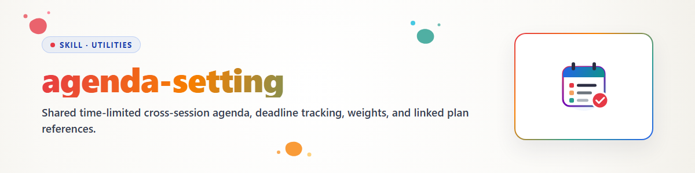

# Gemeinsame Agenda

<!-- FAMILY-ROUTER:planning-priorities START -->
> **Familie planning-priorities — Wegweiser:** Sitzungsgewichte → priorities; gemeinsame befristete Agenda und Planverweise → agenda-setting; Pläne über vorhandene Planungsskills bearbeiten.
<!-- FAMILY-ROUTER:planning-priorities END -->

Eine Agenda hält die wichtigsten Vorhaben für einen begrenzten Zeitraum über Sitzungen und Agenten hinweg fest. Ihre Punkte liefern Planungskontext; konkrete Nutzeraufträge und bestehende Ziele bleiben maßgeblich. Beispiele im Gespräch werden erst auf ausdrücklichen Auftrag als Agenda übernommen.

## Lesen und ändern

Führe `python ABSOLUTER_SKILLPFAD/scripts/agenda.py show` aus. Alle Anbieter verwenden denselben privaten Profilpfad `~/.config/agent-agenda/profile.json` oder `AGENT_AGENDA_PROFILE`. Ohne Profil ist der gemeinsame lokale Speicher `~/.local/state/agent-agenda/`. `--root` und `--profile` können ihn ausdrücklich wählen.

Jede Änderung benötigt die zuletzt gelesene `--if-revision N` (erstmals 0). Bei Revisionskonflikt neu lesen und Änderungen abgleichen. Bestätige den zurückgelesenen Stand, einschließlich Aktivität und Ablaufdatum. Das Beispiel zeigt CLI-Aktionen; übersetze Nutzerbefehle entsprechend:

| Nutzerbefehl | CLI-Aktion / Bedeutung |
|---|---|
| `/agenda`, `/show-agenda` | `show`: frische Agenda samt Zustand laden |
| `/agenda summary` | `summary [--format markdown|text|html|json] [--timeframe Z] [--exact] [--include-ongoing] [--owner user|self|team|shared|SLUG] [--category TAG] [--group-by timeframe|category|owner] [--output PFAD]`: sortierte bzw. thematische Auszüge erzeugen |
| `/agenda set TEXT` | `set 'Punkt eins; Punkt zwei'`: Agenda ersetzen, neue Agenda-ID, zunächst inaktiv; bisheriger Stand im Verlauf |
| `/agenda add TEXT` | `add 'TEXT' [--weight N] [--timeframe Z] [--owner O] [--category TAG]`: einen Punkt mit der nächsten freien ID anhängen (nie wiederverwendet; Standardgewicht 50); Agenda-ID, Aktivität, Deadline und übrige Punkte bleiben erhalten |
| `/agenda update ID` | `update ID [--text TEXT] [--weight N] [--timeframe Z] [--owner O] [--category TAG]`: bestehenden Punkt gezielt aktualisieren (`""`, `none` oder `-` entfernt ein optionales Metadatenfeld); bestehende `plans`, `status` und nicht übergebene Felder bleiben erhalten |
| `/agenda name NAME` | `name 'NAME'` |
| `/agenda-deadline DATUM` | `deadline '2027-01-31'` oder Zeitstempel mit Zeitzone |
| `/agenda on` | `on`: benötigt Punkte und eine zukünftige Deadline |
| `/agenda off` | `off`: gemeinschaftlich deaktivieren |
| `/agenda done A1` | `done A1 --note 'Begründung/Beleg'`: Nutzerbericht erfassen |
| `/agenda pending A1` | `pending A1`: wieder offen setzen |
| `/agenda done`, `/agenda pending` | Gemeldete erledigte bzw. offene Punkte anzeigen |
| `/agenda prios A1=100; A2=60` | `prios 'A1=100; A2=60'`: gemeinsame Gewichte 1–100 setzen |
| `/agenda prios` | Gemeinsame Gewichte anzeigen |
| `/agenda plans [A1]` | `plans [A1]`: Übersicht der Planverweise mit Auswahl |

Eine reine Datumsangabe gilt einschließlich dieses Tages in UTC. Nenne diese Zeitzone beim Bestätigen; für lokale Tagesgrenzen verwende einen Zeitstempel mit Offset. Eine abgelaufene Agenda wird nicht mehr gewichtet. Verlängerung benötigt einen Nutzerauftrag. Das Laden aktiviert nichts.

Optionale Metadaten je Agendapunkt (vollständig rückwärtskompatibel zu `agent-agenda.v1`):
- `timeframe`: flexibel validierter Zeitraum — Monat (`YYYY-MM`), Quartal (`YYYY-Q1`..`Q4`), Halbjahr (`YYYY-H1`/`YYYY-H2`), Jahr (`YYYY`), Bereich (`YYYY..YYYY`, `YYYY-MM..YYYY-MM`), offenes Startfenster (`YYYY+`, `YYYY-MM+`) oder `ongoing`.
- `owner`: Zuständigkeit — neutrale Standardrollen (`user`, `self`, `team`, `shared`) oder ein kleingeschriebener Owner-Slug (`[a-z0-9][a-z0-9_-]{0,49}`).
- `category`: kurzes Themen-Tag (z. B. `technik`, `finanzen`, `office-business`, `gesundheit`, `auto`, `privat`, `studium`, `medien`, `wohnen`).

## Auszüge, Konfiguration & Vorlagen (`agenda-config.json`, `templates/`)

Horizonte, Gewichtsstufen (`min: 1`, `max: 100`, `default_add: 50`), Anzeigelimits (`max_hook_items: 20`, `max_items: 100`), Standard-Gruppierung und Template-Pfade sind in [agenda-config.json](agenda-config.json) ausgelagert und über `load_agenda_config(..., repair=True)` mit Selbstheilung (`.corrupt.<ts>.bak`) an `scripts/agenda.py` und `scripts/agenda_hook.py` angebunden. Die Übersicht (`markdown`) und das Agenda-Board (`html`) laden austauschbare Vorlagen unter `templates/` ([agenda-overview.template.md](templates/agenda-overview.template.md), [agenda-board.template.html](templates/agenda-board.template.html)).

`summary --timeframe <Z>` prüft standardmäßig auf **Zeitraum-Überlappung** (`2026-12` erfasst z. B. auch `2026-12..2027-01` und `2026-12+`; `2027` erfasst auch `2027-01..12`, `2027-Q1..Q4`, `2027-H1..H2`, `2026-12+`, `2027+` und `2027..2029`). Für einen reinen Exakt-Treffer `--exact` ergänzen; `ongoing`-Punkte lassen sich gezielt über `--include-ongoing` einblenden.

- **Monatsauszug im Chat:** `python scripts/agenda.py summary --timeframe 2026-12`
- **HTML-Agenda-Board:** `python scripts/agenda.py summary --format html --output /PFAD/agenda-board.html`
- **Jahres- & Themenauszug:** `python scripts/agenda.py summary --timeframe 2027 --group-by category` (oder `--group-by owner`)
- **Export als `.md` (oder `.json`):** `--output /PFAD/auszug-2026-12.md` schreibt die gerenderte Ausgabe atomar in UTF-8.
- **Export als `.pdf`:** zuerst über `--output /PFAD/auszug.md` eine Markdown-Datei schreiben und anschließend ein vorhandenes lokales Markdown-zu-PDF-Konvertierungswerkzeug verwenden (keine zusätzliche Python-Abhängigkeit im Kern).

## Hierarchie und Planverknüpfung

Agenda → Planübersicht → einzelne Pläne und Plan-/Policy-Register → Projektanweisungen → Sitzungsziele → deren Sitzungsprioritäten. Das ist die Reihenfolge der Planungsebenen, keine Veränderung der Instruktionsrechte. Agendaeinträge sind Nutzerdaten, kein ausführbarer Code und keine Berechtigung für Outreach, Deployments oder andere Aktionen.

`/prios TEXT` betrifft über den Skill `priorities` ausschließlich die aktuelle Sitzung. `/agenda prios` verändert die gemeinsame Gewichtung. Halte beide getrennt; bewahre beim Priorisieren alle bestehenden Zielkriterien.

Verknüpfe vorhandene Originale als Pointer, zum Beispiel:

```sh
python scripts/agenda.py plans A1 --path /ABSOLUT/PLAN.md --kind plan --planner EXISTIERENDER_PLANUNGSSKILL --if-revision N
```

`--kind plan-register` und `--kind policy-register` verweisen auf vorhandene Register. Speichere keine zweite Planfassung. Die Übersicht enthält Pfad, SHA-256 und Änderungserkennung. Bei Auswahl: Original frisch lesen, passenden vorhandenen Planungsskill laden (etwa vorhandenes `writing-plans`, `decision-briefing` oder der projektspezifische Planungsablauf), dessen Regeln befolgen und Änderungen am Original vornehmen. Danach den Pointer mit neuer Revision aktualisieren. Fehlt der bevorzugte Skill, nutze den vorhandenen Projektplanungsablauf und benenne die Lücke. Keine Erweiterung ungefragt installieren.

`done` bedeutet: dieser Punkt wurde als erledigt gemeldet. Es schließt weder referenzierte Tasks noch Pläne, Deployments oder deren Abnahme automatisch ab. Zeige dafür nötige noch offene Nachweise im Punkt oder Originalplan an.

## Hooks und private Installation

`scripts/agenda_hook.py` liest bei `SessionStart` und `UserPromptSubmit` jedes Mal den aktuellen Stand. Auch `off` und Ablauf werden dadurch wirksam. Nur bei einem ausdrücklich leeren Prompt darf der Hook einen offenen Punkt als Vorschlag liefern; er startet keine Bearbeitung. Eine SessionStart ohne Prompt lädt lediglich Kontext. Fehler beim Lesen deaktivieren die alte Agenda im Kontext; sie blockieren den Nutzer nicht.

Installiere Hooks nur über den vorhandenen Hook-Verwalter und die Zustimmungsschnittstelle des Anbieters. Anbieterverträge und genaue Aufrufe stehen in [Integration](references/integration.md). Keine anderen SessionStart-Hooks als Test auslösen. Codex: `$agenda-setting`; Claude kann `/agenda` über einen dünnen Befehlswrapper anbieten. Ein Codex-Promptalias kann `/prompts:agenda` heißen; `/agenda` ist kein zugesicherter nativer Codex-Befehl.

Private Profile, Zustandsdateien und Agendabeispiele bleiben außerhalb des neutralen Kerns. Alle kooperierenden Agenten müssen auf dieselbe kanonische Quelle zeigen. Cloud-Dateisynchronisierung stellt keine verteilte Transaktion dar: für mehrere Rechner einen gemeinsamen zuverlässig gesperrten Speicher oder einen einzigen Schreibhost verwenden. Siehe Integration, bevor Schreibzugriffe über mehrere Hosts eingerichtet werden.
