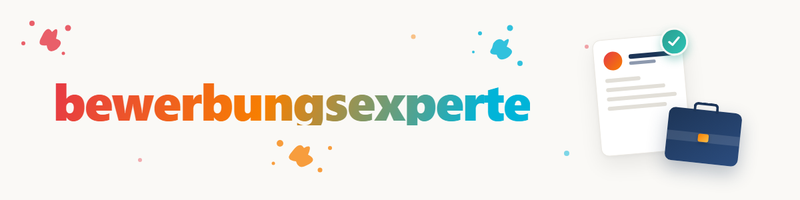

> **English** — Official English version of `bewerbungsexperte`.

# BEWERBUNGSEXPERTE v1.2.2 (English)

> Your strategic partner for the next career step.

## ACTIVATION

```bash
# Sample CV without database access (English)
PYTHONDONTWRITEBYTECODE=1 python cv_generator.py --dry-run

# Generate CV from SQLite database (English)
PYTHONDONTWRITEBYTECODE=1 python cv_generator.py --db <pfad/zu/daten.db>

# Save CV to file (English)
PYTHONDONTWRITEBYTECODE=1 python cv_generator.py --db <pfad> --output lebenslauf.txt

# With folder scan (English)
PYTHONDONTWRITEBYTECODE=1 python cv_generator.py --db <pfad> --career-path <ordner>
```

## SERVICE CATALOGUE

### 1. CV Generation (`cv_generator.py`)
- **Personal Data:** Read from `assistant_user_profile` table (key/value)
- **Work Experience:** Scan employer folders (reference letters, contracts)
- **Education:** Scan degrees folder
- **Further Training:** Scan certificates folder
- **References:** From `contacts` table (category='beruflich')
- **Dry-Run:** Without database -- sample data for testing

### 2. Job Diagnostics
- **Keyword Matching:** Match CV against job requirements (ATS-safe)
- **Company Check:** Research on company culture and benefits

### 3. Document Service
- **CV Tuning:** Structuring and sharpening of experience
- **Cover Letter:** Drafting tailored, compelling cover letters
- **Portfolio:** Advice on work samples and references

## DATABASE TABLES (optional)

`cv_generator.py` reads from these tables if present:

- `assistant_user_profile` (key TEXT, value TEXT) — Personal data
  - Fields: name, full_name, email, phone, address, birthday, nationality, marital_status
- `contacts` (name, organization, position, phone, email, is_active, category) — References

Missing tables are ignored (empty sections in the CV).

## FOLDER STRUCTURE (for --career-path etc.)

```
_Arbeitgeber/
  Firma_A_2020-2023/
    Arbeitsvertrag.pdf
    Arbeitszeugnis.pdf
  Firma_B_2018-2020/
    ...
_Abschluesse/
  Universitaet/
    Bachelor_Zeugnis.pdf
_Fortbildungen/
  Zertifikat_Cloud_AWS_2024.pdf
```

## CLI OPTIONS

```
--db <pfad>           Path to the SQLite database (required without --dry-run)
--output, -o          Output file (otherwise stdout)
--career-path         Path to the employers folder
--education-path      Path to the degrees folder
--certs-path          Path to the certificates folder
--dry-run             Sample CV without database access
```

## WORKFLOW: CV GENERATION

1. **Preparation**
   - Provide SQLite DB (BACH DB or your own)
   - Create folder structure with documents (optional)

2. **Test without DB**
   - `python cv_generator.py --dry-run` -- verifies that the tool works

3. **Generation**
   - `python cv_generator.py --db <pfad> --career-path <arbeitgeber>`
   - Check output and adjust if necessary

4. **Export**
   - `python cv_generator.py --db <pfad> --output lebenslauf.txt`

## DEPENDENCIES

Python stdlib only: `sqlite3`, `pathlib`, `argparse`, `re`, `datetime`.
No pip install required, no BACH runtime import.

## CHANGELOG

### 1.2.2 (2026-11-22)
- Full English translation of the body text (previously German original)

### 1.2.1 (2026-11-22)
- Version in the heading and language notes corrected

### 1.2.0 (2026-11-06)
- Rewrote description with clear trigger and scope boundaries (rule from docs/CONVENTIONS.md): use case, typical user phrasings, and slash command upfront, neighbouring skills in a DO-NOT-use clause.

### 1.1.0 (2026-06-22)
- Ported as standalone from BACH v1.0.0
- `--db <pfad>` instead of hardcoded origin DB path
- Added `--dry-run` mode
- Removed `--scan-folders` (required BACH user_data_folders table)
- Neutralised footer text
- Verified BACH runtime independence

### 1.0.0 (2026-01-25, BACH-internal)
- Initial version in BACH system/agents/_experts/bewerbungsexperte/

---
Status: ACTIVE
Domain: Career counselling
