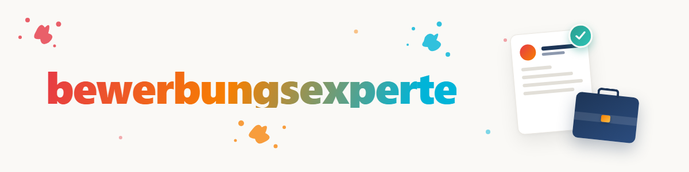

> **Français** — Version française officielle de la compétence `bewerbungsexperte`.


# BEWERBUNGSEXPERTE v1.2.2 (Français)

> Votre partenaire stratégique pour la prochaine étape de votre carrière.

## ACTIVATION

```bash
# Exemple de CV sans accès à la base de données (Français)
PYTHONDONTWRITEBYTECODE=1 python cv_generator.py --dry-run

# Générer un CV à partir d'une base de données SQLite (Français)
PYTHONDONTWRITEBYTECODE=1 python cv_generator.py --db <pfad/zu/daten.db>

# Enregistrer le CV dans un fichier (Français)
PYTHONDONTWRITEBYTECODE=1 python cv_generator.py --db <pfad> --output lebenslauf.txt

# Avec analyse de dossiers (Français)
PYTHONDONTWRITEBYTECODE=1 python cv_generator.py --db <pfad> --career-path <ordner>
```

## CATALOGUE DES SERVICES

### 1. Génération de CV (`cv_generator.py`)
- **Données personnelles :** Lire depuis la table `assistant_user_profile` (key/value)
- **Expérience professionnelle :** Scanner le dossier des employeurs (certificats de travail, contrats)
- **Formation :** Scanner le dossier des diplômes
- **Formations continues :** Scanner le dossier des certificats
- **Références :** Depuis la table `contacts` (category='beruflich')
- **Dry-Run :** Sans base de données -- données d'exemple pour les tests

### 2. Diagnostic de poste
- **Correspondance des mots-clés :** Comparaison du CV avec les exigences du poste (compatible ATS)
- **Vérification de l'entreprise :** Recherche sur la culture d'entreprise et les avantages

### 3. Service de documents
- **Optimisation du CV :** Structuration et mise en valeur des expériences
- **Lettre de motivation :** Rédaction de lettres personnalisées et convaincantes
- **Portfolio :** Conseils sur les échantillons de travail et les références

## TABLES DE LA BASE DE DONNÉES (optionnel)

`cv_generator.py` lit ces tables si elles existent :

- `assistant_user_profile` (key TEXT, value TEXT) — Données personnelles
  - Champs : name, full_name, email, phone, address, birthday, nationality, marital_status
- `contacts` (name, organization, position, phone, email, is_active, category) — Références

Les tables manquantes sont ignorées (sections vides dans le CV).

## STRUCTURE DES DOSSIERS (pour --career-path etc.)

```
_Arbeitgeber/
  Firma_A_2020-2023/
    Arbeitsvertrag.pdf
    Arbeitszeugnis.pdf
  Firma_B_2018-2020/
    ...
_Abschluesse/
  Universitaet/
    Bachelor_Zeugnis.pdf
_Fortbildungen/
  Zertifikat_Cloud_AWS_2024.pdf
```

## OPTIONS CLI

```
--db <pfad>           Chemin vers la base de données SQLite (obligatoire sans --dry-run)
--output, -o          Fichier de sortie (sinon stdout)
--career-path         Chemin vers le dossier des employeurs
--education-path      Chemin vers le dossier des diplômes
--certs-path          Chemin vers le dossier des certificats
--dry-run             Exemple de CV sans accès à la base de données
```

## WORKFLOW : GÉNÉRATION DE CV

1. **Préparation**
   - Fournir la base de données SQLite (base BACH ou la vôtre)
   - Créer la structure de dossiers avec les documents (optionnel)

2. **Test sans base de données**
   - `python cv_generator.py --dry-run` -- vérifie que l'outil fonctionne

3. **Génération**
   - `python cv_generator.py --db <pfad> --career-path <arbeitgeber>`
   - Vérifier la sortie et ajuster si nécessaire

4. **Exportation**
   - `python cv_generator.py --db <pfad> --output lebenslauf.txt`

## DÉPENDANCES

Uniquement la bibliothèque standard Python : `sqlite3`, `pathlib`, `argparse`, `re`, `datetime`.
Aucune installation pip requise, aucun import du runtime BACH.

## JOURNAL DES MODIFICATIONS

### 1.2.2 (2026-11-22)
- Traduction française complète du corps du texte (auparavant l'original allemand)

### 1.2.1 (2026-11-22)
- Version dans le titre et notes de langue corrigées

### 1.2.0 (2026-11-06)
- Description réécrite avec un déclencheur clair et une délimitation du périmètre (règle de docs/CONVENTIONS.md) : cas d'usage, formulations types des utilisateurs et commande slash en tête, compétences voisines dans une clause NE PAS utiliser.

### 1.1.0 (2026-06-22)
- Porté en version autonome depuis BACH v1.0.0
- `--db <pfad>` à la place du chemin de base de données d'origine codé en dur
- Ajout du mode `--dry-run`
- Suppression de `--scan-folders` (nécessitait la table BACH user_data_folders)
- Texte de pied de page neutralisé
- Indépendance vis-à-vis du runtime BACH vérifiée

### 1.0.0 (2026-01-25, interne à BACH)
- Version initiale dans BACH system/agents/_experts/bewerbungsexperte/

---
Statut : ACTIF
Domaine : Conseil en carrière
