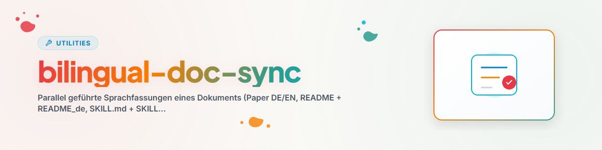

# Bilingual-Doc-Sync — parallele Sprachfassungen synchron halten

## Zweck

Zweisprachig geführte Dokumente divergieren schleichend: Die aktiv bearbeitete Fassung
wächst, die andere veraltet — bis „Übersetzung" nur noch dem Namen nach stimmt. Dieser
Skill macht die Synchronprüfung zu einem definierten Ablauf mit einer entscheidenden
Vorab-Festlegung: **Welche Fassung führt?** Ohne Leitsprache-Regel wird jede Divergenz
zur Einzelfallentscheidung und der Abgleich unwiederholbar.

## Ablauf

### 0. Einsprachigen Inhalt erkennen (VOR jedem Abgleich)

Divergenz ist nicht immer „veraltet" — manchmal ist sie **neuer, echter Inhalt, der bisher
nur in einer Fassung existiert** (externer Beitrag/PR in einer Nicht-Leitsprache, eine
Änderung, die zuerst in der Nebenfassung ankam, oder Content-Verlust durch einen
History-Rewrite o. ä.). Das ursprüngliche Verfahren kannte nur „in EN oder DE eintragen,
dann an alle ausliefern" — keinen Fall, in dem etwas nur in einer Fassung steht. Belegfall:
`ellmos-ai/skills` PR #1 fügte einen chinesischsprachigen Discovery-Link nur in README.md
ein; ein späterer History-Rewrite verlor ihn wieder, weil kein Schritt geprüft hat, ob
Inhalt existiert, der in keiner anderen Fassung steht (T-20260926-967984806).

- **Prüfen, nicht annehmen:** Vor dem eigentlichen Abgleich (Schritt 3) einen Diff gegen
  den letzten bekannten synchronisierten Stand (oder gegen die anderen Fassungen direkt)
  ziehen und gezielt nach Inhalt suchen, der in EINER Fassung neu ist und in KEINER anderen
  ein Gegenstück hat — nicht nur nach fehlenden Abschnitten der Leitsprache.
- **Werkzeug:** `scripts/check_language_parity.py <datei1> <datei2> [...]` extrahiert
  Markdown- UND HTML-Links (`[text](url)`, `<a href="url">`, ``) aus allen
  übergebenen Fassungen (Links bleiben über Übersetzung hinweg unverändert und sind damit
  ein robuster, sprachunabhängiger Indikator) und meldet jeden Link, der nicht in ALLEN
  Fassungen vorkommt, mit Exit 1. Exit 0 heißt: keine Link-Teilmengen-Abweichung gefunden —
  kein Beweis für vollständige Parität, aber ein gezielter Schritt-0-Rauchtest vor dem
  manuellen Abgleich. Links innerhalb eines `<!-- lang-only: <code> -->`-Blocks werden nur
  gegen Dateien geprüft, deren Sprachcode in der Markierung genannt ist (per Dateiname
  erkannt, z. B. `README_zh.md` → `zh`, `README.md` → `en`) — sie zählen dort NICHT als
  „fehlt in den anderen Fassungen". Zusätzlich filtert das Skript standardmäßig
  `shields.io`-Badge-URLs mit codiertem Label-Text heraus (dort steckt oft die übersetzte
  Beschriftung direkt in der URL — kein echter Contentverlust, sondern erwartete
  Übersetzungs-Varianz; `--include-badges` schaltet den Filter ab). Nicht-UTF-8-lesbare
  Dateien und fehlende Argumente enden mit Exit 2 und einer Fehlermeldung, nicht mit einem
  Traceback.
- **Entscheidung bei Fund:** einsprachiger Inhalt wird NIE still verworfen. Drei Auswege,
  keine stille Löschung:
  (a) **übersetzen und in ALLE Fassungen übernehmen** — der Normalfall bei allgemein
  relevantem Inhalt;
  (b) **bewusst auf eine/mehrere Sprache(n) beschränkt** ("lang-only") — wenn der Inhalt nur
  für diese Zielgruppe gilt (Belegfall T-20260926-967984806: ein chinesischsprachiger
  Discovery-Link ist für DE/ES/JA/RU-Leser:innen nicht relevant, eine Übersetzung in alle
  sechs Fassungen wäre selbst falsch gewesen — Nutzerkorrektur nach der ersten Fassung
  dieses Schritts). Markierung: **`<!-- lang-only: <code>[,<code>...] --> … <!-- /lang-only -->`**
  (HTML-Kommentar, in Markdown-Renderern unsichtbar; für mehrere Zielsprachen kommagetrennt,
  z. B. `zh,ja`). Kein etablierter Branchenstandard für diesen engen Fall bekannt (P-009
  geprüft) — HTML-Kommentare sind die portabelste, unsichtbar rendernde Wahl für Markdown.
  Markierter Inhalt wird beim Abgleich **weder übersetzt noch als fehlend gemeldet**;
  (c) **als Konflikt eskalieren**, wenn unklar ist, ob der Inhalt noch gewollt ist (z. B. wirkt
  widersprüchlich zur Leitfassung) — Nutzer/Entscheidungskette fragen.
  In allen drei Fällen gilt: niemals kommentarlos aus der Fassung entfernen, in der der
  Inhalt steht, nur weil die anderen ihn nicht haben.

### 1. Bestand feststellen

- Liegen beide (alle) Sprachfassungen vor? Fehlt eine ganz → **nachziehen** (vollständige
  Übersetzung der führenden Fassung, nicht Neudichtung).
- Namenskonvention prüfen (z. B. `DOKUMENT.md` + `DOKUMENT.en.md` oder `_de`/`_en`-Suffixe)
  und Abweichler angleichen — Auffindbarkeit ist die halbe Synchronität.

### 2. Leitsprache klären (vor jedem Abgleich)

- Die Leitsprache ist die Fassung, in der inhaltlich gearbeitet wird (bei Papers oft EN,
  bei lokaler Doku oft die Muttersprache). Sie gewinnt bei Widerspruch.
- **Rücktransfer-Ausnahme:** Löst die Nebenfassung etwas nachweislich besser (klarere
  Formulierung, korrigierter Fehler), wird es in die Leitfassung ÜBERNOMMEN — erst
  rücktransferieren, dann normal synchronisieren. Fachliche Korrektheit prüfen, bevor
  eine „schönere" Formulierung übernommen wird.

### 3. Parallelität prüfen

Struktur zuerst, dann Inhalt:

1. **Gliederungsvergleich:** Abschnitte/Überschriften beider Fassungen nebeneinander —
   fehlende, zusätzliche, umsortierte Abschnitte sind die groben Divergenzen.
2. **Abschnittsweise Stichprobe** der übereinstimmenden Gliederung: Aussagen, Zahlen,
   Verweise, Beispiele identisch? Besonders divergenzanfällig: Changelogs, Tabellen,
   Zahlenwerte, Literatur-/Linkverzeichnisse, zuletzt bearbeitete Abschnitte.
3. **Nicht übersetzbare Invarianten** prüfen: Code-Blöcke, Identifier, Formeln, Pfade
   müssen in beiden Fassungen IDENTISCH sein (Code wird nie übersetzt).

### 4. Beheben

- Divergenzen in Richtung Leitsprache auflösen (bzw. nach Rücktransfer).
- Sprachtypografie der Zielsprache respektieren (im Deutschen echte Umlaute ä ö ü ß,
  keine ae/oe/ue-Ersatzschreibung; Anführungszeichen-Konventionen).
- Metadaten nachziehen: Versionsnummern, Datumsfelder, Changelog-Einträge in BEIDEN
  Fassungen (der Changelog selbst ist der häufigste Divergenzpunkt).

### 5. Dokumentieren

Ergebnis festhalten (was war divergent, was wurde übernommen, was rücktransferiert).
Als periodischer Lauf über einen Bestand: mit dem Rotations-Gerüst kombinieren
(`rotation-check`) — ein Dokument(-Paar) pro Lauf, Registry als Gedächtnis.

## Erweiterung: Expansions-Audit (sollten MEHR Sprachen existieren?)

Neben dem Synchronhalten bestehender Fassungen gehört zur Sprachpflege die Frage, ob ein
Dokument/Projekt WEITERE Sprachen verdient:

1. **Eignung bewerten** statt blind übersetzen: Zielgruppe, internationale Nutzbarkeit,
   Store-/Web-Präsenz, Mobilität des Inhalts. Nicht jedes interne Dokument braucht Englisch;
   nicht jede App braucht fünf Sprachen.
2. **Technische Vorbereitung prüfen:** Ist das Ziel überhaupt auf Sprachdateien/Parallel-
   Fassungen vorbereitet (i18n-Struktur, Namenskonvention)? Wenn nein, ist DAS die erste
   Aufgabe, nicht die Übersetzung.
3. **Befund dokumentieren, nicht sofort massenübersetzen:** Konkrete Übersetzungsaufgaben
   in die projektlokale TODO-Datei; „keine weitere Sprache sinnvoll" ist ein gültiges,
   festzuhaltendes Ergebnis.
4. **QA bei nachgezogenen Fassungen:** Auto-generierte Übersetzungen stichprobenartig
   gegen die Leitfassung prüfen (Abschnitt 3), bevor sie als „vorhanden" gelten.

## Beispiel

```text
Auftrag: „Prüf, ob das Paper in DE und EN synchron ist."

1. Bestand: paper_en.tex (führend) + paper_de.tex vorhanden.
2. Gliederung: DE fehlt der neue Abschnitt 4.2 (letzte EN-Revision); DE hat einen
   besseren Beweis-Absatz in 3.1.
3. Rücktransfer: 3.1-Formulierung fachlich geprüft → in EN übernommen.
4. Nachziehen: 4.2 nach DE übersetzt; Zahlen in Tabelle 2 abgeglichen (DE hatte
   veraltete Werte); Literaturverzeichnis identisch gemacht.
5. Registry-Eintrag: „paper-X | 2026-07-03 | de-en-sync | 3 Divergenzen behoben,
   1 Rücktransfer | nächster Check nach nächster EN-Revision".
```

## Red Flags

| Gedanke | Realität |
| --- | --- |
| „Ich übersetze die Unterschiede einfach frisch" | Erst Leitsprache + Rücktransfer-Frage klären — sonst wird die bessere Lösung überschrieben. |
| „Die Gliederung passt, also ist es synchron" | Zahlen, Changelogs und Verweise divergieren zuerst — Stichprobe in die Tiefe ist Pflicht. |
| „Code-Kommentare übersetze ich mit" | Code-Blöcke und Identifier bleiben in beiden Fassungen identisch (englisch). |
| „Ich synchronisiere alle Dokumente in einem Rutsch" | Ein Paar pro Lauf (Rotations-Gerüst) hält den Abgleich prüfbar. |

## Autorisierte Serienübersetzungen

Bei einem ausdrücklichen Auftrag für einen ganzen Sprachbestand unterstützt
`scripts/worldset.py` den Ablauf mit der Claude Message Batches API. Die
Arbeitseinheit ist Quelle × Sprache × SHA-256. Das Skript benötigt nur Python
3.10 oder neuer sowie `pip install -r scripts/requirements.txt`. Die Sprachliste wird ausdrücklich aus der jeweils geltenden
Projektkonvention übernommen; die eingebauten Codes sind DE, EN, ES, ZH, JA,
RU, FR, HI, AR, BN und PT.

```bash
python scripts/worldset.py scan --root /path/to/checkout --kind skills --out /private/run/plan.json
python scripts/worldset.py submit --projection /private/run/plan.json --receipt /private/run/batch.json --limit 20
python scripts/worldset.py collect --receipt /private/run/batch.json --out /private/run/results
```

`--kind readme` plant stattdessen README-Sprachfassungen. README.md ist dabei
standardmäßig Englisch; eine andere Leitsprache muss mit
`<!-- source-language: de -->` ausdrücklich deklariert werden. Den Bestand
vorher auf bereits etablierte alternative Dateinamen prüfen.

`retry-plan --receipt ... --results ... --out ...` erstellt aus abgeschlossenen
Gatefehlern genau einen Korrekturversuch. Erneute Fehler bleiben zur Prüfung
liegen. Pro Sprache kann `submit --glossary <json>` ein Terminologieobjekt
verwenden; dessen Einträge werden dem jeweiligen Sprachexperten mitgegeben.

Der API-Schlüssel kommt aus `ANTHROPIC_API_KEY` oder `--key-file`; sein Wert
wird weder in Receipts noch in Übersetzungen geschrieben. Nur das ausdrücklich
freigegebene vorhandene Guthaben nutzen, niemals automatisch aufladen. Das
Skript beendet Cloudarbeit bei fehlendem Guthaben. Ein lokaler Modelladapter
braucht seine eigene Freigabe und Ressourcenprüfung.

Die Projektion ist ein Eingabesnapshot, keine zweite Aufgabenqueue. Die
Provider-Batch-ID ist der Ausführungshandle; laufende Batches werden abgefragt,
nicht neu eingereicht. Ein Receipt ohne Batch-ID nach einem Transportfehler
muss mit der Batchliste des Anbieters abgeglichen werden. Einreichungen nicht
blind wiederholen. Vorlagen und Glossare sind untrusted data.

Ausgaben liegen ausschließlich in `raw/` und nach bestandenen Struktur- und
Sprachprüfungen in `candidates/`. Auch bestandene Kandidaten brauchen eine
unabhängige sprachliche Stichprobe; mechanische Gates beweisen keine
Übersetzungsqualität. Bestehende Sprachfassungen ohne Quellhash werden erhalten,
weil sie eigenständige Ergänzungen enthalten können. `--include-stale` plant
nur zuvor hashmarkierte veraltete Übersetzungen neu. Vor der Übernahme Quellhash,
Zielzustand und Locks erneut prüfen; danach reguläre Repository-, Privacy-,
Commit- und Deployment-Gates ausführen. Hintergrundbetrieb nur über den bereits
zuständigen Scheduler mit dessen Claim- und Ressourcenvertrag.

### Separate API-Sprachprüfung

Beim Scan gilt die deklarierte Quellsprache, sonst der deutsche Standard für
eigene Skills. Für englische Fremdquellen ist \`--source-language en\` explizit
anzugeben; \`--kind skills-flat\` unterstützt eine flache Skill-Bibliothek.
\`--source-languages\` lädt bei gemischten Beständen eine geprüfte JSON-Zuordnung
von relativem Quellpfad zu Sprachcode. Die Originalquelle bleibt erhalten;
fehlende deutsche Fassungen werden dann als \`SKILL.de.md\` angelegt.
Vorhandene ältere Sprachordner wie \`EN/SKILL.md\` oder \`fr/SKILL.md\` zählen als
erhaltene Fassungen und werden nicht durch konkurrierende Dateien ergänzt.

`scripts/worldset_review.py` bereitet bestandene Kandidaten für eine unabhängige
Sprachprüfung vor. Der Übersetzer bleibt Haiku; das Prüfmodell wird separat
angegeben. Erst eine anhand bereits geprüfter Beispiele kontrollierte Probe
verwenden, dann den weiteren Prüfumfang anhand der Fehlerquote festlegen.

```bash
python scripts/worldset_review.py prepare --translation-receipt batch.json --results-dir staging --out review-plan.json
python scripts/worldset_review.py submit --projection review-plan.json --receipt review-batch.json --model claude-sonnet-5-5
python scripts/worldset_review.py collect --receipt review-batch.json --out review-results
```

Die Prüfung liest jede ausgewählte Quelle und Fassung vollständig. Ihre
Entscheidung ist an Quellhash, Kandidatenhash, Pfade, Sprache und tatsächlich
beobachtetes Prüfmodell gebunden. Bedeutungsfehler und fehlende lokale Trigger
blockieren die Übernahme auch bei hohem Gesamtwert. Wegen der Fehlerquote im
Pilot verlangt der automatische Prüfer mindestens 4,5 von 5 Punkten.
Jeder benannte Befund benötigt zusätzlich eine explizite Operatorprüfung:
\`operator_reviewed: true\`, \`operator\` und \`operator_notes\` im hashgebundenen
Reviewdatensatz. Auch als geringfügig bewertete Bedeutungsänderungen dürfen
nicht automatisch durchlaufen. Fehlerhafte oder gekürzte
Prüfantworten bleiben zurückgestellt. Die erzeugten `reviews-<batch-id>.json`
sind Eingaben für `worldset.py apply`; die Sprachprüfung schreibt keine Ziele.
Ein automatisches Urteil ersetzt keine projektspezifische Endabnahme.

`retry-plan` erlaubt einen Korrekturlauf. Bei `max_tokens` wird dessen
Ausgabelimit gezielt auf mindestens 64.000 erhöht; nach einem bereits
ausgeschöpften Limit von 128.000 ist eine Aufteilung nötig. Die Freigabe der
API-Kosten und das Verbot automatischer Guthabenaufladung gelten weiterhin.
Rohdaten und eingefrorene Schutzverträge abgeschlossener Batches erhalten.
Neue Parserregeln dürfen ältere Markerzuordnungen nicht nachträglich ersetzen.
Bei nackten URLs ohne Trennzeichen zum Folgetext kann die Grenze mehrdeutig
sein; solche Fälle bleiben zur Formatprüfung zurückgestellt. Eindeutige
Markdown-Links oder Trennzeichen verhindern diese Mehrdeutigkeit.

## Gezielte semantische Korrekturen

`scripts/worldset_repair.py` bearbeitet vollständige Kandidaten, die die
mechanischen Prüfungen bestehen, deren Sprachprüfung oder Operatorprüfung aber
konkrete Fehler gefunden hat. Die Eingabe enthält Originalbatch und ID,
vollständige Quelle und Kandidatenfassung, deren Hashes, das tatsächlich
beobachtete Übersetzungsmodell, den vollständigen unabhängigen Reviewdatensatz
und konkrete `repair_feedback`. Bei getrennten Quellbeständen jeden Bestand mit
seiner eigenen `--repository-root` vorbereiten.

```bash
python scripts/worldset_repair.py --repository-root repo prepare --cases repair-cases.json --out repair-plan.json
python scripts/worldset_repair.py --repository-root repo submit --projection repair-plan.json --receipt repair-batch.json
python scripts/worldset_repair.py --repository-root repo collect --receipt repair-batch.json --out repair-staging
```

Der Reparaturauftrag bindet Quelle, Kandidat, vollständigen Review und Feedback
an eine neue ID. Vor dem API-Aufruf müssen die aktuelle Quelle und das noch
fehlende Ziel passen. Der native Batch bleibt das einzige Ausführungshandle;
ein reserviertes Receipt nach unklarem Submit darf nicht erneut eingereicht
werden. Der API-Schlüssel bleibt auf dem ausführenden Host. Bei verschiedenen
Hosts eine separat abgelegte, per Hash geprüfte Quellkopie als Eingabewurzel
verwenden; sie ersetzt nicht die erneute Prüfung der echten Quelle beim Apply.

Haiku liefert höchstens 16 eindeutige, nicht überlappende Ersetzungen. Code,
Links, Sprache und Provenienz bleiben geschützt; nur der Zeitstempel im
Frontmatter wird vom Collector angepasst. Nach der letzten Änderung laufen
die vollständigen mechanischen Prüfungen erneut. Vorhandene Zielfassungen und
README-Kandidaten ohne YAML-Frontmatter sind für diesen Reparaturweg
ausgeschlossen; diese Grenze wird bereits vor dem Submit geprüft.

Das Ergebnis bleibt `review_required`. Danach mit `worldset_review.py` eine
neue vollständige unabhängige Sprachprüfung durchführen und alle Befunde
zusätzlich auflösen. Der frühere Review ist keine Freigabe des reparierten
Kandidaten. Erst danach gilt der bestehende Apply-Vertrag mit frischem
Lockscan, Quellhashprüfung und atomarer Neuanlage.

## Verwandte Skills

- `rotation-check` — Gerüst für den periodischen Lauf über einen Dokumentbestand.
- `workflow-extract` — wenn dieser Check als stehende Automation eingerichtet werden soll.

## Changelog

### 1.5.1 (2026-10-15)
- Reguläre Thinking-Metadaten neben dem JSON-Reparaturtext verarbeiten;
  Tool-Blöcke, unbekannte Antworttypen und Antworten ohne JSON-Text abweisen.
- Regression mit gespeicherten echten Providerantworten und eindeutiger
  Modulauswahl im Testprozess abgesichert.

### 1.5.0 (2026-10-15)
- Begrenzte semantische Korrekturen mit vollständiger Quell-, Kandidaten-, Review-
  und Feedbackbindung, nativen Receipts und erneuter unabhängiger Sprachprüfung
  ergänzt; explizite Prüfungen bleiben auch unter optimiertem Python aktiv.

### 1.4.0 (2026-10-15)
- Deklarierte oder explizite Quellsprachen, flache Bibliotheken und vorhandene
  ältere Sprachordner beim Scan berücksichtigt, einschließlich deutscher
  Zielfassungen englischer Quellen.

### 1.3.1 (2026-10-15)
- Separate, hashgebundene API-Sprachprüfung ergänzt; Code-Spans anhand des
  CommonMark-Parsers geschützt, URL- und Absatzzuordnung geprüft und begrenzte
  Korrekturläufe nach ausgeschöpftem Ausgabelimit ermöglicht.

### 1.3.0 (2026-10-15)
- Autorisierte Serienübersetzungen mit unveränderlichen Eingabeprojektionen,
  nativen Batch-Handles, geschützten Code-/Linkbereichen, Quellhash-Provenienz
  und getrennten Prüfkandidaten ergänzt.

### 1.2.2 (2026-09-26)
- `scripts/check_language_parity.py`: Praefixregel fuer lang-only-Codes —
  ein Basis-Code (z.B. `zh`) deckt jetzt auch seine Regionsvarianten ab
  (`zh-cn`, `zh-tw`); umgekehrt gilt das nicht.
- Die fail-closed-Pruefung eines lang-only-Codes vergleicht jetzt gegen ALLE
  README-Dateien im Verzeichnis, nicht nur die uebergebene Teilmenge — ein
  Aufruf mit nur zwei von sechs Fassungen loest dadurch keinen Fehlalarm
  mehr aus. Ein gueltiger Code ohne Datei in DIESEM Aufruf ergibt jetzt nur
  einen Hinweis (kein Exit 1); ein wirklich unbekannter Code (Tippfehler wie
  `cn` statt `zh`) bleibt Exit 1.

### 1.2.1 (2026-09-26)
- `scripts/check_language_parity.py`: ein lang-only-Code, der zu keiner der
  uebergebenen Sprachfassungen passt (z.B. Tippfehler `cn` statt `zh`), wird
  jetzt fail-closed als Befund gemeldet statt den Link still freizustellen.
- Dateinamen mit Regionscode werden jetzt als Sprache erkannt:
  `README_zh-CN.md` und `README_zh_CN.md` liefern beide `zh-cn`.

### 1.2.0 (2026-09-26)
- Schritt 0 „Einsprachigen Inhalt erkennen" ergänzt (T-20260926-967984806): Divergenz kann
  neuer, noch nicht propagierter Inhalt sein statt Veralterung; drei Auswege (übersetzen+
  überall / lang-only markieren / als Konflikt eskalieren), nie stille Löschung. Neue
  `<!-- lang-only: <code> -->`-Markierung für bewusst zielgruppenbeschränkten Inhalt.
- `scripts/check_language_parity.py` + `scripts/test_check_language_parity.py` ergänzt:
  findet Links, die nur in einer Teilmenge der Sprachfassungen vorkommen (Markdown- und
  HTML-Links), respektiert die lang-only-Markierung, filtert shields.io-Badge-Rauschen,
  fängt Nicht-UTF-8-Dateien mit Exit 2 statt Traceback ab.

### 1.1.0 (2026-07-03)
- Expansions-Audit ergänzt (i18n-Eignung bewerten, technische Vorbereitung, QA für
  nachgezogene Fassungen) — integriert statt als eigener i18n-coverage-audit-Skill
  (Dedup-Entscheid).

### 1.0.0 (2026-07-03)
- Initiale Version. Abstrahiert aus der Codex-Automation
  „research-paper-de-en-synchronisationscheck", verallgemeinert auf beliebige parallel
  geführte Sprachfassungen (Papers, READMEs, Skills, Website-Texte).
