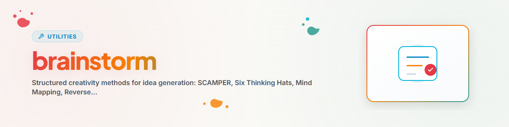

> **Français** — Version française officielle de la compétence `brainstorm`.

# Brainstorm — Créativité structurée

> Créativité structurée pour l'innovation — SCAMPER, Six Thinking Hats, Mind Mapping, Reverse Brainstorming, TRIZ, Rapid Ideation

---

## Quand l'utiliser ?

- Besoin de nouvelles idées
- Blocage / panne de créativité
- Recherche d'innovation
- Résoudre un problème de manière créative

**Mots déclencheurs :** brainstorm, idées, créatif, innovant, génération d'idées

---

## Méthodes

### 1. SCAMPER

**Substitute, Combine, Adapt, Modify, Put to other use, Eliminate, Reverse**

Améliorer systématiquement des solutions existantes :
- **S**ubstituer : que peut-on remplacer ?
- **C**ombiner : que peut-on associer ?
- **A**dapter : que peut-on ajuster ?
- **M**odifier : que peut-on transformer ?
- **P**our un autre usage : à quoi d'autre cela peut-il servir ?
- **É**liminer : que peut-on supprimer ?
- **R**enverser : que peut-on inverser ?

---

### 2. Six Thinking Hats (Edward de Bono)

Explorer systématiquement 6 perspectives :

- **Chapeau Blanc — Faits :** de quelles informations disposons-nous ? Que manque-t-il ?
- **Chapeau Rouge — Émotion :** quel ressenti cela inspire-t-il ? Intuition, sentiment spontané
- **Chapeau Noir — Critique :** qu'est-ce qui pourrait mal tourner ? Risques, faiblesses
- **Chapeau Jaune — Optimisme :** quelles sont les opportunités ? Meilleur scénario
- **Chapeau Vert — Créativité :** nouvelles idées ? Pensée hors des sentiers battus ?
- **Chapeau Bleu — Méta :** pilotage du processus, synthèse, prochaines étapes

**Processus :** définir le problème (Bleu) -> faits (Blanc) -> émotions (Rouge) -> critique (Noir) -> positif (Jaune) -> nouvelles idées (Vert) -> synthétiser (Bleu)

---

### 3. Mind Mapping (Carte mentale)

Visualiser les idées de manière hiérarchique :
1. Thème central
2. Branches principales (3–7)
3. Sous-branches pour chaque catégorie
4. Ajouter détails et idées
5. Repérer les connexions

---

### 4. Reverse Brainstorming (Brainstorming inversé)

Inverser le problème : « Comment rendre les choses PIRES ? »

1. Inverser le problème
2. Recueillir de mauvaises idées
3. Inverser chaque mauvaise idée = bonnes idées

Particulièrement efficace lorsque la recherche directe d'idées piétine.

---

### 5. TRIZ (Théorie de résolution des problèmes inventifs)

Top 10 des principes appliqués au logiciel :
1. **Segmentation :** découper un monolithe en modules
2. **Extraction :** isoler une propriété gênante
3. **Qualité locale :** composants différents, propriétés différentes
4. **Fusion :** combiner des fonctions similaires
5. **Universalité :** un élément, plusieurs fonctions
6. **Imbrication :** placer des composants les uns dans les autres
7. **Action préalable :** préparer à l'avance
8. **Rétroaction :** surveillance et ajustement
9. **Auto-service :** le système s'entretient lui-même
10. **Asymétrie :** conceptions non symétriques

---

### 6. Rapid Ideation (Idéation rapide)

La quantité avant la qualité — 50+ idées en 20 minutes.

**Règles :**
- AUCUNE critique pendant la phase d'idéation
- Idées FOLLES bienvenues
- Rebondir sur les idées des autres
- Quantité D'ABORD

**Rythmé par minuteur :**
- Tour 1 (5 min) : idéation libre
- Tour 2 (5 min) : variations
- Tour 3 (5 min) : combinaisons
- Tour 4 (5 min) : idées extrêmes

---

## Workflow

```
1. Demande utilisateur
2. Comprendre l'objectif
3. Choisir la ou les méthodes
4. Générer des idées (aucune critique !)
5. Regroupement thématique (Clustering)
6. Matrice Faisabilité / Impact
7. Sélection du Top 5–10
8. Restitution + recommandation
```

---

## Journal des modifications

### 1.1.1 (2026-11-22)
- Mention linguistique corrigée.

### 1.1.0 (2026-11-06)
- Description reformulée avec déclencheur clair et délimitation (règle de `docs/CONVENTIONS.md`) : situation d'emploi, formulations types et commande slash en tête, compétences voisines dans une clause « Ne PAS utiliser ».

### 1.0.0 (2026-03-15)
- Portage depuis BACH v3.8.0.

---

*Porté depuis BACH v3.8.0 | Version autonome*

**Voir aussi :** [think](../think/SKILL.md) (Analyse, cause racine, SWOT) | [decide](../decide/SKILL.md) (Cadres de décision)
