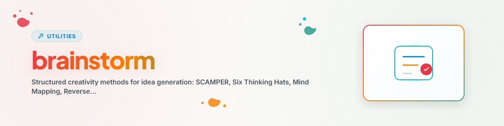

# Brainstorm

> Criatividade estruturada para inovação — SCAMPER, Six Hats, Mind Mapping, Reverse Brainstorming, TRIZ, Rapid Ideation

---

## Quando usar?

- Precisa de novas ideias
- Estagnado / bloqueio criativo
- Procura por inovação
- Resolver um problema de forma criativa

**Palavras-gatilho:** brainstorm, ideias, criativo, inovador, geração de ideias

---

## Métodos

### 1. SCAMPER

**Substitute, Combine, Adapt, Modify, Put to other use, Eliminate, Reverse**

Melhorar sistematicamente soluções existentes:
- **S**ubstitute: O que pode ser substituído?
- **C**ombine: O que pode ser combinado?
- **A**dapt: O que pode ser adaptado?
- **M**odify: O que pode ser modificado?
- **P**ut to other use: Para que mais pode ser usado?
- **E**liminate: O que pode ser eliminado?
- **R**everse: O que pode ser invertido?

---

### 2. Six Thinking Hats (Edward de Bono)

Analisar sistematicamente 6 perspectivas:

- **Chapéu Branco — Fatos:** Que informações temos? O que falta?
- **Chapéu Vermelho — Emoção:** Que sensação isso transmite? Intuição, instinto
- **Chapéu Preto — Crítica:** O que poderia dar errado? Riscos, fraquezas
- **Chapéu Amarelo — Otimismo:** Quais são as oportunidades? Melhor cenário
- **Chapéu Verde — Criatividade:** Novas ideias? Fora da caixa?
- **Chapéu Azul — Meta:** Controle do processo, resumo, próximos passos

**Processo:** Definir o problema (Azul) -> Fatos (Branco) -> Emoções (Vermelho) -> Crítica (Preto) -> Positivos (Amarelo) -> Novas ideias (Verde) -> Resumir (Azul)

---

### 3. Mind Mapping

Visualizar pensamentos hierarquicamente:
1. Tema central
2. Ramos principais (3-7)
3. Subramos para cada categoria
4. Adicionar detalhes e ideias
5. Reconhecer conexões

---

### 4. Reverse Brainstorming

Inverter o problema: "Como tornamos isso PIOR?"

1. Inverter o problema
2. Coletar más ideias
3. Inverter = Boas ideias

Especialmente útil quando a geração direta de ideias estagna.

---

### 5. TRIZ (Theory of Inventive Problem Solving)

Top 10 princípios para software:
1. **Segmentation:** Dividir o monólito em módulos
2. **Extraction:** Isolar a propriedade perturbadora
3. **Local Quality:** Componentes diferentes, propriedades diferentes
4. **Merging:** Combinar funções semelhantes
5. **Universality:** Um elemento, várias funções
6. **Nesting:** Componentes um dentro do outro
7. **Preliminary Action:** Preparação antecipada
8. **Feedback:** Monitoramento e ajuste
9. **Self-Service:** O sistema se mantém sozinho
10. **Asymmetry:** Projetos não simétricos

---

### 6. Rapid Ideation

Quantidade antes de qualidade — 50+ ideias em 20 min.

**Regras:**
- NENHUMA crítica durante a ideação
- Ideias SELVAGENS são bem-vindas
- Construir sobre as ideias dos outros
- Quantidade PRIMEIRO

**Baseado em tempo:**
- Rodada 1 (5 min): Ideação aberta
- Rodada 2 (5 min): Variações
- Rodada 3 (5 min): Combinações
- Rodada 4 (5 min): Ideias extremas

---

## Fluxo de trabalho

```
1. User Request
2. Ziel verstehen
3. Methode(n) waehlen
4. Ideen generieren (keine Kritik!)
5. Clustering
6. Feasibility/Impact Matrix
7. Top 5-10 Auswahl
8. Output + Empfehlung
```

---

## Registro de alterações

### 1.0.0 (2026-03-15)
- Portado do BACH v3.8.0

---

*Portado do BACH v3.8.0 | Versão standalone*

**Veja também:** [think](../think/SKILL.md) (Análise, Causa raiz, SWOT) | [decide](../decide/SKILL.md) (Frameworks de decisão)
