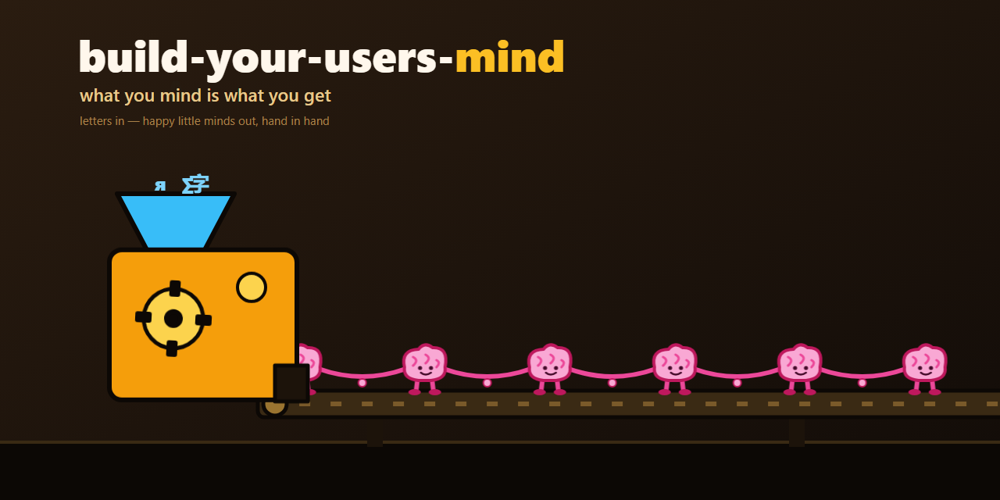

# build-your-users-mind — مرجع عام مستقل عن المزوّد

هذه المهارة مرجع مختصر إلى الوحدة العامة
[`ellmos-ai/build-your-users-mind`](https://github.com/ellmos-ai/build-your-users-mind).
تتضمن الوحدة الإجراء الكامل والقوالب والمخططات والنصوص البرمجية والاختبارات
وتوثيق محوّلات المصادر. لا يكرر هذا الفهرس الشيفرة البرمجية.

## ما تقدمه الوحدة

بموافقة صريحة من الشخص المختص، تساعد الوحدة الوكيل على:

1. استخراج المساهمات الحقيقية التي كتبها المستخدم من سجلات تفاعلاته الخاصة؛
2. تنقيح المحتوى الحساس قبل تخزينه بشكل دائم؛
3. تقليص الأدلة المتعلقة بالتفضيلات والقرارات المتكررة وتصنيفها؛
4. بناء نموذج تفضيلات محلي مع مستويات ثقة ومصادر إثبات؛
5. ربط مرجع موجز ببيئة تشغيل الوكيل المختارة؛ و
6. معايرة التنبؤات استنادًا إلى ملاحظات حقيقية لاحقة.

الوحدة العامة إجراء يصلح لأي مستخدم وبيئات تشغيل وكيل مدعومة. لا تتضمن
نموذجًا لأي شخص بعينه.

## حدود الأمان والخصوصية

- يلزم الحصول على موافقة الشخص المختص قبل قراءة سجلات التفاعل.
- تبقى الملفات الشخصية والسجلات الخام ومجموعات الأدلة والمسارات المحلية خاصة.
- التنبؤات فرضيات غير مؤكدة، وليست قراءةً للأفكار ولا تشخيصًا ولا تصريحات
  صادرة عن المستخدم.
- لا يوسّع التنبؤ بالتفضيلات أبدًا صلاحيات الوكيل.
- تحتاج الإجراءات الخارجية أو غير القابلة للتراجع أو الحرجة للأمان أو القانونية
  أو الطبية أو المهنية أو المالية، أو ما شابهها من إجراءات ذات عواقب جسيمة، إلى
  تأكيد صريح.
- لا يجوز أبدًا أن تصبح التنبؤات التي يولدها الوكيل أدلة أولية عن المستخدم.

## التثبيت

```bash
git clone https://github.com/ellmos-ai/build-your-users-mind.git <clone-path>
```

اتبع الملفات الحالية `README.md` و`SKILL.md`
و`SOURCE-ADAPTERS.md`، وتعليمات الخصوصية الخاصة بالوحدة. احتفظ بملف تعريف
المستخدم الناتج خارج المستودعات العامة. ومستودع الوحدة هو المرجع المعتمد
للتنفيذ والإصدارات.

## النواة العامة والملفات الخاصة

`build-your-users-mind` هو اسم الوحدة العام المحايد تجاه المستخدمين.
`decision-avatar` هو بروتوكول التشغيل العام لهذا الفهرس. يُعد أفاتار
لشخص مسمى، وملفات الأدلة، والأوامر المحلية، والتوجيهات الخاصة بالملف الشخصي
امتدادات خاصة، ولا يجوز نشرها تحت اسم مهارة شخصية.

## سجل التغييرات

### 1.0.0 (2026-07-30)

- إضافة مرجع محايد إلى الوحدة العامة المستقلة.
- استبدال ملف الوكيل الشخصي المنشور سابقًا بحد صارم بين النواة العامة
  والملف الخاص.
