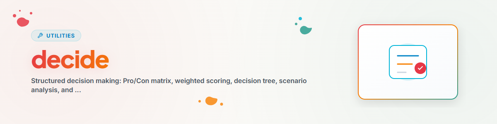

> **Español** — Versión oficial en español de `decide`.


# Decide — Toma de Decisiones Estructurada (Español)

> Decisiones racionales mediante marcos de trabajo estructurados y métodos de evaluación

---

## ¿Cuándo Usar?

- Elegir entre varias opciones
- Necesidad de una lista de pros y contras
- Decisión multicriterio
- Incertidumbre sobre decisiones importantes

**Palabras clave (Trigger words):** decide, choose, compare, evaluate, weigh

---

## Marcos de Trabajo (Frameworks)

### 1. Matriz Pros/Contras (Simple)

Decisiones rápidas entre 2 opciones.

```
PRO A:                    CON A:
- Advantage 1             - Disadvantage 1
- Advantage 2             - Disadvantage 2

PRO B:                    CON B:
- Advantage 1             - Disadvantage 1
- Advantage 2             - Disadvantage 2

Recommendation: [A/B] because [reasoning]
```

---

### 2. Puntuación Ponderada (Compleja)

Decisiones multicriterio con ponderación.

| Criterio | Peso | Opción A | Puntuación A | Opción B | Puntuación B |
|-----------|--------|----------|---------|----------|---------|
| Criterio 1 | 30% | 8 | 2.4 | 6 | 1.8 |
| Criterio 2 | 25% | 7 | 1.75 | 9 | 2.25 |
| TOTAL | 100% | - | X.XX | - | X.XX |

**Proceso:**
1. Recopilar criterios
2. Asignar pesos (suma = 100%)
3. Calificar opciones (escala 1-10)
4. Calcular puntuaciones (calificación x peso)
5. Comparar y recomendar

---

### 3. Árbol de Decisión (Secuencial)

Decisiones con rutas claras si-entonces:
1. Definir la pregunta inicial
2. Primera ramificación (criterio más importante)
3. Siguiente nivel (segundo más importante)
4. Llegar a la opción final

---

### 4. Análisis de Escenarios (Incertidumbre)

```
Best Case (X% probability):
  Outcome: +Y points -> Expected value: +Z

Realistic Case (X%):
  Outcome: +Y -> Expected value: +Z

Worst Case (X%):
  Outcome: -Y -> Expected value: -Z

Total expected value: [Sum]
```

---

### 5. Matriz de Eisenhower (Priorización)

```
              URGENT          NOT URGENT
IMPORTANT     1. DO           2. PLAN
NOT IMPORTANT 3. DELEGATE     4. ELIMINATE
```

---

## Lista de Verificación de Calidad

Verificar antes de la recomendación final:
- [ ] ¿Se han identificado todos los criterios relevantes?
- [ ] ¿Se han considerado los valores del usuario?
- [ ] ¿Se han considerado los efectos a largo plazo?
- [ ] ¿Se han identificado y evaluado los riesgos?
- [ ] ¿Se ha realizado la verificación de sesgos?
- [ ] ¿Se ha evaluado la reversibilidad?

---

## Mejores Prácticas

### Definición de Criterios
- Específicos y medibles
- No demasiados (3-7 es lo ideal)
- Independientes entre sí

### Ponderación
- Suma = 100%
- Criterio más importante >= 25%
- Ningún peso < 5%

### Recomendación
- Clara y fundamentada
- Mencionar alternativas
- Nombrar riesgos
- Considerar la reversibilidad

---

## Flujo de Trabajo y Procedimiento

```
1. User request
2. Understand decision
3. Identify options (2-5)
4. Choose framework
5. Collect criteria
6. Apply framework
7. Bias check (optional)
8. Make recommendation
9. Document reasoning
```

---

## Registro de Cambios

### 1.1.0 (2026-11-06)
- Descripción con un disparador claro (cuándo usarla) y la delimitación frente a decision-briefing y decision-shot. Evaluación del plugin: la skill se activa ahora en una decisión real con compromisos (3/3 ejecuciones, antes 0/3) y sigue sin activarse en una pregunta trivial.

### 1.0.0 (2026-03-15)
- Portado desde BACH v3.8.0

---

*Portado desde BACH v3.8.0 | Versión independiente*