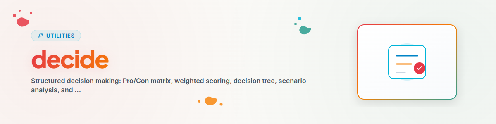

> **Français** — Version française officielle de la compétence `decide`.

# Decide — Prise de décision structurée

> Des décisions rationnelles grâce à des cadres structurés et des méthodes d'évaluation

---

## Quand l'utiliser ?

- Trancher entre plusieurs options
- Besoin d'une liste pour/contre
- Décision multicritère
- Hésitation face à des décisions importantes

**Mots déclencheurs :** décider, choisir, comparer, évaluer, peser le pour et le contre

---

## Cadres d'analyse (Frameworks)

### 1. Matrice Pour/Contre (simple)

Décisions rapides entre 2 options.

```
POUR A :                  CONTRE A :
- Avantage 1              - Inconvénient 1
- Avantage 2              - Inconvénient 2

POUR B :                  CONTRE B :
- Avantage 1              - Inconvénient 1
- Avantage 2              - Inconvénient 2

Recommandation : [A/B] parce que [Justification]
```

---

### 2. Score pondéré / Weighted Scoring (complexe)

Décisions multicritères avec pondération.

| Critère | Poids | Option A | Score A | Option B | Score B |
|---------|-------|----------|---------|----------|---------|
| Critère 1 | 30% | 8 | 2,4 | 6 | 1,8 |
| Critère 2 | 25% | 7 | 1,75 | 9 | 2,25 |
| TOTAL | 100% | - | X,XX | - | X,XX |

**Processus :**
1. Recueillir les critères
2. Fixer les pondérations (somme = 100 %)
3. Évaluer les options (échelle de 1 à 10)
4. Calculer les scores (note × poids)
5. Comparer et recommander

---

### 3. Arbre de décision (séquentiel)

Décisions comportant des chemins clairs de type Si-Alors :
1. Définir la question de départ
2. Premier embranchement (critère le plus important)
3. Niveau suivant (deuxième critère le plus important)
4. Jusqu'à l'option finale

---

### 4. Analyse de scénarios (incertitude)

```
Meilleur scénario (X % de probabilité) :
  Résultat : +Y points -> Valeur espérée : +Z

Scénario réaliste (X %) :
  Résultat : +Y -> Valeur espérée : +Z

Pire scénario (X %) :
  Résultat : -Y -> Valeur espérée : -Z

Valeur espérée totale : [Somme]
```

---

### 5. Matrice d'Eisenhower (priorisation)

```
               URGENT          NON URGENT
IMPORTANT      1. FAIRE        2. PLANIFIER
NON IMPORTANT  3. DÉLÉGUER     4. ÉLIMINER
```

---

## Check-list qualité

À vérifier avant la recommandation finale :
- [ ] Tous les critères pertinents identifiés ?
- [ ] Valeurs de l'utilisateur prises en compte ?
- [ ] Impacts à long terme examinés ?
- [ ] Risques identifiés et évalués ?
- [ ] Contrôle des biais effectué ?
- [ ] Réversibilité vérifiée ?

---

## Bonnes pratiques

### Définir les critères
- Spécifiques et mesurables
- Pas trop nombreux (3 à 7 idéalement)
- Indépendants les uns des autres

### Pondération
- Somme = 100 %
- Critère le plus important ≥ 25 %
- Aucun poids < 5 %

### Recommandation
- Claire et justifiée
- Mentionner les alternatives
- Nommer les risques
- Tenir compte de la réversibilité

---

## Flux de travail

```
1. Demande de l'utilisateur
2. Comprendre la décision
3. Identifier les options (2 à 5)
4. Choisir le cadre d'analyse
5. Recueillir les critères
6. Appliquer le cadre
7. Contrôle des biais (optionnel)
8. Formuler la recommandation
9. Documenter le raisonnement
```

---

## Journal des modifications

### 1.1.1 (2026-11-22)
- Indication de langue corrigée

### 1.1.0 (2026-11-06)
- Description reformulée avec déclencheur clair (quand utiliser) et délimitation vis-à-vis de `decision-briefing` et `decision-shot`. Évaluation plugin : la compétence se déclenche désormais pour une véritable décision avec compromis (3/3 exécutions, contre 0/3 auparavant) et reste à l'écart pour une question triviale.

### 1.0.0 (2026-03-15)
- Porté depuis BACH v3.8.0

---

*Porté depuis BACH v3.8.0 | Version autonome*

**Voir aussi :** [think](../think/SKILL.md) (analyse, cause racine, SWOT) | [brainstorm](../brainstorm/SKILL.md) (méthodes créatives, génération d'idées) | [decision-shot](../decision-shot/SKILL.md) (condenser la sortie de cette analyse en une synthèse exécutive avec recommandation et lien vers la version complète)
