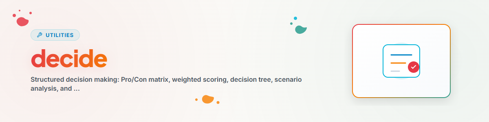

# Decide — Tomada de decisão estruturada

> Decisões racionais por meio de frameworks estruturados e métodos de avaliação

---

## Quando usar?

- Decidir entre opções
- Necessidade de uma lista de prós e contras
- Decisão com múltiplos critérios
- Insegurança em decisões importantes

**Palavras-gatilho:** decidir, escolher, comparar, avaliar, ponderar

---

## Frameworks

### 1. Matriz Prós/Contras (simples)

Decisões rápidas entre 2 opções.

```
PRO A:                    CON A:
- Vorteil 1               - Nachteil 1
- Vorteil 2               - Nachteil 2

PRO B:                    CON B:
- Vorteil 1               - Nachteil 1
- Vorteil 2               - Nachteil 2

Empfehlung: [A/B] weil [Begruendung]
```

---

### 2. Pontuação ponderada (complexa)

Decisões com múltiplos critérios e ponderação.

| Critério | Peso | Opção A | Pontuação A | Opção B | Pontuação B |
|-----------|---------|----------|---------|----------|---------|
| Critério 1 | 30% | 8 | 2.4 | 6 | 1.8 |
| Critério 2 | 25% | 7 | 1.75 | 9 | 2.25 |
| TOTAL | 100% | - | X.XX | - | X.XX |

**Processo:**
1. Reunir os critérios
2. Definir os pesos (soma = 100%)
3. Avaliar as opções (escala de 1 a 10)
4. Calcular as pontuações (avaliação x peso)
5. Comparar e recomendar

---

### 3. Árvore de decisão (sequencial)

Decisões com caminhos claros de se-então:
1. Definir a pergunta inicial
2. Primeira bifurcação (critério mais importante)
3. Próximo nível (segundo critério mais importante)
4. Até a opção final

---

### 4. Análise de cenários (incerteza)

```
Best Case (X% Wahrscheinlichkeit):
  Ergebnis: +Y Punkte -> Erwartungswert: +Z

Realistic Case (X%):
  Ergebnis: +Y -> Erwartungswert: +Z

Worst Case (X%):
  Ergebnis: -Y -> Erwartungswert: -Z

Gesamt-Erwartungswert: [Summe]
```

---

### 5. Matriz de Eisenhower (priorização)

```
              DRINGEND        NICHT DRINGEND
WICHTIG       1. TUN          2. PLANEN
NICHT WICHTIG 3. DELEGIEREN   4. ELIMINIEREN
```

---

## Lista de verificação de qualidade

Antes da recomendação final, verificar:
- [ ] Todos os critérios relevantes foram identificados?
- [ ] Os valores do usuário foram considerados?
- [ ] Os efeitos de longo prazo foram ponderados?
- [ ] Os riscos foram identificados e avaliados?
- [ ] A verificação de viés foi realizada?
- [ ] A reversibilidade foi verificada?

---

## Boas práticas

### Definir critérios
- Específicos e mensuráveis
- Não em excesso (3 a 7 é o ideal)
- Independentes entre si

### Ponderação
- Soma = 100%
- O critério mais importante >= 25%
- Nenhum peso < 5%

### Recomendação
- Clara e fundamentada
- Mencionar alternativas
- Nomear os riscos
- Considerar a reversibilidade

---

## Fluxo de trabalho

```
1. User Request
2. Entscheidung verstehen
3. Optionen identifizieren (2-5)
4. Framework waehlen
5. Kriterien sammeln
6. Framework anwenden
7. Bias-Check (optional)
8. Empfehlung aussprechen
9. Reasoning dokumentieren
```

---

## Registro de alterações

### 1.0.0 (2026-03-15)
- Portado do BACH v3.8.0

---

*Portado do BACH v3.8.0 | Versão standalone*

**Veja também:** [think](../think/SKILL.md) (análise, causa raiz, SWOT) | [brainstorm](../brainstorm/SKILL.md) (métodos criativos, geração de ideias) | [decision-shot](../decision-shot/SKILL.md) (condensar o resultado desta análise em uma forma executiva resumida com recomendação e link para a versão completa)
