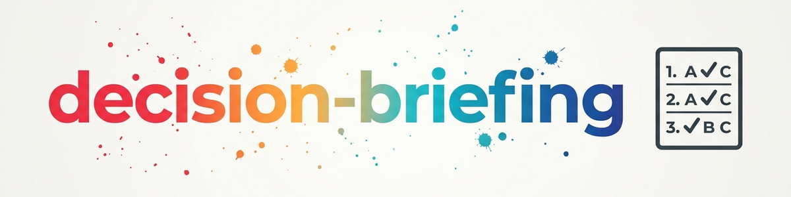

# Decision-Briefing — একটি বিষয়ের অনেক সিদ্ধান্ত কাঠামোবদ্ধভাবে নিষ্পত্তি করা

> খোলা সিদ্ধান্তের স্তূপ থেকে সুপারিশসহ একটি নম্বরযুক্ত ব্রিফিং তৈরি হয়, যার উত্তর ব্যবহারকারী অক্ষর দিয়ে দ্রুত দিতে পারেন — আলাদাভাবে বা ব্যাচে।

---

## কখন ব্যবহার করবেন?

**একাধিক সিদ্ধান্ত অপেক্ষমাণ থাকলেই সবসময় — বিষয় যা-ই হোক।** সাধারণ পরিস্থিতি:

- কোনো ক্ষেত্র/বিষয়ে অনেক খোলা সিদ্ধান্ত জমে গেছে
- একটি দস্তাবেজ (পরিকল্পনা, TODO-তালিকা, ধারণাপত্র) একাধিক অমীমাংসিত বিষয় ধারণ করে
- কথোপকথনে একের পর এক কয়েকটি সিদ্ধান্তের প্রশ্ন জমেছে
- এজেন্ট নিজেই ব্যবহারকারীকে একাধিক প্রশ্ন করতে চায় — একটি-একটি না করে ব্রিফিং হিসেবে একত্র করা
- ব্যবহারকারী খোলা বিষয়গুলো দ্রুত এবং ভিত্তিসহ নিষ্পত্তি করতে চান

**ট্রিগার-শব্দ:** খোলা সিদ্ধান্ত, সিদ্ধান্ত-সেশন, ব্রিফিং, নিষ্পত্তি করা, একে একে দেখা, চলুন সব সিদ্ধান্ত নিয়ে নিই

**পার্থক্য:** [decide](../decide/SKILL.md) একটি প্রশ্নের জন্য কাঠামো দেয়। `decision-briefing` একটি বিষয়ের অনেক সিদ্ধান্তের নিষ্পত্তি সমন্বয় করে — এবং জটিল একক ক্ষেত্রে `decide` ব্যবহার করে। কোনো সিদ্ধান্ত আগে থেকেই নেওয়া/বিশ্লেষিত হয়ে থাকলে এবং শুধু সংক্ষিপ্ত নির্বাহী রূপে (লাভ/ক্ষতি, মূল বক্তব্য, সুপারিশ, পূর্ণ বিশ্লেষণের লিংক) পৌঁছে দিতে হলে [decision-shot](../decision-shot/SKILL.md) উপস্থাপনা দেখভাল করে — এটি প্রতিযোগী দক্ষতা নয়, বরং এরপরের আউটপুট ফরম্যাট।

---

## মূল UX

এর কেন্দ্রে রয়েছে ব্রিফিং-ফরম্যাট। প্রতিটি সিদ্ধান্ত এমনভাবে উপস্থাপন করা হয় যাতে উত্তর দ্রুত এবং মানসিক বোঝা ছাড়া দেওয়া যায়:

- প্রতিটি বিষয়ের জন্য **স্পষ্ট সাধারণ-ভাষার শিরোনাম** (যেমন *„Hermes-ভাষাসহায়তা“*, *„পুরোনো কাজের সেশন উদ্ধার“*)
- **সাধারণ ভাষায় উত্তম-পুরুষে তিন-অংশের কাঠামো (ত্রয়ী):**
  1. *পরিস্থিতি:* অবস্থা / সমস্যা কী?
  2. *আমি করছি ...:* আমি নির্দিষ্টভাবে কী করার পরিকল্পনা বা সুপারিশ করছি?
  3. *ফলব্যাক:* ব্যর্থ হলে কী ঘটে, বা তারপর ব্যবহারকারী কী সিদ্ধান্ত নেবেন?
- **প্রশ্নের পাঠে কোনো প্রযুক্তিগত সংক্ষেপ নয়:** মানুষের দৃশ্যমান লেখায় কোনো টিকিট নম্বর (`T-...`), D-শনাক্তকারী, Git হ্যাশ বা ফাইল-পাথ থাকবে না।
- **বিকল্পগুলো অক্ষরে** A/B/C/D (২–৪টি, স্পষ্ট ও বোধগম্যভাবে লেখা)
- **চিহ্নিত সুপারিশ** উত্তম-পুরুষে (যেমন `→ Ich empfehle Option A, weil ich damit ...`)
- **প্রযুক্তিগত রেফারেন্স টেবিল শুধু পরিশিষ্টে:** স্থিতিশীল নম্বর (`[E01]`, `[E02]`), টিকিট-আইডি ও লক্ষ্য রেজিস্টার শেষে একটি সংক্ষিপ্ত টেবিলে রাখা হয়।

**ব্যবহারকারীর উত্তরের ফরম্যাট:**

```
Per Buchstabe:   "E01: A"  oder  "1A"
Batch:           "1A 2C 3B"
Per Klartext:    "Bei der Hermes-Sprachunterstützung Option A"
Vertiefen:       "E02: mehr Info"  oder  "2?"
Vertagen:        "E03: später"
Gesamtabnahme:   "Passt so, alle Empfehlungen umsetzen"
```

---

## ওয়ার্কফ্লো (৪ ধাপ)

```
Thema + vorliegende Entscheidungen
     |
     v
Phase 1: ERFASSEN & INVENTARISIEREN
     |
     v
Phase 2: BRIEFING AUFBEREITEN
     |
     v
Phase 3: DECISION-SESSION
     |
     v
Phase 4: PROTOKOLL & RÜCKSCHREIBEN
```

### ধাপ ১: সংগ্রহ ও তালিকাকরণ

উৎস: ব্যবহারকারী যা উল্লেখ করেন, বিদ্যমান দস্তাবেজ, বা কথোপকথনের প্রেক্ষাপট। সিস্টেম-ব্যাপী কোনো স্ক্যান নয় — যা উপস্থিত আছে শুধু তা-ই।

1. সব খোলা সিদ্ধান্ত একটি তালিকায় সাজানো (প্রতিটি ১ লাইন: সংক্ষিপ্ত শিরোনাম)
2. **নকল** চিহ্নিত ও একত্র করা (একই প্রশ্ন, একাধিকবার লেখা)
3. **নির্ভরতা** চিহ্নিত করা ("E04 নির্ভর করে E01-এর উপর")
4. **ক্রম** ঠিক করা: প্রথমে বাধা (যে সিদ্ধান্তের উপর অন্যগুলো নির্ভর করে), তারপর জরুরিতা অনুযায়ী
5. তালিকাটি ব্যবহারকারীকে সংক্ষেপে নিশ্চিতকরণের জন্য দেখানো ("সব পেয়েছি? কিছু বাদ পড়েছে?")

### ধাপ ২: ব্রিফিং প্রস্তুত করা

প্রতিটি সিদ্ধান্তের জন্য:

```
[E01] <Sprechender Klartext-Titel>
  Lage: <1 Satz: Was ist die Situation?>
  Handlung: <1-2 Sätze in Ich-Form: Was schlage ich vor zu tun?>
  Rückfall: <1 Satz: Was passiert bei Fehlschlag oder als nächster Schritt?>
  A) <Option in Alltagssprache>
  B) <Option in Alltagssprache>
  → Meine Empfehlung: A — <Begründung in Ich-Form>
```

ব্রিফিংয়ের শেষে:
```
### Technische Referenztabelle (nur für Buchung & Audit)
| Nummer | Klartext-Titel | Empfehlung | Ticket-ID / D-Nummer | Quelle / Pfad |
|---|---|---|---|---|
| E01 | Hermes-Sprachunterstützung | A | T-20260913-989062143 | hermes-agent |
```

ভালো বিকল্পের নিয়ম:

- বিকল্পগুলো পরস্পরকে বাদ দেবে এবং পুরো পরিসর ঢেকে রাখবে
- প্রয়োজনে "বর্তমান অবস্থা বজায় রাখা" বা "স্থগিত রাখা" বিকল্প যুক্ত করা
- সুপারিশটি স্বচ্ছভাবে যুক্তিসহ — কখনো গোপনে প্রভাবিতকারী নয়
- তথ্য অস্পষ্ট হলে: আগে স্পষ্ট করুন (বা খোলা প্রশ্ন হিসেবে চিহ্নিত করুন), অনুমান করবেন না

### ধাপ ৩: সিদ্ধান্ত-সেশন

1. ব্রিফিং উপস্থাপন — একটি-একটি (প্রতি বার্তায় একটি সিদ্ধান্ত) বা ব্যাচে (সবগুলো একসাথে); ৫টির বেশি হলে ৩–৫টির ব্লকে
2. অক্ষর-উত্তর গ্রহণ ও স্বীকৃতি
3. "আরও তথ্য" উত্তরে: সিদ্ধান্তটি গভীরভাবে বিশ্লেষণ (নিচের পদ্ধতি-টুলকিট)
4. জটিল একক ক্ষেত্রে (অনেক মানদণ্ড, উচ্চ গুরুত্ব): [decide](../decide/SKILL.md) দক্ষতায় উত্তরণ (Weighted Scoring, Scenario Analysis)
5. স্থগিত সিদ্ধান্ত স্পষ্টভাবে খোলা হিসেবে এগিয়ে নেওয়া — নীরবে বাদ না দেওয়া

### ধাপ ৪: রেকর্ড ও ফিরিয়ে লেখা

1. **ফলাফল-টেবিল** তৈরি:

```
| Nr.  | Entscheidung        | Gewählt | Status   |
|------|---------------------|----------|----------|
| E01  | <Kurztitel>         | A        | getroffen|
| E02  | <Kurztitel>         | C        | getroffen|
| E03  | <Kurztitel>         | —        | vertagt  |
```

2. গৃহীত সিদ্ধান্তগুলো **মূল দস্তাবেজ/TODO-ফাইলে** লেখা — খোলা প্রশ্নটি যেখানে আছে সেখানে, যেমন:

```
ENTSCHEIDUNG: <Frage>
  → GETROFFEN 2026-06-13: Option A (<Kurzfassung>)
  → Nächste Aktion: <falls die Entscheidung eine Folgeaktion impliziert>
```

3. **স্থগিত বিষয় স্পষ্টভাবে খোলা হিসেবে রাখা** (মূল দস্তাবেজ বা TODO-তালিকায়), যাতে পরের ব্রিফিংয়ে আবার আসে

---

## উদাহরণ ব্রিফিং (কাল্পনিক)

বিষয়: একটি ক্লাব-ওয়েবসাইটের পুনঃপ্রবর্তন — প্রকল্প-পরিকল্পনা থেকে ৩টি খোলা সিদ্ধান্ত।

```
[E01] Welches System für die neue Website?
  Kontext: Aktuelle Seite ist handgepflegtes HTML; 2 Personen sollen künftig Inhalte pflegen.
  A) Static-Site-Generator (schnell, sicher, Pflege via Git)
  B) Klassisches CMS mit Admin-Oberfläche
  C) Website-Baukasten (gehostet)
  → Empfehlung: B — zwei nicht-technische Redakteure brauchen eine Oberfläche, kein Git.

[E02] Wie wird gehostet?
  Kontext: Budget ~10 EUR/Monat, kein eigener Admin im Verein.
  A) Shared Hosting beim bestehenden Anbieter
  B) Eigener kleiner VPS
  C) Managed Hosting passend zum gewählten System
  → Empfehlung: C — am wenigsten Wartungsaufwand ohne Admin; Konsequenz: hängt von E01 ab.

[E03] Wann geht die neue Seite live?
  Kontext: Inhalte sind zu 60% migriert; Vereinsjubiläum in 3 Monaten.
  A) Sofort als Soft-Launch (Rest nachziehen)
  B) Nach vollständiger Inhaltsmigration
  C) Zum Jubilaeum als Stichtag
  → Empfehlung: A — umkehrbar und liefert früh Feedback; finale Inhalte folgen.
```

ব্যবহারকারী ব্যাচে উত্তর দেন: **"1B 2C 3A"** → ফলাফল-টেবিল, তারপর তিনটি সিদ্ধান্ত প্রকল্প-পরিকল্পনায় নিষ্পন্ন হিসেবে লেখা হয়।

---

## পদ্ধতি-টুলকিট ("আরও তথ্য" ও গভীর বিশ্লেষণের জন্য)

| পদ্ধতি | কখন | সংক্ষিপ্ত বর্ণনা |
|---------|------|------------------|
| **Pro/Contra-ম্যাট্রিক্স** | ২–৩টি বিকল্প, দ্রুত তুলনা | সব বিকল্প পাশাপাশি মূল্যায়ন |
| **Nutzwertanalyse** | একাধিক মানদণ্ড | ওজনযুক্ত মানদণ্ড, প্রতি বিকল্পের পয়েন্ট (সম্ভব হলে পরিমাণগত) |
| **Second-Order Thinking** | গুরুত্ব অস্পষ্ট | পরিণতির পরিণতি কী? |
| **Prämortem** | ঝুঁকিপূর্ণ সিদ্ধান্ত | "এটি ব্যর্থ হয়েছে — কেন?" আগেভাগে দুর্বলতা খুঁজে বের করা |
| **10/10/10-পদ্ধতি** | আবেগগত/সময়গত বিকৃতি | ১০ মিনিট / ১০ মাস / ১০ বছর পরে সিদ্ধান্তটি কেমন দেখাবে? |

---

## কার্যনীতি

- **সিদ্ধান্ত চাপিয়ে না দেওয়া:** তথ্য দেওয়া, সুপারিশ স্বচ্ছভাবে যুক্তিসহ — সিদ্ধান্ত ব্যবহারকারীর
- **পক্ষপাত শনাক্তকরণ:** চিন্তার ভুল দৃশ্যমান হলে তা উল্লেখ করা (Confirmation Bias, Sunk Cost)
- **প্রত্যাবর্তনযোগ্যতা বিবেচনা:** ফেরানো যায় এমন সিদ্ধান্ত দ্রুত, চূড়ান্তগুলো বেশি যত্নে
- **সময়ের চাপ বিবেচনা:** দ্রুত সিদ্ধান্তে সহজ পদ্ধতি লাগে — প্রতিটি প্রশ্নের জন্য Nutzwertanalyse প্রয়োজন নেই

### তৈরি উপাদানে সেশন-উৎসের চিহ্ন

এই দক্ষতা যদি কোনো গুরুত্বপূর্ণ, নতুন ও স্থায়ীভাবে সংরক্ষিত ব্রিফিং, প্রতিবেদন, হ্যান্ডঅফ বা রসিদ তৈরি করে,
তবে উপাদানটি ঠিক একটি লাইন দিয়ে শেষ হবে:

`session: <session-id> | <agent>@<host> | YYYY-MM-DD`

- উৎস-অগ্রাধিকার: স্পষ্ট রানটাইম/CLI তথ্য, তারপর কর্তৃপক্ষসম্পন্ন প্রোভাইডার পরিবেশ বা হুক, নইলে `unbekannt`। মান কখনো অনুমান করবেন না।
- সাব-এজেন্ট তার প্যারেন্ট সেশনের সেশন-আইডি ব্যবহার করে।
- সাধারণ চ্যাট, উল্লেখিত উৎস-দস্তাবেজ, নীতিমালা, `CLAUDE.md`, README এবং শুধু ফিরিয়ে লেখা সিদ্ধান্তে ঢালাও চিহ্ন দেওয়া হবে না। পুরোনো ফাইলে অন্ধভাবে চিহ্ন বসানো হবে না।

---

## পার্থক্য ও সমন্বয়

| কার্যক্রম | `decide` | `decision-briefing` |
|---|---|---|
| কাঠামো দিয়ে একটি সিদ্ধান্ত সাজানো | ✓ | — |
| একটি বিষয়ের অনেক সিদ্ধান্তের তালিকা | — | ✓ |
| A/B/C বিকল্পসহ নম্বরযুক্ত ব্রিফিং | — | ✓ |
| ব্যাচ-উত্তর ("1A 2C 3B") | — | ✓ |
| মূল দস্তাবেজে ফিরিয়ে লেখা | — | ✓ |
| একটি একক প্রশ্নের সম্পন্ন বিশ্লেষণ সংক্ষিপ্ত রূপে পৌঁছে দেওয়া | — | — (দেখুন [decision-shot](../decision-shot/SKILL.md)) |

**সমন্বয়:** সেশনের মধ্যে জটিল একক ক্ষেত্রে `decision-briefing` `decide`-এর কাঠামো প্রয়োগ করে (Weighted Scoring, Scenario Analysis)। তার আগের বড় চিন্তা-প্রক্রিয়ার জন্য (বিশ্লেষণ → ধারণা → সিদ্ধান্ত) দেখুন [structured-thinking](../structured-thinking/SKILL.md)।

---

## পরিবর্তনের ইতিহাস

### 1.2.0 (2026-09-18)
- বোধগম্য সিদ্ধান্ত-পাঠের স্টাইল-নিয়ম যুক্ত (T-20260913-883789445, ব্যবহারকারীর নির্দেশ 2026-09-13):
  - দৃশ্যমান প্রশ্ন-পাঠে কোনো দুর্বোধ্য টিকিট নম্বর, D-শনাক্তকারী বা পাথ নয়।
  - প্রেক্ষাপট ও সুপারিশের জন্য উত্তম-পুরুষে ত্রয়ী (পরিস্থিতি, „আমি করছি …“, পিছু-হটা)।
  - প্রতিটি সিদ্ধান্ত-বিন্দুর জন্য স্পষ্ট সাধারণ-ভাষার শিরোনাম; উত্তর-ফরম্যাটে সাধারণ ভাষা ও সামগ্রিক গ্রহণ যুক্ত।
  - প্রযুক্তিগত মানচিত্রায়ন (সংক্ষেপ, টিকিট-আইডি, রেজিস্টার-পাথ) ব্রিফিংয়ের শেষে পরিশিষ্ট-টেবিলে সরানো।

### 1.1.0 (2026-09-09)
- P-018 নতুন তৈরি গুরুত্বপূর্ণ ব্রিফিং, প্রতিবেদন, হ্যান্ডঅফ ও রসিদের জন্য সেশন-উৎসের চিহ্ন যুক্ত করে; উৎস-অগ্রাধিকার, সাব-এজেন্টের জন্য প্যারেন্ট সেশন এবং সংকীর্ণ বর্জন নির্ধারিত।

### 1.0.0 (2026-06-13)
- BACH-বিশেষজ্ঞ `decision-briefing` v1.0.0 থেকে পোর্ট করা; স্ক্যানার-উপাদান (scanner.py, sources.json, মার্কার-স্ক্যান) ইচ্ছাকৃতভাবে সরানো হয়েছে — সংগ্রহ বিদ্যমান প্রেক্ষাপট থেকে হালকাভাবে করা হয়

---

*BACH থেকে পোর্ট করা | স্ক্যানারবিহীন স্বতন্ত্র সংস্করণ*

**আরও দেখুন:** [decide](../decide/SKILL.md) (একটি একক সিদ্ধান্তের কাঠামো) | [structured-thinking](../structured-thinking/SKILL.md) (বিশ্লেষণ → ধারণা → সিদ্ধান্ত একটি মেটা-ওয়ার্কফ্লো হিসেবে) | [decision-shot](../decision-shot/SKILL.md) (সম্পন্ন বিশ্লেষণ সংক্ষিপ্ত নির্বাহী রূপে পূর্ণ সংস্করণের লিংকসহ উপস্থাপন)
