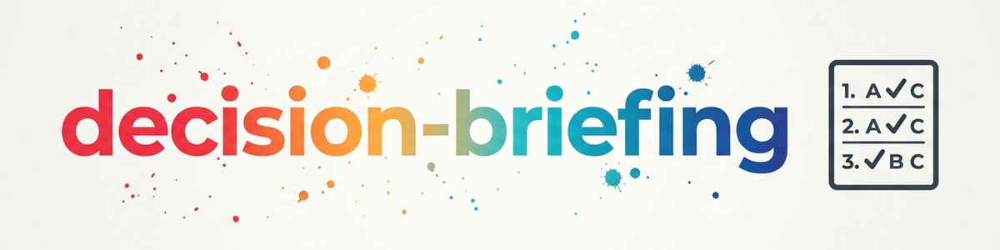

> **Français** — Version française officielle de la compétence `decision-briefing`.

# Decision-Briefing — Traiter de façon structurée de nombreuses décisions d'un même sujet

> D'une pile de décisions ouvertes naît un briefing numéroté avec recommandations, auquel l'utilisateur peut répondre en un éclair par lettres — une par une ou en lot.

---

## Quand l'utiliser ?

**Toujours, dès que plusieurs décisions se présentent** — quel que soit le sujet. Situations typiques :

- Beaucoup de décisions ouvertes se sont accumulées dans un domaine/sujet
- Un document (plan, liste TODO, concept) contient plusieurs points non tranchés
- Plusieurs questions décisionnelles se sont empilées au cours de la discussion
- L'agent a lui-même plusieurs questions pour l'utilisateur — au lieu de les poser une par une, les grouper en briefing
- L'utilisateur veut « liquider » rapidement et rigoureusement des points ouverts

**Mots déclencheurs :** décisions ouvertes, session de décision, briefing, traiter en lot, passer en revue, tranchons tout cela

**Délimitation :** [decide](../decide/SKILL.md) fournit des cadres pour UNE question. `decision-briefing` coordonne le traitement de NOMBREUSES décisions d'un sujet — et fait appel à `decide` pour les cas individuels complexes. Si une décision est déjà prise/analysée et ne doit plus être transmise que sous forme de synthèse exécutive (Pour/Contre, points clés, recommandation, lien vers l'analyse complète), [decision-shot](../decision-shot/SKILL.md) prend le relais — ce n'est pas une compétence concurrente, mais le format de sortie suivant.

---

## UX centrale

Le format du briefing constitue le cœur de la compétence. Chaque décision est présentée de sorte que la réponse soit rapide et sans charge cognitive superflue :

- **Titre parlant en langage clair** pour chaque point (ex. *« Prise en charge linguistique d'Hermes »*, *« Sauvetage d'anciennes sessions de travail »*)
- **Langage courant à la première personne (triptyque) :**
  1. *Situation :* quel est le contexte / le problème ?
  2. *Ce que je propose :* qu'est-ce que je prévois/recommande concrètement de faire ?
  3. *Repli :* que se passe-t-il en cas d'échec ou que décide l'utilisateur ensuite ?
- **Aucun sigle technique dans le texte des questions :** pas de numéros de tickets (`T-...`), identifiants D, hashes Git ni chemins de fichiers dans le texte visible par l'humain.
- **Options en lettres** A/B/C/D (2–4 options, formulées clairement et simplement)
- **Recommandation marquée** à la première personne (ex. `→ Je recommande l'option A, car ainsi je ...`)
- **Tableau de référence technique uniquement en annexe :** les numéros stables (`[E01]`, `[E02]`), IDs de tickets et registres cibles figurent à la fin dans un tableau compact.

**Formats de réponse de l'utilisateur :**

```
Par lettre :            "E01: A"  ou  "1A"
En lot (Batch) :        "1A 2C 3B"
En langage clair :      "Pour la prise en charge linguistique d'Hermes, option A"
Approfondir :           "E02: plus d'infos"  ou  "2?"
Reporter :              "E03: plus tard"
Validation globale :    "Ça convient, appliquer toutes les recommandations"
```

---

## Workflow (4 phases)

```
Sujet + décisions en attente
     |
     v
Phase 1 : RECUEILLIR & INVENTORIER
     |
     v
Phase 2 : PRÉPARER LE BRIEFING
     |
     v
Phase 3 : SESSION DE DÉCISION
     |
     v
Phase 4 : PROCÈS-VERBAL & RÉPERCUSSION
```

### Phase 1 : Recueillir et inventorier

Sources : ce que cite l'utilisateur, un document fourni ou le contexte de la conversation. Aucun scan global du système — uniquement ce qui est présent.

1. Dresser la liste de toutes les décisions ouvertes (1 ligne par point : titre court)
2. Repérer et fusionner les **doublons** (même question formulée plusieurs fois)
3. Marquer les **dépendances** (« E04 dépend de E01 »)
4. Fixer l'**ordre** : bloqueurs d'abord (décisions dont d'autres dépendent), puis par urgence
5. Montrer brièvement la liste à l'utilisateur pour confirmation (« Ai-je tout ? Manque-t-il quelque chose ? »)

### Phase 2 : Préparer le briefing

Pour chaque décision :

```
[E01] <Titre parlant en langage clair>
  Situation : <1 phrase : quelle est la situation ?>
  Action : <1-2 phrases à la 1re personne : que proposé-je de faire ?>
  Repli : <1 phrase : que se passe-t-il en cas d'échec ou comme étape suivante ?>
  A) <Option en langage courant>
  B) <Option en langage courant>
  → Ma recommandation : A — <Justification à la 1re personne>
```

À la fin du briefing :
```
### Tableau de référence technique (uniquement pour enregistrement & audit)
| Numéro | Titre en clair | Recommandation | ID Ticket / Numéro D | Source / Chemin |
|---|---|---|---|---|
| E01 | Prise en charge linguistique d'Hermes | A | T-20260913-989062143 | hermes-agent |
```

Règles pour de bonnes options :

- Les options doivent être mutuellement exclusives et couvrir le spectre des choix
- Si besoin, inclure une option « conserver le statu quo » ou « reporter »
- La recommandation est justifiée de manière transparente — jamais faussement suggestive
- En cas de faits incertains : clarifier d'abord (ou marquer comme question ouverte), ne pas deviner

### Phase 3 : Session de décision

1. Présenter le briefing — un par un (une décision par message) ou en lot (toutes d'un coup) ; au-delà de 5 décisions, par blocs de 3–5
2. Recueillir et acquitter les réponses par lettres
3. En cas de réponse « plus d'infos » : approfondir la décision (boîte à outils méthodologique ci-dessous)
4. Pour les cas individuels complexes (nombreux critères, forte portée) : escalader vers la compétence [decide](../decide/SKILL.md) (notation pondérée, analyse de scénarios)
5. Maintenir explicitement les décisions reportées comme ouvertes — ne pas les laisser disparaître silencieusement

### Phase 4 : Procès-verbal et répercussion

1. Établir le **tableau de résultats** :

```
| N°   | Décision            | Choix    | Statut   |
|------|---------------------|----------|----------|
| E01  | <Titre court>       | A        | prise    |
| E02  | <Titre court>       | C        | prise    |
| E03  | <Titre court>       | —        | reportée |
```

2. Inscrire les décisions prises dans les **documents sources / fichiers TODO** — à l'emplacement exact de la question ouverte, ex. :

```
DÉCISION : <Question>
  → PRISE 2026-06-13 : Option A (<Résumé court>)
  → Prochaine action : <si la décision implique une action consécutive>
```

3. **Maintenir explicitement ce qui est reporté comme ouvert** (dans le document source ou dans la liste TODO), afin qu'il réapparaisse lors du prochain briefing

---

## Briefing sous forme de formulaire (guide de construction)

Au lieu de taper des lettres dans le chat, l'utilisatrice ou l'utilisateur peut cliquer directement dans un briefing prêt à l'emploi : choisir des options, ajouter une remarque par poste, « Tout comme recommandé » (validation groupée), enregistrer et envoyer. À partir des données du briefing (petit JSON au format `form.schema.json`), le générateur `scripts/formular/build_form.py` de la compétence [decision-draw](../decision-draw/SKILL.md) produit **un formulaire HTML autonome** (ne pas reconstruire à chaque fois ; par poste : bref contexte, coût/effort, risque/réversibilité, échéance, conséquence d'un « Non », détails longs uniquement repliables ; plus le choix « Question en retour / plus d'infos nécessaires ») ; le fichier de réponse (`ticket-master.decision-answers.v1`) contient par poste l'option choisie et alimente ainsi la colonne « Choix » du tableau de résultats de la Phase 4. Guide complet (deux voies, schéma de réponse, endroits à adapter) : [decision-draw/references/formular.md](../decision-draw/references/formular.md). Le formulaire n'écrit dans aucun registre ; l'enregistrement reste exclusivement en Phase 4. **Ouverture et sauvegarde :** ne jamais ouvrir le formulaire directement comme fichier ou via `Invoke-Item` (sinon un sélecteur de dossier apparaît à l'enregistrement), mais démarrer `python ../decision-draw/scripts/formular/serve_form.py <formular.html> [--out-dir <dossier_cible>]` en processus d'arrière-plan. Le service local (uniquement `127.0.0.1`) ouvre le formulaire dans Edge normal, écrit au clic sur « Enregistrer et envoyer » le fichier de réponse (`<dokument_id>.antwort.json`) et la copie répondue (`<dokument_id>_BEANTWORTET.html`) sans boîte de dialogue dans le dossier cible (par défaut : dossier du formulaire ; passer `--out-dir` si le document indique un `zielordner`) puis s'arrête de lui-même. Le dossier cible s'affiche dans le formulaire après sauvegarde ; l'indiquer à l'utilisatrice ou à l'utilisateur. Sans Python, le formulaire s'ouvre comme fichier et sauvegarde via des liens de téléchargement, du texte et en dernier recours le sélecteur de dossier (règle 9).

**Modes d'image (`bilder_modus`) :**
- `serie` (par défaut, 1–12 images) : galerie/série classique.
- `polaroid` (2–12 images, exactement 1 image par option A, B, C...) : cartes de variantes cliquables avec lettres d'options façon Polaroid pour les décisions visuelles de design et de mise en page (sélection au clic ou par touche `A`/`B`/`C`).
- `swipe` (1–60 images) : décisions en pile une à une (Oui / Non / Question par bouton, flèches directionnelles ou geste de balayage) avec récapitulatif et confirmation pour les contrôles en masse (ex. justificatifs, factures, brouillons).

Règles impératives issues de l'incident du 2026-11-07 (justifications dans le guide) :

1. Rien de présélectionné (ou explicitement signalé comme présélectionné).
2. Validation globale uniquement après un « Oui » explicite dans la boîte de dialogue du document ; ne jamais l'appliquer lors de la restauration d'un état intermédiaire.
3. Lister les postes sensibles (rouge, argent, suppression, impact externe, licence) avant la sauvegarde.
4. Tests UI uniquement en mode headless, jamais via un navigateur visible ni les outils Playwright-MCP (un navigateur de test visible avait rempli lui-même le formulaire une fois).
5. Remise uniquement après vérification indépendante par une autre instance.
6. Enregistrement uniquement via la Phase 4 ; la comparaison avec une prédiction scellée d'avatar est optionnelle. La prédiction d'avatar ne devient visible dans le formulaire qu'après qu'un choix a été effectué.
7. La sauvegarde ne dépend jamais d'une boîte de dialogue (règle 9 du guide) : liens de téléchargement, texte à copier et « Sauvegarder l'état intermédiaire » sont disponibles avant même le sélecteur de dossier et restent affichés après toute annulation ou erreur ; « enregistré » uniquement après écriture complète.
8. Bref et pertinent pour la décision (modèle de poste avec limites et champs obligatoires, longs développements uniquement repliables) ; le choix « Question en retour / plus d'infos nécessaires » n'est jamais une approbation et bloque la validation globale. Dans l'en-tête de carte, le titre en clair figure en premier dans `<legend>`, le sigle discrètement à la fin.

Le visualiseur Tk de `decision-draw` n'est pas homologué nativement ; il n'est ouvert qu'après accord explicite de l'utilisatrice ou de l'utilisateur.

---

## Exemple de briefing (fictif)

Sujet : refonte du site web d'une association — 3 décisions ouvertes issues du plan de projet.

```
[E01] Quel système pour le nouveau site web ?
  Contexte : le site actuel est en HTML maintenu à la main ; 2 personnes doivent désormais gérer les contenus.
  A) Générateur de site statique (rapide, sûr, maintenance via Git)
  B) CMS classique avec interface d'administration
  C) Éditeur de site web en ligne (hébergé)
  → Recommandation : B — deux rédacteurs non techniques ont besoin d'une interface, pas de Git.

[E02] Comment sera-t-il hébergé ?
  Contexte : budget ~10 EUR/mois, aucun administrateur dédié dans l'association.
  A) Hébergement mutualisé chez le fournisseur actuel
  B) Petit VPS dédié
  C) Hébergement géré adapté au système retenu
  → Recommandation : C — le moins de maintenance sans admin ; conséquence : dépend de E01.

[E03] Quand le nouveau site passe-t-il en ligne ?
  Contexte : contenus migrés à 60 % ; jubilé de l'association dans 3 mois.
  A) Tout de suite en lancement progressif (compléter le reste ensuite)
  B) Après migration complète des contenus
  C) Pour le jubilé comme date butoir
  → Recommandation : A — réversible et apporte des retours précoces ; les contenus finaux suivront.
```

L'utilisateur répond en lot : **« 1B 2C 3A »** → tableau de résultats, puis les trois décisions sont inscrites comme PRISES dans le plan de projet.

---

## Boîte à outils méthodologique (pour « plus d'infos » et approfondissement)

| Méthode | Quand | Description succincte |
|---------|-------|-----------------------|
| **Matrice Pour/Contre** | 2–3 options, comparaison rapide | Évaluer toutes les options côte à côte |
| **Analyse multicritère (Nutzwertanalyse)** | Plusieurs critères | Critères pondérés, points par option (quantitatif si possible) |
| **Second-Order Thinking** | Portée incertaine | Quelles sont les conséquences des conséquences ? |
| **Prémortem** | Décision risquée | « Cela a échoué — pourquoi ? » Identifier les failles en amont |
| **Méthode 10/10/10** | Biais émotionnel/temporel | Quel effet aura la décision dans 10 minutes / 10 mois / 10 ans ? |

---

## Principes de travail

- **Ne pas imposer de décisions :** fournir les informations, justifier la recommandation avec transparence — l'utilisateur décide
- **Détection des biais :** signaler les biais cognitifs lorsqu'ils apparaissent (biais de confirmation, coûts irrécupérables)
- **Tenir compte de la réversibilité :** trancher vite les décisions réversibles, traiter plus à fond les décisions définitives
- **Tenir compte de l'urgence :** les décisions rapides appellent des méthodes plus simples — toute question ne mérite pas une analyse multicritère

### Provenance de session sur les artefacts générés

Lorsque cette compétence crée un nouveau briefing important conservé durablement, un rapport,
une passation (handoff) ou un reçu (receipt), l'artefact se termine par exactement une ligne :

`session: <session-id> | <agent>@<host> | YYYY-MM-DD`

- Priorité des sources : indication explicite du runtime/CLI, puis environnement ou hook
  faisant autorité du fournisseur, sinon `unbekannt`. Ne jamais deviner les valeurs.
- Un sous-agent utilise l'identifiant de session de sa session parente.
- Les échanges de routine, documents sources consultés, politiques, `CLAUDE.md`, READMEs et
  décisions simplement réinscrites ne reçoivent pas de tampon systématique. Les anciens fichiers ne sont
  pas estampillés à l'aveugle rétroactivement.

---

## Délimitation et synergies

| Fonction | `decide` | `decision-briefing` |
|---|---|---|
| Structurer une décision isolée avec un cadre | ✓ | — |
| Inventorier de nombreuses décisions d'un même sujet | — | ✓ |
| Briefing numéroté avec options A/B/C | — | ✓ |
| Réponses en lot (« 1A 2C 3B ») | — | ✓ |
| Répercussion dans les documents sources | — | ✓ |
| Transmettre l'analyse achevée d'une question en version courte | — | — (voir [decision-shot](../decision-shot/SKILL.md)) |

**Synergie :** pour les cas individuels complexes au sein d'une session, `decision-briefing` applique les cadres de `decide` (notation pondérée, analyse de scénarios). Pour le processus de réflexion plus large en amont (analyse → idées → décision), voir [structured-thinking](../structured-thinking/SKILL.md).

---

## Configuration, modèles et moteur de rendu (`briefing-config.json`, `scripts/render_briefing.py`)

Les paramètres tels que la taille de bloc (`batch_threshold: 5`, `block_size: 4`), les lettres d'options, les formats de sortie (`md`, `html`, `txt`, `json`) et les chemins de modèles se trouvent dans [briefing-config.json](briefing-config.json) (cascade d'auto-réparation avec `config.json` optionnel et `profiles/<kanal>.json`). Le script stdlib [scripts/render_briefing.py](scripts/render_briefing.py) génère des briefings structurés à partir des modèles interchangeables dans [templates/briefing.template.md](templates/briefing.template.md) et [templates/briefing.template.html](templates/briefing.template.html).

```bash
python scripts/render_briefing.py --dry-run --format html --out output/briefing.html
python scripts/render_briefing.py daten.json --format md --repair
```

---

## Journal des modifications

### 1.6.0 (2026-11-27)
- Ajout de `briefing-config.json`, des modèles interchangeables (`templates/briefing.template.md`, `templates/briefing.template.html`), du moteur de rendu stdlib `scripts/render_briefing.py` (avec auto-réparation) et de `tests/test_decision_briefing.py`.

### 1.5.1 (2026-11-22)
- Mention linguistique corrigée.

### 1.5.0 (2026-11-15)
- Enregistrement du formulaire sans sélecteur de dossier : `scripts/formular/serve_form.py` (service local de sauvegarde sur `127.0.0.1`, bibliothèque standard uniquement) ouvre le formulaire dans Edge normal et écrit lui-même la réponse ; instructions d'ouverture et de sauvegarde dans la section formulaire, repli sans Python conservé (liens de téléchargement, texte, sélecteur de dossier en dernier). Motif : ticket `T-20261115-242335144`.

### 1.4.0 (2026-11-09)
- Documentation des modes d'image pour les briefings en formulaire (`bilder_modus` dans `form.schema.json` / `build_form.py` de `decision-draw`) : `serie` (défaut, 1–12 images), `polaroid` (2–12 images, exactement 1 image par option avec lettres A, B, C... pour les choix de variantes visuelles) et `swipe` (1–60 images pour le contrôle séquentiel en masse Oui/Non/Question avec récapitulatif de confirmation).
- Prédiction d'avatar : le badge n'est visible qu'après un choix effectué (aucun ancrage cognitif préalable).
- Badge de sigle dans l'en-tête de carte : titre en clair en premier dans `<legend>`, sigle technique discret aligné à droite.
- Parité complète DE/EN assurée avec `SKILL.en.md`.

### 1.3.0 (2026-11-07)
- Formulaire généré à partir de données plutôt que d'un générateur de documents (`build_form.py` dans `decision-draw`) : modèle court de poste avec coût/effort, risque/réversibilité, échéance, conséquence d'un « Non », choix « Question en retour / plus d'infos nécessaires ».
- Section « Briefing sous forme de formulaire (guide de construction) » : formulaire HTML cliquable au lieu de lettres dans le chat, renvoi vers l'implémentation de référence et le guide dans `decision-draw` (`references/formular.md`, `scripts/formular/`), règles impératives issues de l'incident du 2026-11-07. L'enregistrement reste exclusivement en Phase 4.
- Règle 9 « La sauvegarde ne dépend jamais d'une boîte de dialogue » ajoutée (liens de téléchargement, texte à copier, état intermédiaire, message de réussite honnête) ; implémentation de référence et tests dans `decision-draw`.

### 1.2.0 (2026-09-18)
- Règle de style ancrée pour des textes décisionnels compréhensibles (`T-20260913-883789445`, consigne utilisateur 2026-09-13) :
  - Aucun numéro de ticket cryptique, identifiant D ou chemin dans le texte visible des questions.
  - Triptyque à la 1re personne (Situation, « Ce que je propose … », Repli) pour contexte et recommandation.
  - Titres parlants en langage clair par point de décision ; formats de réponse étendus au langage clair et à la validation globale.
  - Correspondance technique (sigles, IDs de tickets, chemins de registres) déplacée vers le tableau d'annexe en fin de briefing.

### 1.1.0 (2026-09-09)
- P-018 ajoute la provenance de session pour les nouveaux briefings, rapports, passations et reçus importants ; priorité des sources, session parente pour les sous-agents et exclusions strictes précisées.

### 1.0.0 (2026-06-13)
- Portage depuis l'expert BACH `decision-briefing` v1.0.0 ; composant scanner (`scanner.py`, `sources.json`, scans de marqueurs) volontairement retiré — le recueil s'effectue de façon légère à partir du contexte présent.

---

*Porté depuis BACH | Version autonome sans scanner*

**Voir aussi :** [decide](../decide/SKILL.md) (cadres pour une décision isolée) | [structured-thinking](../structured-thinking/SKILL.md) (méta-workflow analyse → idées → décision) | [decision-shot](../decision-shot/SKILL.md) (présenter une analyse achevée en synthèse exécutive avec lien vers la version complète)
