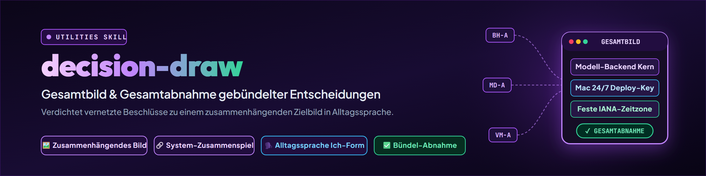

# decision-draw — গুচ্ছ সিদ্ধান্তের সামগ্রিক চিত্র ও অনুমোদন

> যখন পাঁচ বা দশটি সিদ্ধান্ত সামনে আসে, তখন বিকল্পের খুঁটিনাটির ভিড়ে গড়ে ওঠা সিস্টেমটির সামগ্রিক রূপ সহজেই চোখের আড়ালে চলে যায়। decision-draw বিকল্পগুলো বর্ণনা করে না, বরং কার্যকর পুরো চিত্রটি তুলে ধরে: সব সুপারিশ গৃহীত হলে সিস্টেমগুলো একসঙ্গে কীভাবে কাজ করে? ব্যবহারকারী ছবিটি সামগ্রিকভাবে গ্রহণ করেন অথবা লক্ষ্যভিত্তিক সংশোধন করেন।

---

## কখন ব্যবহার করবে

- একাধিক সম্পর্কিত সিদ্ধান্ত ([decision-briefing](../decision-briefing/SKILL.md) বা একটি সিদ্ধান্ত-টেমপ্লেট থেকে) একটি ক্লান্তিকর একক-প্রশ্নের তালিকা হিসেবে প্রক্রিয়া করা উচিত নয়।
- ব্যবহারকারী সিদ্ধান্তের আগে দেখতে চান, বাস্তবায়নের পর উপাদানগুলো দৈনন্দিন কাজে প্রকৃতপক্ষে কীভাবে একসঙ্গে কাজ করবে।
- নির্ভরতা গ্রাফ ([decision-path](../decision-path/SKILL.md)) থেকে ঘনিষ্ঠভাবে যুক্ত সিদ্ধান্তের একটি গুচ্ছ চিহ্নিত হয়েছে, যা একটি কার্যগত একক হিসেবে অনুমোদন করা যেতে পারে।
- ট্রিগার-শব্দ: `/decision-draw`, "সব কিছুতে সম্মত হলে পুরো ছবিটা কেমন দেখায়", "আমাকে সামগ্রিক চিত্রটি আঁকো", "সিদ্ধান্তগুলোর সামগ্রিক ধারণা", "decision draw", "তারপর সিস্টেমগুলো কীভাবে একসঙ্গে কাজ করে", "সামগ্রিক অনুমোদনের জন্য চিত্র"।
- **ব্যবহার করবে না:**
  - যখন ব্যবহারকারী প্রতিটি প্রশ্নে আলাদা বিকল্প যাচাই করতে চান এবং A/B/C অক্ষর দিয়ে বাছাই করতে চান — সেটি করে [decision-briefing](../decision-briefing/SKILL.md)।
  - শুধুমাত্র টার্মিনালে কার্যকারণ ও অবরোধ বিশ্লেষণের জন্য — সেটি করে [decision-path](../decision-path/SKILL.md)।
  - একক প্রশ্ন বা ঘনিষ্ঠ গোষ্ঠীর জন্য ৫-অংশের একক ব্লকে (প্রসঙ্গ, প্রতি বিকল্পে পক্ষ/বিপক্ষ, সুপারিশ) বিচ্ছিন্ন বিকল্প যাচাইয়ের জন্য — সেটি করে [decision-shot](../decision-shot/SKILL.md)।
  - একটি একক উন্মুক্ত মৌলিক প্রশ্নের পদ্ধতিগত বিকাশের জন্য — সেটি করে [decide](../decide/SKILL.md)।

---

## সিদ্ধান্ত-পরিবারের মধ্যে সীমানা

| স্কিল | UX ও মনোযোগ | বিকল্পের প্রতি মনোভাব | অনুমোদনের রূপ |
|---|---|---|---|
| `decision-briefing` | **ভাগ করে** একক প্রশ্নে | সব বিকল্প A/B/C/D দেখায় | অক্ষর-কোড (`1A 2C 3B`) |
| `decision-path` | **কাঠামো দেয়** কার্যকারণ সম্পর্কের | গ্রাফে বিকল্পের মূল্যায়ন করে | টার্মিনালে রোগনির্ণয় (ASCII) |
| `decision-draw` | **সংযুক্ত লক্ষ্য-চিত্র** (সংযুক্ত সিদ্ধান্তগুলো একত্র করে) | শুধু **সুপারিশকৃত বিকল্পটি** বর্ণনা করে (বিকল্পগুলোর লিংক দেওয়া) | সামগ্রিক অনুমোদন বা সংশোধন-বাক্য |
| `decision-shot` | **কাঠামোবদ্ধ একক ব্লক** (একক প্রশ্ন বা ঘনিষ্ঠ গোষ্ঠীর জন্য) | প্রতিটি বিকল্প ২–৪টি পক্ষ/বিপক্ষ বিন্দুসহ দেখায় | নির্বাহী সিদ্ধান্ত / একক অনুমোদন |
| `decide` | একটি একক ক্ষেত্র **বিকশিত করে** | মূল্যায়ন ম্যাট্রিক্স (মানদণ্ড) | বিশ্লেষণধর্মী সুপারিশ |

> **কেন্দ্রীয় নিয়ম:**
> `decision-draw` **শুধুমাত্র সুপারিশকৃত বিকল্প** বর্ণনা করে। বাতিল বিকল্পগুলো হারিয়ে যায়নি — সেগুলো [decision-briefing](../decision-briefing/SKILL.md), [decision-shot](../decision-shot/SKILL.md) বা সংযুক্ত টিকিটে নথিবদ্ধ আছে এবং হেডারে লিংক করা হয়। এই উল্লেখ ছাড়া একটি ড্র ব্যবহারকারীর পছন্দের সুযোগ কেড়ে নেবে, সহজ করবে না।

---

## বাধ্যতামূলক শৈলী-নিয়ম: ব্যবহারকারীর লেখায় সংকেত ও নম্বর নয়

> **মূল ব্যবহারকারী-নির্দেশ (প্রতিক্রিয়া 2026-09-13 / টিকিট T-20260913-883789445):**
> *„Die decision draws sind mir zu technisch, das muss ohne Nummer sein, die kennst du im Hintergrund oder nutzt du zur Texterstellung [...].“*

1. **দৃশ্যমান ব্যবহারকারী-লেখায় কোনো প্রযুক্তিগত সংকেত নয়:**
   মানুষের জন্য দৃশ্যমান গদ্যে (গুচ্ছ, ধারণা, পারস্পরিক সম্পর্ক, বাস্তবায়ন, জিজ্ঞাসা) **কোনো** অভ্যন্তরীণ সংকেত (যেমন `BH-A`, `MD-A`, `HA-A`, `PRA`) থাকবে না, কোনো টিকিট-নম্বর (`T-2026...`) থাকবে না, কোনো D-নম্বর (`D-2026...`) থাকবে না, কোনো আপেক্ষিক পথ, Git-হ্যাশ বা পরিমাপ-মানও থাকবে না।
2. **প্রতিটি আইটেমের জন্য ২–৪ বাক্য দৈনন্দিন ভাষায়, প্রথম-পুরুষে (আমি):**
   গুচ্ছের প্রতিটি আইটেম তিন ধাপের কাঠামোয় লেখা হবে:
   - *অবস্থা:* বর্তমান প্রারম্ভিক পরিস্থিতি কী?
   - *„আমি করছি …“:* আমি বাস্তবে কী পরিকল্পনা করছি / আমার কর্মসুপারিশ কী?
   - *ব্যর্থতার বিকল্প:* ব্যর্থ হলে কী ঘটে, বা তারপর ব্যবহারকারী কী সিদ্ধান্ত নেন?
   *(উদাহরণ: „Hermes টাস্কে শুধু ইংরেজি সমর্থন করে। আমি Hermes-এ একটি Issue হিসেবে জানাই এবং আমাদের জন্য একটি Workaround বানাই। এই মুহূর্তে ব্যবহারযোগ্য নয় এমন পুরোনো সেশন আছে। আমি সেগুলো আবার ব্যবহারযোগ্য করার চেষ্টা করি। যদি তা না হয়, আমি তোমাকে ১০টি সেশনের একটি এলোমেলো নমুনা দিই এবং তার সারসংক্ষেপ করি — যাতে তুমি সিদ্ধান্ত নিতে পারো উদ্ধার করা অর্থবহ কি না।“)*
3. **বোঝার সুবিধার জন্য স্পষ্ট শিরোনাম:**
   প্রতিটি আইটেমের একটি বোধগম্য জার্মান শিরোনাম থাকবে (যেমন *„Modell-Backend als eigenes Herzstück“*, *„Sichere Deploy-Schlüssel auf dem Mac“*)। ব্যবহারকারী এই শিরোনামের মাধ্যমে কাজ করেন অথবা সামগ্রিক অনুমোদন দেন।
4. **প্রযুক্তিগত সংযোগ শুধু পরিশিষ্টে:**
   সহজ শিরোনাম, অভ্যন্তরীণ সংকেত, টিকিট-ID ও রেজিস্টারের অবস্থার মধ্যকার অনুবাদ **শুধুমাত্র** দস্তাবেজের শেষে একটি চূড়ান্ত পরিশিষ্ট-টেবিলে হবে। সেখানে — এবং শুধু সেখানেই — স্বয়ংক্রিয় পার্সার ও রেজিস্টার-ফিরিয়ে-লেখক কাজ করে।

---

## বাধ্যতামূলক কাঠামো (আট অংশ)

একটি সম্পূর্ণ `decision-draw` ব্যতিক্রম ছাড়া এই কাঠামো অনুসরণ করে:

### ১. গুচ্ছ ও পরিধি (সহজ ভাষায়)
দৈনন্দিন ভাষায় গুচ্ছের আইটেমগুলোর সারসংক্ষেপ (আমি-রূপে, প্রতি বিন্দুতে ২–৪ বাক্য, লেখায় কোনো ID/সংকেত নয়)।

### ২. ধারণা
কাঙ্ক্ষিত লক্ষ্য-অবস্থা গদ্যে এক সংযুক্ত প্রবাহ হিসেবে:
- সব সুপারিশ ঠিক এভাবে বাস্তবায়িত হলে কী ধরনের সিস্টেম-ভূদৃশ্য বা কর্মপ্রবাহ তৈরি হয়?
- বিকল্পের মুখোমুখি তুলনা নয়, পাশাপাশি সম্ভাব্যতার ভাষা নয় („man könnte auch“-এর মতো)।
- স্পষ্ট, নির্দিষ্ট ক্রিয়াবাচ্যে: লক্ষ্য-অবস্থায় সিস্টেমটি এভাবে কাজ করে।

### ৩. পারস্পরিক সম্পর্ক
স্কিলের কার্যগত কেন্দ্রবিন্দু:
- সিদ্ধান্ত নেওয়া অংশগুলো বাস্তবায়নের **পরে** বাস্তবে কীভাবে একে অপরের সঙ্গে জড়ায়?
- একটি উপাদান-তালিকার চেয়ে একটি সুনির্দিষ্ট শেষ-থেকে-শেষ প্রবাহ ধরে উপস্থাপন অগ্রাধিকার পায়।
- ডেটা-প্রবাহ, ইন্টারফেস ও দায়িত্ব স্পষ্ট ও বোধগম্য করে।

### ৪. বাস্তবায়ন
সুনির্দিষ্ট বাস্তবায়নের ক্রম:
- বাস্তবে অনুশীলনে কী ঘটে?
- কিনারা ও নির্ভরতার যুক্তি সরাসরি [decision-path](../decision-path/SKILL.md) থেকে গ্রহণ করে।
- স্বাধীন কর্মধারাগুলো সৎভাবে সমান্তরাল হিসেবে দেখানো হয় (কৃত্রিম কার্যকারণ-শৃঙ্খল বানানো হবে না; একটি গুচ্ছে একাধিক সমান্তরাল ধারা থাকতে পারে)। ক্রম শুধু সেখানেই দাবি করা হয় যেখানে প্রমাণিত নির্ভরতা বা সময়সীমা আছে।
- গেট, স্থানান্তর ধাপ ও পরীক্ষাগুলো নাম ধরে উল্লেখ করে।

### ৫. এই চিত্র যা আবৃত করে না
মিথ্যা পূর্ণতার বিরুদ্ধে সুরক্ষা:
- কোন প্রান্তিক প্রশ্ন, খোলা বিষয় বা 🔴-আত্মবিশ্বাস ইচ্ছাকৃতভাবে বাদ রাখা হয়েছে?
- প্রতিবেশী সিস্টেমের সঙ্গে ইন্টারফেসের সীমানা কোথায়?
- যে ছবি তার প্রান্তগুলো গোপন রাখে, সে ভুয়া নিরাপত্তার অনুভূতি তৈরি করে।

### ৬. অনুমোদন
ব্যবহারকারীর সঙ্গে মিথস্ক্রিয়া:
- ব্যবহারকারী ছবিটি সামগ্রিকভাবে যাচাই করেন।
- উত্তরের বিকল্প ১: **সুস্পষ্ট সামগ্রিক অনুমোদন** („Passt so“, „Abnahme“, „So umsetzen“)। শুধু এখানে গুচ্ছের সব আইটেম সিদ্ধান্ত-হিসেবে লিপিবদ্ধ হয়।
- উত্তরের বিকল্প ২: **সহজ শিরোনাম বা দৈনন্দিন ভাষায় সংশোধন** („Beim Mac-Deploy lieber kein Auto-Restart“, „VersicherungsManager erst mal vertagen“)। এটি একক সিদ্ধান্তে বিভাজন ঘটায়; যেসব আইটেম সংশোধিত হয়নি সেগুলো খোলা থাকে।

### ৭. বিপরীত হস্তান্তর
ব্যবহারকারীর সংশোধনগুলোকে একক সিদ্ধান্তে রূপান্তরের পদ্ধতিগত প্রক্রিয়া:
- **স্বয়ংক্রিয় অন্তর্ভুক্তি নেই:** শুধু সুস্পষ্ট সামগ্রিক অনুমোদনেই অপরিবর্তিত আইটেমগুলো লিপিবদ্ধ হয়। আংশিক সংশোধন **কোনো** সামগ্রিক অনুমোদন নয়!
- **সংশোধনে বিচ্ছিন্নকরণ:** কোনো সংশোধন এলে সেটি একক সিদ্ধান্তে ভাগ করা হয়; গুচ্ছের বাকি সব আইটেম কঠোরভাবে **খোলা** থাকে (উৎস-রেজিস্টার / টেমপ্লেটে), যতক্ষণ না ব্যবহারকারী পরিশোধিত চিত্রটি সামগ্রিকভাবে গ্রহণ করেন বা অবশিষ্ট আইটেমগুলো একে একে নিশ্চিত করেন।
- **বাধ্যতামূলক বিপরীত-হস্তান্তর সারণি:** প্রতিটি সংশোধন-প্রতিক্রিয়া অবশ্যই চার কলামের একটি কাঠামোবদ্ধ মূল্যায়ন-সারণি তৈরি করে (মূল সংশোধন, প্রভাবিত সংকেত, নির্ভরতা-অবস্থা, অমীমাংসিত অস্পষ্টতা)।
- **শুধু ফেজ ৪-এর মাধ্যমে লেখার পথ:** `decision-draw`-এর রেজিস্টারে **কোনো** নিজস্ব লেখার পথ নেই। লিপিবদ্ধকরণ **শুধুমাত্র** [decision-briefing](../decision-briefing/SKILL.md)-এর ফেজ ৪-এর প্রমিত পদ্ধতির মাধ্যমে হয়।

### ৮. পরিশিষ্ট: প্রযুক্তিগত রেফারেন্স-টেবিল (শুধু লিপিবদ্ধকরণ ও নিরীক্ষার জন্য)
দস্তাবেজের শেষে একটি সংক্ষিপ্ত টেবিল, যাতে থাকবে:
`| Klartext-Titel | Internes Kürzel / ID | Ticket-Referenz | Unterstellte Empfehlung | Konfidenz | Link / Details |`

---

## উদাহরণ (পাইলট অংশ: Ticket-Master 2026-09-13 — BACH ও Systemverbund)

```markdown
# DECISION-DRAW: BACH-Kernverbund & Betriebsintegrität

## 1. Bündel und Umfang

- **Modell-Backend als eigenes Herzstück:** Die Modellzuteilung ist aktuell eng mit dem Monolithen verzahnt. Ich lagere das Backend als eigenständiges Kernmodul aus, damit Rechte und Budgets unabhängig geprüft werden. Scheitert ein externer Dienst, schaltet das System automatisch auf das lokale Reservemodell zurück.
- **Sichere Deploy-Schlüssel auf dem Mac:** Auf dem Mac laufen Dauerprozesse, die bei harten Updates unsauber abbrechen können. Ich richte einen lesenden Schlüssel und ein Meldeskript ein, das Aktualisierungen anzeigt, ohne laufende Dienste abzuschießen. Sollte ein Dienst dennoch hängen, meldet der Watcher das direkt an die Betriebsübersicht.
- **Einheitliche Konfigurations-Sollwerte:** Die beiden Hauptrechner nutzen teilweise unterschiedliche Spracheinstellungen. Ich gleiche die Konfigurationen über das gemeinsame Sync-Verzeichnis an, lasse dem Laptop aber ausreichend Spielraum für mobile Tests.
- **Feste Zeitzone im VersicherungsManager:** Datumsberechnungen bei Fristen hängen bisher vom Betriebssystem ab. Ich verankere eine feste Zeitzone in den Anwendungseinstellungen, damit Fristen überall auf die Minute genau übereinstimmen.
- **Öffentliche Bereitstellung der USMC-Dokumentation:** Die Modul-Dokumentation ist im Webauftritt noch als privat markiert und löst Prüfwarnungen aus. Ich korrigiere die Sichtbarkeit auf öffentlich, damit der nächtliche Seiten-Bau ohne Fehler durchläuft.

---

## 2. Konzept

Wir etablieren ein sauberes, entkoppeltes Multi-Host-System, bei dem das Modell-Backend
als eigenständiges Kernmodul `agents-heart` betrieben wird. Rechte und Budgets liegen
strukturiert in einer SQLite-Datenbank, während Zuteilungsentscheidungen zweistufig
fallen: BACH ermittelt fachlich fundiert die Kandidatenmenge, clutch wählt darin
preis- und kapazitätsoptimal das finale Modell.

Auf dem Mac Studio laufen die 24/7-Dienste geschützt und stabil über einen read-only
Deploy-Key; Updates ziehen automatisch ein, benachrichtigen den Operator bei laufenden
Diensten aber sanft, statt Hintergrundprozesse hart abzuschießen. Konfigurationen
dürfen dort bewusst hostspezifisch auf Leistung abgestimmt sein, während app-weite
Einstellungen (wie Zeitzonen im VersicherungsManager nach dem bewährten routinika-Muster)
deterministisch fest verdrahtet sind. USMC bleibt der kanonische öffentliche
Memory-Baustein und behält seinen festen Platz im Webauftritt.

---

## 3. Zusammenspiel

Die fünf Posten bilden keine serielle Kausalkette, sondern stellen modular entkoppelte Bausteine der täglichen Betriebsintegrität dar, die im Gesamtsystem parallel ineinandergreifen:

- **Kernarchitektur & Modell-Routing (`BH-A`):** Das Modul `agents-heart` entkoppelt die Modellzuteilung. Trifft eine Aufgabe ein, ermittelt BACH fachbezogen die Kandidatenmenge und clutch wählt kosten- und kapazitätsoptimal das Modell.
- **Host-Konfiguration & Deploy-Integrität (`CF-A`, `MD-A`):** Während auf dem Laptop und der Workstation konsistente Reasoning-Stufen gelten (`CF-A`; hostabhängige Modelle bleiben transparent), betreibt der Mac Studio seine persistenten Hintergrundprozesse unter validierten Einstellungen. Bei Aktualisierungen zieht der Mac den Code via Read-only Deploy-Key (`MD-A`); der GUI-Server startet neu, während langlebige 24/7-Dienste den Update-Bedarf sanft an das Dashboard melden.
- **Domänen-Persistenz & Fristen (`VM-A`):** Applikationen wie der VersicherungsManager schreiben Fristen und Deadlines gegen eine app-weite `settings`-Tabelle nach routinika-Muster. Zeitrechnungen und Deadline-Projektionen operieren über alle Profile hinweg deterministisch auf derselben IANA-Zeitzone.
- **Öffentlicher Auftritt (`PD-A`):** Der nächtliche Seiten-Builder validiert den Zustand der Repositories. USMC wird mit korrigierter `public`-Deklaration fehlerfrei publiziert, ohne Warnungen in den Sicherheits-Gates auszulösen.

---

## 4. Umsetzung

Da die Vorlage für diese fünf Posten im Abhängigkeitsgraphen ([decision-path](../decision-path/SKILL.md)) keine serielle Kette vorgibt, erfolgt die Umsetzung ehrlich in vier voneinander unabhängigen, parallelen Arbeitssträngen (Ausweg a: parallele Stränge statt erfundener Kausalität). Eine sequenzielle Reihenfolge gilt nur dort, wo externe Fristen oder interne Schritte belegt sind:

- **Strang A (Termingebunden — Frist 2026-09-14):**
  1. USMC-Metadaten auf `public` nachziehen (`PD-A`); Draft-PR #2 verwerfen. Duldet wegen des nächtlichen Builder-Laufs keinen Aufschub, ist technisch jedoch von allen anderen Strängen unabhängig.
- **Strang B (Host-Konfiguration & Mac-Deploy — parallel ausführbar):**
  1. B1: Sollwerte in `.SYNC` festschreiben (`CF-A`), Reasoning-Stufe `high` für beide Hosts synchronisieren.
  2. B2 (unabhängig von B1): Read-only Deploy-Key auf Mac Studio hinterlegen und Pull-and-Report-Skript einrichten (`MD-A`).
- **Strang C (Domänen-Datenbank — parallel ausführbar):**
  1. Migration der app-weiten `settings`-Tabelle im VersicherungsManager nach routinika-Vorbild implementieren (`VM-A`), um die saubere Basis für den nachgelagerten Publisher-Bau zu schaffen.
- **Strang D (Architektur-Herauslösung — interner Mehrstufenplan):**
  1. D1: SQLite-Schema für Rollen und Budgets in `agents-heart` anlegen (`BH-A` E1).
  2. D2: Backend-Katalog als Python-Modul ausgründen (`BH-A` E3) und clutch-Seam für Zuteilung binden (`BH-A` E2).
  3. D3: Modul `agents-heart` final herauslösen und anbinden (`BH-A` E5, E6).

---

## 5. Was dieses Bild nicht abdeckt

- **Task-Claiming Race Condition:** Der Integritätsfehler bei doppeltem Task-Claim läuft
  in einem separaten Hotfix-Ticket und ist nicht Teil dieser Freigabe.
- **Cockpit-Frontend:** Das Monitoring-Cockpit (`BH-A` E4) wird bewusst noch nicht gebaut,
  solange das Backend nicht produktiv meldet.
- **Sichtbarkeitsschaltung nach außen:** Reine Bereitstellung von Code schaltet keine
  neuen Repos public; die finale Freigabe bleibt dem Nutzer vorbehalten.

---

## 6. Abnahme

Du kannst diesen Systemverbund als Ganzes abnehmen oder in Alltagssprache korrigieren:

- **Ausdrückliche Gesamtabnahme:** „Passt so, genau so umsetzen.“ (Nur dies führt zur Verbuchung aller Posten).
- **Korrektur-Beispiele:**
  - *„Keine hostspezifischen Sonderwege auf dem Mac: MD-A braucht volles Schreibrecht (A2) für direkte Pushes, und CF-A soll alle Konfigurationen strikt an die Workstation angleichen (Gruppe 1=A, 2=A).“* (Mehrfachtreffer)
  - *„BH-A E5 lieber ocean-heart nennen statt agents-heart.“*
  - *„VM-A erst mal vertagen, der Publisher hat noch Zeit.“*

---

## 7. Rücktransfer

Wird das Gesamtbild abgenommen oder korrigiert, übersetzt der Skill die Rückmeldung:

### Fall A: Ausdrückliche Gesamtabnahme
Nimmt der Nutzer das Gesamtbild ausdrücklich als Ganzes ab (z. B. *„Passt so, genau so umsetzen“*):
- Alle fünf Posten (`BH-A: 1A/2A/3A/4B/5A/6A`, `MD-A: A1`, `CF-A: 1C/2B/3B`, `VM-A: A`, `PD-A: A`) werden als GETROFFEN an [decision-briefing](../decision-briefing/SKILL.md) Phase 4 übergeben.
- Phase 4 übernimmt die Eintragung ins Register `DECIDED-AND-DONE.md` und aktualisiert die fünf Quelltickets.

### Fall B: Teilkorrektur mit Mehrfachtreffer
Gibt der Nutzer eine inhaltliche Korrektur ein, z. B.:
> *„Keine hostspezifischen Sonderwege auf dem Mac: MD-A braucht volles Schreibrecht (A2) für direkte Pushes, und CF-A soll alle Konfigurationen strikt an die Workstation angleichen (Gruppe 1=A, 2=A).“*

**1. Strukturierte Rücktransfer-Tabelle:**

| Originalkorrektur (Wortlaut des Nutzers) | Betroffene Kürzel | Domino-Status (welche abhängigen Knoten kippen dadurch) | Offene Mehrdeutigkeiten |
|---|---|---|---|
| *„Keine hostspezifischen Sonderwege auf dem Mac: MD-A braucht volles Schreibrecht (A2) für direkte Pushes, und CF-A soll alle Konfigurationen strikt an die Workstation angleichen (Gruppe 1=A, 2=A).“* | `MD-A`, `CF-A` *(Mehrfachtreffer: 1 Aussage bewegt 2 Posten)* | **`MD-A`:** Kippt von A1 auf A2. Erfordert SSH-Write-Key auf Mac Studio, Push-Rechte im GitHub-Repo `bach` und Sicherheitsprüfung des LaunchAgents.<br>**`CF-A`:** Gruppe 1 kippt von C auf A (Laptop-Claude-Desktop wird restriktiver). Gruppe 2 kippt von B auf A (`codex.model` wird starr angeglichen). Gruppe 3 bleibt B (`high`), da bereits synchron. | **`CF-A` Gruppe 1:** Nutzer verlangt Angleichung an Workstation (1=A) — Rückfrage nötig, ob die bisher bewusste Freizügigkeit auf dem Laptop wirklich entzogen werden soll.<br>**`MD-A`:** Unklar, ob Write-Key für alle Repos oder nur für `bach` gelten soll. |

**2. Status der unberührten Posten (Schutz vor ungefragtem Mitbuchen):**
- Die unveränderten Posten `BH-A`, `VM-A` und `PD-A` werden **nicht** gebucht!
- Sie verbleiben im Status **OFFEN** (`PENDING`) in der Vorlage bzw. im Register `TO-DECIDE-USER.txt`.
- Eine Teilkorrektur ist **keine** Gesamtabnahme. Erst wenn das nach Korrektur aktualisierte Gesamtbild vom Nutzer als Ganzes abgenommen wird oder die verbleibenden Punkte einzeln bestätigt werden, dürfen sie verbucht werden.

**3. Buchungsweg:**
- `decision-draw` besitzt keinen eigenen Schreibmechanismus.
- Übergeben wird an **[decision-briefing](../decision-briefing/SKILL.md) Phase 4** nur, was die Tabelle als eindeutig ausweist: `CF-A` Gruppe 2 = A und Gruppe 3 = B.
- **Nicht** übergeben werden `MD-A` und `CF-A` Gruppe 1 — für beide steht in der Spalte *Offene Mehrdeutigkeiten* eine Rückfrage. Eine Mehrdeutigkeit, die man vor der Buchung klären wollte, darf man nicht in derselben Runde als geklärt verbuchen.
- Phase 4 trägt die eindeutigen Teile mit Begründung in Ticket `T-20260913-947070291.txt` ein und aktualisiert `DECIDED-AND-DONE.md`. Ticket `T-20260913-799464688.txt` (`MD-A`) bleibt offen, bis die Rückfrage beantwortet ist.

---

## 8. Anhang: Technische Referenztabelle (nur für Buchung & Audit)

| Klartext-Titel | Internes Kürzel | Ticket / Quelle | Unterstellte Empfehlung | Konfidenz | Link / Details |
|---|---|---|---|---|---|
| Modell-Backend als eigenes Herzstück | `BH-A` | `T-20260913-896336887` | 1A / 2A / 3A / 4B / 5A / 6A | 🟢 | `docs/MODELL-BACKEND-KONZEPT_2026-09-13.md` |
| Sichere Deploy-Schlüssel auf dem Mac | `MD-A` | `T-20260913-799464688` | A1 + Skript (nur Melden für 24/7) | 🟢 | Ticket `T-20260913-799464688.txt` |
| Einheitliche Konfigurations-Sollwerte | `CF-A` | `T-20260913-947070291` | 1C (begründet) / 2B (hostabh.) / 3B (high) | 🟢 / 🟡 | Ticket `T-20260913-947070291.<HOST>.txt` |
| Feste Zeitzone im VersicherungsManager | `VM-A` | `T-20260906-496406575` | A (app-weite settings wie routinika) | 🟢 | Ticket `T-20260906-496406575.<HOST>.txt` |
| Öffentliche Bereitstellung der USMC-Dokumentation | `PD-A` | `T-20260913-609930207` | A (auf public nachziehen, Status quo) | 🟢 | Ticket `T-20260913-609930207.txt` |
```

---

## অনুশীলনের নিয়মাবলি

1. **ধারণায় শর্তবাচক নয়:** সমগ্র সিস্টেমটি ইতিমধ্যে বাস্তবায়িত হয়েছে এমনভাবে বর্ণনা করো। ব্যবহারকারী ফলাফল সম্পর্কে স্পষ্টতা চান, তাত্ত্বিক সম্ভাবনা নয়।
2. **ক্রমের আগে কার্যকারণ:** *বাস্তবায়ন* অংশের ক্রম [decision-path](../decision-path/SKILL.md)-এর নির্ভরতা-গ্রাফের স্তর অনুসরণ করে। স্বাধীন ধারাগুলো সৎভাবে সমান্তরাল হিসেবে দেখানো হয় এবং একটি কৃত্রিম কার্যকারণ-শৃঙ্খলে বাঁকানো হয় না।
3. **বিপরীত হস্তান্তরে স্পষ্ট ডমিনো-পরীক্ষা:** ব্যবহারকারীর কোনো সংশোধন কখনো বিচ্ছিন্নভাবে লেখা যাবে না, এটি না দেখে যে গ্রাফের নির্ভরশীল নোডগুলো অবমূল্যায়িত বা প্রভাবিত হচ্ছে কি না।
4. **আংশিক সংশোধনে স্বয়ংক্রিয় অন্তর্ভুক্তি নয়:** শুধু সুস্পষ্ট সামগ্রিক অনুমোদনে অপরিবর্তিত আইটেম লিপিবদ্ধ হয়। প্রতিটি আংশিক সংশোধনে সব অপ্রভাবিত আইটেম কঠোরভাবে খোলা থাকে, যতক্ষণ না সামগ্রিক চিত্রটি আবার মুক্তি পায় বা আইটেমগুলো একে একে নিশ্চিত হয়।
5. **শুধু ফেজ ৪-এর মাধ্যমে লেখার পথ:** `decision-draw`-এর রেজিস্টারে কোনো নিজস্ব লেখার পথ নেই। লিপিবদ্ধকরণ ব্যতিক্রম ছাড়া [decision-briefing](../decision-briefing/SKILL.md)-এর ফেজ ৪-এর মাধ্যমে হয়।
6. **রেজিস্টারের চুক্তিগুলো মেনে চলো:** লিপিবদ্ধকরণ সবসময় সিদ্ধান্ত-রেজিস্টারের নিয়ম অনুযায়ী হয় (ID-এর পুনঃনম্বরায়ন নয়, স্বতন্ত্র লিপিবদ্ধকরণ-কোড, প্রমিত গন্তব্য `DECIDED-AND-DONE.md`)।
7. **ব্যবহারকারীর লেখায় প্রযুক্তিগত নম্বর ও সংকেত নয়:** মানুষের জন্য দৃশ্যমান গদ্যে কোনো ID, সংকেত, পথ বা টিকিট-নম্বর থাকবে না। প্রতিটি আইটেম বোধগম্য আমি-রূপে লেখা হয়; সব শনাক্তকারী পরিশিষ্ট-টেবিলে যায়।

---

## সেশন-উৎপত্তি

একটি Decision-Draw স্থায়ী ধারণা-দস্তাবেজ হিসেবে সংরক্ষিত হলে সেটি এভাবে শেষ হয়:

`session: <session-id> | <agent>@<host> | YYYY-MM-DD`

- উৎস-অগ্রাধিকার: সুস্পষ্ট রানটাইম/CLI-নির্দেশনা, তারপর কর্তৃপক্ষীয় প্রদানকারী-পরিবেশ বা হুক, অন্যথায় `unbekannt`।
- সাব-এজেন্ট প্যারেন্ট সেশনের সেশন-ID উত্তরাধিকার সূত্রে পায়।
- শুধু চ্যাট-টেমপ্লেটে কোনো স্ট্যাম্প দেওয়া হয় না।

---

## পরিবর্তন-লগ

### 1.1.0 (2026-09-18)
- ব্যবহারকারী-বান্ধব সিদ্ধান্ত-লেখার শৈলী-নিয়ম প্রতিষ্ঠিত (T-20260913-883789445, ব্যবহারকারী-নির্দেশ 2026-09-13):
  - দৃশ্যমান ব্যবহারকারী-লেখায় কোনো প্রযুক্তিগত সংকেত, টিকিট-/D-নম্বর, পথ বা পরিমাপ-মান নেই।
  - প্রতিটি আইটেমের জন্য ২–৪ বাক্য দৈনন্দিন ভাষায়, আমি-রূপে (অবস্থা, „আমি করছি …“, ব্যর্থতার বিকল্প)।
  - শনাক্তকরণ ও অনুমোদনের জন্য বোধগম্য সহজ বাংলা শিরোনাম।
  - প্রযুক্তিগত সংযোগ (সংকেত, টিকিট-ID, রেজিস্টারের অবস্থা) কঠোরভাবে সমাপনী পরিশিষ্ট-টেবিলে (অধ্যায় 8) স্থানান্তরিত।

### 1.0.1 (2026-09-13)
- পর্যালোচনার পর পুনর্কাজ:
  - বিপরীত-হস্তান্তর চুক্তি স্পষ্ট করা হয়েছে: আংশিক সংশোধনে স্বয়ংক্রিয় অন্তর্ভুক্তি নেই; অস্পর্শিত আইটেম সামগ্রিক অনুমোদন পর্যন্ত কঠোরভাবে খোলা থাকে।
  - ৪-কলামের বাধ্যতামূলক বিপরীত-হস্তান্তর সারণি চালু (মূল সংশোধন, প্রভাবিত সংকেত, ডমিনো-অবস্থা, অমীমাংসিত অস্পষ্টতা)।
  - উদাহরণে একাধিক মিল দেখানো হয়েছে (একটি ব্যবহারকারী-সংশোধন একসঙ্গে `MD-A` ও `CF-A`-কে নাড়ায়)।
  - চুক্তি ও উদাহরণে `decision-briefing` ফেজ ৪-এর একমাত্র লেখার পথ হিসেবে প্রতিষ্ঠিত।
  - উদাহরণে কার্যকারণ-শৃঙ্খলের ভুল অনুমান সংশোধন: স্বাধীন আইটেমগুলো সৎভাবে চারটি সমান্তরাল কর্মধারা হিসেবে দেখানো হয়েছে (বিকল্প a)।
  - আউটপুট-বিন্যাসের মাধ্যমে `decision-shot`-এর সঙ্গে সীমানা স্পষ্ট করা হয়েছে (পক্ষ/বিপক্ষসহ কাঠামোবদ্ধ একক ব্লক বনাম সামগ্রিক অনুমোদনসহ সংযুক্ত লক্ষ্য-চিত্র)।

### 1.0.0 (2026-09-13)
- ব্যবহারকারীর কাজ T-20260913-107991667-এর ভিত্তিতে প্রথম সংস্করণ।
- সাত অংশের বাধ্যতামূলক কাঠামো (গুচ্ছ, ধারণা, পারস্পরিক সম্পর্ক, বাস্তবায়ন, সীমানা, অনুমোদন, বিপরীত হস্তান্তর)।
- `decision-path`-এর ভিত্তিতে গুচ্ছীকরণের যুক্তি এবং `decision-briefing` ফেজ ৪-এর সঙ্গে ফিরিয়ে-লেখার সেতু।
