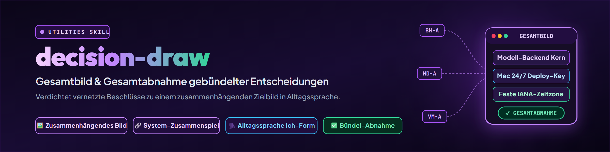

# decision-draw — Big Picture and Overall Sign-Off for Bundled Decisions

## Optional native decision window

Run `python scripts/decision_viewer.py open /absolute/draw.json` for the standalone
file-based Tk viewer. Read [the format and consumer contract](references/viewer.md)
before creating or consuming a GUI decision. Default acceptance remains a draft;
only explicit Submit confirms all visible selections and comments. Ordinary
partial corrections retain the isolation rules below. Claim the file atomically
before any external effect; canonical booking remains decision-briefing Phase 4.

> **Status:** The Tk viewer is **not accepted natively**: the Tk path has never been executed, and its tests run headless with mocks. Open it for a user only after their explicit consent; until then use the HTML form (section "Decision document as a form").

> When five or ten decisions are pending, one easily gets lost in the weeds of
> isolated options and loses sight of the emerging system. decision-draw does not
> describe the alternatives; it paints the working whole: How do the systems
> cooperate once all recommendations are in place? The user signs off on the picture
> as a whole or provides targeted feedback.

---

## Decision document as a form (build guide)

So that the user can click through a decision document inside the document itself (bulk acceptance, a note per item, save and send, a machine-readable answer file `ticket-master.decision-answers.v1`), `scripts/formular/build_form.py` turns a small data JSON (`form.schema.json`, example `example_form.json`) into **one self-contained HTML form**. The form is not rebuilt each time: write the data, run `build_form.py`. Per item a short context (250 characters), one sentence of effect per option, a recommendation with one reason and the mandatory fields cost/effort, risk/reversibility, deadline and consequence of "no"; anything longer only collapsible; every item also has the choice "question / more info needed". Depending on the decision type, three image modes (`bilder_modus`) are available: `serie` (default, 1–12 images), `polaroid` (2–12 cards with letters A, B, C... matching options for variant comparisons, selectable via click or keypress) and `swipe` (1–60 images sequentially as a deck with yes/no/question and mandatory confirmation of the overall summary for bulk reviews). The avatar prediction badge is displayed only after the user has made a choice, avoiding pre-decisional anchoring. The full guide covers the two routes (A: HTML form, B: Tk window with `draw.json`), the answer schema and the places to adapt for a new document: [references/formular.md](references/formular.md) (German). The same route applies to [decision-briefing](../decision-briefing/SKILL.en.md).

Mandatory rules from the incident of 2026-11-07 (reasons in the guide):

1. Nothing preselected (or explicitly marked as preselected).
2. An overall sign-off only after an explicit "yes" in the in-document dialog; never adopt it when restoring a saved draft.
3. List sensitive items (red, money, deletion, external effect, licence) before saving.
4. UI tests headless only, never through a visible browser or the Playwright MCP tools (a visible test browser once filled in the form by itself).
5. Deliver only after an independent check by another instance.
6. Book only through decision-briefing Phase 4; comparing with a sealed avatar forecast is optional.
7. Saving never depends on a dialog (rule 9 of the guide): download links, text to copy and "save draft" are in place before the folder dialog opens and stay after every abort or error; "saved" only after the files are completely written.
8. Short and decision-relevant (post template with limits and mandatory fields, anything longer only collapsible); the choice "question / more info needed" is never consent and blocks the overall sign-off.

---

## When to use

- Multiple interdependent decisions (from [decision-briefing](../decision-briefing/SKILL.md) or a decision briefing document) should not be grinded through as a tedious checklist of individual questions.
- The user wants to see how components actually interact in daily practice after implementation before approving them.
- A cluster of tightly coupled decisions identified via the dependency graph ([decision-path](../decision-path/SKILL.md)) can be signed off together as a functional unit.
- Trigger words: `/decision-draw`, "what does the whole thing look like if we agree to everything", "draw the big picture", "overall decision concept", "decision draw", "how do the systems work together afterwards", "overall sign-off picture".
- Do **not** use:
  - When the user wants to evaluate distinct options per item and choose via letters (A/B/C) — that is done by [decision-briefing](../decision-briefing/SKILL.md).
  - For pure causality and bottleneck analysis in the terminal — that is done by [decision-path](../decision-path/SKILL.md).
  - For isolated option evaluations in 5-part discrete blocks (context, pro/con per option, recommendation) for single issues or tightly grouped questions — that is done by [decision-shot](../decision-shot/SKILL.md).
  - To methodically evaluate a single open policy question — that is done by [decide](../decide/SKILL.md).

---

## Boundaries in the Decision Family

| Skill | UX & Focus | Stance on Options | Sign-off Mode |
|---|---|---|---|
| `decision-briefing` | **Decomposes** into individual items | Shows all options A/B/C/D | Letter codes (`1A 2C 3B`) |
| `decision-path` | **Structures** causalities | Evaluates options in graph | Terminal diagnostics (ASCII) |
| `decision-draw` | **Cohesive target picture** (bundles interdependent decisions) | Describes **only the recommended variant** (alternatives linked) | Holistic sign-off or correction sentence |
| `decision-shot` | **Structured discrete blocks** (for single issues or tight groups) | Shows options with 2–4 pro/con bullet points | Executive decision / individual review |
| `decide` | **Works out** single issue | Evaluation matrix (criteria) | Analytical recommendation |

> **Core Rule:**
> `decision-draw` describes **exclusively the recommended variant**. The discarded alternatives have not vanished — they are documented in [decision-briefing](../decision-briefing/SKILL.md), [decision-shot](../decision-shot/SKILL.md), or linked tickets, and are referenced in the header table. A draw without this link takes away the user's choice instead of simplifying it.

---

## Binding Style Rule: User-Facing Texts Without Shorthand Codes and Numbers

> **Canonical user instruction (Feedback 2026-09-13 / Ticket T-20260913-883789445):**
> *"The decision draws are too technical for me; they need to be without numbers, which you know in the background or use for text generation [...]."*

1. **No technical abbreviations in visible user text:**
   In visible prose for human readers (bundle, concept, interplay, implementation, query), there must be **no** internal codes (such as `BH-A`, `MD-A`, `HA-A`, `PRA`), no ticket numbers (`T-2026...`), no D-numbers (`D-2026...`), no relative paths, git hashes, or raw telemetry.
2. **2–4 sentences of everyday language in first person per item:**
   Each item in the bundle is phrased following the three-part structure:
   - *Situation:* What is the current starting point?
   - *Action ("I do..."):* What do I specifically plan / recommend doing?
   - *Fallback:* What happens if this fails, or what does the user decide next?
   *(Example: "Hermes currently supports only English for tasks. I will file an issue with Hermes and build a local workaround for us. There are currently unusable legacy sessions. I will attempt to recover them. If that fails, I will give you a random sample of 10 sessions and summarize them so you can decide if recovery is worthwhile.")*
3. **Descriptive plain-text titles for orientation:**
   Each item bears an intuitive title (e.g. *"Model Backend as Dedicated Core"*, *"Secure Deploy Keys on the Mac"*). The user interacts via this title or provides an overall sign-off.
4. **Technical mapping exclusively in the appendix:**
   The translation between plain-text title, internal abbreviation, ticket ID, and ledger state happens **exclusively in a concluding appendix table** at the end of the document. Automated parsers and ledger back-transfer routines read from there, and only from there.

---

## Mandatory Structure (Eight Parts)

A complete `decision-draw` strictly follows this eight-part layout:

### 1. Bundle and Scope (in Plain Text)
Overview of bundled items in everyday language (first person, 2–4 sentences per item, no technical IDs/codes in text).

### 2. Concept
The target state in cohesive prose:
- What system landscape or workflow emerges when all recommendations are executed exactly as planned?
- No side-by-side option comparison, no subjunctive hedging ("one could also").
- Clear, confident indicative tense: This is how the system operates in its target state.

### 3. Interplay
The functional core of the skill:
- How do the decided components actually mesh together **after** implementation?
- Framed along a concrete end-to-end operational flow (e.g. "A ticket arrives → agent starts → backend assigns → deploy to host") rather than a static list of components.
- Clarifies data flows, interfaces, and operational responsibilities.

### 4. Implementation
The concrete sequence of rollout steps:
- What happens in practice, step by step?
- Inherits execution sequence and dependency logic directly from [decision-path](../decision-path/SKILL.md).
- Independent workstreams are represented honestly as parallel tracks (do not invent artificial causal chains; a bundle can consist of multiple parallel tracks). Sequential ordering is asserted only where substantiated dependencies or deadlines exist.
- Highlights gates, migration scripts, and validation checks.

### 5. What This Picture Does Not Cover
Boundary defense against false completeness:
- Which secondary questions, unresolved issues, or 🔴 confidences are deliberately excluded?
- Where are the boundary lines to neighboring systems?
- A picture that conceals its margins produces a false sense of safety.

### 6. Sign-Off
The user interaction:
- The user reviews the picture as a whole.
- Response option 1: **Explicit overall sign-off** ("Looks good", "Approved", "Implement everything as proposed"). Only in this case are all bundle items booked as decided.
- Response option 2: **Targeted correction in natural language or by plain title** ("No auto-restart for Mac deploy", "Postpone VersicherungsManager for now"). Triggers decomposition into discrete decisions; all uncorrected items remain open.

### 7. Back-Transfer
The systematic translation of user feedback into individual ledger entries:
- **No Automatic Co-Booking:** Unaltered items are booked **only upon explicit overall sign-off**. A partial correction is **not** an overall approval!
- **Isolation upon Correction:** If the user submits a correction, it is decomposed into individual decisions; all other items in the bundle remain strictly **open** (in source tickets / ledger) until the user accepts the adjusted picture as a whole or confirms remaining items individually.
- **Mandatory Back-Transfer Table:** Every partial feedback generates a structured evaluation table with four columns (Original Correction, Affected Keys, Domino Status, Open Ambiguities).
- **Exclusive Write Path via Phase 4:** `decision-draw` has **no** native write path to tickets or registers. Ledger updates occur **exclusively** via the standardized protocol in [decision-briefing](../decision-briefing/SKILL.md) Phase 4.

### 8. Appendix: Technical Reference Table (for Booking & Audit Only)
Compact table at the end of the document:
`| Plain Title | Internal Abbreviation / ID | Ticket Reference | Assumed Recommendation | Confidence | Link / Details |`

---

## Example (Pilot Dataset: Ticket-Master 2026-09-13 — BACH & System Cluster)

```markdown
# DECISION-DRAW: BACH Core Cluster & Operational Integrity

## 1. Bundle and Scope

- **Model Backend as Its Own Core Heart:** Model assignment is currently tightly coupled with the monolith. I will decouple the backend as an independent core module so that rights and budgets are audited independently. If an external service fails, the system automatically falls back to the local reserve model.
- **Secure Deploy Keys on the Mac:** Persistent background processes run on the Mac and can terminate uncleanly on hard updates. I will configure a read-only key and a reporting script that indicates updates without killing running services. If a service hangs, the watcher alerts operational monitoring directly.
- **Unified Configuration Baselines:** The two main hosts currently use divergent language settings. I will align configurations via the shared sync directory while retaining sufficient flexibility on the laptop for mobile tests.
- **Fixed Timezone in VersicherungsManager:** Date calculations for deadlines currently depend on the host operating system. I will anchor a fixed timezone in application settings so deadlines match to the minute everywhere.
- **Public Deployment of USMC Documentation:** Module documentation is currently marked private in the web presence and triggers audit warnings. I will correct visibility to public so the nightly site build completes without errors.

---

## 2. Concept

We establish a clean, decoupled multi-host architecture where the model backend is
operated as an independent core module named `agents-heart`. Roles, rights, and budgets
are cleanly maintained in a relational SQLite database, while model routing decisions
occur in two stages: BACH builds the domain-qualified candidate set, and clutch selects
the cost- and capability-optimal model within that set.

On the Mac Studio, 24/7 background services operate safely and reliably using a read-only
deploy key; code updates are pulled automatically, and running 24/7 services are gently
notified rather than violently terminated. Configurations may remain host-specific where
performance demands it, while app-wide settings (such as timezones in VersicherungsManager
following the proven routinika pattern) are deterministically hard-wired. USMC remains
the canonical public memory facade and retains its place on the public website.

---

## 3. Interplay

The five items do not form a serial causal chain; instead, they represent modular, decoupled pillars of daily operational integrity that interlock in parallel across the system:

- **Core Architecture & Model Routing:** The `agents-heart` module decouples model assignment. When a task arrives, BACH determines the domain-qualified candidate set and clutch selects the cost- and capacity-optimal model.
- **Host Configuration & Deploy Integrity:** While consistent reasoning effort applies to the laptop and workstation (host-dependent models remain transparent), the Mac Studio runs persistent background processes under validated settings. For updates, the Mac pulls code via read-only deploy key; the GUI server restarts while long-running 24/7 services gently notify the dashboard of update requirements.
- **Domain Persistence & Deadlines:** Applications such as VersicherungsManager persist deadlines against an app-wide `settings` table following the routinika pattern. Calculations and deadline watchers operate deterministically across all profiles on the same IANA timezone.
- **Public Presentation:** The nightly site builder validates repository states. USMC is published cleanly under its corrected `public` declaration, triggering zero alerts in the security gates.

---

## 4. Implementation

Rollout is structured into four independent, parallel workstreams:

- **Track A (Time-Critical — Deadline 2026-09-14):**
  1. Align USMC metadata to `public`; discard Draft PR #2. Delays cannot be tolerated due to the nightly builder run.
- **Track B (Host Configuration & Mac Deploy — Parallelizable):**
  1. B1: Codify configuration targets in `.SYNC`, synchronizing reasoning effort to `high` across both hosts.
  2. B2: Install read-only deploy key on Mac Studio and set up the pull-and-report automation script.
- **Track C (Domain Database — Parallelizable):**
  1. Implement the app-wide `settings` table migration in VersicherungsManager following the routinika pattern.
- **Track D (Architectural Extraction — Internal Multi-Stage Plan):**
  1. D1: Set up SQLite schema for roles and budgets in `agents-heart`.
  2. D2: Carve out the backend catalog as a Python module and bind the clutch allocation seam.
  3. D3: Extract and bind the `agents-heart` module.

---

## 5. What This Picture Does Not Cover

- **Task-Claiming Race Condition:** Addressed in a dedicated hotfix ticket.
- **Cockpit Frontend:** Deferred until the backend produces live operational telemetry.
- **Publishing Public Repositories:** Merging and staging code does not automatically make private repositories public; final visibility toggles remain reserved for the user.

---

## 6. Sign-Off

You can sign off on this system cluster as a whole or provide natural-language adjustments:
- **Explicit Overall Sign-Off:** "Looks good, implement exactly as proposed."
- **Example Corrections:** "No host-specific special handling for the Mac deploy key", "Postpone VersicherungsManager for now".

---

## 7. Back-Transfer

### Structured Back-Transfer Table:

| Original Correction (User Wording) | Affected Keys | Domino Status (dependent nodes affected) | Open Ambiguities |
|---|---|---|---|
| *"No host-specific special handling for the Mac: MD-A needs full write keys (A2) for direct pushing, and CF-A should strictly align all configurations to the workstation (Group 1=A, 2=A)."* | `MD-A`, `CF-A` *(Multi-hit)* | **`MD-A`:** Flips from A1 to A2. Requires SSH write key on Mac Studio, push rights in GitHub repo `bach`, and security review.<br>**`CF-A`:** Group 1 flips from C to A. Group 2 flips from B to A. Group 3 remains B (`high`). | **`CF-A` Group 1:** Clarification required whether permissiveness on the laptop should truly be revoked.<br>**`MD-A`:** Unclear whether write key applies to all repositories or exclusively to `bach`. |

### Status of Untouched Items:
Unaltered items (`BH-A`, `VM-A`, `PD-A`) remain strictly **OPEN** until explicit overall approval.

---

## 8. Appendix: Technical Reference Table (for Booking & Audit Only)

| Plain Title | Internal Abbreviation / ID | Ticket Reference | Assumed Recommendation | Confidence | Link / Details |
|---|---|---|---|---|---|
| Model Backend as Heart | `BH-A` | `T-20260913-896336887` | 1A / 2A / 3A / 4B / 5A / 6A | 🟢 | `docs/MODELL-BACKEND-KONZEPT_2026-09-13.md` |
| Mac Deploy & Restart | `MD-A` | `T-20260913-799464688` | A1 + script (report-only for 24/7) | 🟢 | Ticket `T-20260913-799464688.txt` |
| Host Configuration Targets | `CF-A` | `T-20260913-947070291` | 1C (justified) / 2B (host-dep.) / 3B (high) | 🟢 / 🟡 | Ticket `T-20260913-947070291.<HOST>.txt` |
| VersicherungsManager Timezone | `VM-A` | `T-20260906-496406575` | A (app-wide settings like routinika) | 🟢 | Ticket `T-20260906-496406575.<HOST>.txt` |
| USMC Page Visibility | `PD-A` | `T-20260913-609930207` | A (align declaration to public, status quo) | 🟢 | Ticket `T-20260913-609930207.txt` |

*Note: All discarded alternatives remain documented in the Ticket-Master decision briefing.*
```

---

## Practical Rules

1. **Avoid Subjunctive Phrasing in Concept:** Describe the system as if already built. The user needs total clarity on the end state, not theoretical possibilities.
2. **Causality Precedes Chronology:** Execution order in *Implementation* mirrors the dependency graph layers from [decision-path](../decision-path/SKILL.md). Independent workstreams must be honestly represented as parallel tracks rather than bent into an artificial causal chain.
3. **Explicit Domino Checks during Back-Transfer:** Never record a user correction in isolation without verifying whether dependent nodes in the graph are invalidated or impacted.
4. **No Automatic Co-Booking upon Partial Corrections:** Only explicit overall sign-off books unaltered items. For every partial correction, all untouched items remain strictly open until the revised picture is approved or items are individually confirmed.
5. **Exclusive Write Path via Phase 4:** `decision-draw` possesses no native write mechanism. All ledger and ticket bookings proceed strictly via [decision-briefing](../decision-briefing/SKILL.md) Phase 4.
6. **Adhere to Ledger Rules:** All bookings must comply with register contracts (no ID renumbering, canonical booking codes, canonical target `DECIDED-AND-DONE.md`).

---

## Session Provenance

When a decision draw is stored as a persistent concept artifact, it concludes with:

`session: <session-id> | <agent>@<host> | YYYY-MM-DD`

- Source priority: Explicit runtime/CLI argument, then authoritative provider environment or hook, otherwise `unknown`.
- Subagents inherit their parent session ID.
- Routine chat outputs do not receive a provenance stamp.

---

## Changelog

### 1.3.0 (2026-11-09)
- Image modes for the form template (`build_form.py`, `form.schema.json`, `formular.js`, `formular.css`): `serie` (default, 1–12 images), `polaroid` (2–12 cards with letters A, B, C... matching options, selectable by click or keypress) and `swipe` (1–60 images sequentially as a deck with yes/no/question and mandatory summary confirmation for bulk reviews).
- Avatar prediction: Badge is displayed only after a choice has been made (avoiding cognitive anchoring).
- Identifier badge in card header: Descriptive plain-text title in `<legend>` first, technical abbreviation discreetly aligned to the right.
- `make_fixtures.py` repaired for Rule-9 save area (waits for `#save-links a` and reads blob contents).
- Full DE/EN parity with `SKILL.md` established (including the 8-part structure with technical appendix table and the style rule for human-friendly plain texts).

### 1.2.0 (2026-11-07)
- Template instead of a document generator: `scripts/formular/build_form.py <data.json>` with `formular.html`, `form.schema.json` and `example_form.json`. Post template with length limits (errors, no silent truncation) and mandatory fields cost/effort, risk/reversibility, deadline, consequence of "no"; the choice "question / more info needed" (answer schema extended by `state: question` and `counts.questions`); optional `bilder[]` embedded as `data:` URIs. The former generator is `build_from_markdown.py` (migration example); the rule 9 tests run as a shared mixin on both.
- Rule 9 "saving never depends on a dialog" (incident of 2026-11-07: after the folder dialog was aborted the form offered nothing more): the reference form now has download links per file (nothing starts by itself), text to copy, "save draft", honest success and error messages and no `startIn`; tests `HeadlessSave` (headless, simulated failures) and `SaveArea`.
- Added the build guide "Decision document as a form" with the reference implementation `scripts/formular/` and the mandatory rules from the incident of 2026-11-07; added the status note for the Tk viewer (not accepted natively).

### 1.1.0 (2026-09-18)
- Style rule for user-friendly decision texts established (T-20260913-883789445, user instruction 2026-09-13):
  - No technical codes, ticket/D-numbers, paths, or telemetry in visible text.
  - 2–4 sentences of everyday language in first person (Situation, "I do...", Fallback) per item.
  - Descriptive plain-text titles for identification and sign-off.
  - Technical mapping (codes, ticket IDs, register states) strictly moved to concluding appendix table (Section 8).

### 1.0.1 (2026-09-13)
- Rework following independent review:
  - Hardened back-transfer contract: No automatic co-booking on partial corrections; untouched items remain strictly open until overall sign-off.
  - Introduced mandatory 4-column back-transfer table (Original Correction, Affected Keys, Domino Status, Open Ambiguities).
  - Demonstrated multi-hit feedback in example (one user statement moving `MD-A` and `CF-A` simultaneously).
  - Established exclusive write path via `decision-briefing` Phase 4 in both contract and example.
  - Eliminated unsubstantiated causal chain in example: Independent items honestly mapped into four parallel workstreams (Approach a).
  - Clarified distinction with `decision-shot` based on output format (structured discrete blocks with pro/con vs. cohesive target picture with overall sign-off).

### 1.0.0 (2026-09-13)
- Initial release based on user order T-20260913-107991667.
- Mandatory structure (bundle, concept, interplay, implementation, boundaries, sign-off, back-transfer).
- Bundling logic based on `decision-path` and back-transfer bridge to `decision-briefing` Phase 4.
