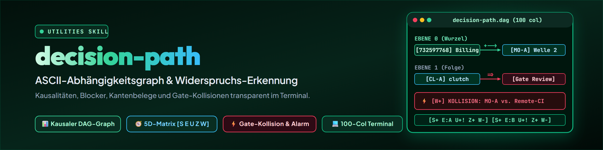

# decision-path — Graphe de dépendances ASCII des décisions ouvertes

> Les décisions ne tombent pas dans le vide. Ce qui paraît raisonnable isolément bloque souvent des travaux ultérieurs, exige des étapes préalables inachevées ou contourne des contrats de protection existants. decision-path rend visibles dans le terminal les causalités, les ordres de succession et les contradictions.

---

## Quand l'utiliser

- Un ensemble de décisions ouvertes (issu de [decision-briefing](../decision-briefing/SKILL.md) Phase 1, d'un contexte de session ou d'un modèle de décision) doit être structuré.
- Il faut clarifier quelles décisions sont immédiatement librement décidables (nœuds racines) et lesquelles dépendent de conditions préalables ou de bloqueurs externes.
- Un aperçu est demandé sur les recommandations qui s'accordent entre elles et sur les endroits où deux arbitrages se contredisent logiquement ou organisationnellement.
- Mots déclencheurs : `/decision-path`, « quelles décisions dépendent les unes des autres », « graphe de dépendances des décisions », « visualiser le chemin de décision », « arbre de décision ASCII », « contradictions entre décisions », « vérifier les causalités ».
- **À ne pas utiliser** :
  - Pour la saisie et l'inventaire initiaux des questions ouvertes : c'est le rôle de [decision-briefing](../decision-briefing/SKILL.md) Phase 1.
  - Pour regrouper les variantes recommandées en une vue d'ensemble cohérente en vue de leur validation : c'est le rôle de [decision-draw](../decision-draw/SKILL.md).
  - Pour les blocs individuels compacts en cinq parties avec options et pour/contre par option : c'est le rôle de [decision-shot](../decision-shot/SKILL.md).
  - Pour l'élaboration méthodologique d'une question complexe isolée (notation pondérée, scénarios) : c'est le rôle de [decide](../decide/SKILL.md).

---

## Délimitation au sein de la famille des décisions

| Skill | Tâche | Entrée | Sortie |
|---|---|---|---|
| `decide` | Élabore **une seule** décision de manière méthodique | Critères, options | Matrice d'évaluation, décision individuelle |
| `decision-briefing` | **Décompose de nombreuses** décisions ouvertes en questions individuelles avec options | Liste de points ouverts | Briefing numéroté A/B/C/D, marquages grossiers, réservation |
| `decision-path` | **Valide et visualise les causalités et contradictions** sur de nombreuses décisions | Marquages grossiers issus du briefing / registre | Graphe de dépendances ASCII avec 5 évaluations par nœud et statut des arêtes |
| `decision-draw` | **Regroupe les recommandations** en une vue d'ensemble à valider globalement | Paquet issu de `decision-path` | Concept, interaction (seule la variante recommandée), retour de transfert |
| `decision-shot` | Condense des **analyses achevées** à l'essentiel (1 décision ou un petit ensemble) | 1 question analysée ou groupe | Synthèse en cinq parties avec options, pour/contre et lien vers l'analyse complète |
| `decision-avatar` | Fournit la **modélisation des préférences de l'utilisateur** | Contexte, décisions antérieures | Évaluation de confiance 🟢 / 🟡 / 🔴 |

### Contrat et compétence par rapport à decision-briefing

`decision-briefing` Phase 1 détermine déjà, lors de la lecture, des dépendances et des ordres de succession approximatifs (par exemple à partir de mots-signaux comme « Ensuite automatiquement : », de bloqueurs ou de références à des tickets). `decision-path` ne redéduit pas silencieusement cette structure une seconde fois, mais s'appuie directement sur ces marquages grossiers :

1. **decision-briefing fournit les marquages grossiers :** il met à disposition l'inventaire brut des décisions ouvertes et leurs premiers signaux de couplage.
2. **decision-path valide, évalue et visualise :** il confronte les signaux à l'état réel des preuves, distingue les arêtes établies des arêtes supposées, attribue les cinq évaluations par nœud et met impitoyablement au jour les collisions de portes.
3. **Retour en cas d'écart :** si `decision-path` constate une dépendance absente du briefing ou incomplètement saisie, il ne la reprend jamais silencieusement, mais la signale au briefing sous forme de note de correction.

---

## Les cinq évaluations par nœud (et statut de preuve des arêtes)

Les cinq dimensions `[S E U Z W]` évaluent les **nœuds** (les décisions à venir ou tranchées dans le contexte systémique). Les arêtes portent leur type de relation sémantique (par exemple débloquante, bloquante, préalable) ainsi que leur statut de preuve (établi ou supposé).

Chaque nœud du graphe porte une ligne d'évaluation compacte avec exactement cinq dimensions :

```
[S+ E:<Option> U<Richtung><Konfidenz> Z+ W-]
```

1. **pertinent (`S`)** — Viabilité fonctionnelle et architecturale :
   - `S+` : La solution est robuste, résout un problème réel et évite une complexité inutile.
   - `S~` : Partiellement pertinente, mais comporte des risques de maintenance ou de processus.
   - `S-` : Solution de façade, activisme ou impasse connue (par exemple filtre placé au mauvais endroit).

2. **recommandé (`E`)** — La recommandation d'action concrète et fondée sur les faits :
   - `E:<Option>` : Option claire (par exemple `E:A`, `E:B`, `E:klaeren`, `E:Schritt1`).
   - `E-` : Aucune recommandation possible (par exemple faute de faits ou en présence d'une véritable question de principe).

3. **typique de l'utilisateur (`U`)** — Conformité avec la manière de travailler et les règles de l'utilisateur (via `decision-avatar`) :
   Code **direction** (l'option correspond-elle à la manière de travailler ?) et **sécurité de la preuve / confiance** séparément :
   - **Direction (premier caractère après U) :**
     - `+` : Typique de l'utilisateur — correspond à des décisions antérieures documentées, à des directives (`CLAUDE.md`, politiques) ou à des préférences explicites de l'utilisateur.
     - `~` : Neutre / ouvert — aucune direction de préférence marquée ne peut être établie.
     - `-` : Atypique — rompt avec la manière de travailler habituelle ou avec les schémas antérieurs de l'utilisateur.
   - **Sécurité de la preuve / confiance (second caractère) :**
     - Dans le graphe ASCII, purement ASCII :
       - `!` : Élevée / établie (en prose : 🟢 documenté).
       - `~` : Moyenne / plausible (en prose : 🟡 appréciation, arbitrage de l'utilisateur requis).
       - `?` : Faible / non étayée (en prose : 🔴 terrain inconnu, question de principe). **Escalader plutôt que deviner !**
   - *Exemples :* `U+!` (typique de l'utilisateur et documenté), `U+~` (typique de l'utilisateur, mais sujet d'arbitrage), `U-!` (documenté et atypique), `U~?` (ouvert, aucune directive → escalade).

4. **cohérent (`Z`)** — Compatibilité souple, stylistique et architecturale, avec les voisins :
   - `Z+` : S'accorde sans heurt sur le plan stylistique et architectural ; forme un ensemble cohérent sans friction.
   - `Z~` : Légère friction stylistique ou surcharge organisationnelle, mais fonctionnellement compatible.
   - `Z-` : Frotte nettement au sein de l'ensemble du système (par exemple prolifération de configurations, couplage malpropre, rupture de paradigme), sans toutefois enfreindre une règle stricte.

5. **contradictoire (`W`)** — Contradiction franche et violation de règle ou de porte (**sortie la plus importante — alerte !**) :
   - `W-` : Sans contradiction avec les autres recommandations, les directives contraignantes et les portes de protection actives.
   - `W+` : **Collision franche / alerte !** Annule une autre recommandation, enfreint une politique contraignante (`CLAUDE.md`, P-00x) ou ignore une porte de protection active. Les nœuds en collision sont toujours impérativement listés dans la section `WIDERSPRUECHE`, avec leur cause et la voie de résolution.

---

## Types d'arêtes et règles de dérivation

Les dépendances sont **strictement dérivées des textes sources**, jamais inventées de manière spéculative. Les arêtes portent leur type de relation et leur statut de preuve :

| Signal dans le texte | Type d'arête | Notation | Signification |
|---|---|---|---|
| « Ensuite automatiquement : … », « débloque », « permet » | Débloque | `+-->` | La cible ne devient exécutable qu'après la décision source (établi) |
| « bloque », « empêche », « la porte de protection s'applique » | Bloque | `=>` | La cible est bloquée tant que la source n'est pas résolue |
| « suppose », « nécessite au préalable », « condition préalable » | Suppose | `-->` | La cible exige, chronologiquement et logiquement, la décision source |
| « décision subséquente », « étape 2 ensuite » | Succession | `-->` | Étape logique qui suit la mise en œuvre |
| « est réfutée par la mesure », « dépassé », « caduc » | Invalide | `--X-->` | Un constat source rend obsolète le point cible |
| Même D-ID, même ID de ticket ou même système, sans preuve textuelle | Supposée | `?-->` | Lien plausible sans preuve causale explicite (non étayé) |

> **Règle pour les arêtes non étayées :**
> Lorsqu'aucune preuve causale explicite n'existe dans le texte, l'arête est marquée comme supposée (`?-->`) — jamais comme fait établi. Lorsqu'aucun lien n'est attesté, les nœuds restent placés indépendamment les uns des autres.

---

## Consignes de format pour le graphe ASCII

1. **Monospace et adapté au terminal :** largeur de ligne maximale de **100 colonnes**. Pas de tableaux larges qui se replient dans le terminal.
2. **Jeu de caractères et pureté :** ASCII pur. Dans le bloc de code du graphe, aucun emoji (🟢🟡🔴) n'est autorisé ; les niveaux de confiance y sont codés exclusivement par des caractères ASCII (`!`, `~`, `?`).
3. **Identifiants de nœud :** uniquement les abréviations existantes (`PD-A`, `MD-A`, `BH-A`, `VM-A`, `QR-A`, `CL-A`, `MO-A`, `D-001`, `732597768`). Ne jamais inventer de nouveaux identifiants artificiels ! Si une abréviation manque, le numéro de poste fait foi. Les étapes internes ultérieures sont consignées sous forme d'annotations non numérotées `(...)` sur l'arête.
4. **Structure par niveaux :**
   - `EBENE 0 - haengt an nichts` : Nœuds racines, décisions non bloquées, leviers externes.
   - `EBENE 1 - haengt an genau einer` : Décisions directement subséquentes.
   - `EBENE 2 - haengt an mehreren / tiefe Kette` : Nœuds dépendant de plusieurs éléments ou situés en aval.
   - `WIDERSPRUECHE` : Contradictions franches, collisions de portes et recommandations incohérentes (`W+`).
   - `LEGENDE` : Élément obligatoire de tout graphe. Chaque caractère structurel utilisé dans le graphe (`|`, `=Option`, `(...)`, flèches d'arêtes) doit figurer dans la légende et y être expliqué.
5. **Projection Mermaid facultative :** peut être ajoutée, si nécessaire, sous forme de bloc de code supplémentaire (`mermaid`), lorsque cela ne demande aucun effort supplémentaire. Le graphe ASCII reste la sortie principale et contraignante.

---

## Exemple (extrait pilote : Ticket-Master 2026-09-13)

Extrait réel du modèle de décision du Ticket-Master (`732597768`, `MO-A`, `CL-A`, `QR-A`, `387521104`, `CL-B`) :

```
====================================================================================================
DECISION-PATH: ABHAENGIGKEITSGRAPH (Pilot Ticket-Master 2026-09-13)
====================================================================================================

EBENE 0 - haengt an nichts (Wurzelentscheidungen & externe Blocker)
  [732597768] GitHub-Billing klaeren                        [S+ E:klaeren U+! Z+ W-]
      |  schaltet frei
      +--> [MO-A] Welle 2 freigeben                         [S+ E:A       U+~ Z+ W-]

  [CL-A] clutch Admin-Merge PR #6 & PR #8                   [S+ E:A       U+! Z+ W-]
      |  blockiert durch: [Gate "1 Approving Review" (Self-Approval unmoeglich)]
      --> (Folgeentscheidung: Branchschutz auf 0 oder Bot anpassen)

  [QR-A] Queue-Rename Junction (_TICKETS -> TICKETS)        [S+ E:B       U+! Z+ W-]
      +--> [387521104] Nachtfenster faehrt                  (belegt: nur unter B)

  [CL-B] Review-Gate-Pilot: Mac-Signierschluessel           [S+ E:Schritt1 U+~ Z+ W-]
      --> (Folgeschritte 2-4: Modell-Automatisierung nach Schluessel-Bereitstellung)

EBENE 1 - haengt an genau einer Vorbedingung
  [MO-A] Welle 2 freigeben                                  [S+ E:A       U+~ Z+ W-]
      |  setzt voraus: [732597768] (Billing geklaert, Remote-CI-Gates wieder aktiv)
      |  setzt voraus: [Gate PRIVATE.txt "gruenes Remote-CI"]
      --> (Folgeschritt: Sichtbarkeit schalten bleibt reine Nutzerhandlung)

EBENE 2 - haengt an mehreren / tiefe Kette
  [387521104] Nachtfenster Migration autonom fahren         [S+ E:B       U+! Z+ W-]
      |  setzt voraus: [QR-A]=B (NTFS-Junction gesetzt)
      |  setzt voraus: (Junction auf dem zweiten Host per Transfer-Ticket gesetzt -
      |                  Ticketnummer in der Vorlage nicht genannt)

----------------------------------------------------------------------------------------------------
WIDERSPRUECHE & GATE-KOLLISIONEN
----------------------------------------------------------------------------------------------------
  [MO-A]=B  X  [Gate PRIVATE.txt "gruenes Remote-CI"]
               Konflikt: Option B wuerde Welle 2 rein auf lokaler Testbasis freigeben,
               obwohl zwei Modulvertraege ausdruecklich gruenes Remote-CI fordern.
               Aufloesung: Empfehlung A erzwingt erst [732597768] (Billing), heilt Kollision.

  [CL-A]=StatusQuo  X  [Gate "1 Approving Review" (Self-Approval unmoeglich)]
               Konflikt: master verlangt 1 Review, einziges Repo-Konto ist lukisch.
               Aufloesung: Empfehlung A (Admin-Merge) bricht Blockade legitim auf.

----------------------------------------------------------------------------------------------------
LEGENDE & BEWERTUNGSSCHLUESSEL
----------------------------------------------------------------------------------------------------
  Kanten & Struktur:
    +-->   schaltet frei (Kausalitaet im Quelltext belegt)
    =>     blockiert / verhindert (Gate oder externer Blocker)
    -->    setzt voraus / Reihenfolge (Vorbedingung oder Folgeschritt)
    ?-->   vermutete Abhaengigkeit (Koppelung plausibel, aber unbelegt)
    --X--> entwertet / ueberholt (macht Zielposten obsolet)
    X      Widerspruch / Kollision (Gate- oder Regelverletzung)
    |      vertikaler Verbindungsstrang / Attribut-Zuordnung
    [ID]   Entscheidungsknoten (Kuerzel oder Postennummer aus Vorlage)
    [Gate]  externes Gate / Regel / Vertrag - KEIN Entscheidungsknoten
    =Opt   spezifische Option eines Knotens (z. B. [MO-A]=B)
    (...)  unnummerierte Kanten-Annotation / Folgeschritt (keine neue ID)

  Knoten-Status [S E U Z W]:
    S: Sinnvoll      (+ tragfaehig / ~ mit Vorbehalt / - ungeeignet)
    E: Empfohlen     (A, B, C, klaeren, Schritt1, - keine Empfehlung)
    U: Usertypisch   (Richtung: + typisch / ~ neutral / - untypisch;
                      Konfidenz: ! gesichert / ~ Abwaegung / ? Eskalation)
                      [! = belegt (Prosa gruen), ~ = Nutzerabwaegung (Prosa gelb),
                       ? = ungesichert / Eskalation (Prosa rot)]
    Z: Zusammenpass. (+ harmoniert stilistisch / ~ Reibung / - Architektur-Bruch)
    W: Widerspruch   (- widerspruchsfrei / + harte Kollision mit Gate oder Regel)
====================================================================================================
```

---

## Ce que decision-path NE fait PAS

1. **Ne tranche aucune décision :** le skill fournit une cartographie transparente de la situation. Le pouvoir de décision reste à l'utilisateur.
2. **N'élabore aucune option :** le skill ne discute aucune nouvelle variante ni aucun catalogue de critères ; cela relève de [decide](../decide/SKILL.md) ou de [decision-briefing](../decision-briefing/SKILL.md).
3. **N'écrit pas dans le registre :** le graphe ne modifie aucun fichier de registre ou de ticket. La réinscription après une décision prise relève de [decision-briefing](../decision-briefing/SKILL.md) Phase 4 ou du mécanisme de retour de transfert de [decision-draw](../decision-draw/SKILL.md).
4. **Aucun sigle cryptique incompréhensible dans le texte destiné à l'utilisateur :** lorsque les résultats du graphe sont expliqués à l'utilisateur, la règle de style contraignante s'applique (T-20260913-883789445) : 2 à 4 phrases en langage courant, à la première personne (situation, « Je fais … », repli). Les libellés des nœuds utilisent des titres courts et lisibles. Les identifiants techniques et les numéros de tickets sont déplacés dans un tableau en annexe.

---

## Provenance de session

Si le graphe de dépendances est enregistré comme artefact d'analyse durable, le document se termine par :

`session: <session-id> | <agent>@<host> | YYYY-MM-DD`

- Priorité des sources : indication explicite d'exécution / CLI, puis environnement ou hook de fournisseur faisant autorité, sinon `unbekannt`.
- Les sous-agents héritent de l'identifiant de session parente.
- Les échanges courants et les sorties temporaires du terminal ne reçoivent aucun horodatage.

---

## Journal des modifications

### 1.1.0 (2026-09-18)
- Règle de style pour des textes de décision compréhensibles ancrée (T-20260913-883789445, instruction de l'utilisateur du 2026-09-13) :
  - Explications destinées à l'utilisateur à la première personne naturelle, sans déluge de numéros.
  - Titres courts et lisibles pour les nœuds du graphe dans le terminal.
  - Attribution technique (numéros de ticket / D) déplacée dans un tableau en annexe.

### 1.0.0 (2026-09-13)
- Première version basée sur la demande de l'utilisateur T-20260913-107991667.
- Clé d'évaluation en cinq parties par nœud (pertinent, recommandé, typique de l'utilisateur avec direction et confiance séparées via `decision-avatar`, cohérent, contradictoire) ; les arêtes portent le type de relation et le statut de preuve.
- Contrat contraignant avec `decision-briefing` : le briefing fournit les marquages grossiers, decision-path valide et visualise ; retour en cas d'écart.
- Délimitation nette par rapport à `decision-shot` en termes de format de sortie (synthèses en cinq parties avec options et pour/contre).
- Correction de la structure causale : CL-A au niveau de la porte d'approbation et non de la facturation ; suppression des identifiants inventés au profit d'annotations d'arêtes non numérotées.
- Spécification ASCII cohérente (100 colonnes au maximum) avec une notation d'arête unifiée `--X-->`, une légende structurelle complète et un code de graphe exempt d'emoji.
