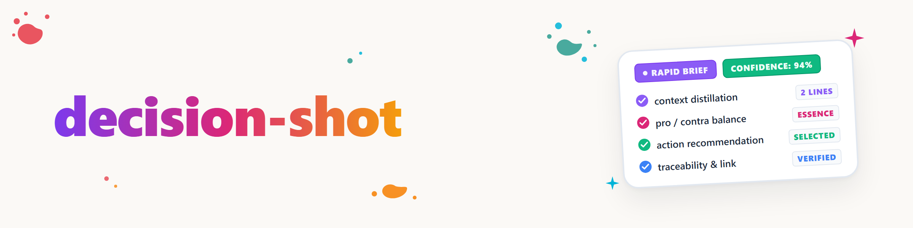

# decision-shot

> التحليل منجز. ما يلزم الآن ليس استدلالًا ثانيًا، بل الجوهر مع الطريق
> الذي يعود إلى الكامل.

## متى تُستخدم

- قرار واحد (أو مجموعة مترابطة بإحكام، مثل عدة أسئلة فرعية لموضوع واحد) تم
  التفكير فيه بالفعل -- في المحادثة، أو في تذكرة، أو عبر إطار `decide`، أو في
  المرحلة الثانية من `decision-briefing` -- ويجب الآن إتاحته لشخص ما (المستخدم،
  أو وكيل آخر، أو مستند تسليم) خلال ثوانٍ.
- كلمات التشغيل: "اختصره مع المزايا والمساوئ"، "ملخص تنفيذي"، "سياق مختصر"،
  "نقاط حوارية حوله"، "أعطني هذا مكثفًا مع التوصية"، `/decision-shot`.
- **ليس** عند وجود نقاط مفتوحة غير محسومة كثيرة يريد المستخدم الإجابة عنها تباعًا
  أو دفعةً بالحروف -- فهذا من عمل [decision-briefing](../decision-briefing/SKILL.md).
  **وليس** لصياغة قرار أولًا -- فهذا من عمل [decide](../decide/SKILL.md).
  decision-shot عرض خالص لتحليل موجود سلفًا.

## الفرق (ملخص)

| المهارة | ماذا تفعل | متى تكون جاهزة |
|---|---|---|
| `decide` | تصوغ قرارًا واحدًا بإطار (مصفوفة مزايا/مساوئ، تقييم مرجّح، شجرة قرار، ...) | ما زال التحليل ناقصًا |
| `decision-briefing` | تجمع قرارات مفتوحة كثيرة لموضوع، وتعرضها دفعة A/B/C/D، وتتلقى إجابات بالحروف | ما زالت عدة نقاط غير محسومة |
| `decision-shot` | تكثّف تحليلًا واحدًا جاهزًا (أيًّا كان مصدره) في صيغة تنفيذية مختصرة مع رابط للنسخة الكاملة | التحليل موجود، والعرض فقط مفقود |
| `knappform` | معدِّل عام لأسلوب الرد لكل إجابة في الجلسة | على مستوى الجلسة، بغض النظر عن الموضوع |
| `paveman` | تختصر ملفات نثرية موجودة (ملفات القواعد والذاكرة) بشكل حتمي | تختصر ملفًا، لا مخرجات محادثة |

لا يتنافس `decision-shot` مع أيٍّ من المهارات الأربع -- إنه الصيغة التي تُستخدم بعد
`decide` أو بجانب `decision-briefing` حين يجب تسليم الجوهر. يسترشد الأسلوب المخفّض
بـ `knappform`/`paveman` (انظر هناك لقائمة الحذف الكاملة)، لكنه يُطبّق هنا
بصرامة على صيغة ثابتة من خمسة أجزاء.

## الصيغة (إلزامية، خمسة أجزاء)

```
## <Entscheidungstitel>

**Kontext:** <2-3 Zeilen -- worum es geht, warum jetzt, was auf dem Spiel steht>

**<Option A>**
+ <staerkstes Pro-Argument>
+ <zweites Pro-Argument, nur falls es traegt>
- <staerkstes Contra-Argument>

**<Option B>**
+ <Pro>
- <Contra>
- <Contra>

**Talking Points:**
- <Punkt, der im Gespraech/in einer Mail sofort zieht>
- <Punkt, der einen typischen Einwand vorwegnimmt>

**Empfehlung:** <Option> -- <ein Satz Begruendung, keine Wiederholung der Pro-Liste>

**Vollanalyse:** <Pfad oder Link -- Ticket-Datei, Dokument, Chat-Referenz>
```

## القواعد

- **نصوص المستخدم بلا أرقام أو رموز تقنية (بصيغة المتكلم بلغة يومية):**
  في النص المرئي للإنسان (العنوان، والسياق، والخيارات، والنقاط الحوارية، والتوصية) لا توجد **أي** رموز داخلية أو أرقام تذاكر (`T-...`) أو معرّفات D أو مسارات ملفات نسبية.
  يصف السياق الوضع والإجراء المزمع بصيغة المتكلم ("أقترح أن...").
  المراجع التقنية (معرّف التذكرة، والمسار الدقيق للملف) تُذكر حصرًا في السطر الختامي `**Vollanalyse:**` أو في جدول مراجع.
- **الأسطر ميزانية لا هدف.** سطران إلى ثلاثة للسياق، ونقطتان إلى أربع نقاط لكل خيار، ونقطتان إلى ثلاث نقاط حوارية، وجملة واحدة للتوصية -- ما زاد يُحذف لا يُختصر ثم يُبقى. إذا لم يتسع خيار لأربع نقاط فليس من شأن هذه المهارة بل من شأن التحليل الكامل.
- **أسلوب مخفّض كـ `knappform`/`paveman`:** لا حشو، ولا عبارات مجاملة، ولا تهرّب. تبقى النفي (`nicht`، `nie`، `kein`، `nur`،
  `außer`) دون مساس، لأن حذفها يقلب المعنى.
- **المزايا والمساوئ نقاط لا جمل.** `+`/`-` بادئةً، وفكرة واحدة لكل سطر، بلا تابع.
- **النقاط الحوارية تواصلية لا تحليلية.** تجيب عن "ماذا أقول إذا سألني أحد" -- لا عن "ماذا يرد في التحليل". تكرار قائمة المزايا والمساوئ علامة على عدم التكثيف بعد.
- **التوصية تُسوِّغ نفسها في جملة.** لا تكرار لقائمة المزايا، ولا "انظر أعلاه" -- يجب أن تحمل الجملة الواحدة معناها دون بقية الكتلة.
- **رابط/مسار التحليل الكامل إلزامي لا اختياري.** لا يحل decision-shot محل التحليل، بل يجعله سريع الوصول. إذا لم يوجد مصدر ملموس (نشأ شفهيًا في المحادثة فقط، دون مستند)، فاذكر مرجع المحادثة أو الجلسة بأكبر قدر من الدقة (مثلًا "هذه الجلسة، الرد على F4") بدل ترك الحقل فارغًا.
- **قرارات مترابطة متعددة** (مجموعة، مثل عدة أسئلة فرعية لموضوع): كتلة لكل قرار مفصولة بـ `---`، والسياق المشترك يُذكر مرة واحدة في البداية فقط إن كان صالحًا لكل القرارات حقًا.

### ختم الجلسة للـ Decision-Shots المحفوظة

عند حفظ الـ Decision-Shot كأثر جديد دائم ومهم، ينتهي الملف بـ:

`session: <session-id> | <agent>@<host> | YYYY-MM-DD`

يأتي معرّف الجلسة أولًا من معامل صريح في وقت التشغيل أو سطر الأوامر، ثم من بيئة مزوّد موثوقة
أو خطاف (hook)؛ فإن غاب الاثنان يُكتب `unbekannt`. لا تخمّن القيم أبدًا. تستخدم الوكلاء الفرعيون
جلسة الأصل. لا يُختم المحادثة الروتينية أو المصادر أو السياسات أو `CLAUDE.md` أو ملفات README أو
الملفات القديمة بشكل شامل، ولا يُعاد ختمها.

## مثال

```
## Wo laeuft der naechtliche Backup-Job?

**Kontext:** Ich beobachte wiederholte Ausfälle auf dem Laptop, weil das Gerät nachts
schläft. Ich schlage vor, den Job auf den Mac Studio umzuziehen, der rund um die Uhr läuft.

**Laptop (Status quo)**
+ Keine Netzwerkabhaengigkeit
- Job faellt regelmaessig aus, wenn das Geraet schlaeft
- Kein zentraler Log-Ueberblick

**Mac Studio**
+ Laeuft 24/7, keine Ausfaelle durch Schlafmodus
+ Zentrale Logs an einem Ort
- Braucht funktionierendes Tailscale/SSH als Voraussetzung

**Talking Points:**
- "Der Ausfall ist kein Bug im Skript, sondern eine Standortfrage."
- "Tailscale laeuft schon fuer andere Jobs stabil -- kein neues Risiko."

**Empfehlung:** Mac Studio -- einzige Option ohne den bekannten Schlafmodus-
Ausfall, und die Abhaengigkeit (Tailscale) ist bereits im Betrieb bewaehrt.

**Vollanalyse:** `.SYNC/MAC_STUDIO_COMPUTE_HANDOFF.md`, Abschnitt "Backup-Jobs" (Ticket T-20260620-42)
```

## سجل التغييرات

### 1.2.0 (2026-09-18)
- تثبيت قاعدة الأسلوب لنصوص القرارات المفهومة (T-20260913-883789445، تعليمات المستخدم بتاريخ 2026-09-13):
  - لا أرقام تذاكر أو معرّفات D أو مسارات داخلية في النص المرئي (العنوان، والسياق، والنقاط الحوارية).
  - السياق والتوصية بلغة يومية طبيعية بصيغة المتكلم.
  - مراجع التذكرة والمسار التقنية محصورة بصرامة في سطر التحليل الكامل الختامي.

### 1.1.0 (2026-09-09)
- يضيف P-018 ختم الجلسة للـ Decision-Shots المهمة المحفوظة حديثًا، مع أولوية ضيقة للمصادر
  واستثناءات.

### 1.0.0 (2026-08-24)
- النسخة الأولى.
