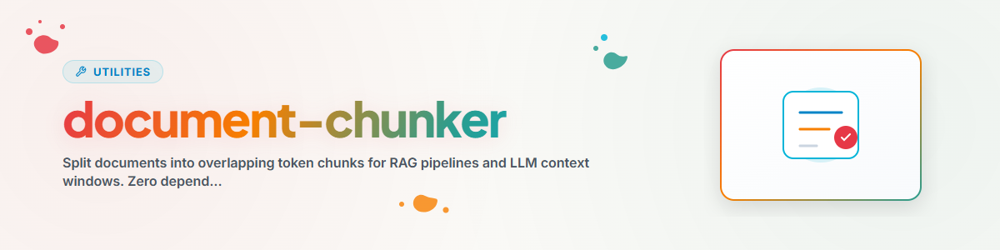

> **English** — Offizielle English-Version / Documento Oficial en English.


# Document Chunker (English)

Splits documents into overlapping token chunks. Optimized for RAG pipelines
and LLM context windows. Zero dependencies — Python stdlib + re only.

## Usage

### As Library
```python
from document_chunker import DocumentChunker

chunker = DocumentChunker(chunk_size=400, overlap=80)
chunks = chunker.chunk_text("Long text...")

for chunk in chunks:
    print(f"Chunk {chunk['chunk_id']}: {chunk['tokens']} tokens")
```

### Chunking a File
```python
chunks = chunker.chunk_document("document.md", source="My Project")
```

### Chunking an Entire Directory
```python
from document_chunker import chunk_corpus

chunks = chunk_corpus(["doc1.md", "doc2.txt"], source="Corpus")
```

### CLI
```bash
python document_chunker.py document.md    # Single file
python document_chunker.py ./docs/        # Entire directory
```

## Parameters

| Parameter | Default | Description |
|-----------|---------|-------------|
| chunk_size | 400 | Max tokens per chunk |
| overlap | 80 | Overlapping tokens between chunks |

## Supported File Types

`.txt`, `.md`, `.py`, `.sh`

## Changelog

### 1.1.0 (2026-11-06)
- Description rewritten with a clear trigger and delimitation (rule from docs/CONVENTIONS.md): situation of use, typical user phrases and the slash command first, neighbouring skills named in a Do NOT clause.

### 1.0.0 (2026-03-12)
- Ported from BACH system/tools/document_chunker.py