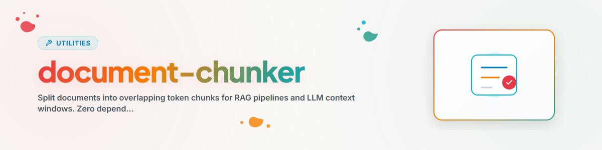

> **Deutsch** — Offizielle Deutsch-Version / Documento Oficial en Deutsch.

# दस्तावेज़ चंकर (Deutsch)

दस्तावेज़ों को अतिव्यापी टोकन चंक्स में विभाजित करता है। RAG पाइपलाइन और LLM संदर्भ विंडो के लिए अनुकूलित। शून्य निर्भरताएँ — केवल Python stdlib + re।

## उपयोग

### लाइब्रेरी के रूप में
```python
from document_chunker import DocumentChunker

chunker = DocumentChunker(chunk_size=400, overlap=80)
chunks = chunker.chunk_text("Long text...")

for chunk in chunks:
    print(f"Chunk {chunk['chunk_id']}: {chunk['tokens']} tokens")
```

### एक फ़ाइल को चंक करना
```python
chunks = chunker.chunk_document("document.md", source="My Project")
```

### पूरी डायरेक्टरी को चंक करना
```python
from document_chunker import chunk_corpus

chunks = chunk_corpus(["doc1.md", "doc2.txt"], source="Corpus")
```

### CLI
```bash
python document_chunker.py document.md    # Single file
python document_chunker.py ./docs/        # Entire directory
```

## पैरामीटर

| पैरामीटर | डिफ़ॉल्ट | विवरण |
|-----------|---------|-------------|
| chunk_size | 400 | प्रति चंक अधिकतम टोकन |
| overlap | 80 | चंक्स के बीच अतिव्यापी टोकन |

## समर्थित फ़ाइल प्रकार

`.txt`, `.md`, `.py`, `.sh`

## परिवर्तन लॉग

### 1.0.0 (2026-03-12)
- BACH system/tools/document_chunker.py से पोर्ट किया गया
