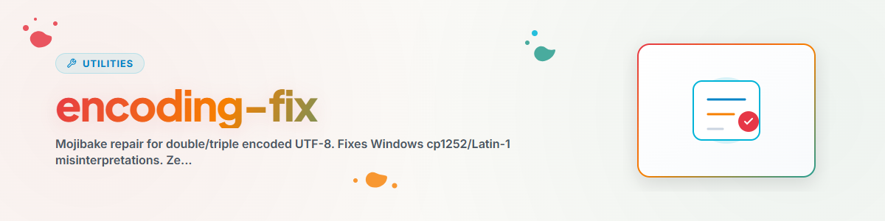

> **Français** — Version française officielle de la compétence `encoding-fix`.

# Encoding Fix — Correction d'encodage

Répare le mojibake (UTF-8 doublement ou triplement encodé) causé par une mauvaise interprétation Windows cp1252/Latin-1. Zéro dépendance — uniquement la bibliothèque standard Python.

## Problème typique

```
"ü" (U+00FC) → UTF-8 \xc3\xbc → lu comme cp1252 → "ü"
```

## Utilisation

### En tant que bibliothèque
```python
from encoding_fix import sanitize_outbound

clean = sanitize_outbound("Würge")  # → "Würge"
```

### Sortie de sous-processus
```python
from encoding_fix import sanitize_subprocess_output

text = sanitize_subprocess_output(process.stdout)
```

### CLI
```bash
python encoding_fix.py "Würge"    # Vérifier une chaîne isolée
python encoding_fix.py              # Auto-test
```

## Fonctionnalités

- **Idempotent :** Un texte correctement encodé n'est pas modifié
- **Jusqu'à 3 passes :** Répare aussi les chaînes triplement encodées
- **Décodeur de sous-processus :** Repli UTF-8/cp1252 pour les sorties de processus
- **Zéro dépendance :** Uniquement la bibliothèque standard Python

## Journal des modifications

### 1.0.1 (2026-11-22)
- Indication de langue corrigée

### 1.0.0 (2026-03-12)
- Porté depuis BACH `system/tools/encoding_fix.py`
