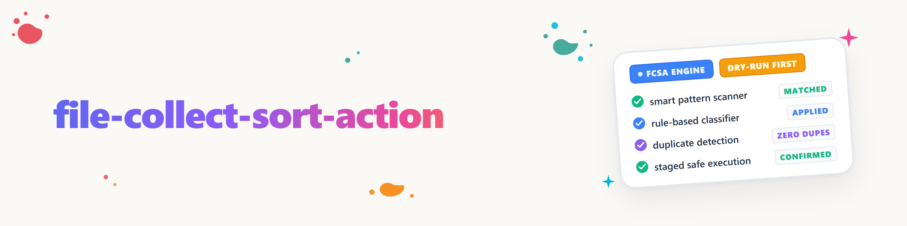

# File Collect Sort Action

> O usuário deixou este módulo intencionalmente em modo passivo até que uma tarefa concreta o exija
> (Ticket T-20260818-916568570, usuário literalmente: *"um dia vou dizer: pegue da pasta sempre estes e aqueles arquivos e colete-os lá -> aí você reconhece a skill do nosso módulo e configura isso"*). Esta skill É a detecção que ele aguarda.

## Quando esta skill se aplica

Gatilhos são frases do usuário que descrevem uma **coleta recorrente por regra**, não um "mova este único arquivo":

- "Pegue de `<Ordner>` sempre `<Dateiart>` e colete-os em `<Ziel>`"
- "Ordene automaticamente a pasta `<X>` segundo `<Kriterium>`"
- "Colete os arquivos recebidos de `<Quelle>` em `<Ziel>`"
- "Organize esta pasta com base em regras" / "mova automaticamente todos os `<Dateiart>` de `<Ordner>`"
- Qualquer variante que nomeie **origem**, **característica de reconhecimento** (tipo de arquivo, padrão de nome ou conteúdo) e **destino**, e implique que isso deve acontecer **repetidamente** (não apenas uma vez agora)

**Não** é esta skill: mover um único arquivo pontual (isso um agente faz diretamente, sem camada de configuração), nem `dokument-ingest` (que responde "com o que eu leio o *conteúdo*", não "para onde o *arquivo* pertence"), nem indexação incremental de texto sem mover arquivos (`gardener`).

## O que o módulo faz (resumo)

`file-collect-sort-action` (nome curto **f-csa**, CLI **`fcsa`**) é um agente orientado por configuração de varredura→categorização→ação, com três arquivos de configuração e uma memória de processamento:

| Arquivo | Função |
|---|---|
| `config.json` | `scan_paths` (lista positiva), inclusão/exclusão de formatos, regras de detecção de duplicatas, portões de segurança (`allow_hard_delete`) |
| `categories-definitions.json` | Modelos de reconhecimento por categoria (nome do arquivo/extensão/conteúdo), checks/gates, `default_target`, `default_actions` + `default_stepping` |
| `action-rules.json` | Parâmetros de ação por categoria (destinos de move/copy, modo de duplicata, modo de exclusão, backend de OCR, ordem de colocação) |
| `processing-csa.json` | é gravado **em cada pasta varrida**: arquivos conhecidos, sua categoria, ações aplicadas, impressão digital efetiva das configurações (fingerprint) |

IDs de ação conhecidos: `duplicate_check`, `move`, `copy`, `delete`, `ocr_extract`, `place_information`. Semântica de execução em sequência: `default_stepping: true` = as ações são executadas da esquerda para a direita, na ordem listada, e um ID de ação listado duas vezes é executado **duas vezes**; `false` = conjunto (duplicatas colapsam em uma única execução).

## Modelo de segurança: SEMPRE respeitar ao configurar

- **Dry-Run é obrigatório antes de qualquer primeira ativação real**, por caminho de varredura. `fcsa run` (sem `--dry-run`) recusa a execução sem um Dry-Run registrado para exatamente esse caminho.
- **Uma alteração de configuração desarma a confirmação novamente** (fingerprint sobre os três arquivos de configuração). Após cada ajuste de configuração, a próxima execução real precisa de um Dry-Run novo.
- **Exclusão é fail-closed.** `delete` sempre move para `trash_dir`, a menos que *tanto* `action-rules.json` (`delete.hard_delete: true`) *quanto* `config.json` (`allow_hard_delete: true`) concordem explicitamente. **Para esta skill vale adicionalmente:** nunca ativar exclusão definitiva sem autorização explícita e separada do usuário; o padrão permanece `_trash`.
- **`scan_paths` é uma lista positiva explícita**; qualquer outro caminho lança `PathNotAllowedError`; caminhos com segmento `.PRIVAT` ou `CREDENTIALS` são rejeitados ao carregar.
- **Dry-Run não produz efeito algum, byte a byte, na pasta varrida**: `processing-csa.json` é gravado exclusivamente em execução real, nunca em Dry-Run.

## Fluxo: da frase-gatilho à automação configurada

1. **Estruturar a tarefa.** Extrair da frase do usuário a origem, a(s) característica(s) de reconhecimento e o(s) destino(s). Em caso de ambiguidade, perguntar de forma direcionada (tipo de arquivo? incluir subpastas? o que fazer em caso de colisão de nome no destino: skip/overwrite/rename/quarantine?).
2. **Localizar o módulo.** Primeiro verificar com `fcsa --help` se a CLI está disponível. Se faltar, identificar o caminho de módulo ou pacote autorizado para o sistema atual; não inventar caminho local, nome de pacote nem checkout paralelo. Após uma instalação, executar `fcsa --help` novamente antes de criar configurações.
3. **Criar a pasta de configuração.** `fcsa init <config-dir>` grava `scan_paths` inicialmente em uma pasta `inbox/` nova **dentro** da própria pasta de configuração, nunca automaticamente em uma pasta real do usuário. Modelos de exemplo para isso: `fcsa/_examples/*.example.json` no módulo.
4. **Ajustar a configuração à tarefa real.** Definir `scan_paths` como a pasta de origem indicada; em `categories-definitions.json` inserir o(s) modelo(s) de reconhecimento para o tipo de arquivo indicado (`default_target` = destino indicado); em `action-rules.json` configurar as ações adequadas (tipicamente `move`, eventualmente `duplicate_check` antes dela). `state_dir`/`trash_dir` NÃO podem estar dentro de um `scan_path` (o módulo recusa isso, caso contrário haveria um laço de auto-alimentação).
5. **Apresentar sempre primeiro o Dry-Run:** `fcsa run --config-dir <config-dir> --dry-run`. Mostrar o resultado ao usuário (o que seria movido para onde, o que foi reconhecido como duplicata).
6. **Ativação real somente após go explícito do usuário.** Só então `fcsa run --config-dir
   <config-dir>` (sem `--dry-run`). `fcsa status --config-dir <config-dir>` mostra depois o status.
7. **Expandir gradualmente** (usuário: "e depois isso se expande com o tempo"): acrescentar mais categorias/pastas em vez de começar uma nova configuração. Os três arquivos de configuração podem ser mantidos de forma aditiva. Cada expansão exige novamente um Dry-Run antes da próxima execução real, por causa do fingerprint das configurações.

## Limites / pontos abertos conhecidos (estado do ticket T-20260818-916568570)

- O módulo está na Passagem 1, com status "development". O pipeline central, a CLI e os portões de segurança estão prontos e testados (63/63 testes), mas **nunca foi ativado contra uma pasta real do usuário**. A primeira ativação real é intencionalmente este uso da skill. A visibilidade do repositório é "private": nenhuma publicação sem um `repo-publish-check` próprio.
- Duas interpretações de lacunas de especificação estão documentadas (`CHANGELOG.md`/`TODO.md` no módulo): `default_stepping: false` colapsa uma ação listada duas vezes em **uma** execução; `duplicate_check` com resultado `skip` interrompe a **toda** a cadeia de ações restante para o arquivo (não apenas move/copy). Se necessário, esclarecer com o usuário antes que uma configuração dependa disso.
- OCR é um backend plugável (`none`/`command`); nenhum mecanismo de OCR próprio está incluído. Para extração OCR real, conectar `ellmos-filecommander` `fc_ocr` pelo tipo de backend `command`.

## Origem

Módulo construído no ticket T-20260818-916568570 (Passagem 1, fcsa-worker), por desejo do usuário deixado intencionalmente em modo passivo (PARKED/until-trigger) até que exatamente o gatilho descrito acima ocorra. Esta skill implementa exatamente essa anotação de espera.

## Changelog

### 1.0.0 (2026-08-18)
- Versão inicial. Reconhecimento de gatilho para pedidos de "coletar/ordenar arquivos automaticamente", com fluxo de configuração que documenta a obrigatoriedade de Dry-Run e a ativação real somente após go do usuário.
