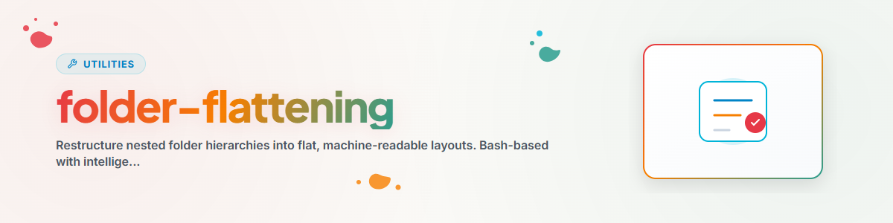

> **Français** — Version française officielle de la compétence `folder-flattening`.

# Workflow : Aplatissement de dossiers (Folder-Flattening)

Objectif : transformer des arborescences de dossiers imbriquées en une structure plate et lisible par machine.
Avantage : plus besoin de cliquer à travers les niveaux, mais recherche directe via base de données (`Verzeichnis.db`).
Les doublons sont autorisés lorsqu'ils sont pertinents sur le plan thématique.

---

## Vue d'ensemble des phases

| Phase | Ce qui se passe | Section du script |
|-------|-----------------|-------------------|
| 1 | Aplatir : ramener tous les sous-dossiers au même niveau | `phase_flatten` |
| 2 | Raccourcir : réduire les longs noms de chemin au dernier segment, fusionner en cas de conflit | `phase_shorten` |
| 3 | Nettoyer : supprimer les soulignements multiples (`___`), retirer les `_` en fin de nom | `phase_cleanup_underscores` |
| 4 | Regrouper : dossiers numériques, dossiers de CD et noms courts dans des dossiers collecteurs | `phase_group_problematic` |
| 5 | Analyse par triplets : groupes glissants de 3, le nom le plus court devient cible de fusion | `phase_tripel_merge` |
| 6 | Fusion par format média : regrouper les dossiers selon le type de fichier (modèle) | `phase_media_merge` |
| 7 | Ranger : supprimer les dossiers vides | `phase_cleanup_empty` |

---

## Règles importantes

### Correspondance dans l'analyse par triplets
- **Sous-chaîne :** `Aufklaerung` dans `Aufklaerungsbroschueren` -> fusion dans `Aufklaerung`
- **Pluriel/Umlaut :** `Raum` = `Raeume`, `Teil` = `Teile`, `Buch` = `Buecher`
- **Premier mot :** `Autismus ADHS` correspond à `Autismus Beruf` (même début)

### Longueur minimale
- Nom d'un seul mot sans espace : **au moins 8 caractères** (évite `Hand`, `Haus`, `Form`)
- Avec espace (ex. `ICF Katalog`) : **acceptable dès 3 caractères**
- Ainsi `ICF`, `ASS Frauen`, etc. restent autorisés

### Redémarrage après fusion
Après chaque fusion, la liste des dossiers est rechargée et relancée au niveau de la cible de fusion.
Ainsi, `Autismus` collecte toutes ses extensions avant de poursuivre.

---

## Fusion par format média (système de modèles)

La Phase 6 utilise un tableau modèle `MEDIA_TYPES`. Chaque entrée définit :
- Dossier cible (avec préfixe `_`)
- Extensions de fichiers appartenant à ce type

```bash
MEDIA_TYPES=(
    "_Audio|mp3|m4a|wav|flac|ogg|wma|aac|opus|aiff"
    "_Video|mp4|avi|mkv|mov|wmv|flv|webm|m4v|mpg|mpeg|3gp"
    "_Bilder|jpg|jpeg|png|gif|bmp|tiff|tif|webp|svg|ico|heic|heif|raw|cr2|nef"
    # Extensible :
    # "_Tabellen|xlsx|xls|csv|ods"
    # "_Prasentationen|pptx|ppt|odp"
    # "_Code|py|js|ts|sh|bat|ps1"
    # "_CAD|dwg|dxf|step|stl"
    # "_3D|obj|fbx|blend|gltf|glb"
    # "_Fonts|ttf|otf|woff|woff2"
)
```

Seuls les dossiers contenant **exclusivement** des fichiers d'un même type sont déplacés.
Les dossiers comportant des sous-dossiers sont ignorés.

### Ajouter un nouveau type média

Ajouter simplement une nouvelle ligne dans le tableau `MEDIA_TYPES` :
```bash
"_DossierCible|ext1|ext2|ext3"
```

---

## Exécution

```bash
# Passage complet :
cd /chemin/vers/repertoire_cible
bash ordner_flattening_komplett.sh

# Ou phases individuelles :
bash ordner_flattening_komplett.sh --phase flatten
bash ordner_flattening_komplett.sh --phase tripel
bash ordner_flattening_komplett.sh --phase media
bash ordner_flattening_komplett.sh --phase cleanup
```

---

## Retour d'expérience de la session du 26.01.2026

- Départ : 206 dossiers + 252 fichiers isolés, ~5 600 sous-dossiers imbriqués
- Après Flatten : ~2 200 dossiers sur un seul niveau
- Après raccourcissement + nettoyage : ~2 005 dossiers
- Après regroupement (nombres, CD) : ~2 005 -> dossiers collecteurs créés
- Après Triplets v1 : ~1 561 dossiers
- Après Triplets v2 (règle des 8 caractères) : réduction supplémentaire
- Phase format média : dossiers Audio/Vidéo/Images consolidés

## Journal des modifications

### 1.0.1 (2026-11-22)
- Mention linguistique corrigée.
