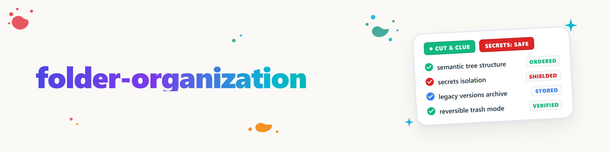

# Folder Organization

## Outcome and boundary

Create an explainable filing structure in which every change is justified by local rules, content,
file relationships, or an explicit user decision. This is a semantic organization protocol, not a
second file-moving program and not a mandatory provider integration.

Inspection stays read-only. An explicit request to clean or organize the named folder authorizes
safe, reversible moves inside that scope when no material ambiguity remains. Overwriting, permanent
deletion, moving outside the scope, rewriting canonical content, or activating recurring automation
requires separate approval.

## Standalone core and optional seeds

Start with the standalone core. It needs only reading, writing, hashing, and ordinary file
operations. Use [`scripts/folder_organization.py`](scripts/folder_organization.py) for a reproducible
read-only inventory; [`config.json`](config.json) contains safe defaults and overrides. The script writes to
stdout by default. `--out` may only create a new file outside the scanned root; existing targets are
never overwritten. Its log and version findings are low-confidence search leads, not approval to
archive anything.

The library copy uses extended catalog frontmatter. If a host accepts only portable base
frontmatter (`name`, `description`), [`scripts/export_portable.py`](scripts/export_portable.py)
creates a self-contained copy in a new destination. The complete protocol and all local
replacements remain available in that export.

Discover capabilities rather than brands. Integrations may strengthen the core but never change its
meaning or authority:

| Needed capability | Standalone replacement | Optional detected seed/adapter |
|---|---|---|
| Inventory, hashes, plan | bundled Python script or native file search | FolderHome planning/receipts |
| Document content/OCR | available local reader; otherwise `unreadable/review` | doc-services or equivalent |
| Cloud-/lock-safe operations | native operation with fresh state check | FileCommander or provider adapter |
| Stable recurring rules | emit a configuration proposal | file-collect-sort-action or equivalent |
| Re-index clues | leave conspicuous CLUE markers in ordinary text | Gardener or another local indexer |

Ellmos components are optional **grounding seeds**. Use their stronger gates when available and
authorized. When absent, perform the same reasoning with this skill's heuristics and replacements.
Never upload material externally merely because a local reader is unavailable.

## Procedure

### 1. Establish root, rules, and mode

- Choose the smallest common filing root; do not scan an entire home or cloud root for convenience.
- Read controlling files at and above the root: agent rules, READMEs, naming rules, registries,
  manifests, and locks.
- Record the mode: one-time semantic organization, **topic-cluster synthesis (consolidating
  grown/competing subfolders)**, archive maintenance, log maintenance, Cut-and-Clue, or preparation
  of a recurring rule.
- Existing target folders and their observed use outweigh an invented ideal taxonomy. However, when
  competing historical taxonomies from earlier cleanup passes coexist side by side (e.g. parallel
  `UPPERCASE` and `lowercase` folders or mixed-language duplicate directories), reconcile them into
  **one** consistent canonical scheme.

### 2. Apply the secrets policy before content access

Before opening or hashing, compare names with `secret_policy.protected_name_patterns` and the
exclusions in `config.json`. Record protected files such as `.env`, private keys, and credential
files by path and metadata only; never place their content in model context, reports, or logs.
`--hash-all` does not bypass this boundary. If an ordinary readable file incidentally matches a
secret signal, stop content output and report only the signal ID.

When the item is probably in a cloud/sync root, apply the configured `cloud_action`. The default is
`localize-after-approval`: prove a restrictive local destination outside every sync root, show a
dry run and obtain approval, copy opaque bytes and compare internal hashes, then recoverably replace
the cloud source and leave a non-secret pointer. Block when `local_secret_root` is unset or runtime
references would break.

Read [`references/secrets-policy.en.md`](references/secrets-policy.en.md) for the full transaction,
pointer modes (`control-file`, `sidecar`, `placeholder`), local map, rotation guidance, and hard
blockers. Exclude secret candidates from normal sorting, archiving, Cut-and-Clue, and review trash
until the policy decision is resolved.

### 3. Inventory files and relationships

Record path, size, modification time, type, and proportionate SHA-256 hashes. Exclude transient
bytecode and test caches (`__pycache__`, `.pytest_cache`) prior to hashing and stage them directly
for cleanup. For ambiguous or generic filenames (`README.md`, `index.html`, `NOTIZ.md`,
`concept.md`, `draft.md`, bare dates/numbers), inspect the first heading, opening lines, or
metadata. Unreadable binaries remain unresolved; name and extension alone never justify an
irreversible action.

**3b. Treat the directory and file list as a topic list first:**
Extract a flat **topic list** from existing folder names, descriptive filenames, and sampled
document headings/opening lines before fixing target directories. This surfaces thematic links
previously scattered across legacy folders or the root.

Treat related files as sets: language editions, source/export, Markdown/PDF, document/assets,
data/script/result, attachment/primary file, and predecessor/successor. Check links, manifests,
includes, code references, and registries before moving anything.

For difficult collections, read [`references/heuristics.md`](references/heuristics.md).

### 4. Plan structure, topic clusters, and item decisions

Derive the target structure from purpose, existing rules, and the extracted topic list. The root is
a routing surface, not permanent storage. Do not create a generic miscellaneous folder for
unresolved items; use a review group or decision list.

**4a. Calibrate optimal cluster count & reconcile legacy taxonomies:**
- **Find the sweet spot:** Too many clusters (e.g. 30+ micro-folders with 1–3 files each) dilute
  navigation; too few (3–4 catch-all folders) under-differentiate. For medium to large collections
  (100–1,000 files), **8–15 disjoint top-level thematic clusters** in consistent `kebab-case` (or
  the root's prescribed naming convention) work best.
- **Sub-divide large clusters:** When a thematic cluster exceeds ~40–50 files with distinct
  sub-domains (e.g. separate research projects, sub-modules, or document types), introduce 3–6
  clean subdirectories inside that cluster.
- **Reconcile competing taxonomies:** Merge parallel legacy folders covering the same topic (e.g.
  `FORSCHUNG/` and `forschung/`, `BACH/` and `bach-und-ocean/`) completely into the canonical
  cluster.

Each proposed change records source, target/action (`keep`, `move`, `rename`, `archive`,
`trash-review`, `cut-and-clue`, or `review`), evidence, confidence, and affected relationships.

- **High:** explicit local rule, unambiguous manifest evidence, or proven successor chain.
- **Medium:** strong semantic fit or established cluster without an explicit rule.
- **Low:** name, extension, timestamp, or weak similarity only. Do not move automatically.

Produce a complete dry run before mutation. Collisions, symlinks, cloud locks, unreadable inputs,
and destinations outside the root block the affected item.

### 5. Archive versions and logs

Archive a predecessor only when several signals establish the chain: version/date marker, internal
version, high content overlap, matching purpose, and one clearly current successor. Modification time
alone is insufficient. Referenced evidence and released artifacts remain preserved.

Distinguish active runtime logs, audit/evidence logs, and rotatable history. Never move logs still
being written. Archive completed old logs under the local convention or a structure such as
`_archive/logs/<year>/`, preserving hash and origin. Compression is a separate decision; archiving
does not imply deletion.

### 6. Apply Cut-and-Clue

When a file mixes valid and obsolete content, copy the valid material into new canonical file(s) and
leave a machine-readable clue in the old material and, when useful, adjacent to the problematic
passage. Verify completeness before archiving the original.

Read [`references/cut-and-clue.md`](references/cut-and-clue.md) for marker syntax, `[sic]`, binary
sidecars, and history preservation. `[sic]` marks a knowingly quoted error; use `OUTDATED` or
`SUPERSEDED` for obsolete material.

### 7. Stage deletion candidates and resolve duplicates in two stages

Move deletion candidates into `_trash_review/<run-id>/` inside the root or remove them via the
configured reversible trash adapter (`fc_safe_delete`). Preserve relative paths and write
`MANIFEST.md` or `RESTORE.json` with source, staged path, hash, reason, and timestamp. Never
permanently delete the folder automatically. Place trash and archives outside watched inboxes to
avoid self-feeding loops.

**7b. Two-stage duplicate resolution (Exact SHA-256 duplicates vs. same-name collisions):**
1. **Stage A — Identical SHA-256 hash (true duplicate):** Keep exactly **one** canonical file using
   this deterministic priority order:
   - **(1) Canonical target cluster** over root storage or legacy duplicate folders,
   - **(2) Explicit date stamp in the filename** (`*_YYYY-MM-DD.*`) over undated shadow copies,
   - **(3) Clean original name** over cloud/OneDrive conflict copies (`*-<HOST>-2..N.*`, `*(1).*`).
   Stage all remaining byte-identical copies and obsolete 1-line stub READMEs from dissolved legacy
   folders reversibly in the review trash (`_trash_review` / `fc_safe_delete`).
2. **Stage B — Identical filename, but different SHA-256 hash:** Never overwrite or delete as a
   false duplicate! Disambiguate by date or context suffix (`<stem>_<YYYY-MM-DD>.<ext>` or
   `<stem>_<subproject>.<ext>`) and retain both files in the target cluster (or evaluate as a
   version chain under step 5).

### 8. Execute, verify, and update upstream writers

- Recheck source, hash, destination, and destination absence immediately before each action.
- Never overwrite; block collisions or use an explicitly planned new name.
- Read back targets, compare hashes, confirm 0 remaining SHA-256 duplicates (`fc_detect_duplicates`
  or hash scan), search references for stale paths, and update affected registers.
- Remove dissolved empty legacy directories. Keep a rollback path or manifest for every move.
- Re-index CLUE markers when a local indexer exists; otherwise they remain visible ordinary text.

**8b. Control files & writer back-propagation (Upstream protection against re-pollution):**
A cleaned folder re-accumulates clutter within hours if automations, cronjobs, sidecars, or agent
rules continue writing to legacy paths or directly into the root:
- **Update root control files:** Bring `CLAUDE.md`, `ARCHITECTURE.md` (including Mermaid lint),
  `README.md`/`LIESMICH.txt`, and `.MOVED.md` pointers up to the new cluster topology.
- **Audit and patch active writers:** Search scripts, sidecar configs, scheduler definitions, and
  global delivery rules (`USER.md`, `OneDrive/CLAUDE.md`) for references to the cleaned directory.
  Point local writers to the new thematic clusters and eliminate dual "dated + undated" shadow
  writes, which inevitably trigger `*-HOST-2` cloud conflict copies.
- **Cross-actor / cross-host order:** For writers on other hosts or managed by other agents, file an
  explicit adjustment order in the shared sync channel (`.SYNC/agents/AUFTRAG_*.md`).

**8c. Pitfalls on Windows & Cloud-Sync drives (NTFS / OneDrive):**
- **NTFS case-insensitivity on folder renames:** Renaming a directory from `UPPERCASE` to
  `lowercase` (e.g. `FORSCHUNG` → `forschung`) on Windows/NTFS keeps the old uppercase directory
  name if files are moved directly. Always perform a **two-step rename** via a temporary intermediate
  name (`FORSCHUNG` → `FORSCHUNG__tmp` → `forschung`).
- **OneDrive `WinError 5 (Access Denied)` on empty legacy directories:** When the cloud filter
  driver (`cldflt`) blocks `rmdir()` on empty directories, move the empty directories via
  `os.replace` into a temporary staging folder inside the same root and remove that staging folder
  once via `fc_safe_delete`.
- **Dehydrated cloud cache artifacts (`Errno 22 Invalid argument`):** Exclude `__pycache__` and
  `.pytest_cache` before the SHA-256 pass so unsynced cloud cache files do not raise read errors.

## Short examples

- `report_v1.md` and `report_v2.md`: mark only a possible version chain. Internal version, content,
  and references must prove whether `v1` may actually be archived.
- `concept.md` mixes current rules and obsolete sections: transfer all valid substance to a new
  canonical file, preserve a byte-identical original, and add clues or a sidecar naming the
  successor.
- `.env` in a sync root: do not open it or copy content into the report. Produce a policy plan; do
  not mutate anything without a verified `local_secret_root`, approval, and safe runtime migration.

## Learning and automation

Collect user corrections as rule candidates, never promote them silently. Propose recurring
automation only after a pattern is repeatedly confirmed, conflict-free, and narrowly scoped. Every
new or changed automation requires another dry run and approval.

## Closeout

Report the initial inventory, executed and blocked actions, archive and review-trash locations,
Cut-and-Clue successors, updated references, hash/readback results, unresolved decisions, and
candidate recurring rules. Report secret candidates only by path/signal ID, policy status, blocked
or approved cloud localization, pointer mode, and readback. Never repeat values, local secret paths,
or sensitive context. A plan is not an executed cleanup.

## Related skills

- Rule-based file automation: known recurring source-pattern-target rules.
- Pipeline/project optimizer: structural redesign of a project or stack.
- Tidy-up/maintenance: session closeout, registries, and temporary project files.
- Folder flattening: only when flattening is the explicitly requested transformation.

## Changelog

### 1.2.0 (2026-11-10)

- Added topic-list clustering and cluster count calibration (sweet spot of 8–15 disjoint thematic
  clusters, sub-clustering for clusters > 40 files, reconciliation of competing legacy taxonomies)
  in steps 1, 3b, and 4a.
- Added two-stage duplicate resolution in step 7b: deterministic canonical priority for exact
  SHA-256 matches (target cluster → date stamp → clean original name over cloud conflict copies) vs.
  date/context disambiguation for same-name files with different hashes.
- Added upstream writer back-propagation (root control files, local scripts/sidecars, `.SYNC`
  adjustment order) and Windows/OneDrive NTFS pitfalls (two-step case rename, staging empty folders
  on `WinError 5`, excluding dehydrated cache artifacts before SHA-256) in steps 8b and 8c.

### 1.1.0 (2026-08-24)

- Added a configurable secrets policy with protected-name no-open handling, redacted incidental
  detection, and transactional cloud localization using a local map and non-secret pointer.

### 1.0.0 (2026-08-24)
- Initial provider- and user-neutral release with standalone inventory script, optional seed model,
  semantic organization, version/log archiving, Cut-and-Clue, and reversible review trash.
