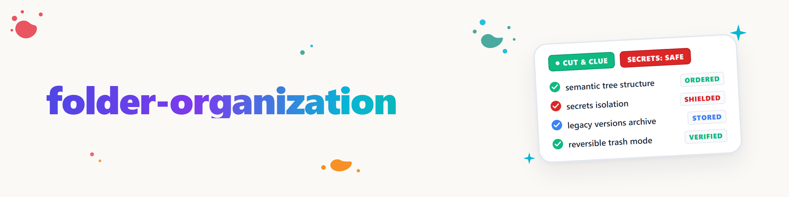

# फ़ोल्डर व्यवस्थापन

## लक्ष्य और सीमा

एक ऐसा व्यवस्थित संग्रह बनाएँ जिसमें हर बदलाव स्थानीय नियमों, सामग्री, फ़ाइलों के संबंधों या उपयोगकर्ता के स्पष्ट निर्णय से तर्कसंगत हो। यह skill एक semantic व्यवस्था-प्रोटोकॉल है, दूसरा फ़ाइल-स्थानांतरण प्रोग्राम नहीं, और किसी एक प्रदाता से बंधा हुआ नहीं।

सूची-निर्माण या जाँच read-only रहती है। "इस फ़ोल्डर को साफ़ करो" जैसा स्पष्ट अनुरोध निर्दिष्ट क्षेत्र के भीतर सुरक्षित, उलटने योग्य स्थानांतरण अधिकृत करता है, बशर्ते कोई अनसुलझी अस्पष्टता न हो। अधिलेखन, स्थायी मिटाना, क्षेत्र से बाहर स्थानांतरण, सामग्री का अंतर्वस्तु-पुनर्लेखन या स्थायी automation सक्रिय करना अलग स्वीकृति माँगते हैं।

## मानक कोर और वैकल्पिक seeds

हमेशा मानक कोर से शुरू करें। उसे केवल पढ़ना, लिखना, hashing और सामान्य फ़ाइल-क्रियाएँ चाहिए। पुनरुत्पादनीय सूची के लिए [`scripts/folder_organization.py`](scripts/folder_organization.py) उपलब्ध है; सुरक्षित डिफ़ॉल्ट और ओवरराइड [`config.json`](config.json) में हैं। स्क्रिप्ट डिफ़ॉल्ट रूप से केवल stdout पर लिखती है। `--out` केवल जाँचे गए root के बाहर एक नई फ़ाइल बना सकता है; मौजूदा लक्ष्य अधिलेखित नहीं होते। उसके लॉग और संस्करण-खोजें कम विश्वास वाले सुराग हैं, संग्रहीत करने की स्वीकृति नहीं।

लाइब्रेरी संस्करण में विस्तारित catalog frontmatter है। यदि लक्ष्य प्रणाली केवल पोर्टेबल बुनियादी frontmatter (`name`, `description`) स्वीकार करती है, तो [`scripts/export_portable.py`](scripts/export_portable.py) एक नए लक्ष्य फ़ोल्डर में स्वतंत्र प्रति बनाता है। विषय-आधारित कार्य-प्रवाह और सभी स्थानीय विकल्प उसमें पूर्णतः बने रहते हैं।

इसके बाद क्षमताएँ खोजें, ब्रांड नाम नहीं। मौजूदा integration कोर को बेहतर बना सकता है, पर अर्थ या अनुमति नहीं बदल सकता:

| आवश्यक क्षमता | मानक विकल्प | वैकल्पिक पहचाना गया seed/adapter |
|---|---|---|
| सूची, hashes, योजना | संलग्न Python स्क्रिप्ट या मूल फ़ाइल-खोज | FolderHome-योजना/receipts |
| दस्तावेज़ सामग्री/OCR | मौजूदा स्थानीय reader; अन्यथा `unreadable/review` | doc-services या समकक्ष extractor |
| cloud/lock-सुरक्षित क्रियाएँ | नई स्थिति-जाँच के साथ मूल क्रिया | FileCommander या प्रदाता-स्वामित्व adapter |
| आवर्ती स्थिर नियम | कॉन्फ़िगरेशन को सुझाव के रूप में दें | file-collect-sort-action या समकक्ष automation |
| सुराग पुनः index करना | टेक्स्ट में CLUE चिह्न जो ध्यान खींचें | Gardener या अन्य स्थानीय indexer |

इसलिए Ellmos घटक **Grounding Seeds** हैं: यदि उनकी क्षमताएँ उपलब्ध हों और कार्य के लिए स्वीकृत हों, तो उनके सख्त gates उपयोग करें। न हों, तो वही विषयगत प्रक्रिया heuristic रूप से इस skill के विकल्पों से चलाएँ। केवल स्थानीय reader न होने के कारण बाहरी स्थानांतरण न करें।

## प्रक्रिया

### 1. Root, नियम और मोड तय करें

- सबसे छोटा साझा संग्रह-root चुनें; सुविधा के लिए पूरा उपयोगकर्ता- या cloud-root स्कैन न करें।
- root में और उसके ऊपर नियंत्रण-फ़ाइलें पढ़ें, जैसे `AGENTS.md`, `CLAUDE.md`, `README.md`, `START.md`, नाम-नियम, रजिस्टर, manifests और locks।
- मोड दर्ज करें: एकबारगी semantic व्यवस्था, संग्रह-रखरखाव, लॉग-रखरखाव, Cut-and-Clue, या आवर्ती नियम की तैयारी।
- मौजूदा लक्ष्य फ़ोल्डर और उनका वास्तविक उपयोग किसी काल्पनिक आदर्श वर्गीकरण से अधिक प्रभावी है।

### 2. सामग्री खोलने से पहले गुप्त-नीति

खोलने या hash करने से पहले नाम को `secret_policy.protected_name_patterns` और `config.json` के अपवादों से मिलाएँ। `.env`, निजी कुंजियों या credential फ़ाइलों जैसी संरक्षित फ़ाइलों को केवल पथ और metadata से दर्ज करें; उनकी सामग्री मॉडल-संदर्भ, रिपोर्ट या लॉग में न जाए। `--hash-all` यह सीमा नहीं हटाता। यदि किसी सामान्य पठनीय फ़ाइल में संयोग से गुप्त-संकेत मिले, तो सामग्री-आउटपुट रोकें और केवल संकेत-ID बताएँ।

यदि खोज किसी Cloud/Sync root में प्रतीत हो, तो कॉन्फ़िगर की गई `cloud_action` लागू होती है। डिफ़ॉल्ट है `localize-after-approval`: किसी भी sync-root के बाहर स्थानीय लक्ष्य और सख्त अनुमतियाँ सुनिश्चित करें, dry-run चलाएँ और स्वीकृति लें, फ़ाइल को अपारदर्शी रूप से कॉपी करें और आंतरिक hash से जाँचें, फिर cloud स्रोत को उलटने योग्य रूप से बदलें और एक गैर-गुप्त pointer छोड़ें। `local_secret_root` सेट न होने पर या चालू संदर्भों के खतरे में होने पर रोकें।

पूरी transaction, pointer मोड (`control-file`, `sidecar`, `placeholder`), स्थानीय pointer-map, rotation संकेत और कठोर blocker [`references/secrets-policy.md`](references/secrets-policy.md) में हैं। गुप्त-संदिग्ध फ़ाइलों को नीति-निर्णय तक सामान्य छँटाई, संग्रह, Cut-and-Clue और रीसायकल-बिन से बाहर रखें।

### 3. सूची और संबंध दर्ज करें

पथ, आकार, संशोधन-समय, प्रकार और, जहाँ उचित हो, SHA-256 दर्ज करें। अस्पष्ट दस्तावेज़ों के लिए सामग्री या metadata पढ़ें। न पढ़ी जा सकने वाली binary फ़ाइलें स्पष्ट रूप से अनिश्चित रहती हैं; केवल नाम या extension किसी अपरिवर्तनीय क्रिया का औचित्य नहीं।

संबंधित फ़ाइलों को समूह मानें: भाषा-संस्करण, स्रोत/निर्यात, Markdown/PDF, दस्तावेज़/assets, डेटा/स्क्रिप्ट/परिणाम, संलग्नक/मुख्य फ़ाइल, तथा पूर्ववर्ती/उत्तराधिकारी। स्थानांतरण से पहले links, manifests, includes, कोड-संदर्भ और रजिस्टर जाँचें।

कठिन संग्रहों के लिए विस्तृत साक्ष्य और विश्वास-matrix [`references/heuristics.md`](references/heuristics.md) में पढ़ें।

### 4. लक्ष्य संरचना और व्यक्तिगत निर्णय की योजना

लक्ष्य संरचना उद्देश्य, मौजूदा नियमों और वास्तविक समूहों से निकालें। Root एक रूटिंग-सतह है, स्थायी भंडार नहीं। जब खोज विषयगत रूप से अनिश्चित हो, तो `_Sonstiges` जैसे सामान्य फ़ोल्डर न बनाएँ; उसके बजाय `review/` या निर्णय-सूची उपयोग करें।

हर प्रस्तावित बदलाव में कम से कम ये हों:

| फ़ील्ड | सामग्री |
|---|---|
| स्रोत | सटीक सापेक्ष पथ और वैकल्पिक hash |
| लक्ष्य/क्रिया | `keep`, `move`, `rename`, `archive`, `trash-review`, `cut-and-clue`, `review` |
| औचित्य | नियम, सामग्री, संबंध या संस्करण-प्रमाण |
| विश्वास | उच्च, मध्यम या निम्न |
| दुष्प्रभाव | प्रभावित links, समूह, रजिस्टर या automation |

- **उच्च:** स्पष्ट स्थानीय नियम, निश्चित manifest-संबंध या स्पष्ट रूप से प्रमाणित उत्तराधिकारी-क्रम।
- **मध्यम:** मज़बूत विषयगत मेल या मौजूदा समूह, पर स्पष्ट नियम नहीं।
- **निम्न:** केवल नाम, extension, संशोधन-समय या अनिश्चित समानता। स्वतः स्थानांतरित न करें।

परिवर्तन से पहले पूर्ण Dry-Run दें। टकराव, symlinks, cloud locks, न पढ़ी जा सकने वाली फ़ाइलें और root के बाहर के लक्ष्य संबंधित क्रिया को रोकते हैं।

### 5. संस्करण और लॉग संग्रहीत करें

पुरानी फ़ाइल को तभी पूर्ववर्ती मानकर संग्रहीत करें जब क्रम कई संकेतों से प्रमाणित हो: संस्करण/तिथि-पहचान, आंतरिक संस्करण-उल्लेख, उच्च सामग्री-अतिव्यापन, मेल खाता उद्देश्य और एक स्पष्ट रूप से वैध उत्तराधिकारी। केवल संशोधन-समय पर्याप्त नहीं। संदर्भित साक्ष्य-स्थितियाँ और स्वीकृत प्रकाशन सुरक्षित रहते हैं।

लॉग में सक्रिय runtime-लॉग, audit/साक्ष्य-लॉग और घूमने योग्य इतिहास में फ़र्क करें। सक्रिय या अभी लिखे जा रहे लॉग न हिलाएँ। पुराने बंद लॉग स्थानीय परंपरा के अनुसार संग्रहीत करें, अन्यथा जैसे `_archive/logs/<jahr>/` के अंतर्गत, hash और मूल स्थान सहित। संपीड़न एक अलग निर्णय है; संग्रहीत करना अपने-आप मिटाना नहीं।

### 6. Cut-and-Clue लागू करें

यदि एक फ़ाइल में वैध और पुरानी दोनों सामग्री हो, तो अंधाधुंध स्थानांतरण उतना ही गलत है जितना उसे पूरा रखना। तब वैध सामग्री को नई कैनोनिकल फ़ाइल(फ़ाइलों) में **काटें**, और मूल सामग्री में तथा आवश्यकता होने पर ठीक समस्या-स्थान पर स्थिति, कारण और उत्तराधिकारी का मशीन-पठनीय **Clue** छोड़ें। पूर्णता-जाँच के बाद ही मूल को संग्रहीत करें।

चिह्न, `[sic]` के नियम, binary फ़ाइलें और इतिहास-हानि से सुरक्षा [`references/cut-and-clue.md`](references/cut-and-clue.md) में हैं। `[sic]` किसी जानबूझकर उद्धृत त्रुटि को चिह्नित करता है; अप्रचलन के लिए `OUTDATED` या `SUPERSEDED` उपयोग करें।

### 7. मिटाने के बजाय समीक्षा-रीसायकल-बिन

root के भीतर हटाने-योग्य उम्मीदवारों को `_trash_review/<run-id>/` जैसे रन-फ़ोल्डर में ले जाएँ। सापेक्ष संरचना बनाए रखें और `MANIFEST.md` या `RESTORE.json` में स्रोत, नया पथ, hash, कारण और समय लिखें। उसमें से कुछ भी अपने-आप स्थायी रूप से न मिटाएँ। इससे उपयोगकर्ता पूरे रन की समीक्षा कर सकता है और बाद में स्वयं हटा या वापस ला सकता है।

यदि कोई निगरानी-किया जा रहा इनपुट-फ़ोल्डर है, तो रीसायकल-बिन और संग्रह उसके स्कैन-क्षेत्र के बाहर बनाएँ, ताकि स्व-पुनर्भरण न हो।

### 8. क्रियान्वित करें और प्रमाण दें

- हर क्रिया से ठीक पहले स्रोत, hash, लक्ष्य और लक्ष्य की अनुपस्थिति फिर से जाँचें।
- कभी अधिलेखित न करें; टकराव पर रोकें या एक स्पष्ट रूप से योजित नया नाम उपयोग करें।
- रन के बाद लक्ष्य-सूची पढ़ें, hashes मिलाएँ, संदर्भों में पुराने पथ-नाम खोजें और प्रभावित रजिस्टर अद्यतन करें।
- केवल स्वयं बनाए गए खाली फ़ोल्डर हटाएँ। हर परिवर्तन के लिए वापसी-मार्ग या manifest सुरक्षित रखें।
- स्थानीय indexer होने पर CLUE चिह्नों को पुनः index करें; उसके बिना वे सामान्य, ध्यान खींचने वाले पाठ के रूप में प्रभावी रहते हैं।

## संक्षिप्त उदाहरण

- `bericht_v1.md` और `bericht_v2.md`: पहले केवल संभावित संस्करण-क्रम के रूप में चिह्नित करें। आंतरिक संस्करण, सामग्री और संदर्भ तय करें कि क्या `v1` वास्तव में संग्रहीत किया जा सकता है।
- `konzept.md` में वैध नियम और पुराने खंड हैं: वैध सार पूरी तरह एक नई कैनोनिकल फ़ाइल में लें, बाइट-समान मूल सुरक्षित रखें और उत्तराधिकारी के साथ Clues/sidecar बनाएँ।
- किसी sync-root में `.env`: उसे न खोलें और न रिपोर्ट में कॉपी करें। नीति-योजना बनाएँ; सिद्ध `local_secret_root`, स्वीकृति और सुरक्षित runtime-परिवर्तन के बिना कोई फ़ाइल न बदलें।

## सीखना और automation

उपयोगकर्ता के सुधारों को नियम-उम्मीदवार के रूप में संग्रह करें, उन्हें चुपचाप नियमों में न बदलें। जब कोई पैटर्न बार-बार पुष्ट, संघर्ष-रहित और स्पष्ट रूप से सीमित हो, तभी उससे आवर्ती automation का सुझाव दें। हर नई या बदली automation को फिर से Dry-Run और स्वीकृति चाहिए।

## समापन रिपोर्ट

सूची, क्रियाएँ, संग्रह, रीसायकल-बिन, Cut-and-Clue उत्तराधिकारी और खुले निर्णयों के अलावा सभी गुप्त-उम्मीदवारों को केवल पथ/संकेत-ID, उनकी नीति-स्थिति, अवरुद्ध या स्वीकृत cloud-स्थानांतरण, pointer-मोड और readback से बताएँ। कभी मान, स्थानीय गुप्त-पथ या संवेदनशील संदर्भ-पंक्तियाँ न दोहराएँ।

प्रारंभिक सूची, क्रियान्वित और अवरुद्ध क्रियाएँ, संग्रह और रीसायकल-बिन पथ, Cut-and-Clue उत्तराधिकारी, अद्यतन संदर्भ, hash/readback परिणाम, खुले निर्णय और सुझाए गए आवर्ती नियम बताएँ। योजना बनाना क्रियान्वित व्यवस्था नहीं है।

## संबंधित Skills

- नियम-आधारित फ़ाइल automation: पहले से ज्ञात, आवर्ती स्रोत-पैटर्न-लक्ष्य नियमों के लिए।
- Pipeline/project optimizer: पूरे प्रोजेक्ट या stack के संरचनात्मक पुनर्गठन के लिए।
- Tidy-up/maintenance: सत्र-समापन, रजिस्टर-रखरखाव और अस्थायी प्रोजेक्ट-फ़ाइलों के लिए।
- Folder-flattening: केवल तभी जब स्पष्ट रूप से माँगा गया परिवर्तन समतलीकरण हो।

## Changelog

### 1.1.0 (2026-08-24)

- कॉन्फ़िगर करने योग्य गुप्त-नीति जोड़ी गई: संरक्षित फ़ाइल-नामों को न खोलना, संपादित यादृच्छिक-पहचान, और स्थानीय mapping तथा गैर-गुप्त pointer के साथ transactional cloud-स्थानांतरण।

### 1.0.0 (2026-08-24)
- प्रदाता- और उपयोगकर्ता-निरपेक्ष पहला संस्करण: मानक स्क्रिप्ट, वैकल्पिक seed-सिद्धांत, semantic छँटाई, संस्करण/लॉग संग्रहण, Cut-and-Clue और समीक्षा-रीसायकल-बिन के साथ।
