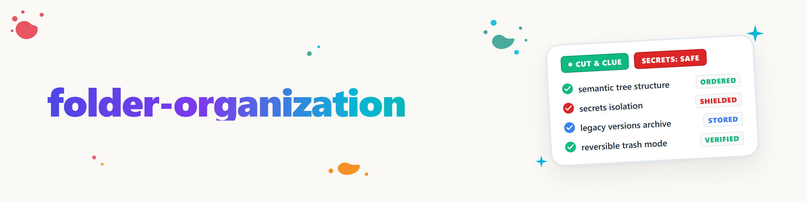

# Folder Organization

## Ziel und Grenze

Erzeuge eine nachvollziehbare Ablage, in der jede Änderung durch lokale Regeln, Inhalt,
Dateibeziehungen oder eine ausdrückliche Nutzerentscheidung begründet ist. Der Skill ist ein
semantisches Ordnungsprotokoll, kein zweites Dateiverschiebeprogramm und keine Pflichtbindung an
einen Anbieter.

Eine Bestandsaufnahme oder Prüfung bleibt read-only. Ein ausdrücklicher Auftrag wie „räume diesen
Ordner auf“ autorisiert sichere, reversible Verschiebungen innerhalb des genannten Bereichs,
sofern keine ungelöste Mehrdeutigkeit besteht. Überschreiben, endgültiges Löschen, Verschieben aus
dem Bereich, inhaltliches Umschreiben oder Aktivieren einer Dauerautomation braucht eine gesonderte
Freigabe.

## Standalone-Kern und optionale Seeds

Beginne immer mit dem Standalone-Kern. Er benötigt nur Lesen, Schreiben, Hashing und gewöhnliche
Dateioperationen. Für eine reproduzierbare Bestandsaufnahme steht
[`scripts/folder_organization.py`](scripts/folder_organization.py) bereit; sichere Defaults und
Überschreibungen stehen in [`config.json`](config.json). Das Skript schreibt standardmäßig nur
auf stdout. `--out` darf ausschließlich eine neue Datei außerhalb des untersuchten Roots anlegen;
vorhandene Ziele werden nicht überschrieben. Seine Log- und Versionsfunde sind Suchhinweise mit
niedriger Konfidenz, keine Freigabe zum Archivieren.

Die Bibliotheksfassung besitzt erweitertes Katalog-Frontmatter. Falls ein Zielsystem nur portables
Basis-Frontmatter (`name`, `description`) akzeptiert, erzeugt
[`scripts/export_portable.py`](scripts/export_portable.py) eine eigenständige Kopie in einem neuen
Zielordner. Der fachliche Ablauf und alle lokalen Ersatzteile bleiben darin vollständig erhalten.

Entdecke danach Fähigkeiten, nicht Markennamen. Eine vorhandene Integration darf den Kern
verbessern, aber weder Bedeutung noch Berechtigung verändern:

| Benötigte Fähigkeit | Standalone-Ersatz | Optionaler erkannter Seed/Adapter |
|---|---|---|
| Inventar, Hashes, Plan | mitgeliefertes Python-Skript oder native Dateisuche | FolderHome-Planung/Receipts |
| Dokumentinhalt/OCR | vorhandener lokaler Reader; sonst `unreadable/review` | doc-services oder gleichwertiger Extraktor |
| Cloud-/Lock-sichere Operationen | native Operation mit frischem Zustandscheck | FileCommander oder provider-eigener Adapter |
| Wiederkehrende stabile Regeln | Konfiguration als Vorschlag ausgeben | file-collect-sort-action oder gleichwertige Automation |
| Hinweise neu indizieren | auffällige CLUE-Marker im Text | Gardener oder anderer lokaler Indexer |

Ellmos-Komponenten sind damit **Grounding Seeds**: Wenn ihre Fähigkeiten verfügbar und für den
Auftrag freigegeben sind, nutze ihre stärkeren Gates. Fehlen sie, führe denselben fachlichen Ablauf
heuristisch und mit den Ersatzteilen dieses Skills aus. Keine externe Übertragung nur deshalb, weil
ein lokaler Reader fehlt.

## Vorgehen

### 1. Root, Regeln und Modus bestimmen

- Den kleinsten gemeinsamen Ablageroot wählen; nicht aus Bequemlichkeit einen ganzen Benutzer- oder
  Cloud-Root scannen.
- Steuerdateien im Root und aufwärts lesen, etwa `AGENTS.md`, `CLAUDE.md`, `README.md`,
  `START.md`, Namensregeln, Register, Manifeste und Locks.
- Modus festhalten: einmalige semantische Ordnung, **Themencluster-Synthese (Konsolidierung
  gewachsener/konkurrierender Unterordner)**, Archivpflege, Logpflege, Cut-and-Clue oder
  Vorbereitung einer wiederkehrenden Regel.
- Bestehende Zielordner und ihre reale Verwendung sind stärker als eine erfundene Idealtaxonomie.
  Liegen jedoch konkurrierende historische Taxonomien aus früheren Aufräumläufen nebeneinander
  (z. B. parallele `GROSSBUCHSTABEN`- und `kleinbuchstaben`-Ordner oder deutsch/englisch gemischte
  Dubletten-Ordner), werden sie in **ein** konsistentes kanonisches Schema zusammengeführt.

### 2. Geheimnis-Policy vor jedem Inhaltszugriff

Vor dem Öffnen oder Hashen Namen gegen `secret_policy.protected_name_patterns` und die Ausschlüsse
in `config.json` prüfen. Geschützte Dateien wie `.env`, private Schlüssel oder Credential-Dateien
nur über Pfad und Metadaten erfassen; ihr Inhalt darf nicht in Modellkontext, Bericht oder Log
gelangen. `--hash-all` hebt diese Grenze nicht auf. Wird in einer gewöhnlich lesbaren Datei
zufällig ein Geheimnissignal erkannt, Inhaltsausgabe stoppen und nur die Signal-ID melden.

Liegt der Fund vermutlich in einem Cloud-/Sync-Root, greift die konfigurierte `cloud_action`.
Standard ist `localize-after-approval`: lokales Ziel außerhalb aller Sync-Roots und restriktive
Berechtigungen belegen, Dry-Run und Freigabe einholen, Datei opak kopieren und intern per Hash
prüfen, erst dann die Cloud-Quelle wiederherstellbar ersetzen und einen nicht geheimen Pointer
hinterlassen. Ohne gesetztes `local_secret_root` oder bei gefährdeten Laufzeitreferenzen blockieren.

Die vollständige Transaktion, Pointermodi (`control-file`, `sidecar`, `placeholder`), lokale
Pointer-Map, Rotationshinweise und harten Blocker stehen in
[`references/secrets-policy.md`](references/secrets-policy.md). Geheimnisverdächtige Dateien bis
zur Policy-Entscheidung aus normaler Sortierung, Archivierung, Cut-and-Clue und Papierkorb nehmen.

### 3. Bestand und Beziehungen erfassen

Erfasse Pfad, Größe, Änderungszeit, Typ und – soweit verhältnismäßig – SHA-256. Klammere flüchtige
Bytecode- und Test-Caches (`__pycache__`, `.pytest_cache`) vor dem Hashing aus und merke sie direkt
für die Bereinigung vor. Lies bei mehrdeutigen oder nichtssagenden Dateinamen (`README.md`,
`index.html`, `NOTIZ.md`, `konzept.md`, `entwurf.md`, reine Datums-/Nummernnamen) die erste
Überschrift bzw. die ersten Inhaltszeilen oder Metadaten. Unlesbare Binärdateien bleiben
ausdrücklich ungeklärt; Dateiname und Endung allein rechtfertigen keine irreversible Aktion.

**3b. Verzeichnis- und Dateiliste als Themenliste behandeln:**
Extrahiere aus den bestehenden Ordnernamen, sprechenden Dateinamen und den gelesenen
Dokumenttiteln/Anfangszeilen zunächst eine flache **Themenliste**, bevor Zielordner festgelegt
werden. So werden thematische Zusammenhänge sichtbar, die zuvor über verschiedene Altordner oder
den Root verstreut waren.

Behandle zusammengehörige Dateien als Set: Sprachfassungen, Quelle/Export, Markdown/PDF,
Dokument/Assets, Daten/Skript/Ergebnis, Anhang/Hauptdatei sowie Vorgänger/Nachfolger. Prüfe vor
einer Verschiebung Links, Manifeste, Includes, Codeverweise und Register.

Für die detaillierte Evidenz- und Konfidenzmatrix bei schwierigen Beständen
[`references/heuristics.md`](references/heuristics.md) lesen.

### 4. Zielstruktur, Themencluster und Einzelentscheidungen planen

Die Zielstruktur aus Zweck, bestehenden Regeln und der erhobenen Themenliste ableiten. Der Root ist
eine Routingfläche, kein Dauerlager. Keine pauschalen Ordner wie `_Sonstiges` anlegen, wenn der Fund
inhaltlich ungeklärt ist; dafür `review/` oder eine Entscheidungsliste verwenden.

**4a. Optimale Cluster-Anzahl kalibrieren & Unterordner schneiden:**
- **Sweet Spot wählen:** Zu viele Cluster (z. B. 30+ Mikro-Ordner mit je 1–3 Dateien) verwässern die
  Navigation; zu wenige (3–4 Großordner) differenzieren zu wenig. Für mittlere bis große Bestände
  (100–1.000 Dateien) bewähren sich typischerweise **8–15 disjunkte Themencluster** auf oberster
  Ebene in einheitlichem `kebab-case` (oder der im Root vorgeschriebenen Namenskonvention).
- **Binnengliederung großer Cluster:** Überschreitet ein Themencluster ~40–50 Dateien mit klar
  trennbaren Teilgebieten (z. B. verschiedene Forschungsprojekte, Teilmodule oder Dokumenttypen),
  innerhalb des Themenordners 3–6 saubere Unterordner anlegen.
- **Taxonomie-Versöhnung:** Parallele Altordner desselben Themas (z. B. `FORSCHUNG/` und
  `forschung/`, `BACH/` und `bach-und-ocean/`) restlos in den gewählten kanonischen Cluster
  zusammenführen.

Jede geplante Änderung enthält mindestens:

| Feld | Inhalt |
|---|---|
| Quelle | exakter relativer Pfad und optional Hash |
| Ziel/Aktion | `keep`, `move`, `rename`, `archive`, `trash-review`, `cut-and-clue`, `review` |
| Begründung | Regel, Inhalt, Beziehung oder Versionsbeleg |
| Konfidenz | hoch, mittel oder niedrig |
| Nebenwirkung | betroffene Links, Sets, Register oder Automation |

- **Hoch:** explizite lokale Regel, eindeutiger Manifestbezug oder klar belegte Nachfolgereihe.
- **Mittel:** starke inhaltliche Passung oder bestehendes Cluster, aber keine explizite Regel.
- **Niedrig:** nur Name, Endung, Änderungszeit oder unsichere Ähnlichkeit. Nicht automatisch bewegen.

Vor der Mutation einen vollständigen Dry-Run liefern. Kollisionen, Symlinks, Cloud-Locks,
unlesbare Dateien und Ziele außerhalb des Roots blockieren die jeweilige Aktion.

### 5. Versionen und Logs archivieren

Eine alte Datei nur dann als Vorgänger archivieren, wenn die Reihe durch mehrere Signale belegt
ist: Versions-/Datumskennung, interne Versionsangabe, hohe Inhaltsüberlappung, passender Zweck und
ein eindeutig gültiger Nachfolger. Änderungszeit allein reicht nicht. Referenzierte Beweisstände
und freigegebene Veröffentlichungen bleiben erhalten.

Bei Logs zwischen aktivem Laufzeitlog, Audit-/Beweislog und rotierbarem Verlauf unterscheiden.
Aktive oder noch geschriebene Logs nicht bewegen. Alte abgeschlossene Logs nach lokaler Konvention,
sonst etwa unter `_archive/logs/<jahr>/`, mit Hash und Ursprungsort archivieren. Komprimierung ist
eine eigene Entscheidung; Archivierung bedeutet nicht automatisch Löschung.

### 6. Cut-and-Clue anwenden

Enthält eine Datei zugleich gültige und überholte Inhalte, ist blindes Verschieben ebenso falsch
wie vollständiges Beibehalten. Dann gültige Inhalte in neue kanonische Datei(en) **schneiden** und
im alten Material sowie gegebenenfalls direkt an der Problemstelle einen maschinenlesbaren
**Clue** zu Status, Grund und Nachfolger hinterlassen. Erst nach Vollständigkeitsprüfung das
Original archivieren.

Die Marker, Regeln für `[sic]`, Binärdateien und den Schutz vor Geschichtsverlust stehen in
[`references/cut-and-clue.md`](references/cut-and-clue.md). `[sic]` kennzeichnet einen bewusst
zitierten Fehler; für Überholtheit `OUTDATED` oder `SUPERSEDED` verwenden.

### 7. Prüf-Papierkorb und zweistufige Duplikat-Auflösung

Löschkandidaten innerhalb des Roots in einen Laufordner wie `_trash_review/<run-id>/` verschieben
oder über den konfigurierten reversiblen Papierkorb-Adapter (`fc_safe_delete`) entsorgen.
Relative Struktur erhalten und `MANIFEST.md` oder `RESTORE.json` mit Quelle, neuem Pfad, Hash,
Grund und Zeitpunkt schreiben. Nichts daraus automatisch endgültig löschen. So kann der Nutzer den
gesamten Lauf prüfen und später selbst entfernen oder zurückrollen.

Liegt eine überwachte Eingangsablage vor, Papierkorb und Archiv außerhalb ihres Scanbereichs
anlegen, damit keine Selbstfütterung entsteht.

**7b. Zweistufige Duplikat-Auflösung (Exakte SHA-256-Dupletten vs. Namensgleichheit):**
1. **Stufe A — Gleicher SHA-256-Hash (echte Duplette):** Existieren mehrere byteidentische Kopien,
   bleibt genau **eine** kanonische Datei erhalten nach folgender deterministischer Priorität:
   - **(1) Kanonischer Zielordner** vor Root-Ablage oder veraltetem Doppelordner,
   - **(2) Expliziter Datumsstempel im Dateinamen** (`*_YYYY-MM-DD.*`) vor undatierter Schattenkopie,
   - **(3) Sauberer Originalname** vor Cloud-/OneDrive-Konfliktkopien (`*-<HOST>-2..N.*`, `*(1).*`).
   Alle übrigen identischen Kopien sowie inhaltsleere 1-Zeilen-Stub-READMEs aus aufgelösten
   Altordnern werden reversibel in den Prüf-Papierkorb (`_trash_review` / `fc_safe_delete`) gelegt.
2. **Stufe B — Gleicher Dateiname, aber verschiedener SHA-256-Hash:** Niemals überschreiben oder als
   vermeintliche Duplette löschen! Stattdessen inhaltlich bzw. zeitlich **disambiguieren** (z. B.
   durch Anhängen des Änderungs-/Inhaltsdatums `<stamm>_<YYYY-MM-DD>.<ext>` oder der Herkunft
   `<stamm>_<teilprojekt>.<ext>`) und beide Stände im Zielcluster erhalten bzw. nach Schritt 5 als
   belegte Versionsreihe behandeln.

### 8. Ausführen, nachweisen und Schreiber nachziehen

- Direkt vor jeder Aktion Quelle, Hash, Ziel und Ziel-Nichtvorhandensein erneut prüfen.
- Niemals überschreiben; bei Kollision blockieren oder einen ausdrücklich geplanten neuen Namen
  verwenden.
- Nach dem Lauf Zielbestand lesen, Hashes vergleichen, mit einem Duplikat-Check (`fc_detect_duplicates`
  oder Hash-Scan) 0 verbleibende SHA-256-Dupletten bestätigen, alte Pfadnamen in Referenzen suchen
  und betroffene Register aktualisieren.
- Aufgelöste leere Altordner entfernen. Für jede Mutation Rückweg oder Manifest erhalten.
- CLUE-Markierungen bei vorhandenem lokalen Indexer neu indizieren; ohne Indexer bleiben sie als
  normaler, auffälliger Text wirksam.

**8b. Steuerdateien & Schreiber-Rückverfolgung (Upstream-Schutz gegen Neu-Vermüllung):**
Ein aufgeräumter Ordner vermüllt binnen Stunden erneut, wenn Automationen, Cronjobs, Sidecars oder
Agenten-Regeln weiter in die alten Pfade oder direkt in den Root schreiben:
- **Steuerdateien im Root aktualisieren:** `CLAUDE.md`, `ARCHITECTURE.md` (inkl. Mermaid-Lint),
  `README.md`/`LIESMICH.txt` und `.MOVED.md`-Wegweiser auf die neue Cluster-Topologie bringen.
- **Aktive Schreiber ermitteln und umstellen:** Per Volltextsuche in Skripten, Sidecars,
  Scheduler-Definitionen und globalen Auslieferungsregeln (`USER.md`, `OneDrive/CLAUDE.md`) prüfen,
  wer in den bereinigten Ordner schreibt. Lokale Pfade sofort auf die neuen Themencluster umstellen
  und das parallele Schreiben undatierter Schattenkopien (neben datierten Berichten) abstellen, da
  dies auf Cloud-Drives zwangsläufig `*-HOST-2`-Konfliktkopien erzeugt.
- **Cross-Actor-/Cross-Host-Auftrag:** Können Schreiber auf anderen Hosts oder von anderen Agenten
  nicht direkt gepatcht werden, einen verbindlichen Anpassungsauftrag im gemeinsamen Sync-Kanal
  (`.SYNC/agents/AUFTRAG_*.md`) hinterlegen.

**8c. Fallstricke auf Windows & Cloud-Sync-Laufwerken (NTFS / OneDrive):**
- **NTFS Case-Insensitivity bei Ordner-Umbenennungen:** Soll ein Ordner von `GROSSBUCHSTABEN` auf
  `kleinbuchstaben` umgestellt werden (z. B. `FORSCHUNG` → `forschung`), erkennt Windows/NTFS den
  Zielpfad als bereits existierend und behält die alte Großschreibung bei. Immer einen
  **Zwei-Schritt-Rename** über einen temporären Zwischennamen (`FORSCHUNG` → `FORSCHUNG__tmp` →
  `forschung`) ausführen.
- **OneDrive `WinError 5 (Zugriff verweigert)` beim Löschen leerer Altordner:** Blockiert der
  Cloud-Filtertreiber (`cldflt`) `rmdir()` auf leeren Verzeichnissen, die leeren Ordner per
  `os.replace` in einen temporären Staging-Ordner innerhalb desselben Roots verschieben und diesen
  gesammelt per `fc_safe_delete` entfernen.
- **Dehydrierte Cloud-Cache-Dateien (`Errno 22 Invalid argument`):** Vor dem SHA-256-Scan
  `__pycache__` und `.pytest_cache` ausklammern, da nicht-synchronisierte Cache-Artefakte in
  Cloud-Ordnern Lese-Exceptions werfen.

## Kurzbeispiele

- `bericht_v1.md` und `bericht_v2.md`: zunächst nur als mögliche Versionsreihe markieren. Erst
  interne Version, Inhalt und Referenzen entscheiden, ob `v1` wirklich archiviert werden darf.
- `konzept.md` enthält gültige Regeln und überholte Abschnitte: gültige Substanz vollständig in
  eine neue kanonische Datei übernehmen, byteidentisches Original sichern und Clues/Sidecar mit
  Nachfolger anlegen.
- `.env` in einem Sync-Root: nicht öffnen oder in den Bericht kopieren. Policy-Plan erzeugen; ohne
  belegtes `local_secret_root`, Freigabe und sichere Laufzeitumstellung keine Datei verändern.

## Lernen und Automatisierung

Nutzerkorrekturen als Regelkandidaten sammeln, niemals still in Regeln befördern. Erst wenn ein
Muster wiederholt bestätigt, konfliktfrei und klar begrenzt ist, daraus eine wiederkehrende
Automation vorschlagen. Jede neue oder geänderte Automation braucht erneut Dry-Run und Freigabe.

## Abschlussbericht

Zusätzlich zu Bestand, Aktionen, Archiven, Papierkorb, Cut-and-Clue-Nachfolgern und offenen
Entscheidungen alle Geheimniskandidaten ausschließlich über Pfad/Signal-ID, ihren Policy-Status,
blockierte oder freigegebene Cloud-Auslagerungen, Pointermodus und Readback nennen. Niemals Werte,
lokale Geheimnispfade oder sensible Kontextzeilen wiedergeben.

Nenne Ausgangsbestand, ausgeführte und blockierte Aktionen, Archiv- und Papierkorbpfade,
Cut-and-Clue-Nachfolger, aktualisierte Referenzen, Hash-/Readback-Ergebnis, offene Entscheidungen
und vorgeschlagene wiederkehrende Regeln. Eine Planung ist keine ausgeführte Ordnung.

## Verwandte Skills

- Regelbasierte Datei-Automation: für bereits bekannte, wiederkehrende Quelle-Muster-Ziel-Regeln.
- Pipeline-/Projekt-Optimizer: für den strukturellen Umbau eines ganzen Projekts oder Stacks.
- Tidy-up/Maintenance: für Sitzungsabschluss, Registerpflege und temporäre Projektdateien.
- Folder-Flattening: nur wenn die ausdrücklich gewünschte Transformation das Einebnen ist.

## Changelog

### 1.2.0 (2026-11-10)

- Themenlisten-Clustering und Cluster-Kalibrierung (Sweet Spot 8–15 disjunkte Themencluster,
  Binnengliederung großer Cluster ab ~40 Dateien, Zusammenführung konkurrierender Alt-Taxonomien)
  in Schritt 1, 3b und 4a ergänzt.
- Zweistufige Duplikat-Auflösung in Schritt 7b ergänzt: deterministische Kanonik-Priorität bei
  exakter SHA-256-Gleichheit (Zielordner → Datumsstempel → Originalname vor Cloud-Konfliktkopie)
  gegenüber inhaltlich/zeitlicher Disambiguierung bei Namensgleichheit mit verschiedenem Hash.
- Schreiber-Rückverfolgung (Upstream-Schutz: Steuerdateien, lokale Skripte/Sidecars, `.SYNC`-Auftrag)
  und Windows-/OneDrive-NTFS-Fallstricke (Zwei-Schritt-Case-Rename, Staging leerer Ordner bei
  `WinError 5`, Ausklammern dehydrierter Cache-Artefakte vor SHA-256) in Schritt 8b/8c ergänzt.

### 1.1.0 (2026-08-24)

- Konfigurierbare Geheimnis-Policy mit Nicht-Öffnen geschützter Dateinamen, redigierter
  Zufallserkennung und transaktionaler Cloud-Auslagerung samt lokalem Mapping und nicht geheimem
  Pointer ergänzt.

### 1.0.0 (2026-08-24)
- Anbieter- und nutzerneutraler Erststand mit Standalone-Skript, optionalem Seed-Prinzip,
  semantischer Sortierung, Versions-/Logarchivierung, Cut-and-Clue und Prüf-Papierkorb.
