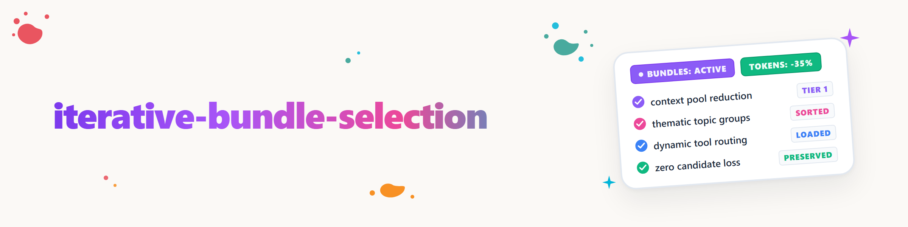

# Iterative Bundle Selection

Reduce large selection sets with a few coarse decisions, without prematurely discarding unselected candidates.

## Basic Principle

1. Capture all candidates as a shared pool and name them unambiguously.
2. Optionally define topic puddles and assign each candidate to exactly one primary puddle.
3. Apply desired filters one after another, globally or within individual puddles, and keep their matches separately.
4. Shuffle within each active puddle, by default forming bundles of five candidates.
5. Label the bundles of the first round uniquely by puddle with `THEMA-A`, `THEMA-B` …
6. Let the user select whole bundles.
7. Remove selected bundles from the open pool and pass them to the next action.
8. Return candidates from unselected bundles to their respective puddle.
9. Keep puddles and filters, reshuffle each puddle separately, and use dash labels.
10. Continue further rounds until the user stops or the pool is empty.

A final bundle may contain fewer than five candidates. Unselected bundles mean "still open," not "rejected."

## Workflow

### 1. Prepare the Pool

- Remove duplicates based on stable names or IDs.
- Exclude already selected or completed candidates.
- Mark blocked candidates, but do not silently delete them.
- State the size of the starting pool.

### 2. Form Topic Puddles

A topic puddle is a delimited sub-pool. Candidates from different puddles are not shuffled together.

- Use this method only if the user requests topic puddles or explicitly finds a thematic separation useful.
- Document puddles with a stable ID, title, assignment rule, and candidate count.
- Derive puddles from user specifications, existing categories, or traceable characteristics.
- Transparently show automatically derived assignments before the first follow-up action.
- By default, assign each candidate to exactly one primary puddle; do not create silent duplicates across multiple puddles.
- Keep ambiguous candidates in `UNZU — Unzugeordnet` until an assignment is determined.
- Output a puddle with fewer than five candidates as a small bundle; never pad it with another topic.
- Filters can apply globally to all puddles or locally to a named puddle.
- Filtered candidates keep their puddle assignment so they return to the right place when reactivated.
- When splitting, merging, or renaming a puddle, discard and re-form only its affected bundles.

Example:

```text
DEV  | Entwicklung     | 12 Kandidaten | DEV-A, DEV-B, DEV-C
MED  | Medien          |  7 Kandidaten | MED-A, MED-B
UNZU | Unzugeordnet    |  2 Kandidaten | UNZU-A
```

In later rounds, mark the round depth at the bundle letter: `DEV-A′`, `MED-B″`.

### 3. Apply Filter Stages

- Run filters optionally and in the order the user specifies.
- Log each filter with stable ID, mode, rule, and match count.
- Perform text comparisons case-insensitively by default.
- `exclude` removes matches only from the active pool and places them in the filter pool.
- `include` keeps only matches in the active pool; non-matches move to the filter pool.
- If no mode is specified and the user says the pool should be filtered or cleaned, use `exclude` and state this assumption.
- After each stage, output input size, match count, and remaining size.
- Never delete or mark filtered candidates as rejected; the user can deactivate individual filters later.

Example:

```text
F1 | exclude | Name enthält "aws"         | 13 Treffer
F2 | exclude | Name enthält "hyperframes" | 8 Treffer
Aktiver Pool: 44 | Filterpool: 21
```

If a filter changes, discard all existing bundles of the active pool and only then reshuffle.

### 4. Form a Round

- Actually reshuffle candidates; do not merely rename the old bundle structure.
- Use five candidates per bundle where possible.
- Shuffle only candidates from the same topic puddle with each other.
- Do not duplicate or lose any candidates.
- For professionally dependent candidates, mark the dependency rather than concealing it.

Output format:

```text
Bündel DEV-A: dev-1, dev-2, dev-3, dev-4, dev-5
Bündel MED-A: media-1, media-2, media-3
```

Without topic puddles, continue to use the simple labels `A`, `B`, `C` …

### 5. Process the Selection

- Accept replies such as `A, D und F`.
- Before a follow-up action, name the included candidates again in full.
- Check necessary locks, prerequisites, or dry runs per candidate.
- Log successful candidates as selected or completed.
- Return blocked or failed candidates to the remaining pool.

### 6. Re-bundle the Remaining Pool

- Permanently remove only actually successful candidates.
- Return all other candidates to their previous puddles and reshuffle them there separately.
- Reapply active filters to the remaining pool before each reshuffle.
- Mark the next round with dash labels: `DEV-A′`, then `DEV-A″`, etc.
- State the total pool, filter pool, active pool size, and the size of each puddle.

## Protection Rules

- Never interpret non-selection as a final rejection.
- Never silently discard filter matches; they remain retrievable in the filter pool.
- Never cross puddle boundaries when shuffling.
- Do not duplicate or move candidates between puddles during redistribution unless the user changes the grouping.
- Do not lose any candidates due to an unfavorable bundle combination.
- Do not force blocked candidates; they remain open.
- For irreversible or high-risk follow-up actions, have individual candidates confirmed first.
- If needed, document a reproducible shuffle key; otherwise a traceably new distribution suffices.
- The method reduces selection complexity but does not replace the substantive assessment of individual candidates.

## Delineation

- `decide` evaluates a concrete decision using criteria and frameworks.
- `decision-briefing` coordinates several different decision questions.
- `iterative-bundle-selection` reduces a large homogeneous candidate pool through repeated group selection and reshuffling.

## Conclusion

The method ends when the pool is empty, the user explicitly stops, or only candidates requiring an individual decision remain. Then output a brief tally with selected, open, and blocked.

## Changelog

### 1.2.0 (2026-08-25)

- Added optional topic puddles as pool dividers.
- Defined puddle-bound shuffling, local filters, unique bundle labels, and `UNZU` handling.

### 1.1.0 (2026-08-25)

- Added reversible `include` and `exclude` filter stages before reshuffling.
- Defined the filter log, filter pool, and recalculation of existing bundles.

### 1.0.0 (2026-08-25)

- Recorded iterative five-candidate bundles, dash rounds, remaining pool, and blocker return as a standalone data-reduction and decision method.
