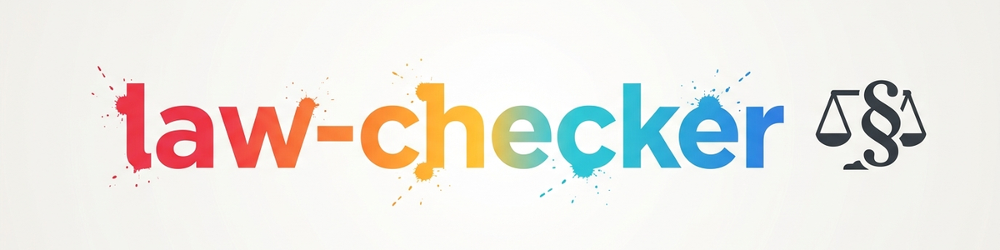

> **Français** — Version française officielle de la compétence `law-checker`.

# law-checker — Compétence de renvoi juridique

Cette compétence est un **renvoi léger (wrapper)** vers le dépôt de module public et
autonome [`ellmos-ai/law-checker`](https://github.com/ellmos-ai/law-checker) (licence MIT,
public). La compétence proprement dite vit là-bas — ce dépôt se borne à lier et documenter
l'installation afin que le module soit découvrable via le catalogue central de compétences.

## Ce que fait le module

`law-checker` fournit des premières analyses juridiques assistées par IA et fondées sur les sources pour le
droit allemand :

- **Registre des lois (`config.json`) :** codes juridiques activables ; toute affirmation juridique
  doit être étayée par des textes officiels chargés localement (article/paragraphe, alinéa, phrase,
  courte citation, source, date de consultation).
- **Agent d'incarnation de code juridique (`agents/gesetzbuch.md`) :** agent générique qui
  répond « depuis le texte de loi » pour toute loi enregistrée — extensible à n'importe quel
  code présent dans le registre.
- **Couche jurisprudentielle séparée :** les décisions de justice ne sont citées qu'après
  vérification sur le web (juridiction, date, numéro de dossier, ECLI lorsque disponible).
- **Workflow risques et escalade :** format d'avis avec feu tricolore de risque, discipline des
  délais et matrice des domaines de spécialisation d'avocats.

## Limites (important)

- **Première orientation assistée par IA, ne remplace pas un conseil juridique individuel et ne constitue pas une habilitation d'avocat.**
- Pas d'exercice de cabinet, pas de service juridique hébergé, pas de calendrier de délais.
- En cas de courrier juridique réel (mise en demeure, notification administrative, assignation, délai) :
  conserver l'original, noter le délai, solliciter un conseil juridique qualifié — NE PAS automatiser la démarche.

## Installation (générique, sans chemins locaux concrets)

1. Cloner le module :
   ```bash
   git clone https://github.com/ellmos-ai/law-checker.git <chemin-clone>
   ```
2. Copier `<chemin-clone>/SKILL.md` dans votre propre environnement de compétences (ex.
   `~/.claude/skills/law-checker/` ou l'équivalent du runtime d'agent utilisé).
3. Pointer le chemin du module dans le `SKILL.md` copié ou ses références vers `<chemin-clone>` —
   NE JAMAIS commiter de vrais chemins locaux ni de noms d'hôtes dans un environnement de compétences versionné.
4. Charger le registre des lois : `python <chemin-clone>/_tools/gesetze_fetch.py`
   (récupère les textes officiels configurés ; les textes eux-mêmes restent volontairement hors du dépôt
   afin de ne pas redistribuer d'extractions périmées de portails).
5. Détails sur la structure, la licence et la responsabilité : voir le README du dépôt du module.

## Origine de cette compétence de renvoi

Ce wrapper a été créé le 2026-07-23 comme entrée vitrine pour le dépôt `ellmos-ai/skills`.
Aucune **duplication de code** n'a lieu — maintenance et versionnage restent exclusivement dans
le dépôt du module `ellmos-ai/law-checker`.

## Journal des modifications

### 0.1.1 (2026-11-22)
- Mention linguistique corrigée.

### 0.1.0 (2026-07-23)
- Compétence de renvoi initiale vers `ellmos-ai/law-checker`.
