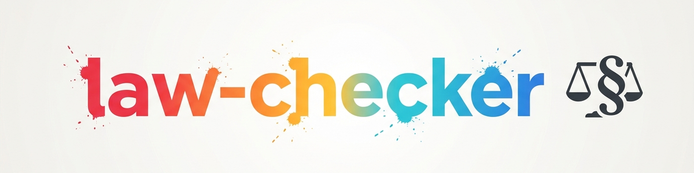

# law-checker (Law-Checker) -- Skill de referência

Esta skill é um **invólucro (wrapper) enxuto** que remete ao repositório de módulo
autônomo e público [`ellmos-ai/law-checker`](https://github.com/ellmos-ai/law-checker) (licença MIT,
público). A skill em si reside lá -- este repositório apenas aponta e documenta
a instalação, para que o módulo seja localizável pelo catálogo central de skills.

## O que o módulo faz

`law-checker` fornece avaliações preliminares de IA baseadas em fontes para
o direito alemão:

- **Registro de leis** (`config.json`): códigos legais ativáveis; cada afirmação
  legal deve ser comprovada a partir de textos normativos oficiais carregados
  localmente (artigo/parágrafo, Absatz, frase, citação resumida, fonte, data de consulta).
- **Agente de incorporação de leis** (`agents/gesetzbuch.md`): agente genérico que
  responde, para cada lei registrada, "a partir da própria lei" -- escalável a
  quaisquer leis no registro.
- **Camada de jurisprudência separada:** decisões são citadas somente após
  verificação na web (tribunal, data, número do processo, ECLI quando disponível).
- **Fluxo de risco e escalonamento:** formato de parecer com semáforo de risco,
  disciplina de prazos e matriz de áreas de atuação de advogados.

## Limites (importante)

- **Orientação inicial assistida por IA, sem substituir aconselhamento jurídico
  individual nem constituir habilitação para advogar.**
- Não é escritório de advocacia, não é serviço jurídico hospedado, não é agenda de prazos.
- Em caso de correspondência jurídica real (advertência, decisão administrativa,
  ação, prazo): preserve o original, anote o prazo, busque orientação jurídica
  qualificada -- NÃO automatize o processo.

## Instalação (genérica, sem caminhos locais concretos)

1. Clonar o módulo:
   ```bash
   git clone https://github.com/ellmos-ai/law-checker.git <klon-pfad>
   ```
2. Incorporar `<klon-pfad>/SKILL.md` no próprio ambiente de skills (por exemplo
   `~/.claude/skills/law-checker/` ou o equivalente do runtime de agentes utilizado).
3. Definir o caminho do módulo no `SKILL.md` incorporado ou nas referências
   correspondentes para `<klon-pfad>` -- NÃO versionar caminhos locais reais
   nem nomes de host em um ambiente de skill versionado.
4. Carregar o registro de leis: `python <klon-pfad>/_tools/gesetze_fetch.py`
   (obtém os textos normativos oficiais configurados; os próprios textos não
   estão no repositório, de propósito, para não redistribuir cópias desatualizadas
   de portais).
5. Detalhes sobre estrutura, licença e responsabilidade: ver o README do repositório do módulo.

## Origem desta skill de referência

Este invólucro foi criado em 2026-07-23 como entrada de demonstração para o
repositório `ellmos-ai/skills`. **Não há duplicação de código** -- a manutenção e
o versionamento permanecem exclusivamente no repositório do módulo `ellmos-ai/law-checker`.

## Changelog

### 0.1.0 (2026-07-23)
- Skill de referência inicial apontando para `ellmos-ai/law-checker`.
