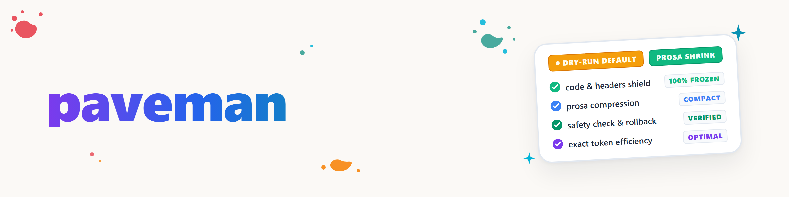

# Paveman — Raccourcir de manière déterministe les fichiers de règles et de mémoire

> Skill d'enveloppe fin et neutre vis-à-vis de l'utilisateur, autour du module `paveman` fourni séparément.
> Le skill détermine quand l'outil convient et décrit son déroulement sûr. Il ne suppose ni une
> machine particulière, ni un chemin d'installation fixe, ni un profil personnel.

## Quand ce skill s'applique

Les déclencheurs sont des phrases de l'utilisateur qui veulent raccourcir un **fichier existant de règles, de conventions ou de mémoire**
sans modifier son contenu métier :

- « Raccourcis `<Datei>` » / « ce fichier est trop long » / « il est coupé à X caractères ou lignes »
- « Compresse la doc sans toucher à la technique ni au code »
- « MEMORY.md ou CLAUDE.md est devenu trop volumineux »
- « Rends ce fichier de règles plus concis, mais garde le sens inchangé »
- Toute variante qui vise le **raccourcissement d'un fichier existant**, et non **l'écriture de nouveau contenu** ni la **traduction** (voir la délimitation ci-dessous)

**Ce n'est pas** ce skill :

- **`knappform`** — modifie la manière dont le modèle lui-même s'exprime dans la conversation en cours
  (style de communication du LLM, basé sur un modèle, sans accès aux fichiers). `paveman` modifie en revanche le
  contenu d'un fichier existant de façon déterministe et sans appel de modèle. Les deux peuvent
  coexister ; ils sont séparés sur les plans technique et fonctionnel.
- **`bilingual-doc-sync`** — complète les versions linguistiques manquantes. `paveman` raccourcit une version
  et ne traduit rien.
- **`llm-text-hygiene`** — supprime les traces d'IA ou les restes de chat des textes. C'est un autre
  objectif que le raccourcissement.
- Écrire ou inventer du nouveau contenu — `paveman` ne raccourcit que ce qui existe déjà.

## Ce que le module peut faire

`paveman` est un réducteur de prose déterministe basé sur des règles, pour les fichiers Markdown et texte :
aucun appel de modèle, aucun jeton et aucun envoi réseau. Le déploiement peut varier selon le système ;
c'est la version du module ou du paquet autorisée à cet endroit qui fait foi.

| Option | Effet |
|---|---|
| *(aucune option)* | **Essai à blanc (par défaut).** Affiche le diff et le gain de caractères, n'écrit rien. |
| `--apply` | Écrit réellement ; une sauvegarde est créée automatiquement au préalable. |
| `--rollback` | Restaure la dernière sauvegarde. |
| `--locker` | Signale les écarts de chemin ou de titre seulement comme avertissement au lieu d'erreur. |
| `--kontext N` | Définit le nombre de lignes de contexte du diff. |

Le **validateur de protection s'exécute à chaque appel**. Les blocs de code, les chemins et les titres ne doivent
pas être modifiés. En mode par défaut, un écart empêche l'écriture au lieu de simplement être signalé.

## Déroulement — toujours dans cet ordre

1. **D'abord l'essai à blanc.** Exécuter `paveman <Datei>` sans `--apply`. Montrer à l'utilisateur le gain de
   caractères, le diff et l'état du validateur (« OK » ou message d'erreur précis).
2. **Écrire uniquement après accord explicite.** Ce n'est qu'alors qu'il faut exécuter `paveman <Datei> --apply` ;
   ne jamais passer automatiquement de l'essai à blanc au mode écriture.
3. **Mentionner `--rollback` avant l'écriture.** L'utilisateur doit savoir à l'avance comment annuler
   un résultat indésirable.
4. **Prendre les erreurs du validateur au sérieux.** Ne pas utiliser `--locker` simplement pour contourner une erreur.
   Vérifier d'abord que l'écart est réellement inoffensif ; le mode plus souple exige une décision délibérée
   de l'utilisateur.
5. **Respecter les contenus soigneusement rédigés.** Un outil basé sur des règles ne détecte pas de façon fiable
   si une formulation est volontairement détaillée. En cas de doute, examiner attentivement le diff de l'essai à blanc.

## Prérequis — vérifier la disponibilité du module

1. Vérifier avec `paveman --help` si la CLI est disponible dans l'environnement actuel.
2. Si la commande est absente, déterminer le chemin de module ou de paquet autorisé pour ce système. Ne pas inventer
   de structure de chemins locale, de nom de paquet ni de dépôt.
3. Si aucune source autorisée ne peut être résolue, signaler le prérequis manquant comme une étape
   d'installation distincte, plutôt que d'exécuter le skill à l'aveugle ou de créer un module parallèle.
4. Après une installation, relancer d'abord `paveman --help`, puis un essai à blanc inoffensif ; un test
   d'écriture réel reste soumis à l'accord préalable.

## Exemples

```text
User: „Kürze meine CLAUDE.md, sie wird beim Sessionstart abgeschnitten.“

→ `paveman CLAUDE.md` (Trockenlauf)
→ Ergebnis: „12.400 → 9.800 Zeichen (-21 %), Validator: OK.“
→ Diff zeigen und auf `--rollback` hinweisen.
→ Nutzer bestätigt.
→ `paveman CLAUDE.md --apply`
```

```text
User: „MEMORY.md ist zu voll, kürze sie bitte.“

→ Trockenlauf: „893 → 893 Zeichen, keine Regel griff — der Text ist bereits knapp.“
→ Kein `--apply` empfehlen; den fehlenden Mehrwert ehrlich melden.
```

## Journal des modifications

### 1.0.1 (2026-08-20)

- Découplage complet de l'enveloppe publique des noms de machines, des chemins de checkout locaux, des données d'installation,
  des références de tickets privés et des résultats de tests locaux.
- Ajout d'un contrat de disponibilité et d'installation neutre vis-à-vis de l'utilisateur ; restauration des caractères allemands
  corrects.

### 1.0.0 (2026-08-19)

- Première version publique de l'enveloppe avec essai à blanc, étape d'accord, retour arrière et
  limites du validateur.
- Délimitation par rapport à `knappform`, `bilingual-doc-sync` et `llm-text-hygiene`.
