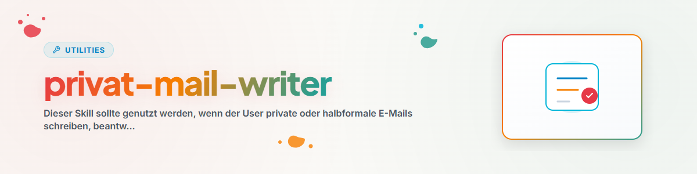

> **English** — Official English version of `privat-mail-writer`.

# Privat-Mail-Writer (English)

## Overview & Purpose

Privat-Mail-Writer creates short, friendly, and contact-appropriate email drafts. The skill is designed to be user-neutral: it contains no real contacts, no real signatures, and no real email content.

Its core is lazy and empirical: only when the user wants to write a concrete email to a contact should you create or update the profile for that specific contact. Do not generate profiles in advance. If no email history is available, do not invent style claims; instead, write briefly in a neutral tone or ask specifically for examples.

## Resources

- `CONFIG.md` - central preferences, if-then rules, permission gates, and blacklist switches.
- `BLACKLIST.md` - exclusions for newsletters, system senders, and contacts without a profile.
- `USECASES.md` - use case registry and rules for new use cases.
- `SIGNATURES.md` - neutral signature and salutation rules.
- `MUSTER-BLOCKS.md` - short reusable text snippets.
- `kontaktprofile.json` - empty, user-neutral schema for contact profiles. Keep real profiles locally and data-minimized only.

## Workflow

1. **Load config:** Read `CONFIG.md`. If the blacklist is active, also check `BLACKLIST.md`.
2. **Check trigger:** Only profile on a concrete writing task for a specific contact, e.g., "write an email to Brother Simon". No inbox sweeps just to create profiles.
3. **Check blacklist:** Newsletters, no-reply addresses, system senders, and excluded domains/contacts do not get a contact profile. For such cases, reply neutrally or do not reply.
4. **Identify email task:** Determine goal, recipient, occasion, desired brevity, language, tone, and necessary facts.
5. **Determine use case:** Read `USECASES.md` and select the best-matching use case. If no use case fits, create a new reusable use case or briefly ask for missing mandatory details.
6. **Check contact profile:** For each non-excluded recipient, look up an existing profile in `kontaktprofile.json` or in a private local profile copy.
7. **Create or update profile:** If no reliable profile exists, read up to the last ten relevant emails with this exact contact from the available mail backend. Sent emails should be weighted more heavily for writing style than received emails.
8. **Store empirics:** In the contact profile, store only summary, verifiable style, relationship, and category signals. Do not store raw emails, long quotes, or unnecessary personal details.
9. **Apply permission gate:** Before sending, handling sensitive content, or dealing with missing mandatory details, observe the gates from `CONFIG.md`.
10. **Write draft:** Combine use case form, contact profile, and current task. Match the style without inventing false closeness, false commitments, or unsubstantiated reasons.
11. **Deliver output:** By default, output subject and email body. Only send if the user has explicitly approved sending and a suitable mail tool is available.

## Contact Profiles

A contact profile does not describe the person themselves, but the observed communication relationship and writing style of the account owner toward that person.

Profile fields should stay concise:

- last contact time
- number and time span of evaluated emails
- salutation and closing formula
- informal/formal address (`Du`/`Sie`/formality)
- sentence length and typical brevity
- warmth, directness, level of commitment
- relationship assessment with confidence
- contact category, e.g. `family`, `inner-circle`, `friends`, `colleagues`, `services`, `official`, `unknown`
- source of category: user statement, email text, address book, signature, or inference
- evidence level of category: `user-confirmed`, `strong`, `medium`, `weak`
- short paraphrased evidence such as "several sent emails end with 'Viele Grüße'" or "replies stay under five sentences"

Check monthly whether an age check is due. If the month of the current date differs from the stored `last_age_check`, delete profiles whose `last_contact_at` is more than one year ago, and set `last_age_check` to the current date. The initial value in the neutral JSON is `2026-06-18`.

## Style Rules

- Write concisely. Private emails rarely need long preambles.
- Stay friendly, but do not over-explain.
- State real reasons only if given by the user or certain from context.
- For formal declines: polite, clear, without a novel of justification.
- When uncertain about facts: ask one brief clarifying question before finalizing the draft.
- Write German texts with proper umlauts: ä, ö, ü, Ä, Ö, Ü, ß.

## New Use Cases

If an email task seems reusable and is not yet covered in `USECASES.md`, add the use case:

- stable ID, e.g. `UC-002`
- name and typical triggers
- goal of the email
- mandatory and optional details
- default length and tone
- short template or sequence of text blocks
- open follow-up questions if mandatory details are missing

A one-off special case is not inflated into a use case. In that case, only deliver the current draft.

## Output Format

For normal drafts:

```text
Betreff: ...

Sehr geehrte ...

...

Mit freundlichen Grüßen
[Signatur]
```

If the user only wants text without a subject, deliver only the email body. If multiple variants make sense, offer at most two variants: "very short" and "a bit warmer".

## Boundaries

Never invent a contact profile. Do not unnecessarily copy confidential details from emails into the response. Never send an email without explicit approval. Do not formulate legal, medical, or financial commitments unless clearly specified by the user.

## Changelog

### 0.2.1 (2026-11-22)
- Language notice corrected

### 0.2.0 (2026-06-19)
- Added `CONFIG.md` and `BLACKLIST.md`.
- Restricted profile creation to concrete email writing tasks.
- Added contact categories with source and evidence level to the profile schema.

### 0.1.0 (2026-06-19)
- Initial version with use case registry, signature rules, sample blocks, and empty contact profile JSON.