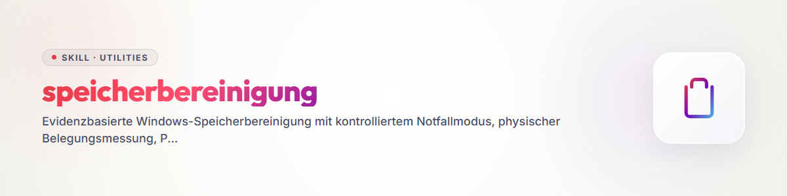

# Speicherbereinigung

## Zweck und Ergebnis

Dieser Skill gewinnt unter Windows kontrolliert Speicher zurück und verhindert,
dass derselbe Füllpfad den Datenträger unmittelbar erneut belegt. Er arbeitet in
drei Phasen: Notfallfreigabe, Ursachenforensik und dauerhafte Begrenzung.

Jede Mutation folgt demselben Protokoll:

`Fund -> Entscheidung -> begrenzte Ausführung -> Readback -> Messung`

Wenn der Nutzer kein höheres Ziel nennt, gilt der Auftrag erst als abgeschlossen,
wenn das Systemvolume nach der letzten Mutation erneut mindestens 50 GB freien
Speicher meldet. Die erste Notfallschwelle von zusätzlich 10 GB beendet nur den
akuten Zustand, nicht den Gesamtauftrag.

## Wann aktivieren

Nutze diesen Skill bei:

- knappem Systemdatenträger oder wiederkehrendem Platzverlust;
- ungewöhnlich großen Logs, Caches, Pagefiles, Archiven oder Builds;
- doppelten Clones, Backup-Generationen oder lokalen Cloudkopien;
- Ressourcenerschöpfungs-Events oder Prozessen mit stark wachsendem Commit;
- dem Verdacht, dass Scheduler, Watcher oder Sync-Clients Daten nacherzeugen.

## Sicherheitsregeln

- Ermittle vor jeder Mutation freien Speicher, Volume, Prozesslage, Locks,
  Reparse Points und den aufgelösten absoluten Zielpfad.
- Prüfe bei rekursiven Aktionen, dass das Ziel innerhalb der ausdrücklich
  gewählten Wurzel liegt. Verwende niemals Variablen oder Globs als ungeprüfte
  Löschziele.
- Lösche keine Volume-, Benutzer-, Repository-, Cloud- oder Projektwurzel.
- Bewahre aktive Quellen, uncommittete Arbeit, Secrets, Konfliktkopien, fremde
  Locks, `.git` und die einzige Wiederherstellungskopie.
- Bevorzuge Papierkorb, Quarantäne, Kompression oder Cloud-Dehydrierung. Eine
  irreversible Löschung ist nur für einen exakt identifizierten,
  regenerierbaren Fund zulässig; dokumentiere Pfad, Größe und Wiederherstellung.
- Ändere Pagefile, Ruhezustand, Dienste oder systemweite Limits nur mit den
  nötigen Rechten, einem Rollback und vollständigem Readback. `Zugriff
  verweigert` ist keine erfolgreiche Maßnahme.
- Lösche niemals OneDrive-Cloudobjekte, um lokalen Speicher freizugeben.
  Cloud-Löschung und lokale Dehydrierung sind verschiedene Operationen.

## Phase 1: Notfallfreigabe

### 1. Baseline

Erfasse mindestens:

```powershell
Get-PSDrive -Name C | Select-Object Used, Free
Get-CimInstance Win32_LogicalDisk -Filter "DeviceID='C:'" |
  Select-Object DeviceID, Size, FreeSpace
Get-Process | Sort-Object PrivateMemorySize64 -Descending |
  Select-Object -First 15 Name, Id, PrivateMemorySize64, WorkingSet64
```

Notiere Uhrzeit, Ausgangswert und das Ziel. Unterscheide `PrivateMemory` oder
Commit von `WorkingSet`: Ein Prozess kann wenig RAM im Working Set zeigen und
trotzdem das Pagefile stark belegen.

### 2. Begrenzt inventarisieren

Beginne bei bekannten lokalen Wurzeln und aktuellen Änderungsfenstern. Suche
nicht blind rekursiv über alle Cloud- oder Benutzerverzeichnisse. Geeignete
Kandidaten sind:

- eindeutig regenerierbare Modell-, Paket- und Build-Caches;
- alte, abgeschlossene Buildausgaben;
- rotierbare Anwendungslogs;
- verifizierte Archiv- oder Backup-Generationen;
- vollständig synchronisierte lokale Cloudkopien.

Dateilänge ist bei Sparse-, komprimierten und Cloud-Platzhalterdateien keine
physische Belegung. Nutze NTFS-Allocation (`GetCompressedFileSizeW`), `compact`
oder ein gleichwertiges Werkzeug und vergleiche vor/nachher den freien Platz.

### 3. Einen Fund bearbeiten

Bearbeite genau einen Fund pro Messschritt. Prüfe danach:

- tatsächlich gewonnene Bytes;
- Fehler, offene Handles und verbleibende Locks;
- Fortbestand der geschützten Quelle;
- Wiederherstellbarkeit oder Regenerierbarkeit;
- ob ein Prozess den Fund sofort neu erzeugt.

Der Notfallmodus endet erst nach nachgewiesenen zusätzlichen 10 GB. Danach geht
der Ablauf unmittelbar in die Forensik über.

## Phase 2: Füllende Prozesse und Entstehung forensisch bestimmen

### 1. Ressourcenerschöpfung und Pagefile

Lies aktuelle und historische Belege zusammen:

```powershell
Get-CimInstance Win32_ComputerSystem |
  Select-Object AutomaticManagedPagefile
Get-CimInstance Win32_PageFileUsage |
  Select-Object Name, AllocatedBaseSize, CurrentUsage, PeakUsage
Get-WinEvent -FilterHashtable @{LogName='System'; Id=2004} -MaxEvents 20
```

Event 2004 des Windows Resource Exhaustion Detector enthält die Prozesse mit
dem höchsten Commit zum Ereigniszeitpunkt. Ordne PID, Prozessname, Zeitstempel
und Bytes den heutigen Prozessen zu. Eine große `pagefile.sys` allein beweist
nicht, dass die Datei selbst der Verursacher ist; gesucht wird der Prozess, der
den Commit ausgelöst hat.

### 2. Dateiwachstum

Gruppiere neue oder geänderte Dateien nach:

- Erstellungs- und Änderungsstunde;
- Elternpfad und Erweiterung;
- Besitzer oder erzeugendem Prozess;
- Tagesrate in Dateien und physisch belegten Bytes.

Prüfe besonders Log-, Cache-, Sync-, Backup-, Build-, Download- und
Session-Verzeichnisse. Eine Retention von sieben Tagen ist ungeeignet, wenn ein
Client mehrere Gigabyte pro Tag schreibt und das Volume klein ist.

### 3. Automationen

Prüfe Aufgabenplanung, Dienste, Watcher und Startprogramme auf Frequenz,
Retention und Erfolg:

```powershell
Get-ScheduledTask | Where-Object State -ne 'Disabled'
Get-ScheduledTaskInfo -TaskName '<task-name>'
```

Verifiziere Aktion, Trigger, Wiederholungsintervall, letzten Rückgabecode und
nächste Laufzeit separat. Ein vorhandener Task ist kein Beweis, dass Retention
oder Frequenz den realen Zuwachs beherrschen.

## Phase 3: Dauerhafte Begrenzung

Wähle die kleinste wirksame, reversible Maßnahme:

- Logrotation häufiger ausführen und zusätzlich ein Größenlimit setzen;
- einen auffälligen Client kontrolliert neu starten und dessen Commit messen;
- Terminal-Scrollback oder Debug-Logging auf einen angemessenen Wert begrenzen;
- alte, regenerierbare Caches entfernen und ihre automatische Neuerzeugung
  beobachten;
- verifizierte Cloudinhalte mit „Speicherplatz freigeben“ dehydrieren;
- Scheduler-Frequenz und Retention an der empirischen Tagesrate ausrichten;
- Pagefile- oder Ruhezustandsänderungen nur administrativ, mit Reboot- und
  Rollbackplan durchführen.

Für Windows Terminal kann ein begrenzter Standard-Scrollback beispielsweise so
aussehen:

```json
{
  "profiles": {
    "defaults": {
      "historySize": 2000
    }
  }
}
```

Bewahre vorhandene Einstellungen und validiere die JSON-Datei nach der Änderung.

### OneDrive-spezifisches Gate

Vor einer Dehydrierung müssen Sync-Status und ausstehende Uploads geprüft sein.
Nutze einen cloudfilterbewussten Dateimanager oder den Explorer-Befehl
„Speicherplatz freigeben“. Dehydrierung darf den Cloudinhalt nicht löschen.

Prüfe den lokalen OneDrive-Logbereich unter
`$env:LOCALAPPDATA\Microsoft\OneDrive\logs` separat. Wenn ein Unterbereich
Gigabytes pro Tag erzeugt, kombiniere zeitbasierte Retention mit einer harten
Größenobergrenze und einem ausreichend häufigen geplanten Lauf. Schütze sehr
neue oder geöffnete Dateien und prüfe nach dem Lauf sowohl Taskstatus als auch
verbleibende Größe.

## Abschlussprüfung und Bericht

Nach der letzten Mutation:

1. Warte, bis asynchrone Cloud- oder Löschoperationen beendet sind.
2. Lies freien Speicher und Prozess-Commit erneut aus.
3. Kontrolliere geänderte Konfigurationen, Tasks und Loggrößen per Readback.
4. Führe einen kurzen Retest aus: Wird im Beobachtungsfenster wieder übermäßig
   Speicher erzeugt?
5. Berichte Ausgangswert, jeden Fund und seine Entscheidung, physisch gewonnene
   Bytes, füllende Prozesse, dauerhafte Anpassungen, Rollbacks, Rest-Risiken und
   Endwert.

Behaupte keine Bereinigung, Prozessbegrenzung oder 50-GB-Zielerreichung ohne
passenden aktuellen Readback.

## Wiederkehrender Build-Müll-Lauf & Ephemeral-/Review-Sandbox-Hygiene (Skripte im Skill)

Vier Skripte unter `scripts/` entfernen regenerierbaren Build-Müll und ephemere Review-Sandboxen, bevor sie Platz oder Sync belegen:

- `scripts/clean_build_junk.py [--all] [--apply] [--days N]`: Python-Caches (`__pycache__`,
  `.pytest_cache`, `.mypy_cache`, `.ruff_cache`, `*.egg-info`), `build/` und `dist/` nur neben einem
  Python-Build-Marker, Flutter-Caches; mit `--local` zusätzlich altersbasiertes Pruning ephemerer
  Arbeitsordner.
- `scripts/clean_flutter_builds.py [WURZEL] [--apply]`: Flutter-/Gradle-Caches (`build/`,
  `.dart_tool/`, `android/.gradle/`), long-path-sicher.
- `scripts/prune_ephemeral.py [--review-hours 24] [--temp-days 7] [--apply] [--selftest]`:
  Täglicher Janitor (`SPEICHER-Ephemeral-Janitor`, 4x täglich) für Review-Sandboxen unter
  `<local_dev>/<review_dir>/<name>` und alte `%TEMP%`-Einträge. Wertet `owner.json` (`expires_at`,
  `canonical_repo`) und `closeout.json` (sofortige Freigabe abgeschlossener Reviews) aus, prüft
  vor dem Löschen `LOCK*`, uncommittete Änderungen (`dirty`), `stash`, Erreichbarkeit aller
  Branch-Tips im kanonischen Klon (`worktree`, `alternates`, `origin.url`, `owner.json`) sowie
  Ketten-Klon-Abhängigkeiten (`ketten-abhaengig`), und räumt verwaiste Worktree-Einträge per
  `git worktree prune` auf.
- `scripts/review_sandbox.py create|closeout ...`: Lifecycle-Helper für Worker, die eine isolierte
  Review-Sandbox anlegen und nach Abschluss sofort wieder freigeben:
  - **Verbot von `--no-hardlinks` und Ketten-Klonen:** Niemals `git clone --bare --no-hardlinks`
    verwenden und niemals aus einem anderen Review-Ordner klonen (`review_sandbox.py` weist beides
    fail-closed ab). Stattdessen ausschließlich `git worktree add --detach` (`--mode worktree`,
    Standard) oder `git clone --shared` (`--mode shared`) direkt gegen den kanonischen Klon unter
    `<local_dev>/repos/<repo>` nutzen.
  - **Besitzer-/Ablaufmarke (`owner.json`):** Jede Sandbox unter `<local_dev>/reviews/<name>` legt
    beim Start eine `owner.json` mit `owner`, `ticket_id`, `canonical_repo`, `created_at` und
    `expires_at` ab.
  - **Sofortige Selbstbereinigung (`closeout`):** Nach Abschluss des Reviews schreibt der erzeugende
    Worker `closeout.json` (`python scripts/review_sandbox.py closeout --sandbox <pfad> --head <sha>`)
    und löscht die Sandbox sofort, sobald alle Sicherheits-Gates grün sind. Dauerhafte Nachweise
    gehören in den PR-Kommentar, Review-Bericht oder das Ticket — nicht in die Sandbox.
  - **Containment:** `closeout` und der Janitor löschen nur direkte Kinder der Review-Wurzel. `closeout`
    verlangt zusätzlich die von `create` angelegte `owner.json` und verweigert jeden anderen Ordner, bevor
    etwas geschrieben oder gelöscht wird. `review_dirs` in der Konfiguration sind einfache Ordnernamen
    direkt unter `local_dev`; andere Einträge werden ignoriert.

**Standard ist der Trockenlauf**; `--apply` löscht endgültig (nur exakt erkannte, regenerierbare
Muster, kein Papierkorb), also erst den Trockenlauf lesen (gilt für alle drei Skripte; bei `%TEMP%` zählt der Zeitstempel des Eintrags der ersten Ebene, nicht der Dateien darin). Die Wurzel kommt aus `$SOFTWARE_ROOT`
oder `<OneDrive>/.TOPICS/.SOFTWARE`, nie aus dem Skriptort. Das lokale Pruning braucht eine
Konfiguration außerhalb des Skills (`$BUILD_JUNK_CONFIG` oder `~/.config/build-junk/config.json` mit
`local_dev`, `prune_globs`, `protect`), weil sie private Ordnernamen enthält; ohne sie wird es
übersprungen und gemeldet. Den wöchentlichen Lauf macht der Task `SOFTWARE-BuildJunk-Janitor`.

## Bekannte Grenzen

- Ohne administrative Rechte können Pagefile-, Ruhezustands- oder Dienständerungen
  blockiert bleiben. Dokumentiere den exakten verbleibenden Schritt.
- Historische Prozess-Events beweisen einen früheren Füller; für die aktuelle
  Lage braucht es zusätzlich Prozess- und Dateiwachstumsdaten.
- Ein geplantes Backup-Konzept ist kein Backup. Transfer oder Löschung setzt
  aktuelle Zielidentität, Manifest oder Hash, Restore-Nachweis und Mount voraus.
- Bei unklarer Besitzlage, laufenden fremden Arbeiten oder unbekanntem Ziel gilt
  die Entscheidung `nichts`.

## Changelog

### 1.2.0 (2026-10-25)

- Skript `prune_ephemeral.py` (Review-Sandboxen und `%TEMP%`) aufgenommen, entstanden im Speichernotfall vom 25.10. (C: bei 0 GB); Selbsttest und Pytest-Fälle ergänzt.
- `clean_flutter_builds.py`: Standard ist jetzt der Trockenlauf, gelöscht wird nur mit `--apply`.
- Review-Sandbox-Hygiene (Drei-Stufen-Härtung): `scripts/prune_ephemeral.py` um `owner.json` (`expires_at`, `canonical_repo`), `closeout.json` (sofortige Freigabe nach Review-Abschluss), Worktree-/`alternates`-Auflösung und Ketten-Klon-Abhängigkeitsschutz (`ketten-abhaengig`) erweitert; `scripts/review_sandbox.py` für `--no-hardlinks`-freie Sandbox-Erzeugung (`worktree`/`shared`) und sofortigen Closeout ergänzt.
- Löschpfade abgesichert (2026-11-01): `remove_review_sandbox` löscht nur direkte Kinder der Review-Wurzel (kein Reparse-Point, keine Laufwerkswurzel); `review_sandbox.py closeout` verweigert Ordner außerhalb der Review-Wurzel oder ohne `owner.json` vor dem ersten Schreiben und fällt nicht mehr auf das Elternverzeichnis oder das aktuelle Verzeichnis zurück; `review_dirs` nur als einfache Ordnernamen unter `local_dev`.

### 1.1.0 (2026-10-18)

- Skripte `clean_build_junk.py` und `clean_flutter_builds.py` aus der .SOFTWARE-Pipeline in den Skill übernommen (Wurzel aus Umgebung, private Ordnernamen in einer Konfiguration außerhalb).

### 1.0.0 (2026-08-05)

- Portabler Erststand für die zentrale Skillbibliothek.
- Ressourcenerschöpfungs-, Pagefile- und Prozessforensik ergänzt.
- Physische NTFS-Belegung und OneDrive-Dehydrierung klar getrennt.
- OneDrive-Logrotation mit Zeit- und Größenlimit aufgenommen.
- Harte Notfall- und Abschlussgates mit Readback definiert.
