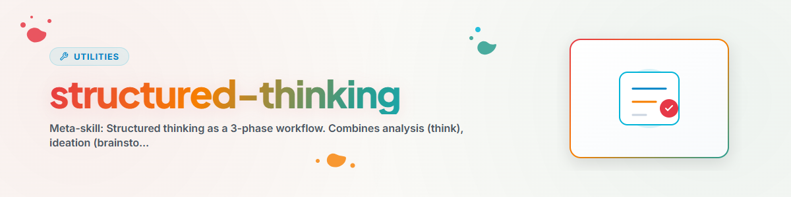

# التفكير المنظم — التحليل، وإيجاد الأفكار، واتخاذ القرار

> ميتا-سير عمل للتفكير المنظم: من تحليل المشكلة عبر الحلول الإبداعية وصولًا إلى قرار مدروس

---

## نظرة عامة على سير العمل

```
Problem/Frage
     |
     v
Phase 1: ANALYSIEREN (think)
  Divide & Conquer, Root Cause, Constraint Relaxation
     |
     v
Phase 2: IDEENFINDEN (brainstorm)
  SCAMPER, Six Hats, Reverse Brainstorming, Rapid Ideation
     |
     v
Phase 3: ENTSCHEIDEN (decide)
  Pro/Con, Weighted Scoring, Scenario Analysis, Eisenhower
     |
     v
Ergebnis + Begruendung
```

---

## المرحلة 1: التحليل

الهدف: فهم المشكلة، وتحديد الأسباب، والتعرّف على البنية.

### الأساليب

| الأسلوب | متى | التسلسل |
|---------|-----|---------|
| **فرّق تسد** | مشكلة معقدة | المشكلة → مشكلات فرعية → حلّها على حدة → الدمج |
| **السبب الجذري (5 مرات لماذا)** | العَرَض ظاهر، والسبب غير واضح | العَرَض → لماذا؟ → لماذا؟ → ... → السبب → الحل |
| **تخفيف القيود** | تبدو المشكلة غير قابلة للحل | تخفيف القيود → الحل → إعادة شد القيود |
| **البحث عن التشابه** | مشكلة جديدة من نوعها | إيجاد مشكلة معروفة مشابهة → تكييف حلها |

### أطر التحليل

| الإطار | الاستخدام |
|--------|-----------|
| **SWOT** | نقاط القوة / نقاط الضعف / الفرص / المخاطر |
| **باريتو** | 80/20 — ما الذي يحقق أكبر أثر رافع؟ |
| **عظمة السمكة** | تحليل منهجي للأسباب (إيشيكاوا) |

### الاستدلالات عند عدم اليقين

1. ما هو سيناريو الحالة الأسوأ؟
2. هل هو قابل للعكس؟
3. ما كلفة عدم التصرف؟

### الاستدلالات عند التعقيد

1. ما هي أبسط خطوة أولى؟
2. ماذا كان سيفعل الخبير؟
3. ما هو حل الـ80%؟

---

## المرحلة 2: إيجاد الأفكار

الهدف: توليد أكبر عدد ممكن من مقترحات الحلول. الكمّ قبل الجودة. لا نقد خلال هذه المرحلة.

### الأساليب

**SCAMPER** — تحسين الحلول القائمة بشكل منهجي:
- **S**ubstitute: ماذا نستبدل؟ | **C**ombine: ماذا نجمع؟ | **A**dapt: ماذا نكيّف؟
- **M**odify: ماذا نعدّل؟ | **P**ut to other use: لأي استخدام آخر؟ | **E**liminate: ماذا نحذف؟
- **R**everse: ماذا نعكس؟

**قبعات التفكير الست** (دي بونو) — 6 منظورات بالتتابع:
1. الأزرق: التحكم في العملية ("ما هو السؤال؟")
2. الأبيض: الحقائق ("ماذا نعرف؟")
3. الأحمر: العاطفة ("ما الذي يبدو صائبًا؟")
4. الأسود: النقد ("ما الذي قد يسوء؟")
5. الأصفر: التفاؤل ("ما هي الفرص؟")
6. الأخضر: الإبداع ("ما الأفكار الجديدة؟")

**العصف الذهني العكسي** — عكس المشكلة:
1. "كيف نجعلها أسوأ؟"
2. جمع الأفكار السيئة
3. العكس = أفكار جيدة

**التوليد السريع** — أكثر من 50 فكرة في 20 دقيقة:
- الجولة 1 (5 دقائق): توليد مفتوح
- الجولة 2 (5 دقائق): تنويعات
- الجولة 3 (5 دقائق): تركيبات
- الجولة 4 (5 دقائق): أفكار متطرفة

### بعد التوليد

1. التجميع: تجميع الأفكار المتشابهة
2. مصفوفة الجدوى/الأثر: تقييم قابلية التنفيذ مقابل التأثير
3. اختيار أفضل 5–10 للمرحلة 3

---

## المرحلة 3: اتخاذ القرار

الهدف: اختيار أفضل خيار مع تسويغ شفاف.

### اختيار الإطار

| الموقف | الإطار |
|--------|--------|
| خياران، قرار سريع | **مصفوفة المزايا والعيوب** |
| 3 خيارات أو أكثر، معايير متعددة | **التقييم الموزون** |
| قرار تسلسلي شرطي (إذا-فإن) | **شجرة القرار** |
| عدم يقين مرتفع | **تحليل السيناريوهات** |
| ترتيب أولويات المهام | **مصفوفة آيزنهاور** |

### التقييم الموزون (الأسلوب الأساسي)

1. جمع المعايير (3–7، محددة وقابلة للقياس)
2. تحديد الأوزان (المجموع = 100%، والأهم ≥ 25%)
3. تقييم الخيارات (مقياس من 1 إلى 10)
4. حساب النقاط (التقييم × الوزن)
5. المقارنة والتوصية

### تحليل السيناريوهات

```
Best Case (X%):      Ergebnis → Erwartungswert
Realistic Case (X%): Ergebnis → Erwartungswert
Worst Case (X%):     Ergebnis → Erwartungswert
Gesamt-Erwartungswert: [Summe]
```

### مصفوفة آيزنهاور

```
              DRINGEND        NICHT DRINGEND
WICHTIG       1. TUN          2. PLANEN
NICHT WICHTIG 3. DELEGIEREN   4. ELIMINIEREN
```

### قائمة تدقيق الجودة قبل التوصية النهائية

- [ ] هل تم تحديد جميع المعايير ذات الصلة؟
- [ ] هل روعيت قيم المستخدم؟
- [ ] هل فُكّر في الآثار طويلة المدى؟
- [ ] هل حُددت المخاطر وقُيّمت؟
- [ ] هل أُجري فحص للتحيّز؟
- [ ] هل تم التحقق من قابلية العكس؟

---

## الاختيار حسب السياق

| الموقف | المرحلة (المراحل) الموصى بها |
|--------|-------------------------------|
| "لدي مشكلة" | المرحلة 1 (التحليل) ← عند الحاجة المرحلتان 2 و3 |
| "أحتاج أفكارًا" | المرحلة 2 (إيجاد الأفكار) |
| "يجب أن أتخذ قرارًا" | المرحلة 3 (القرار) |
| "لقد توقفت تمامًا" | المرحلة 2 (العصف الذهني العكسي) |
| "ماذا يجب أن أعطي الأولوية؟" | المرحلة 3 (آيزنهاور) |
| "فهم مشكلة معقدة" | المرحلة 1 (فرّق تسد + SWOT) |

---

## سجل التغييرات

### 1.0.0 (2026-05-19)
- أُنشئت كميتا-مهارة من think وbrainstorm وdecide

---

*ميتا-مهارة | المرجع التفصيلي: [think](../think/SKILL.md)، [brainstorm](../brainstorm/SKILL.md)، [decide](../decide/SKILL.md)*
