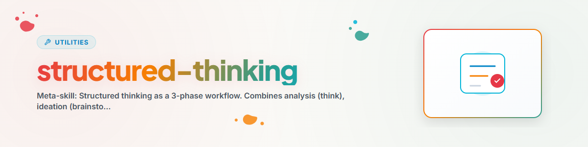

> **Français** — Version française officielle de la compétence `structured-thinking`.

# Pensée structurée — Analyser, trouver des idées, décider

> Méta-flux de travail pour la pensée structurée : de l'analyse du problème jusqu'à la décision argumentée en passant par les solutions créatives

---

## Vue d'ensemble du flux de travail

```
Problème / Question
     |
     v
Phase 1 : ANALYSER (think)
  Divide & Conquer, Cause racine, Relâchement des contraintes
     |
     v
Phase 2 : TROUVER DES IDÉES (brainstorm)
  SCAMPER, Six Hats, Reverse Brainstorming, Rapid Ideation
     |
     v
Phase 3 : DÉCIDER (decide)
  Pour/Contre, Score pondéré, Analyse de scénarios, Eisenhower
     |
     v
Résultat + Justification
```

---

## Phase 1 : Analyser

Objectif : comprendre le problème, identifier les causes, dégager la structure.

### Approches

| Méthode | Quand | Déroulement |
|---------|-------|-------------|
| **Divide & Conquer** | Problème complexe | Problème → Sous-problèmes → Résoudre isolément → Combiner |
| **Root Cause (5× Pourquoi)** | Symptôme visible, cause floue | Symptôme → Pourquoi ? → Pourquoi ? → … → Cause → Solution |
| **Constraint Relaxation** | Le problème semble insoluble | Assouplir les contraintes → Résoudre → Resserrer les contraintes |
| **Recherche par analogie** | Problème inédit | Trouver un problème connu similaire → Adapter la solution |

### Cadres d'analyse

| Cadre | Application |
|-------|-------------|
| **SWOT** | Forces / Faiblesses / Opportunités / Menaces |
| **Pareto** | 80/20 — Qu'est-ce qui apporte le plus grand levier ? |
| **Ishikawa (Fishbone)** | Analyse systématique des causes |

### Heuristiques en cas d'incertitude

1. Quel est le pire scénario ?
2. Est-ce réversible ?
3. Combien coûte l'inaction ?

### Heuristiques en cas de complexité

1. Quel est le premier pas le plus simple ?
2. Que ferait un expert ?
3. Quelle serait la solution à 80 % ?

---

## Phase 2 : Trouver des idées

Objectif : générer un maximum de pistes de solutions. La quantité avant la qualité. AUCUNE critique durant cette phase.

### Méthodes

**SCAMPER** — Améliorer systématiquement des solutions existantes :
- **S**ubstitute : quoi remplacer ? | **C**ombine : quoi combiner ? | **A**dapt : quoi adapter ?
- **M**odify : quoi modifier ? | **P**ut to other use : quel autre usage ? | **E**liminate : quoi supprimer ?
- **R**everse : quoi inverser ?

**Six chapeaux de la réflexion (Six Thinking Hats)** (de Bono) — 6 perspectives successives :
1. Bleu : contrôle du processus (« Quelle est la question ? »)
2. Blanc : faits (« Que savons-nous ? »)
3. Rouge : émotion (« Qu'est-ce qui semble juste ? »)
4. Noir : critique (« Qu'est-ce qui pourrait mal tourner ? »)
5. Jaune : optimisme (« Quelles sont les opportunités ? »)
6. Vert : créativité (« Quelles nouvelles idées existent ? »)

**Brainstorming inversé (Reverse Brainstorming)** — Retourner le problème :
1. « Comment faire pour EMPIRER la situation ? »
2. Recueillir les mauvaises idées
3. Inverser = Bonnes idées

**Idéation rapide (Rapid Ideation)** — 50+ idées en 20 min :
- Tour 1 (5 min) : idéation ouverte
- Tour 2 (5 min) : variations
- Tour 3 (5 min) : combinaisons
- Tour 4 (5 min) : idées extrêmes

### Après l'idéation

1. Regroupement (clustering) : regrouper les idées similaires
2. Matrice faisabilité/impact : évaluer la faisabilité par rapport à l'effet
3. Sélection du top 5-10 pour la phase 3

---

## Phase 3 : Décider

Objectif : sélectionner la meilleure option avec une justification transparente.

### Choix du cadre

| Situation | Cadre |
|-----------|-------|
| 2 options, décision rapide | **Matrice Pour/Contre** |
| 3+ options, plusieurs critères | **Score pondéré (Weighted Scoring)** |
| Décision séquentielle Si-Alors | **Arbre de décision** |
| Forte incertitude | **Analyse de scénarios** |
| Prioriser des tâches | **Matrice d'Eisenhower** |

### Score pondéré (méthode centrale)

1. Recueillir les critères (3 à 7, spécifiques et mesurables)
2. Fixer les poids (somme = 100 %, critère principal ≥ 25 %)
3. Évaluer les options (échelle 1 à 10)
4. Calculer les scores (note × poids)
5. Comparer et recommander

### Analyse de scénarios

```
Meilleur scénario (X %) :  Résultat → Valeur espérée
Scénario réaliste (X %) : Résultat → Valeur espérée
Pire scénario (X %) :     Résultat → Valeur espérée
Valeur espérée totale : [Somme]
```

### Matrice d'Eisenhower

```
               URGENT          NON URGENT
IMPORTANT      1. FAIRE        2. PLANIFIER
NON IMPORTANT  3. DÉLÉGUER     4. ÉLIMINER
```

### Check-list qualité avant la recommandation finale

- [ ] Tous les critères pertinents identifiés ?
- [ ] Valeurs de l'utilisateur prises en compte ?
- [ ] Impacts à long terme examinés ?
- [ ] Risques identifiés et évalués ?
- [ ] Contrôle des biais effectué ?
- [ ] Réversibilité vérifiée ?

---

## Sélection adaptée au contexte

| Situation | Phase(s) recommandée(s) |
|-----------|-------------------------|
| « J'ai un problème » | Phase 1 (Analyse) → évent. Phase 2+3 |
| « J'ai besoin d'idées » | Phase 2 (Idéation) |
| « Je dois prendre une décision » | Phase 3 (Décision) |
| « Je suis bloqué » | Phase 2 (Brainstorming inversé) |
| « Que dois-je prioriser ? » | Phase 3 (Eisenhower) |
| « Comprendre un problème complexe » | Phase 1 (Divide & Conquer + SWOT) |

---

## Journal des modifications

### 1.1.1 (2026-11-22)
- Indication de langue corrigée

### 1.1.0 (2026-11-06)
- Description reformulée avec déclencheur clair et délimitation (règle issue de `docs/CONVENTIONS.md`) : situation d'usage, formulations typiques et commande slash en tête, compétences voisines dans une clause « Ne PAS utiliser ».

### 1.0.0 (2026-05-19)
- Créée comme méta-compétence à partir de `think`, `brainstorm` et `decide`

---

*Méta-compétence | Référence détaillée : [think](../think/SKILL.md), [brainstorm](../brainstorm/SKILL.md), [decide](../decide/SKILL.md)*
