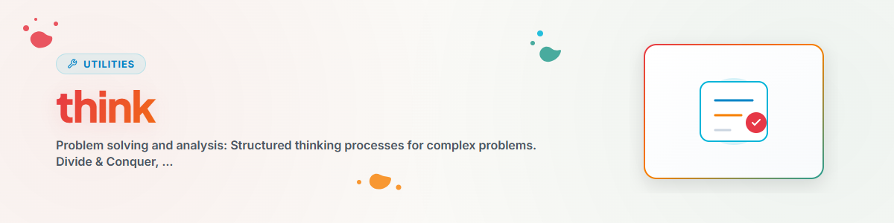

# Think — সমস্যা সমাধান ও বিশ্লেষণ

> জটিল সমস্যার জন্য কাঠামোবদ্ধ চিন্তাপ্রক্রিয়া

---

## সমস্যা সমাধানের পদ্ধতি

### 1. ভাগ করো ও জয় করো

```
Problem -> Teilprobleme -> Loese einzeln -> Kombiniere
```

### 2. মূল কারণ বিশ্লেষণ

```
Symptom -> Warum? -> Warum? -> Warum? -> Ursache -> Loesung
```

### 3. সীমাবদ্ধতা শিথিলকরণ

```
Unloesbares Problem -> Constraints lockern -> Loesen -> Constraints wieder anziehen
```

### 4. সাদৃশ্য অনুসন্ধান

```
Neues Problem -> Aehnliches bekanntes Problem -> Loesung adaptieren
```

---

## বিশ্লেষণ পদ্ধতি

| পদ্ধতি | প্রয়োগ |
|---------|-----------|
| **SWOT** | শক্তি/দুর্বলতা/সুযোগ/ঝুঁকি |
| **পক্ষে/বিপক্ষে** | সিদ্ধান্ত গ্রহণ |
| **Pareto** | 80/20 অগ্রাধিকার নির্ধারণ |
| **Fishbone** | কারণ বিশ্লেষণ |

---

## সিদ্ধান্ত-Heuristics

### অনিশ্চয়তার ক্ষেত্রে

```
1. Was ist das Worst-Case-Szenario?
2. Ist es reversibel?
3. Was kostet Nicht-Handeln?
```

### জটিলতার ক্ষেত্রে

```
1. Was ist der einfachste erste Schritt?
2. Was wuerde ein Experte tun?
3. Was waere die 80%-Loesung?
```

---

## Changelog

### 1.0.0 (2026-03-15)
- BACH v3.8.0 থেকে পোর্ট করা হয়েছে

---

*BACH v3.8.0 থেকে পোর্ট করা হয়েছে | Standalone-Version*

**আরও দেখুন:** [brainstorm](../brainstorm/SKILL.md) (সৃজনশীল পদ্ধতি, ধারণা উদ্ভাবন) | [decide](../decide/SKILL.md) (সিদ্ধান্ত কাঠামো)
