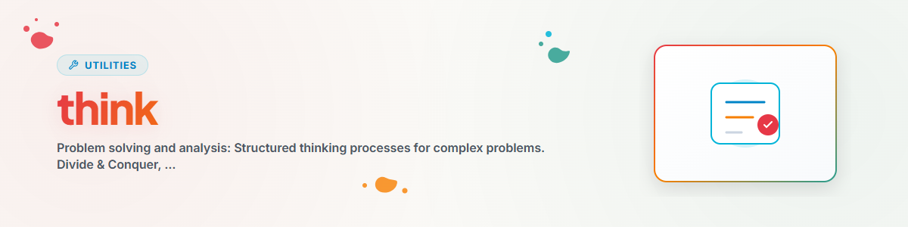

> **Français** — Version française officielle de la compétence `think`.

# Think — Résolution de problèmes et analyse

> Processus de réflexion structurés pour les problèmes complexes

---

## Approches de résolution de problèmes

### 1. Diviser pour régner (Divide & Conquer)

```
Problème -> Sous-problèmes -> Résoudre séparément -> Combiner
```

### 2. Analyse des causes racines (Root Cause Analysis)

```
Symptôme -> Pourquoi ? -> Pourquoi ? -> Pourquoi ? -> Cause -> Solution
```

### 3. Relâchement des contraintes (Constraint Relaxation)

```
Problème insoluble -> Assouplir les contraintes -> Résoudre -> Resserrer les contraintes
```

### 4. Recherche par analogie

```
Nouveau problème -> Problème connu similaire -> Adapter la solution
```

---

## Méthodes d'analyse

| Méthode | Application |
|---------|-------------|
| **SWOT** | Forces / Faiblesses / Opportunités / Menaces |
| **Pour/Contre** | Prise de décision |
| **Pareto** | Priorisation 80/20 |
| **Ishikawa (Fishbone)** | Analyse des causes |

---

## Heuristiques de décision

### En cas d'incertitude

```
1. Quel est le pire scénario ?
2. Est-ce réversible ?
3. Combien coûte l'inaction ?
```

### En cas de complexité

```
1. Quel est le premier pas le plus simple ?
2. Que ferait un expert ?
3. Quelle serait la solution à 80 % ?
```

---

## Journal des modifications

### 1.1.1 (2026-11-22)
- Indication de langue corrigée

### 1.1.0 (2026-11-06)
- Description reformulée avec déclencheur clair et délimitation (règle issue de `docs/CONVENTIONS.md`) : situation d'usage, formulations typiques et commande slash en tête, compétences voisines dans une clause « Ne PAS utiliser ».

### 1.0.0 (2026-03-15)
- Porté depuis BACH v3.8.0

---

*Porté depuis BACH v3.8.0 | Version autonome*

**Voir aussi :** [brainstorm](../brainstorm/SKILL.md) (méthodes créatives, génération d'idées) | [decide](../decide/SKILL.md) (cadres de décision)
